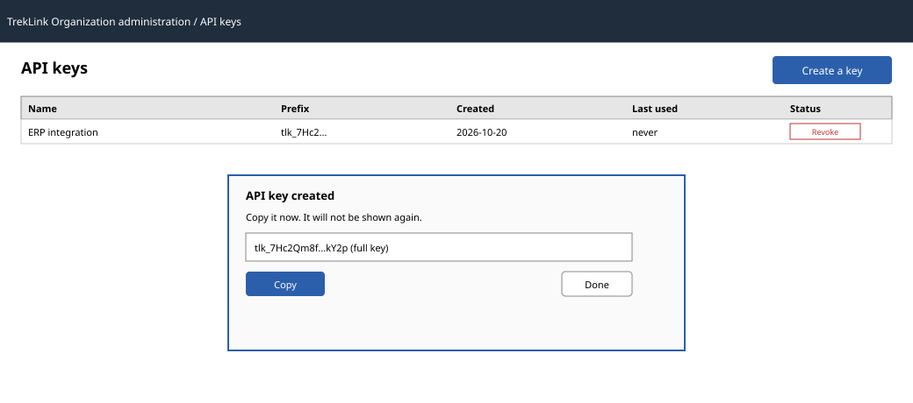

# API keys

| | |
|---|---|
| Owner | TanNB |
| Task | `specs/frontend/tasks.md` 3.4 |
| Assigned, due | 2026-10-21, 2026-10-23 |
| Status | Ready for review |
| Routes | `/o/api-keys` |
| Roles | Org Manager: full read and write. No other role sees this page (`design.md` §2, api-design 20 to 22 are all "Org Manager: own"). |
| Use case, FRs, story | UC-06; FR-ORG-06, BR-20; US-UC06 |
| Requirements | REQ-UBI-03, REQ-EVT-09, REQ-ERR-06 (`specs/organizations/requirements.md`) |
| Wireframe |  |

Scope from the task: organizations api-design 20 to 22; the secret is shown once with a copy button
and never again.

## Data

| Shown | Source (api-design file, property) |
|---|---|
| Key rows: id, name, prefix, createdAt, lastUsedAt, revokedAt | organizations api-design 20, `GET /api/organizations/:id/api-keys` |
| The new key, once (name, prefix, createdAt, the full `key`) | organizations api-design 21, `POST /api/organizations/:id/api-keys` response |

## Actions

| Control | Endpoint | Confirmation | Success message |
|---|---|---|---|
| Create a key | `POST /api/organizations/:id/api-keys` (21) | none | "API key created. Copy it now; it will not be shown again." (server `message`, the dialog itself is the warning, chapter 06 §8 item 6) |
| Copy the new key | client-side clipboard only, no endpoint | none | "Copied." toast, client-side (no MSG, not a server action) |
| Revoke a key | `POST /api/organizations/:id/api-keys/:keyId/revoke` (22) | yes, "Revoke {name}? Anything using it stops working immediately." | "API key revoked" (server `message`) |

## States

| State | What the user sees |
|---|---|
| Loading | Table shows skeleton rows; Create and Revoke show their pending state at once |
| Empty | "No API keys yet." (MSG01) with the Create action |
| Error 400 `VALIDATION_FAILED` | MSG02 under the name field |
| Error 409 `KEY_LIMIT` | No MSG; the server `message` ("Revoke an unused key before creating another.") shown as a dialog, Create stays open so the Manager can revoke one from the list behind it |
| Not found or forbidden | MSG26 |

## Form fields (if any)

| Step | Field | Type | Required | Rule |
|---|---|---|---|---|
| 1 Create key (one step) | name | text | yes | non-empty label |

## Mobile, accessibility, live data

- 360 px layout: not one of NFR-UI-01's mandatory screens; below 760 px the table collapses to one
  card per key (name, prefix, a row-end Revoke action); the new-key dialog stays full-width with the
  key value wrapped, never truncated, so the whole value can be selected and copied.
- Tab order and focus after each action: after Create, focus moves into the dialog to the key value
  so it can be selected or copied immediately; closing the dialog returns focus to the Create button;
  after Revoke, focus moves to the row's new "Revoked" status text.
- WebSocket events and invalidated query keys: a revoked key closes any open socket authenticated
  with it (`apiKey.revoked`, `specs/organizations/design.md` §5), but that is a server-to-broker/
  gateway effect, not a `/live` event this page subscribes to (`ws-live-contract.md` carries no
  `apiKey.*` event type). This page invalidates `['organization', id, 'apiKeys']` on Create and
  Revoke through TanStack Query; it opens no socket of its own.

## Checklist

Chapter 06 §7 (Screen Design Checklist) and §8 (UI and UX practices), ticked by the owner before review.

- [x] Route and roles match `design.md` §2 and the three endpoints' Permission fields exactly.
- [x] Data: every field names its api-design source; the full key is shown only from 21's response,
  never re-fetched (REQ-UBI-03, the key is stored only as a hash).
- [x] Actions: every control names its endpoint or states it is client-only, its confirmation, and
  its message.
- [x] States: the one error code the endpoints return beyond the generic ones, plus empty.
- [x] Forms: one step, one field.
- [x] Mobile: not mandatory; collapse behaviour and the no-truncation rule for the secret are stated.
- [x] Accessibility: tab order and the post-action focus target are stated.
- [x] Live data: stated as none for this page, with the server-side revocation effect noted for
  context and the query key invalidated instead.
- [x] Traceability: UC-06, FR-ORG-06, BR-20, US-UC06 are in the header table.
