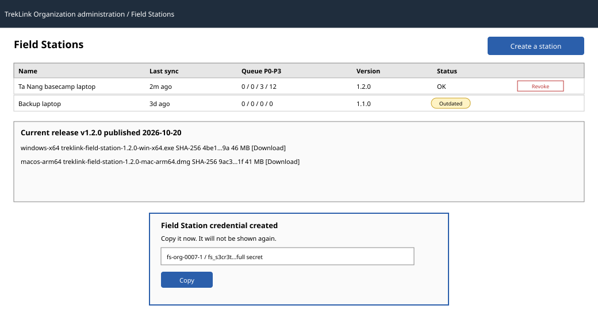

# `FieldStationsPage`

| | |
|---|---|
| Owner | TanNB |
| Task | `specs/frontend/tasks.md` 3.5 |
| Assigned, due | 2026-10-21, 2026-10-23 |
| Status | Ready for review |
| Routes | `/o/field-stations` |
| Roles | Org Manager: full read and write. Org Operator: read-only, no Create or Revoke (api-design 23's Permission; `design.md` §2 "stations readable by Operators"). TrekLink Staff and Admin can also read (23) and revoke (25) from here if they open an organization's own URL, but their normal path is the aggregated `fieldStations` rows of [`SystemHealthPage`](9-3-systemhealthpage.md) (D-057 rule 9, LongNN's lane), not this page. |
| Use case, FRs, story | UC-06, UC-42; FR-EVT-13, FR-EVT-14, FR-EVT-18, D-037, D-039; US-UC06, US-UC42 |
| Requirements | REQ-EVT-09, REQ-EVT-11, REQ-ERR-06 (`specs/organizations/requirements.md`) |
| Wireframe |  |

Scope from the task: organizations api-design 23 to 26; create shows the secret once; health columns
with `outdated`; the current release with its version, SHA-256 and one download per operating system.

## Data

| Shown | Source (api-design file, property) |
|---|---|
| Station rows: id, name, mqttUsername, createdAt, revokedAt, lastSyncAt, version, outdated | organizations api-design 23, `GET /api/organizations/:id/field-stations` |
| Queue depth per tier (P0 to P3) and oldestRetryCount, shown as a small bar per row | 23, `queueDepth[]`, `oldestRetryCount` |
| The new station, once (name, mqttUsername, the full `mqttSecret`, `brokerUrl`) | organizations api-design 24, `POST /api/organizations/:id/field-stations` response |
| Current release panel: version, publishedAt, one row per `files[]` (os, downloadUrl, sha256, sizeBytes) | organizations api-design 26, `GET /api/organizations/:id/field-stations/release` |

## Actions

| Control | Endpoint | Confirmation | Success message |
|---|---|---|---|
| Create a station (Manager) | `POST /api/organizations/:id/field-stations` (24) | none | "Field Station credential created. Copy it now; it will not be shown again." (server `message`) |
| Copy the new credential | client-side clipboard only | none | "Copied." toast, client-side |
| Download for an operating system (Manager, Operator) | static file, `files[].downloadUrl` from 26, outside the D-002 envelope | none | browser's own download, no app message |
| Revoke a station (Manager, Staff, Admin) | `POST /api/organizations/:id/field-stations/:stationId/revoke` (25) | yes, "Revoke {name}? The laptop stops syncing on its next connection attempt; events it still holds are delivered once reconfigured with a new credential." | "Field Station credential revoked" (server `message`) |

## States

| State | What the user sees |
|---|---|
| Loading | Station table and release panel load independently; Create and Revoke show their pending state at once |
| Empty | "No Field Stations are registered yet." (screen copy, no MSG code, per D-057 rule 6) with the Create action |
| Error 400 `VALIDATION_FAILED` | MSG02 under the name field |
| Error 409 `INVALID_STATE_TRANSITION` | MSG28, shown when creating while the organization is `SUSPENDED` |
| Error 409 `STATION_LIMIT` | No MSG; the server `message` ("Revoke an unused Field Station before creating another.") shown as a dialog |
| Error 503 `RELEASE_UNAVAILABLE` | No MSG; the server `message` ("The Field Station download is unavailable. Try again later.") shown as a panel in place of the release block; the station table still loads independently |
| `outdated: true` on a row (not an error) | an amber "Outdated" tag next to the version, linking to the current release's download for the station's operating system if known, otherwise to the release panel |
| Not found or forbidden | MSG26 |

## Form fields (if any)

| Step | Field | Type | Required | Rule |
|---|---|---|---|---|
| 1 Create station (one step) | name | text | yes | non-empty label, for example where the laptop runs |

## Mobile, accessibility, live data

- 360 px layout: not one of NFR-UI-01's mandatory screens; below 760 px the station table collapses
  to one card per station (name, version/outdated, a row-end Revoke action) and the release panel's
  per-OS rows stack vertically instead of in a table.
- Tab order and focus after each action: after Create, focus moves into the dialog to the credential
  value (as with API keys, never truncated so it can be copied in full); after Revoke, focus moves to
  the row's new "Revoked" status text.
- WebSocket events and invalidated query keys: `station.stale` (`ws-live-contract.md`,
  `{ fieldStationId, stale, lastSyncAt }`) updates the matching row's stale indicator live without a
  refetch; it does not change `outdated` or `queueDepth`, which only change on the next successful
  sync and are read fresh by invalidating `['organization', id, 'fieldStations']` after Create and
  Revoke.

## Checklist

Chapter 06 §7 (Screen Design Checklist) and §8 (UI and UX practices), ticked by the owner before review.

- [x] Route and roles match `design.md` §2; the Staff/Admin read path is cross-referenced to
  `SystemHealthPage` rather than duplicated.
- [x] Data: every field names its api-design source, including the queue-depth tiers and the release
  file list.
- [x] Actions: every control names its endpoint or states it is client-only or a static download, its
  confirmation, and its message.
- [x] States: one row per error code the three write endpoints return, the empty state, and the
  non-error `outdated` indicator.
- [x] Forms: one step, one field.
- [x] Mobile: not mandatory; collapse behaviour for both the table and the release panel is stated.
- [x] Accessibility: tab order and the post-action focus target are stated.
- [x] Live data: `station.stale` and its effect are named; the query key invalidated by mutations is
  stated for the fields that event does not cover.
- [x] Traceability: UC-06, UC-42, the FRs, D-037, D-039 and US-UC06/42 are in the header table.
