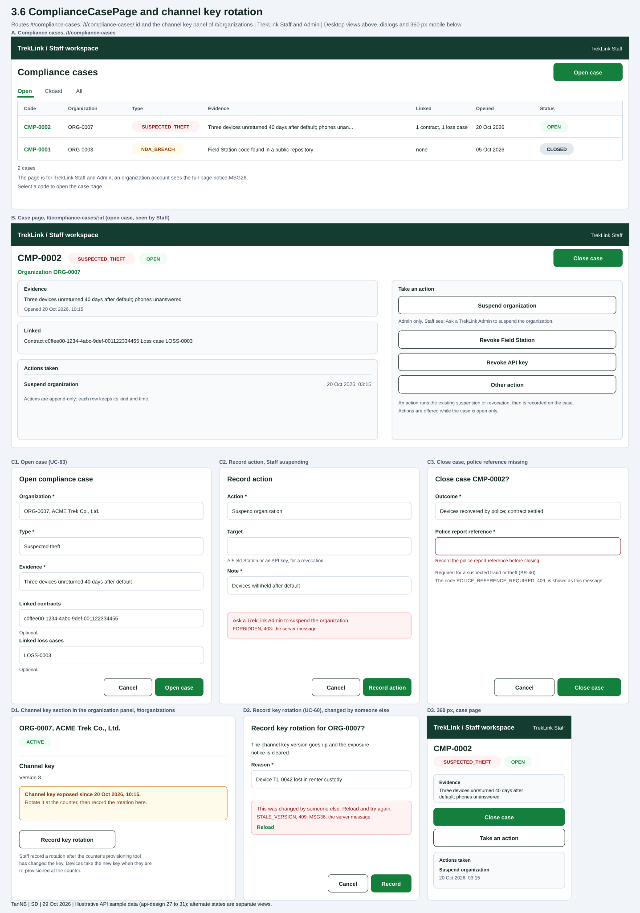

# `ComplianceCasePage` and channel key rotation

| | |
|---|---|
| Owner | TanNB |
| Task | `specs/frontend/tasks.md` 3.6 |
| Assigned, due | 2026-10-21, 2026-10-23 |
| Status | Ready for review |
| Routes | `/t/compliance-cases` (the list) and `/t/compliance-cases/:id` (the case page); the channel key section sits in the organization panel of `/t/organizations`, which task 3.2 builds (`specs/frontend/design.md` §2; `/t/organizations/:id` is not built) |
| Roles | TrekLink Staff: the list, the case page, Open case, revocation actions, Close case, Record key rotation. TrekLink Admin: the same except Record key rotation, which organizations 27 gives to Staff only (see Open points), plus the suspension action. Organization accounts: MSG26 (TrekLink routes). |
| Use case, FRs, story | UC-63, and UC-60 for the key rotation; FR-ORG-07, FR-ORG-08, FR-ORG-09, FR-DEV-13; US-UC63 |
| Requirements | `specs/organizations/requirements.md` REQ-EVT-12, REQ-EVT-13, REQ-ERR-08, AC-10, AC-11; BR-40 |
| Wireframe | Figure 1 below, `3-6-compliancecasepage-and-channel-key-rotation.svg` |

Scope from the task: organizations api-design 27 to 31; open a case, record actions (suspend for Admin only), close with outcome and authority reference (required for fraud and theft); rotate key on the organization page clears the exposed flag

Leader rulings of 2026-10-30 (`treklink-web` #119) applied: the case page reads organizations 32 (`GET /api/compliance-cases/:id`); every action carries its actor; organizations 20 is readable by Staff and Admin for any organization, so the Target of a revocation comes from organizations 20 and 23.

## Wireframe

***Figure 1***: Wireframes of the case list (A), the case page (B), the open case dialog (C1), the record action dialog where the server refuses a Staff suspension (C2), the close case dialog with the police reference missing (C3), the channel key section of the organization panel (D1), the key rotation dialog with a version conflict (D2), and the 360 px case page (D3). The data is illustrative.

## Data

Case list (`/t/compliance-cases`):

| Shown | Source (api-design file, property) |
|---|---|
| Tabs Open, Closed, All | organizations 28 with `status=OPEN`, `CLOSED`, and without a status |
| Code, organization code | organizations 28 `result.items[].code`, `items[].organization.code` |
| Type pill | organizations 28 `result.items[].type` |
| Evidence, truncated to one line | organizations 28 `result.items[].evidence` |
| Linked ("1 contract, 1 loss case", or "none") | organizations 28 `result.items[].linkedContractIds` and `linkedLossCases`, counted |
| Opened | organizations 28 `result.items[].openedAt`, in the viewer's timezone |
| Status pill | organizations 28 `result.items[].status` |
| Count line and pager | organizations 28 `result.totalCount`, `pageNumber`, `pageSize`, `totalPages` |

Case page (`/t/compliance-cases/:id`):

| Shown | Source (api-design file, property) |
|---|---|
| Code, type, status, organization code | organizations 32 `result.code`, `type`, `status`, `organization.code` |
| Evidence and opened time | organizations 32 `result.evidence`, `result.openedAt` |
| Linked contracts (as links to the contract page) and loss cases | organizations 32 `result.linkedContractIds`, `result.linkedLossCases` |
| Actions taken: kind, actor and time | organizations 32 `result.actions[].kind`, `actions[].actor.fullName`, `actions[].at`; organizations 30 and 31 return the same fields |
| Outcome and police report reference, on a closed case | organizations 32 `result.outcome`, `result.authorityReference` |

Channel key section of the organization panel (`/t/organizations`, an `ACTIVE` or `SUSPENDED` organization only):

| Shown | Source (api-design file, property) |
|---|---|
| Version | organizations 03 `result.channelKeyVersion` |
| Exposure notice "Channel key exposed since {date}" | `channelKeyExposedAt` of the organization (see Open points: no read endpoint, organizations 02 or 03, returns it; organizations 27 returns it, always null) |
| The `expectedVersion` the dialog sends | organizations 03 `result.version` of the selected organization |

## Actions

| Control | Endpoint | Confirmation | Success message |
|---|---|---|---|
| Open case (primary action of the list) | organizations 29 `POST /api/organizations/:id/compliance-cases` | dialog form | "Compliance case opened" (server message), then the case page opens |
| Select a code | none, opens the case page | none | none |
| Close case (primary action of an open case) | organizations 31 `POST /api/compliance-cases/:id/close` | dialog naming the case ("Close case CMP-0002?") | "Compliance case closed" (server message) |
| Suspend organization (Admin only; Staff see it disabled with the hint "Ask a TrekLink Admin to suspend the organization.") | organizations 30 `POST /api/compliance-cases/:id/actions` with `kind` `SUSPEND_ORGANIZATION` | the record action dialog, with a note | "Action recorded" (server message) |
| Revoke Field Station, Revoke API key, Other action | organizations 30 with `kind` `REVOKE_FIELD_STATION`, `REVOKE_API_KEY` or `OTHER` and `targetId` for a revocation | the record action dialog, with a note | "Action recorded" |
| Record key rotation (Staff) | organizations 27 `POST /api/organizations/:id/channel-key/rotate` | dialog naming the organization ("Record key rotation for ORG-0007?") | "Channel key rotated" (server message) |

An open case offers Close case and the actions. A closed case offers neither: its page is read only.

## States

| State | What the user sees |
|---|---|
| Loading | Skeleton rows on the list; skeleton cards on the case page. Buttons that call the server show their pending state and are disabled until it answers. |
| Empty list | A tab with no case shows "No compliance cases here." with Open case as the next step. |
| Error `VALIDATION_FAILED` | MSG02 under the field the server names ("{field} is required."); the dialog keeps every value. |
| Error `POLICE_REFERENCE_REQUIRED` | The server message "Record the police report reference before closing." under the Police report reference field (BR-40, REQ-ERR-08). No SRS message code exists (D-059 rule 3). |
| Error `FORBIDDEN` on a suspension by Staff | The server message "Ask a TrekLink Admin to suspend the organization." as an error Alert in the dialog. The page disables Suspend for Staff, so this answer reaches the screen only when the role changed after the page loaded. Any other `FORBIDDEN`: MSG26. |
| Error `INVALID_STATE_TRANSITION` | MSG28 as an error Alert in the dialog, for example "This cannot be done while it is CLOSED." (an action on a closed case, or a rotation for a closed organization). |
| Error `STALE_VERSION` (rotation) | MSG36 by code, "Someone else changed this. Reload to see the latest.", as an error Alert in the dialog with a Reload control (D-059 rule 7); the server's own text is not shown. |
| Error `NOT_FOUND` | The server message ("Compliance case not found.", "Organization not found.") as an error Alert; the list refetches. |
| Unauthenticated | Redirect to `/sign-in` with the same-origin `?next=` path (D-059 rule 1). |
| Any other failure | The server message, or "Something went wrong.", as an error Alert. |
| Success | A toast with the message of the Actions table; the list and the case refetch. |

## Form fields (if any)

Open case (one step, five fields):

| Step | Field | Type | Required | Rule |
|---|---|---|---|---|
| 1 | Organization | select | yes | organizations from organizations 02, without `CLOSED` ones (see Open points) |
| 1 | Type | select | yes | `SUSPECTED_FRAUD`, `SUSPECTED_THEFT`, `IP_VIOLATION`, `NDA_BREACH`, `OTHER_BREACH` |
| 1 | Evidence | text | yes | not blank |
| 1 | Linked contracts | multi-select | no | contracts of the chosen organization (see Open points) |
| 1 | Linked loss cases | multi-select | no | loss cases of the chosen organization (see Open points) |

Record action (one step, three fields):

| Step | Field | Type | Required | Rule |
|---|---|---|---|---|
| 1 | Action | select | yes | `SUSPEND_ORGANIZATION` (Admin only), `REVOKE_FIELD_STATION`, `REVOKE_API_KEY`, `OTHER` |
| 1 | Target | select | for a revocation | a Field Station of the organization (organizations 23) or an API key (organizations 20); hint "A Field Station or an API key, for a revocation." |
| 1 | Note | text | yes | not blank |

Close case (one step, two fields):

| Step | Field | Type | Required | Rule |
|---|---|---|---|---|
| 1 | Outcome | text | yes | not blank |
| 1 | Police report reference | text | for `SUSPECTED_FRAUD` and `SUSPECTED_THEFT` | the page marks it required for those two types and blocks Close case while it is empty; the server repeats the rule |

Record key rotation (one step, one field): Reason, text, required, organizations 27 `reason`.

## Mobile, accessibility, live data

- 360 px layout (Figure 1, D3): the list becomes cards with the code, organization, type pill, status and opened date. The case page stacks the evidence, Close case (full width, primary), Take an action (full width, secondary, opens the record action dialog) and the actions taken. The channel key section stacks under the organization details. Dialogs fill the width.
- Tab order and focus after each action: list: Open case, tabs (arrow keys move between them), the code links of the rows, then the pager. Case page: Close case, then the actions in order, then the linked contracts. A dialog puts focus in its first field, traps focus, closes on Escape and returns focus to the control that opened it; Cancel comes first. After Open case, focus moves to the new case page heading; after an action, to the new row of "Actions taken"; after Close case, to the page heading that now reads CLOSED; after a rotation, to the "Channel key" heading. Type and status are text in their pills, never colour alone.
- WebSocket events and invalidated query keys: no stream. Query keys `['compliance-cases', { status, pageNumber }]` and `['compliance-case', id]`. Opening, recording and closing invalidate both. A suspension or a revocation also invalidates `organizationKeys.all`, `['org-field-stations', orgId]` and `['org-api-keys', orgId]`; a rotation invalidates `organizationKeys.all`.

## Open points raised to the leader (D-052 rule 2)

1. **`channelKeyExposedAt` has no read source.** It exists in the schema and organizations 27 returns it (always null after a rotation), but organizations 02 and 03 return `channelKeyVersion` and `version` only, so the exposure notice has no source. The `expectedVersion` of organizations 27 is also ambiguous: the request sample says 4, its table says 3, and the response `channelKeyVersion` is 3. The screen assumes it is the organization's `version`.
2. **Status filter only.** The overview of organizations 28 says "by status and type", and its query has `status` alone. The screen offers status tabs.
3. **Who rotates the key.** organizations 27 names TrekLink Staff only. The screen shows the control to Staff and not to Admin until this is ruled.
4. **`OTHER` has no permission.** organizations 30 defines the permission for suspension (Admin) and for the two revocations (Staff, Admin), and none for `OTHER`. The screen offers `OTHER` to Staff and Admin.
5. **Pickers and names.** The case responses return contract ids (not codes) and the organization code (not its name). The screen links the contract id to the contract page and shows the code. The linked contract and loss case pickers rely on rentals and devices lists that this module does not specify, and the Organization select assumes organizations 02 without `CLOSED` ones (UC-63 precondition).
6. **No SRS message codes** for `POLICE_REFERENCE_REQUIRED` and the 403 suspension message; the screen shows the server message (D-059 rule 3).

## Checklist

Chapter 06 §7 (Screen Design Checklist) and §8 (UI and UX practices), ticked by the owner before review.

- [x] Routes and roles match `specs/frontend/design.md` §2; what Staff and Admin see is stated
- [x] Every shown field names its api-design file and property; the fields with no source are listed in Open points
- [x] Every action names its endpoint, its confirmation and its message
- [x] States cover loading, empty, every error code of api-design 27 to 31, forbidden (MSG26) and success
- [x] Forms have at most 5 fields in one step, with type, required flag and rule
- [x] The 360 px layout is drawn (Figure 1, D3)
- [x] Tab order, focus after each action and accessible names are stated
- [x] Live data: no event, the query keys and the invalidation are stated
- [x] Traceability: UC-63, UC-60, FR-ORG-07, FR-ORG-08, FR-ORG-09, FR-DEV-13, US-UC63
- [x] One primary action per screen; status is text as well as colour (§8 items 1 and 3)
