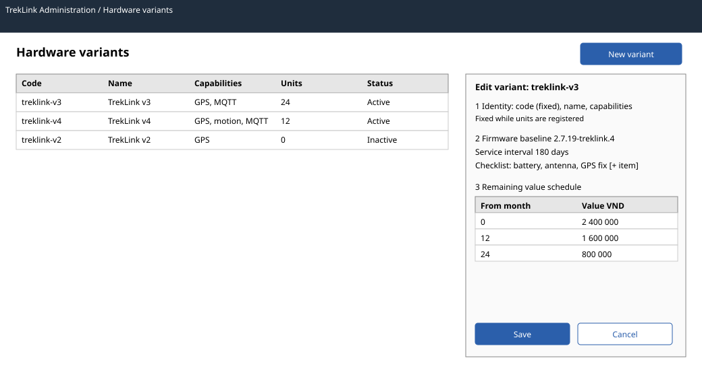

# Hardware variants admin (`/t/admin/variants`)

| | |
|---|---|
| Owner | KhoaDD |
| Task | `specs/frontend/tasks.md` 4.1 |
| Assigned, due | 2026-10-21, 2026-10-23 |
| Status | Ready for review |
| Routes | `/t/admin/variants` (`specs/frontend/design.md` §2) |
| Roles | TrekLink Admin: list, create, edit, deactivate, delete. TrekLink Staff and organization roles: MSG26 (Staff read variants through the fleet screen 4.2 filters, not here). |
| Use case, FRs, story | UC-13; FR-DEV-04, FR-DEV-17; US-UC13 |
| Requirements | `specs/devices/requirements.md` REQ-STA-02, REQ-EVT-18, REQ-ERR-10 |
| Wireframe |  |

Scope from the task: devices api-design 01 to 04; service interval with checklist, firmware baseline, depreciation schedule

## Data

| Shown | Source (api-design file, property) |
|---|---|
| Variant code and name | devices 01 `code`, `name` |
| Capabilities (GPS, motion sensor, MQTT) as text badges | devices 01 `hasGps`, `hasMotionSensor`, `mqttCapable` |
| Firmware baseline | devices 01 `firmwareBaseline` |
| Service interval and checklist items | devices 01 `serviceIntervalDays`, `serviceChecklist[]` |
| Remaining value schedule (used for loss charges) | devices 01 `remainingValueSchedule[].fromMonths`, `valueVnd` |
| Registered units | devices 01 `deviceCount` |
| Active or inactive | devices 01 `isActive`; the list loads with `includeInactive=true` |

## Actions

| Control | Endpoint | Confirmation | Success message |
|---|---|---|---|
| New variant (primary button) | devices 02 `POST /api/hardware-variants` | none | MSG03 |
| Edit (row action, opens the same side panel) | devices 03 `PATCH /api/hardware-variants/:id` | none | MSG03 |
| Deactivate or reactivate (row action) | devices 03 with `isActive` | dialog: "Deactivated variants cannot be requested by organizations. Units already registered keep working." | MSG03 |
| Delete (row action, shown only when `deviceCount` is 0) | devices 04 `DELETE /api/hardware-variants/:id` | dialog naming the variant code | MSG03 |

The sensor flags and the code are read-only once `deviceCount` is above 0 (REQ-STA-02); the panel
shows them as text with the note "Fixed while units are registered".

## States

| State | What the user sees |
|---|---|
| Loading | Table skeleton with five rows |
| Empty | "No hardware variants yet. Add the first variant before registering devices." with the New variant button |
| Error `CONFLICT_UNIQUE` (409) | MSG10 under the code field |
| Error `SCHEDULE_INVALID` (400) | MSG02 under the schedule editor: the first row starts at month 0 and values descend with age |
| Error `CHECKLIST_REQUIRED` (400) | MSG02 under the checklist: a service interval needs at least one checklist item |
| Error `VARIANT_IN_USE` (409) | MSG29 with dependency "registered devices"; the delete action disappears after refetch |
| Error `VALIDATION_FAILED` (400) | MSG02 under each field named in the response |
| Not found or forbidden | MSG26 full-page notice |
| Success | Toast MSG03; the table refetches |

## Form fields (if any)

| Step | Field | Type | Required | Rule |
|---|---|---|---|---|
| 1 | Code | text | yes (create only) | unique; lower case, digits and hyphens, for example `treklink-v3` |
| 1 | Name | text | yes | 1 to 80 characters |
| 1 | GPS, Motion sensor, MQTT capable | three checkboxes | yes | read-only while units are registered |
| 2 | Firmware baseline | text | yes | a version string, for example `2.7.19-treklink.4`; the service scan opens a firmware update when a unit differs (FR-DEV-18) |
| 2 | Service interval | number, days | no | empty means no periodic service |
| 2 | Checklist items | repeatable text rows | yes when an interval is set | at least one item; each 1 to 120 characters |
| 3 | Remaining value schedule | repeatable rows: from month, value in VND | yes | first row from month 0; months increase; values descend |

## Mobile, accessibility, live data

- 360 px layout: the table becomes a card list (code, name, units, active badge, row menu); the side panel opens full screen with the three steps stacked and the Save button fixed at the bottom, at least 44 px high.
- Tab order and focus after each action: New variant, table rows, row menu. The panel moves focus to its first field and returns it to the row that opened it on close. After a delete, focus moves to the table heading. Capability badges carry text, never colour alone.
- WebSocket events and invalidated query keys: no live events. Query key `['hardware-variants', { includeInactive: true }]`, invalidated after each mutation; `['hardware-variants']` used by other screens is invalidated too.

## Checklist

Chapter 06 §7 (Screen Design Checklist) and §8 (UI and UX practices), ticked by the owner before review.

- [x] Route and roles match `design.md` §2
- [x] Data: every field names its source
- [x] Actions: create, edit, deactivate, delete with confirmation where destructive
- [x] States: loading, empty, each error code of devices 02 to 04, 403, success
- [x] Forms: every field with type, requirement and rule
- [x] Mobile: 360 px layout described
- [x] Accessibility: focus order and return, text on every badge
- [x] Live data: none; query keys listed
- [x] Traceability: UC-13, FR-DEV-04, FR-DEV-17, US-UC13
