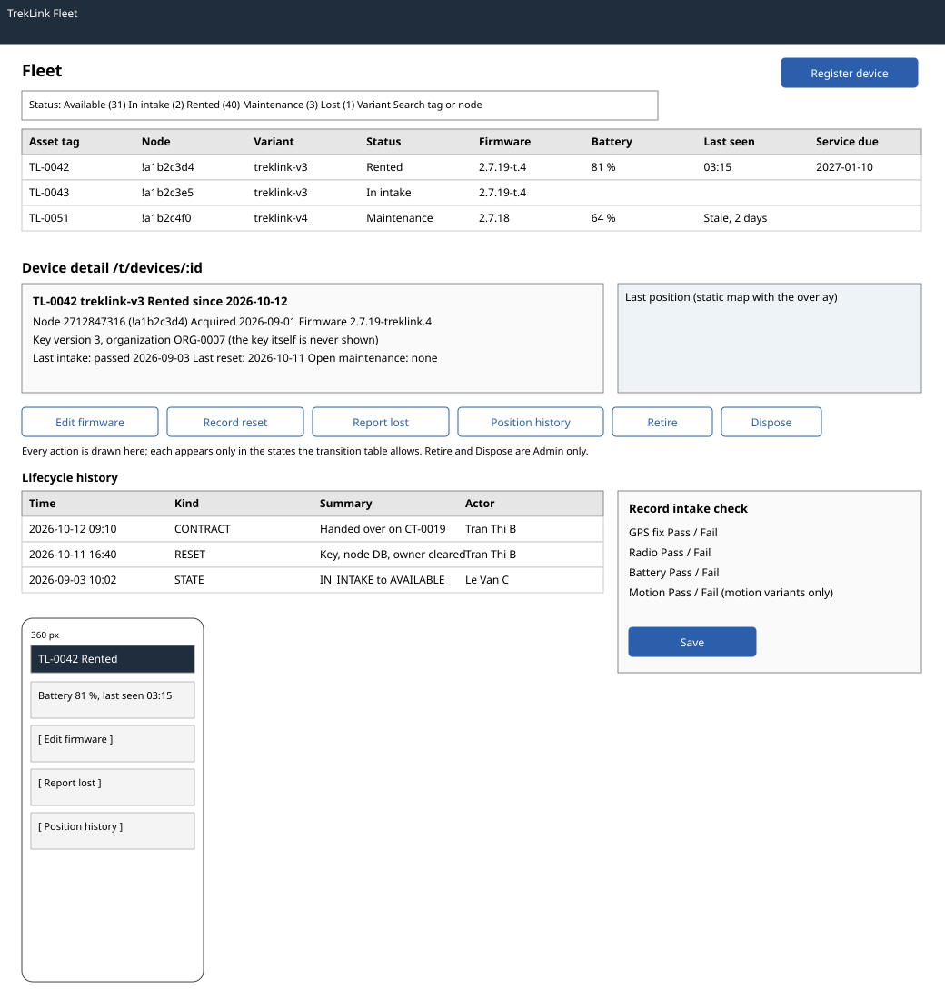

# Fleet table, register, intake and `DeviceDetailPage` (`/t/fleet`, `/t/devices/:id`)

| | |
|---|---|
| Owner | KhoaDD |
| Task | `specs/frontend/tasks.md` 4.2 |
| Assigned, due | 2026-10-21, 2026-10-23 |
| Status | Ready for review |
| Routes | `/t/fleet` (fleet table and the Register panel) and `/t/devices/:id` (device detail with its lifecycle history) (`specs/frontend/design.md` §2). Position and telemetry history is a separate route, `/t/devices/:id/telemetry` (screen 9.2, D-057 rule 8). |
| Roles | TrekLink Staff: view, register, edit firmware, intake check, reset. TrekLink Admin: everything Staff can (D-057 rule 7) plus retire and dispose. Organization roles: MSG26. |
| Use case, FRs, story | UC-11, UC-12, UC-44 (reset part), UC-53, UC-62; FR-DEV-01, FR-DEV-02, FR-DEV-03, FR-DEV-07, FR-DEV-09, FR-DEV-11, FR-DEV-16, FR-DEV-17; US-UC11, US-UC12, US-UC44, US-UC53, US-UC62 |
| Requirements | `specs/devices/requirements.md` REQ-UBI-01 to REQ-UBI-04, REQ-EVT-01, REQ-EVT-02, REQ-EVT-06, REQ-EVT-10, REQ-EVT-17, REQ-EVT-18, REQ-ERR-01, REQ-ERR-03, REQ-ERR-04, REQ-ERR-07; AC-01 to AC-03, AC-08 |
| Wireframe |  (fleet table, device detail, 360 px frame) |

Scope from the task: devices api-design 05 to 10, 16, 23 and monitoring api-design 07; register, intake check (motion field only for motion variants), reset, retire, dispose with the three wipe steps

## Data

| Shown | Source (api-design file, property) |
|---|---|
| Fleet row: asset tag, node id, variant code | devices 06 `items[].assetTag`, `nodeId`, `hardwareVariant.code` |
| Fleet row: status with its text label | devices 06 `items[].status` |
| Fleet row: firmware, battery, last seen | devices 06 `items[].firmwareVersion`, `batteryPct`, `lastSeenAt` |
| Fleet row: service due | devices 06 `items[].serviceDueAt` |
| Filters: status (multi), variant, search by tag or node | devices 06 query `status`, `hardwareVariantId`, `q`; variants from devices 01 |
| Count per status above the table | devices 06 `totalCount` per status filter (one request per chip, cached) |
| Detail header: asset tag, node number and id, variant, acquired, status since | devices 07 `assetTag`, `nodeNum`, `nodeId`, `hardwareVariant`, `acquiredAt`, `status`, `statusChangedAt` |
| Detail: key version and the organization it belongs to (never the key) | devices 07 `keyVersion`, `keyOrganizationId` (REQ-UBI-03) |
| Detail: last intake check, last reset, open maintenance | devices 07 `lastIntakeCheck.passed`, `createdAt`; `lastReset`; `openMaintenance` |
| Detail: last position (small static map with the overlay) | devices 07 `lastPosition.lat`, `lon` |
| Lifecycle history list: time, kind, summary, actor, link | monitoring 07 `items[].at`, `kind`, `summary`, `actor`, `refType`, `refId` |

## Actions

Each action appears only in the states where the transition table allows it (REQ-UBI-01); the server still
answers 409 for anything else.

| Control | Shown when | Endpoint | Confirmation | Success message |
|---|---|---|---|---|
| Register device (primary button on `/t/fleet`) | always | devices 05 `POST /api/devices` | none | MSG03; the new device opens in `IN_INTAKE` |
| Edit firmware version | any state except `DISPOSED` | devices 08 `PATCH /api/devices/:id` with `expectedVersion` | none | MSG03 |
| Record intake check | `IN_INTAKE`, or `MAINTENANCE` with no open record | devices 09 `POST /api/devices/:id/intake-checks` | none | MSG03; status shows the result (`AVAILABLE` on pass) |
| Record reset (three steps) | `RETURNED` with no reset since the last check-in | devices 10 `POST /api/devices/:id/reset` | none; the button stays disabled until all three boxes are ticked | MSG03 |
| Open maintenance | `AVAILABLE` | link to screen 4.3 with the device preselected | none | none |
| Report lost | any in-service state with no open loss case | link to screen 4.4 report form | none | none |
| Retire (Admin) | `MAINTENANCE` not on a live contract row | devices 16 `POST /api/devices/:id/retire` | dialog with the reason field: "A retired device leaves the rentable fleet. Its history is kept." | MSG03 |
| Dispose (Admin) | `RETIRED` | devices 23 `POST /api/devices/:id/dispose` | dialog with the three wipe steps and the method; Dispose stays disabled until every step is ticked | MSG03 |
| Position history | any state | navigation to `/t/devices/:id/telemetry` (screen 9.2) | none | none |
| History row link | `refType` is set | navigation to the contract, incident, maintenance record or loss case | none | none |

The inspection after the reset belongs to the counter check-in (screen 5.5); this page links there when a
`RETURNED` device has its reset logged.

A "Next step" panel shows devices 07 `nextStep` (D-092 rule 4, devices REQ-EVT-23): Reset and Inspect link to
the counter of `nextStep.contractId` (or name the counter in text when it is null); Complete maintenance links
to `/t/maintenance`; Intake check points at Record intake check on this page. A unit with no next step shows
none. A passed inspection makes the unit `AVAILABLE` at once; the intake check follows only maintenance.

## States

| State | What the user sees |
|---|---|
| Loading | Fleet: table skeleton. Detail: header skeleton, history list skeleton |
| Empty | Fleet with no device: "No devices registered yet." with Register device. Fleet with filters and no match: MSG01 |
| Error `CONFLICT_UNIQUE` (409, register) | MSG10 under the asset tag or node number field, whichever the response names; also for a retired device's number (REQ-ERR-01, AC-03) |
| Error `MOTION_RESULT_REQUIRED` (400) | MSG02 under the motion field; the field is required and shown only when the variant `hasMotionSensor` |
| Error `MAINTENANCE_OPEN` (409, intake) | MSG29 with dependency "maintenance records", with a link to the open record |
| Error `RESET_INCOMPLETE` (400) or `WIPE_INCOMPLETE` (400) | MSG02 on the unticked steps (the client blocks the submit, so this only follows a forced request) |
| Error `INVALID_STATE_TRANSITION` (409) | MSG28 with the current state; the page refetches the device |
| Error `STALE_VERSION` (409) | MSG36 dialog with Reload; the form keeps its values until Reload |
| Not found or forbidden | MSG26 full-page notice |
| Stale data | last seen older than `monitoring.deviceStaleSeconds` shows "Stale, last seen {time}" in text |
| Success | Toast MSG03; the device and the fleet list refetch |

## Form fields (if any)

| Step | Field | Type | Required | Rule |
|---|---|---|---|---|
| Register | Asset tag | text | yes | unique for every device ever registered, for example `TL-0042` |
| Register | Node number | number | yes | unique, the Meshtastic `nodeNum` read from the unit |
| Register | Hardware variant | select of active variants | yes | from devices 01 |
| Register | Firmware version | text | yes | prefilled with the variant's `firmwareBaseline` |
| Register | Acquired on | date | yes | not in the future |
| Intake | GPS fix, Radio, Battery | three pass or fail toggles | yes | each must be answered |
| Intake | Motion sensor | pass or fail toggle | when the variant has a motion sensor | hidden otherwise (REQ-EVT-02) |
| Intake | Note | text area | no | up to 500 characters |
| Reset | Key removed, Node database cleared, Owner cleared | three checkboxes | yes, all ticked | the order matches the unit's menu |
| Retire | Reason | text area | yes | 1 to 500 characters |
| Dispose | Key removed, Node database cleared, Owner cleared | three checkboxes | yes, all ticked | BR-42 |
| Dispose | Method | text | yes | how it leaves the fleet, for example "Recycled by vendor" |

## Mobile, accessibility, live data

- 360 px layout: the fleet table becomes a card list (asset tag, status label, battery, last seen); filters move into a bottom sheet. The detail page stacks header, actions as full-width buttons at least 44 px high, then the history list. Dialogs open full screen.
- Tab order and focus after each action: filters, table, pagination. On the detail page: header, action buttons in the order of the table above, history list. A dialog traps focus and returns it to the button that opened it; after register, focus moves to the new device's heading. Status is always a text label, colour is an extra cue only.
- WebSocket events and invalidated query keys: the fleet page does not subscribe (Staff use the fleet map for live state). Query keys `['devices', filters]`, `['device', id]`, `['device-history', id, page]`; each mutation invalidates `['device', id]`, `['device-history', id]` and `['devices']`.

## Checklist

Chapter 06 §7 (Screen Design Checklist) and §8 (UI and UX practices), ticked by the owner before review.

- [x] Route and roles match `design.md` §2; Admin-only actions named
- [x] Data: every field names its source, including the lifecycle history of monitoring 07
- [x] Actions: each shown only in the states the transition table allows
- [x] States: loading, empty, every error code of devices 05 to 10, 16, 23, 403, stale, success
- [x] Forms: register, intake (motion only for motion variants), reset, retire, dispose
- [x] Mobile: 360 px layout drawn
- [x] Accessibility: focus trap and return in dialogs, text status labels
- [x] Live data: none on this page; query keys listed
- [x] Traceability: UC-11, UC-12, UC-44, UC-53, UC-62, US-UC11, US-UC12, US-UC44, US-UC53, US-UC62
