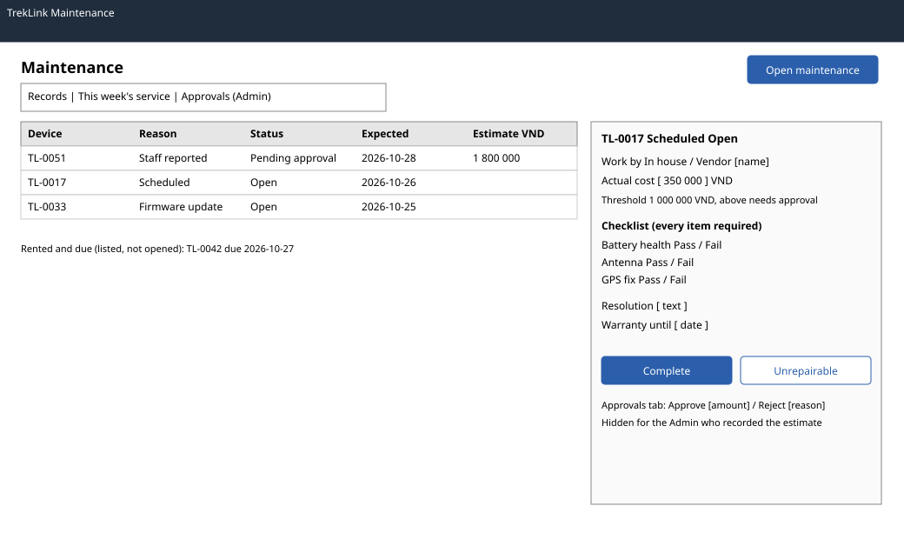

# `MaintenancePage` and `MaintenanceApprovalPage` (`/t/maintenance`, `/t/maintenance/approvals`)

| | |
|---|---|
| Owner | KhoaDD |
| Task | `specs/frontend/tasks.md` 4.3 |
| Assigned, due | 2026-10-21, 2026-10-23 |
| Status | Ready for review |
| Routes | `/t/maintenance` (records and the week's service list) and `/t/maintenance/approvals` (cost decisions), one tab per route as in D-057 rule 3; both added to `specs/frontend/design.md` §2 in this change |
| Roles | TrekLink Staff: list, open, estimate, complete. TrekLink Admin: everything Staff can (D-057 rule 7) plus the approvals tab. The approval controls are hidden on a record whose estimate the viewer recorded (BR-44); a forced request gets 403 `SEPARATION_OF_DUTY` (MSG30). Organization roles: MSG26. |
| Use case, FRs, story | UC-52, UC-64, UC-65; FR-DEV-08, FR-DEV-17, FR-DEV-18, FR-DEV-20, FR-DEV-21; US-UC52, US-UC64, US-UC65 |
| Requirements | `specs/devices/requirements.md` REQ-EVT-09, REQ-EVT-19 to REQ-EVT-22, REQ-STA-03, REQ-STA-04, REQ-ERR-08 to REQ-ERR-10; AC-09 to AC-12 |
| Wireframe |  |

Scope from the task: devices api-design 11 to 15; the week's service list; estimate; completion with resolution, cost, checklist results and firmware version; Admin decision (hidden for the estimator, 403 shown if forced)

## Data

| Shown | Source (api-design file, property) |
|---|---|
| Record row: device asset tag, reason, status, expected date | devices 15 `items[].device.assetTag`, `reason`, `status`, `expectedAt` |
| Record row: work by, vendor, estimate, approved, actual cost | devices 15 `items[].workBy`, `vendorName`, `estimatedCostVnd`, `approvedCostVnd`, `actualCostVnd` |
| Record detail: description, warranty, checklist results, firmware version, opened | devices 15 `description`, `warrantyUntil`, `checklistResults`, `firmwareVersion`, `openedAt` |
| The week's service list (records the scan opened, `SCHEDULED` and `FIRMWARE_UPDATE`) | devices 15 with `reason=SCHEDULED&reason=FIRMWARE_UPDATE&status=OPEN&dueBefore=<end of week>` |
| Devices due but still rented (listed, not opened, REQ-STA-03) | devices 06 `items[]` with `status=RENTED` and `serviceDueAt` before the end of the week |
| Checklist to fill on completion | the device's variant `serviceChecklist[]` from devices 01 |
| Approval threshold shown beside the estimate | devices 15 `approvalThresholdVnd` (the parameter `devices.maintenanceApprovalThresholdVnd`, read by the server, since the parameters endpoint is Admin-only) |
| Approvals tab rows | devices 15 with `status=PENDING_APPROVAL` |

## Actions

| Control | Shown when | Endpoint | Confirmation | Success message |
|---|---|---|---|---|
| Open maintenance (primary; preselects the device when opened from screen 4.2) | device `AVAILABLE`, no open record | devices 11 `POST /api/devices/:id/maintenance` with `expectedVersion` | none | MSG03 |
| Record estimate | record `OPEN` | devices 12 `PATCH .../maintenance/:recordId/estimate` | none; above the threshold the panel states "Admin approval required before completion" | MSG03; status may become `PENDING_APPROVAL` |
| Complete or mark unrepairable | record `OPEN` | devices 14 `PATCH .../maintenance/:recordId` | dialog for `UNREPAIRABLE`: "The device stays in maintenance until an Admin retires it." | MSG03 |
| Approve or reject cost (approvals tab) | record `PENDING_APPROVAL` and the viewer did not record the estimate | devices 13 `POST .../maintenance/:recordId/decision` | dialog with the approved amount (approve) or the reason (reject) | MSG03 |
| Device link | always | navigation to `/t/devices/:id` (screen 4.2) | none | none |

## States

| State | What the user sees |
|---|---|
| Loading | Table skeleton on each tab |
| Empty | Records with filters: MSG01. Service list: "Nothing is due this week." Approvals: "No costs are waiting for a decision." |
| Error `VENDOR_REQUIRED` (400) | MSG02 under the vendor name |
| Error `CHECKLIST_INCOMPLETE` (400) | MSG02 on each checklist item without a result |
| Error `FIRMWARE_VERSION_REQUIRED` (400) | MSG02 under the firmware version field of a `FIRMWARE_UPDATE` record |
| Error `MAINTENANCE_OPEN` (409) | MSG29 with dependency "maintenance records", with a link to the open one |
| Error `SEPARATION_OF_DUTY` (403) | MSG30 dialog (only after a forced request; the controls are hidden) |
| Error `INVALID_STATE_TRANSITION` (409) | MSG28 with the current state, for example a completion attempted while `PENDING_APPROVAL` (REQ-STA-04) |
| Error `STALE_VERSION` (409) | MSG36 dialog with Reload; the form keeps its values until Reload |
| Not found or forbidden | MSG26 full-page notice; a Staff user opening `/t/maintenance/approvals` sees MSG26 |
| Success | Toast MSG03; the list and the device refetch |

## Form fields (if any)

| Step | Field | Type | Required | Rule |
|---|---|---|---|---|
| Open | Reason | select: Staff reported (the scan opens the other two) | yes | `STAFF_REPORTED` from this form |
| Open | Description | text area | yes | 1 to 1000 characters |
| Open | Expected completion | date | yes | today or later |
| Open, Estimate | Work by | select: in house, vendor | yes on estimate | vendor needs a vendor name (REQ-ERR-10) |
| Open, Estimate | Vendor name | text | when work is by a vendor | 1 to 120 characters |
| Open, Estimate | Estimated cost | number, VND | yes on estimate | 0 or more |
| Complete | Status | radio: completed, unrepairable | yes | |
| Complete | Resolution | text area | yes | 1 to 1000 characters |
| Complete | Actual cost | number, VND | yes for completed | 0 or more; above the threshold also needs approval |
| Complete | Warranty until | date | no | after today |
| Complete | Checklist results | pass or fail per item of the variant's checklist | every item for a `SCHEDULED` record | REQ-ERR-09 |
| Complete | Firmware version | text | yes for a `FIRMWARE_UPDATE` record | becomes the device's firmware version (AC-12) |
| Decision | Decision | radio: approve, reject | yes | |
| Decision | Approved amount | number, VND | yes on approve | defaults to the estimate |
| Decision | Reason | text area | yes on reject | 1 to 500 characters |

## Mobile, accessibility, live data

- 360 px layout: tabs become a segmented control under the header; rows become cards (asset tag, reason, status label, expected date); the record panel opens full screen with the Save button fixed at the bottom, at least 44 px high.
- Tab order and focus after each action: tab list, filters, table, then the panel. Opening a record moves focus to its heading; closing returns it to the row. After a decision, focus moves to the next pending row or to the empty message. Status and reason are text labels.
- WebSocket events and invalidated query keys: no live events. Query keys `['maintenance', filters]`, `['maintenance', 'approvals']`, `['maintenance', 'week', weekStart]`; each mutation invalidates `['maintenance']` and `['device', deviceId]`.

## Checklist

Chapter 06 §7 (Screen Design Checklist) and §8 (UI and UX practices), ticked by the owner before review.

- [x] Route and roles match `design.md` §2 (the approvals route is added in this change)
- [x] Data: every field names its source, including the threshold parameter
- [x] Actions: open, estimate, complete, decide; approval hidden for the estimator
- [x] States: loading, empty per tab, every error code of devices 11 to 14, 403, success
- [x] Forms: every field with type, requirement and rule
- [x] Mobile: 360 px layout described
- [x] Accessibility: focus on open, close and after a decision; text labels
- [x] Live data: none; query keys listed
- [x] Traceability: UC-52, UC-64, UC-65, US-UC52, US-UC64, US-UC65

## Row actions and bulk decisions (W29, 2026-11-01)

Added by KhoaDD under D-078 to apply `0-ui-standard.md` §2. Where this section and the tables above
disagree, this section wins.

- Row actions are `RowAction` lists named after the asset tag ("Estimate TL-0009"): Records tab,
  Estimate and Complete on an `OPEN` row; This week's service, Complete; Approvals, Decide. Decide on
  a record the viewer estimated stays reachable, disabled, with the reason "A different Admin must
  decide this: you recorded the estimate." (BR-44).
- Approvals tab, Admin: one checkbox per row, "Select {asset tag}", kept across pages. The bulk bar
  leaves out the records the viewer estimated and offers "Approve N costs" and "Reject N costs".
  Approve sends, per record, the amount it waits on (the actual cost once completed, otherwise the
  estimate; a record with neither is left out) with that record's `expectedVersion`; Reject is an
  alert dialog with one required reason. Each runs devices api-design 13 once per record in sequence,
  with the per-row summary on any failure (STALE_VERSION, SEPARATION_OF_DUTY). An amount other than
  the one waiting stays a row decision.
- The API does not sort; the pagers keep the range and total.
