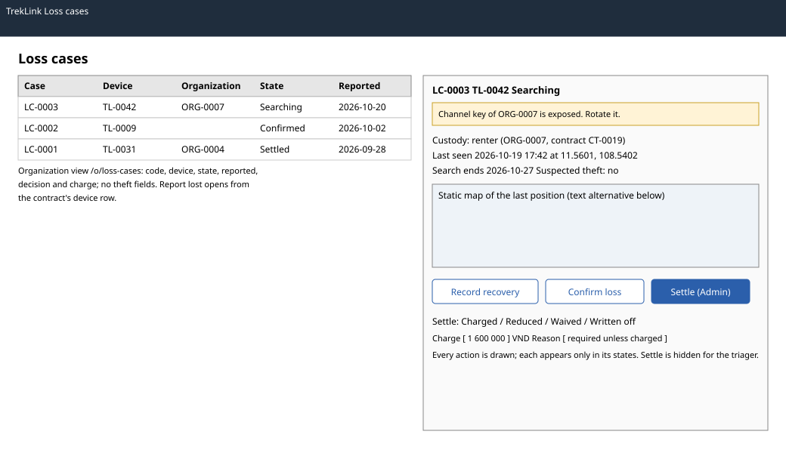

# `LossCasePage` (`/t/loss-cases`, `/t/loss-cases/:id`, `/o/loss-cases`)

| | |
|---|---|
| Owner | KhoaDD |
| Task | `specs/frontend/tasks.md` 4.4 |
| Assigned, due | 2026-10-21, 2026-10-23 |
| Status | Ready for review |
| Routes | `/t/loss-cases` and `/t/loss-cases/:id` (TrekLink), `/o/loss-cases` (organization list); the report form opens from the device row of `/o/contracts/:id` and from `/t/devices/:id` (`specs/frontend/design.md` §2, D-045) |
| Roles | Org Manager: report a device the organization rents, see the organization's cases (read-only after reporting). TrekLink Staff: report any device in service, triage, recover, confirm. TrekLink Admin: everything Staff can (D-057 rule 7) plus the settlement, hidden on a case the viewer triaged (BR-39). Org Operator: MSG26. |
| Use case, FRs, story | UC-49, UC-60; FR-DEV-12 to FR-DEV-15, FR-BILL-05, FR-BILL-11; US-UC49, US-UC60 |
| Requirements | `specs/devices/requirements.md` REQ-EVT-11, REQ-EVT-13 to REQ-EVT-16, REQ-ERR-05, REQ-ERR-06; AC-05 to AC-08 |
| Wireframe |  |

Scope from the task: devices api-design 17 to 22; Staff triage with suspected theft or fraud, recover, confirm; Admin decision (charged, reduced, waived, written off) with reason; Org Manager list at `/o/loss-cases` and the report action on the contract's device row

## Data

| Shown | Source (api-design file, property) |
|---|---|
| Case code, device asset tag, state, reported | devices 18 `items[].code`, `device.assetTag`, `state`, `reportedAt` |
| State the device was in when reported | devices 18 `stateFromDevice` |
| Organization (TrekLink views only) | devices 18 `organization.code` |
| Description from the reporter | devices 18 `description` |
| Last seen time and position (small static map with the overlay) | devices 18 `lastSeenAt`, `lastPosition.lat`, `lon` |
| Custody: who held the device at its last seen time | devices 18 `custody` (`RENTER` or `TREKLINK`, D-040) |
| Channel key exposed (organization key must rotate) | devices 18 `keyExposed`; links to the compliance and key rotation screen 3.6 |
| Suspected theft, police reference | devices 18 `suspectedTheft`, `policeReference` |
| Search ends | devices 18 `searchEndsAt`; the search length is `devices.lossSearchDays` |
| Settlement and charge | devices 18 `decision`, `chargeVnd` |

The organization list shows code, asset tag, state, reported and, once settled, decision and charge. It
never shows `suspectedTheft` or `policeReference`.

## Actions

| Control | Shown when | Endpoint | Confirmation | Success message |
|---|---|---|---|---|
| Report lost (contract device row, device detail) | device in service, no open case | devices 17 `POST /api/devices/:id/loss-cases` | dialog: "TrekLink will contact you. Late and loss charges follow the contract." | Org Manager: panel "Loss reported. TrekLink will contact you." Staff: MSG03 |
| Triage | `REPORTED` | devices 19 `POST /api/loss-cases/:id/triage` | none | MSG03; state `SEARCHING`, custody shown |
| Record recovery | `REPORTED`, `SEARCHING` or `SETTLED` | devices 20 `POST /api/loss-cases/:id/recover` | dialog: "The device returns as RETURNED and needs a reset and an inspection before rent." | MSG03 |
| Confirm loss | `SEARCHING` | devices 21 `POST /api/loss-cases/:id/confirm` | dialog naming the device | MSG03 |
| Settle (Admin) | `CONFIRMED` and the viewer did not triage | devices 22 `POST /api/loss-cases/:id/decision` | dialog with the decision, the charge and the reason | MSG03 |
| Device link | TrekLink views | navigation to `/t/devices/:id` | none | none |

## States

| State | What the user sees |
|---|---|
| Loading | List skeleton; detail header skeleton |
| Empty | TrekLink list: "No loss cases." Organization list: "Your organization has no loss cases." With a state filter: MSG01 |
| Error `LOSS_CASE_OPEN` (409) | MSG29 with dependency "loss cases", with a link to the open case |
| Error `SEPARATION_OF_DUTY` (403) | MSG30 dialog (only after a forced request; the control is hidden) |
| Error `INVALID_STATE_TRANSITION` (409) | MSG28 with the current state; the case refetches |
| Error `STALE_VERSION` (409) | MSG36 dialog with Reload |
| Not found or forbidden | MSG26; another organization's case answers 404 and shows the same notice (auth REQ-ERR-06) |
| Key exposed | Amber banner on the case: "This organization's channel key is exposed. Rotate it." with a link to screen 3.6 |
| Success | Toast MSG03; the case and the list refetch |

## Form fields (if any)

| Step | Field | Type | Required | Rule |
|---|---|---|---|---|
| Report | Description | text area | yes | 1 to 1000 characters: where and when it was last seen |
| Triage | Suspected theft or fraud | checkbox | yes | opens a compliance case when ticked (D-046) |
| Triage | Police reference | text | no | up to 60 characters |
| Recover | Note | text area | yes | 1 to 500 characters: where and how it was found |
| Settle | Decision | radio: charged, reduced, waived, written off | yes | |
| Settle | Charge | number, VND | for charged and reduced | prefilled with the charge raised at confirmation (`chargeVnd`, the variant's remaining value, `RENTER` custody only); reduced must be lower; a `TREKLINK` custody case is normally written off (AC-05) |
| Settle | Reason | text area | unless charged | 1 to 500 characters |

## Mobile, accessibility, live data

- 360 px layout: list rows become cards (code, asset tag, state label, reported); the detail stacks the header, the custody and key banners, the static map and the actions as full-width buttons at least 44 px high. Dialogs open full screen.
- Tab order and focus after each action: filters, list, then detail actions in the order of the table above. A dialog traps focus and returns it to its button; after settling, focus moves to the case heading. Custody and state are text labels; the map has a text alternative with the coordinates and time.
- WebSocket events and invalidated query keys: no live events. Query keys `['loss-cases', scope, filters]`, `['loss-case', id]`; each mutation invalidates both and `['device', deviceId]`.

## Checklist

Chapter 06 §7 (Screen Design Checklist) and §8 (UI and UX practices), ticked by the owner before review.

- [x] Route and roles match `design.md` §2; the organization view hides the theft fields
- [x] Data: every field names its source
- [x] Actions: report, triage, recover, confirm, settle; settlement hidden for the triager
- [x] States: loading, empty per view, every error code of devices 17 to 22, 403 and 404, success
- [x] Forms: every field with type, requirement and rule
- [x] Mobile: 360 px layout described
- [x] Accessibility: focus trap and return, text labels, map text alternative
- [x] Live data: none; query keys listed
- [x] Traceability: UC-49, UC-60, US-UC49, US-UC60
