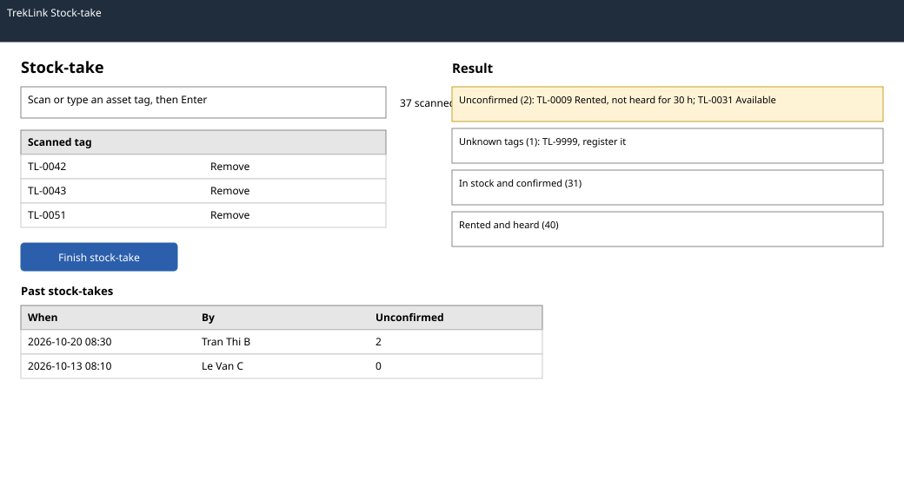

# Stock-take (`/t/stock-take`)

| | |
|---|---|
| Owner | KhoaDD |
| Task | `specs/frontend/tasks.md` 4.5 |
| Assigned, due | 2026-10-21, 2026-10-23 |
| Status | Ready for review |
| Routes | `/t/stock-take` (`specs/frontend/design.md` §2) |
| Roles | TrekLink Staff and TrekLink Admin: run a stock-take and see past ones. Organization roles: MSG26. |
| Use case, FRs, story | UC-54; FR-DEV-10; US-UC54 |
| Requirements | `specs/devices/requirements.md` REQ-EVT-12; AC-04 |
| Wireframe |  |

Scope from the task: devices api-design 25 and 26; scan input; the four result groups

## Data

| Shown | Source (api-design file, property) |
|---|---|
| Scanned tags of the current session, with a count | client state, then devices 25 body `scannedTags` |
| Result: in stock and confirmed by scan | devices 25 `inStockConfirmed` |
| Result: rented units heard recently | devices 25 `rentedSeen` |
| Result: unconfirmed units with their status | devices 25 `unconfirmed[].assetTag`, `status` |
| Result: scanned tags not in the register | devices 25 `unknownTags[]` |
| Past stock-takes: when, by whom, unconfirmed count | devices 26 `items[].createdAt`, `takenBy`, `unconfirmedCount` |

## Actions

| Control | Endpoint | Confirmation | Success message |
|---|---|---|---|
| Scan or type an asset tag, Enter adds it | none (client list; duplicates ignored with the note "Already scanned") | none | none |
| Remove a scanned tag | none | none | none |
| Finish stock-take (primary) | devices 25 `POST /api/stock-takes` | dialog: "Submit {n} scanned tags? Units not scanned and not heard recently are listed as unconfirmed." | MSG03; the four result groups open |
| Unconfirmed or unknown row link | navigation to `/t/devices/:id`, or to Register device on screen 4.2 with the tag prefilled for an unknown tag | none | none |
| Past stock-take row | none in this release (the list shows counts only) | none | none |

The scan list survives a page reload in session storage until it is submitted, so a long count is not lost.

## States

| State | What the user sees |
|---|---|
| Loading | Past stock-takes skeleton; the scan field is usable at once |
| Empty | No scans yet: "Scan a device's asset tag to start." No past stock-takes: "No stock-takes yet." |
| Submitting | Finish button shows progress; the scan field is disabled |
| Result | Four groups in this order: Unconfirmed (first, it needs action), Unknown tags, In stock confirmed, Rented and heard; each with its count |
| Error `VALIDATION_FAILED` (400) | MSG02 above the scan list, for example an empty list |
| Not found or forbidden | MSG26 full-page notice |
| Success | Toast MSG03; the past list refetches |

## Form fields (if any)

| Step | Field | Type | Required | Rule |
|---|---|---|---|---|
| Scan | Asset tag | text, autofocus, accepts a barcode scanner as keyboard input | at least one before finishing | trimmed and upper-cased; duplicates ignored |

## Mobile, accessibility, live data

- 360 px layout: the scan field and the count sit at the top; the scan list scrolls below; the Finish button is fixed at the bottom, at least 44 px high. Results replace the list, one group per collapsible section.
- Tab order and focus after each action: the scan field keeps focus after each Enter so a scanner can feed it; Finish; then the results, focus moving to the Unconfirmed heading. Each added tag is announced through a polite live region ("TL-0042 added, 37 scanned").
- WebSocket events and invalidated query keys: no live events. Query key `['stock-takes', page]`, invalidated after a submit.

## Checklist

Chapter 06 §7 (Screen Design Checklist) and §8 (UI and UX practices), ticked by the owner before review.

- [x] Route and roles match `design.md` §2
- [x] Data: every field names its source
- [x] Actions: scan, remove, finish with confirmation, result links
- [x] States: loading, empty, submitting, result, 400, 403, success
- [x] Forms: the scan field with its rule
- [x] Mobile: 360 px layout described
- [x] Accessibility: focus stays in the scan field, live region announcements
- [x] Live data: none; query keys listed
- [x] Traceability: UC-54, FR-DEV-10, US-UC54, AC-04
