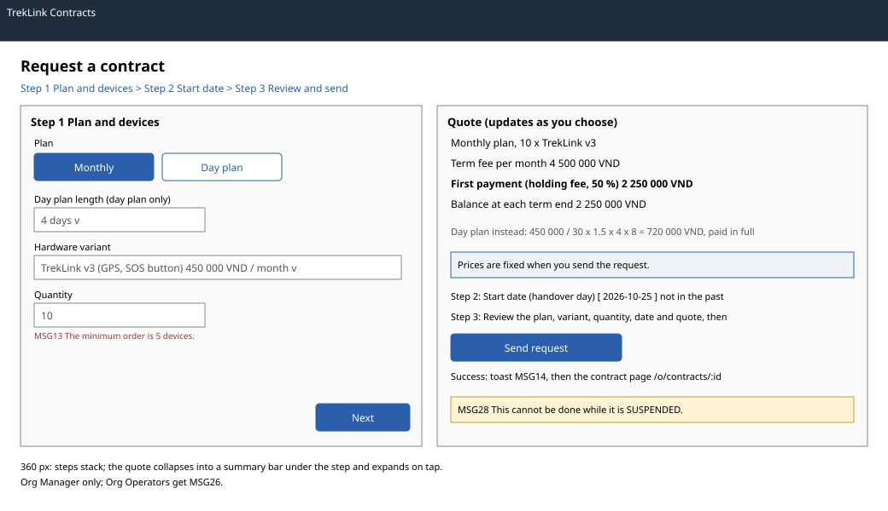

# `ContractRequestPage` with quote (`/o/contracts/new`)

| | |
|---|---|
| Owner | LongLP |
| Task | `specs/frontend/tasks.md` 5.1 |
| Assigned, due | 2026-10-21, 2026-10-23 |
| Status | Ready for review |
| Routes | `/o/contracts/new` (`specs/frontend/design.md` §2) |
| Roles | Org Manager: the whole page. Org Operator: MSG26 (the route is Org Manager only). A Manager whose organization is not `ACTIVE` sees the page with an amber MSG28 banner and Send request disabled. |
| Use case, FRs, story | UC-15, UC-16 (since D-092 rule 1 the request holds its units at once; screen 5.3 approves a held request); FR-CON-01, FR-CON-02, FR-CON-07, FR-BILL-01, FR-BILL-02, FR-CFG-02; US-UC15 |
| Requirements | `specs/rentals/requirements.md` REQ-EVT-01, REQ-EVT-17, REQ-UBI-03, REQ-UBI-04, REQ-ERR-01, REQ-ERR-02, REQ-ERR-03; D-092 rule 1; `specs/frontend/requirements.md` REQ-UBI-07 |
| Wireframe |  |

Scope from the task: rentals api-design 01, billing api-design 02 and devices api-design 24; four steps at most.
Amended 2026-11-01 (KhoaDD under D-078, D-092 rule 1, supervisor feedback of the 2026-11-01 demo): the
form shows how many units are available now and refuses a quantity above it; the request holds the units,
and the page confirms the hold expiry and the deposit due. The wireframe predates the amendment.

## Data

| Shown | Source (api-design file, property) |
|---|---|
| Variant choices with name and monthly price per device | billing 01 `result.variants[].id`, `name`, `monthlyPriceVnd` |
| Day-plan lengths offered | billing 01 `result.dayPlanLengths` |
| Minimum order quantity, as the quantity field's hint | billing 01 `result.minOrderQuantity` |
| Holding-fee ratio, as a percentage in the quote | billing 01 `result.holdingFeeRatio` |
| Quote: first payment, day-plan unit per day, days, total and the formula | billing 02 `result.firstPaymentVnd`, `unitPerDayVnd`, `days`, `totalVnd`, `formula` |
| Quote for a monthly plan: term fee, first payment (the holding fee) and the formula | billing 02 `result.termFeeVnd`, `firstPaymentVnd`, `formula` for `MONTHLY` (D-059 rule 6) |
| Organization state, for the not-active banner | auth 04 `result.organization.status` (`['me']`) |
| Units available now, per variant: in each variant option and as "N available now" beside Quantity | devices 24 `result[].hardwareVariantId`, `available` (counts only; `device.availability.org`) |
| After sending: the new contract's code | rentals 01 `result.code` |
| After sending: the units held and when the hold expires | rentals 01 `result.heldDevices`, `holdExpiresAt` |
| After sending: the deposit due before the hold expires | rentals 01 `result.quote.firstPaymentVnd` (the holding fee, or the whole day-plan fee) |

## Actions

| Control | Endpoint | Confirmation | Success message |
|---|---|---|---|
| Plan, variant or quantity changed (quote refresh, debounced 400 ms once all step 1 fields are valid) | billing 02 `POST /api/quotes` | none | the quote panel updates |
| Next and Back (between steps) | none | none | none |
| Availability refresh: automatic every 30 s and on window focus, and the **Refresh** button beside the count | devices 24 `GET /api/devices/availability` | none | the count updates |
| Send request (step 3, primary) | rentals 01 `POST /api/contracts` | none: the request holds the units; the deposit is due before the hold expires | toast MSG14; the page shows the confirmation panel "Request RC-... sent", "N devices are held for you until {time}.", "Deposit due before then: {amount}." with **Open the contract** (`/o/contracts/:id`, screen 5.2) and **Pay the deposit** (`/o/invoices?contractId=`) |
| Cancel (header link) | none; back to `/o/contracts` | asks first if a field is filled (chapter 06 §8.7) | none |

## States

| State | What the user sees |
|---|---|
| Loading | Step 1 skeleton until billing 01 answers; the quote panel shows a spinner while billing 02 runs; Send request shows its pending state and is disabled until the server answers |
| Empty | No active variant in billing 01: "No devices can be rented right now. Contact TrekLink." and the steps are disabled |
| Error `VALIDATION_FAILED` (400, rentals 01, billing 02) | MSG02 under the field the server names |
| Error `BELOW_MOQ` (400, rentals 01, billing 02) | MSG13 under Quantity, with `minOrderQuantity` |
| Quantity above the count of devices 24 | MSG11 under Quantity, "Only N {variant} devices are available. Lower the quantity or choose another variant."; Next and Send request refuse it. While the count is loading or failed the server decides |
| Error `INSUFFICIENT_DEVICES` (409, rentals 01) | the server's MSG11 under Quantity, back on step 1, and the count is fetched again (another organization took the units first) |
| Error `DAY_PLAN_LENGTH` (400, rentals 01) | MSG02 under Day plan length; not reachable through the select, shown only if the lengths change while the page is open |
| Error `ORGANIZATION_NOT_ACTIVE` (409, rentals 01) | MSG28 banner with the organization's state; Send request disabled |
| Error `UNAUTHENTICATED` (401) | `apiClient` refreshes once and retries, else `/sign-in` (frontend REQ-EVT-02) |
| Not found or forbidden | `FORBIDDEN` (403): MSG26 full page |
| Success | Toast MSG14 and the confirmation panel with the hold expiry and the deposit (`role="status"`, focused) |

## Form fields (if any)

| Step | Field | Type | Required | Rule |
|---|---|---|---|---|
| 1 Plan and devices | Plan | segmented control: Monthly, Day plan | yes | `MONTHLY` or `DAY` (rentals 01 `planType`) |
| 1 Plan and devices | Day plan length | select from `dayPlanLengths` | for a day plan | one of `rentals.dayPlanLengths` (rentals 01 `dayPlanDays`); hidden for Monthly |
| 1 Plan and devices | Hardware variant | select | yes | an active variant from billing 01 (rentals 01 `hardwareVariantId`) |
| 1 Plan and devices | Quantity | integer | yes | at least `rentals.minOrderQuantity` and at most the variant's available count (rentals 01 `quantity`, devices 24) |
| 2 Start date | Start date (handover day) | date | yes | not in the past (rentals 01 `requestedStartDate`) |
| 3 Review and send | none | | | read-only summary of steps 1 and 2 with the quote |

Three steps of at most four fields (chapter 06 §3, REQ-UBI-07). A running contract never changes, so the
review step states: "Plan, variant and quantity cannot change after the request. Need more devices? Send
another request." (FR-CON-07).

## Mobile, accessibility, live data

- 360 px layout: the steps stack in one column; the quote collapses into a summary bar under the current step (first payment) that expands on tap; Next and Send request are full width and at least 44 px high.
- Tab order and focus after each action: the step indicator is a list with `aria-current="step"`; Next moves focus to the next step's heading; a field error moves focus to the first invalid field. The quote panel is an `aria-live="polite"` region so a new amount is announced. VND amounts use thousands separators (chapter 06 §8.8).
- WebSocket events and invalidated query keys: no live events. Query keys `['plans']` (billing 01), `['quote', planType, dayPlanDays, variantId, quantity]` (billing 02) and `['availability', 'all']` (devices 24, refetched every 30 s and on focus); sending invalidates the contract keys and the availability. The count is announced in the quantity hint; the Refresh button is a real button in the tab order after Quantity.

## Checklist

Chapter 06 §7 (Screen Design Checklist) and §8 (UI and UX practices), ticked by the owner before review.

- [x] Route and roles match `design.md` §2; Org Operator gets MSG26; not-active organization banner
- [x] Data: every field names billing 01, billing 02, rentals 01 or auth 04
- [x] Actions: quote refresh, send request (MSG14), cancel with a dirty-form check
- [x] States: loading, empty catalogue, every error code of rentals 01 and billing 02, success
- [x] Forms: three steps, at most four fields each, with type, requirement and rule
- [x] Mobile: 360 px layout described
- [x] Accessibility: step indicator, focus after Next and errors, live quote region
- [x] Live data: none; query keys listed
- [x] Traceability: UC-15, US-UC15
