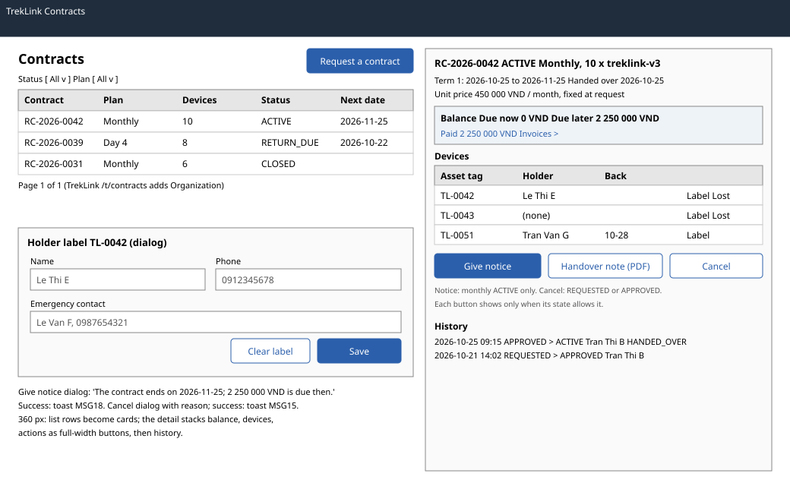

# `ContractDetailPage` and contract lists (`/o/contracts`, `/o/contracts/:id`, `/t/contracts/:id`)

| | |
|---|---|
| Owner | LongLP |
| Task | `specs/frontend/tasks.md` 5.2 |
| Assigned, due | 2026-10-21, 2026-10-23 |
| Status | Ready for review |
| Routes | `/o/contracts` and `/o/contracts/:id` (organization); `/t/contracts/:id` (TrekLink detail). The TrekLink list `/t/contracts` is the approval queue of screen 5.3 (`specs/frontend/design.md` §2). |
| Roles | Org Manager: list, detail, balance, history, handover note, give notice, cancel, holder labels, report a lost device. Org Operator: list and detail read-only plus holder labels; no balance, history, note, notice or cancel (rentals 13 is the only write the role holds). TrekLink Staff and Admin: detail with the organization line, balance, history, note and cancel; no notice and no holder labels. |
| Use case, FRs, story | UC-55, UC-18, UC-23, UC-25, UC-21 (note download); FR-CON-04, FR-CON-06, FR-CON-07, FR-CON-09, FR-CON-14, FR-BILL-06; US-UC18, US-UC23, US-UC25, US-UC55 |
| Requirements | `specs/rentals/requirements.md` REQ-UBI-01, REQ-UBI-03, REQ-UBI-05, REQ-EVT-03, REQ-EVT-08, REQ-EVT-15, REQ-ERR-06; `specs/auth/requirements.md` REQ-ERR-06 |
| Wireframe |  |

Scope from the task: rentals api-design 02, 03, 06, 11, 12, 13, 18 and billing api-design 10; cancel, notice (MSG18), holder labels, handover note download

## Data

| Shown | Source (api-design file, property) |
|---|---|
| List: code, plan (Monthly, or Day with its length), quantity, status, next date | rentals 02 `items[].code`, `planType`, `dayPlanDays`, `quantity`, `status`; next date is `currentTerm.endsAt`, else `returnDueAt`, else `requestedStartDate`; none once the contract is `REJECTED`, `CANCELLED`, `RETURNED` or `CLOSED` |
| List paging | rentals 02 `pageNumber`, `pageSize`, `totalCount`, `totalPages` |
| Organization (TrekLink detail only) | rentals 03 `organization.code`, `legalName` |
| Header: code, status, plan, quantity, variant | rentals 03 `code`, `status`, `planType`, `dayPlanDays`, `quantity`, `hardwareVariant.id`; the variant is named by its display name, billing 01 `variants[].name` matched on `id` (the name the request form shows, screen 5.1), and by `hardwareVariant.code` until that read answers or for a variant no longer listed (dry run 2026-10-30) |
| Dates: requested start, handover appointment, handed over, current term, notice given, ends, return due | rentals 03 `requestedStartDate`, `handoverAppointmentAt`, `handedOverAt`, `currentTerm.seq`, `startsAt`, `endsAt`, `noticeGivenAt`, `endsAt`, `returnDueAt` |
| Reservation expires, only while the contract is `APPROVED`: the reservation holds the units from approval to the handover (rentals REQ-EVT-02, REQ-EVT-14) | rentals 03 `reservationExpiresAt` |
| Prices fixed at request | rentals 03 `monthlyUnitPriceVnd`, `dayPremium`, `holdingFeeRatio` |
| Terms | rentals 03 `terms[].seq`, `startsAt`, `endsAt`, `status` |
| Devices: asset tag, holder, handed over, back, lost | rentals 03 `devices[].assetTag`, `holder.name`, `phone`, `emergencyContact`, `handedOverAt`, `checkedInAt`, `lostAt` |
| Balance: due now, due later, paid, damage charges awaiting approval | billing 10 `dueNowVnd`, `dueLaterVnd`, `paidVnd`, `pendingDamageCharges`, `settled` |
| History: date, from, to, actor, reason | rentals 18 `[].createdAt`, `fromStatus`, `toStatus`, `actor`, `reason` |
| Handover note integrity | rentals 11 `integrity`, `sha256` |

## Actions

| Control | Shown when | Endpoint | Confirmation | Success message |
|---|---|---|---|---|
| Request a contract (list header, primary) | Org Manager | navigation to `/o/contracts/new` (screen 5.1) | none | none |
| Filter by status or plan (list) | always | rentals 02 `GET /api/contracts?status=&planType=` | none | none |
| Give notice (detail, primary) | Org Manager, monthly, `ACTIVE` | rentals 12 `POST /api/contracts/:id/notice` | dialog: "The contract ends at the end of the current term, {currentTerm.endsAt}. The term balance is due then and the devices are returned at the counter." | toast MSG18 |
| Cancel contract (detail, secondary) | Org Manager or Staff, `REQUESTED` or `APPROVED` | rentals 06 `POST /api/contracts/:id/cancel` | dialog naming the contract code, with the reason field; it states that a holding fee already paid is retained | toast MSG15 with `retainedVnd` |
| Handover note (PDF) (detail) | Org Manager or Staff, after handover | rentals 11 `GET /api/contracts/:id/handover-note` | none | the PDF downloads; a hash mismatch (`integrity` other than `OK`) shows a red banner instead |
| Label (device row) | Org Manager or Operator, device out (not checked in, not lost), contract not `CLOSED` | rentals 13 `PUT /api/contracts/:id/devices/:deviceId/holder` | none | toast MSG03 |
| Clear label (label dialog) | the device has a label | rentals 13 with `name: null` | dialog: "Remove the holder label of {assetTag}?" | toast MSG03 |
| Lost (device row) | Org Manager, device out | opens the report form of screen 4.4 (devices 17 `POST /api/devices/:id/loss-cases`) | as in screen 4.4 | as in screen 4.4 |
| Invoices (balance box link) | Org Manager or Staff | navigation to `/o/invoices` or `/t/billing` filtered by the contract (screen 6.1) | none | none |
| Go to counter (TrekLink detail) | Staff, `APPROVED` or devices due back | navigation to `/t/counter/:contractId` (screens 5.4, 5.5) | none | none |

## States

| State | What the user sees |
|---|---|
| Loading | List skeleton rows; detail header, balance and device table skeletons |
| Empty | No contracts: "Your organization has no contracts yet." with Request a contract (Org Manager). With a filter: MSG01 |
| Error `VALIDATION_FAILED` (400, rentals 02, 06, 12, 13) | MSG02 under the field the server names |
| Error `INVALID_STATE_TRANSITION` (409, rentals 06, 12, 13) | MSG28 with the current state; the detail refetches |
| Error `STALE_VERSION` (409, rentals 06, 12) | MSG36 dialog with Reload |
| Error `DAY_PLAN_NO_NOTICE` (409, rentals 12) | The server's `message` ("A day plan ends on its own end date."); not reachable because Give notice is hidden on a day plan |
| Error `DEVICE_NOT_ON_CONTRACT` (409, rentals 13) | MSG12 |
| Error `NOTE_NOT_SIGNED` (409, rentals 11) | The server's `message` ("The handover is not complete yet."); not reachable because the button shows only after handover |
| Not found or forbidden | `NOT_FOUND` (404) or `FORBIDDEN` (403): MSG26 full page; another organization's contract answers 404 (auth REQ-ERR-06) |
| Success | Toast MSG18, MSG15 or MSG03; the detail, the balance and the list refetch |

## Form fields (if any)

| Step | Field | Type | Required | Rule |
|---|---|---|---|---|
| Cancel | Reason | text area | yes | not empty (rentals 06 `reason`) |
| Holder label | Name | text | no | empty name with the other fields empty clears the label (rentals 13 `name`) |
| Holder label | Phone | tel | no | (rentals 13 `phone`) |
| Holder label | Emergency contact | text | no | name and phone (rentals 13 `emergencyContact`) |

Give notice and cancel send the contract `version` as `expectedVersion` (rentals 06, 12). The holder
label is optional personal data and is erased when the contract closes (BR-33); the dialog says so.

## Mobile, accessibility, live data

- 360 px layout: list rows become cards (code, status label, plan, next date); the detail stacks the header, the balance box, the device cards with their row actions, the actions as full-width buttons at least 44 px high, then the history. Dialogs open full screen.
- Tab order and focus after each action: filters, list, pager; on the detail: header actions in the order of the table, then device rows. A dialog traps focus and returns it to its button. Status is a text label in the lifecycle palette (chapter 06 §8.3). Dates show the viewer's timezone with the zone on hover; VND with thousands separators (§8.8).
- WebSocket events: `device.label`, `device.handedOver` and `device.released` invalidate active `['contract', id]` queries by prefix, since label and release entries carry no contract id. Handover and release also invalidate the contract lists, balances and transitions; an expired replay refreshes all four groups. Position and telemetry do not refetch contract views. Query keys `['contracts', scope, filters]`, `['contract', id]`, `['contract-balance', id]`, `['contract-transitions', id]`; every mutation invalidates the first three.

## Checklist

Chapter 06 §7 (Screen Design Checklist) and §8 (UI and UX practices), ticked by the owner before review.

- [x] Route and roles match `design.md` §2; Operator read-only except holder labels; Staff without notice and labels
- [x] Data: every field names rentals 02, 03, 11, 18 or billing 10
- [x] Actions: notice (MSG18), cancel (MSG15), labels, note download, lost device, navigation
- [x] States: loading, empty, every error code of the eight endpoints, 403 and 404, success
- [x] Forms: cancel reason and holder label fields with type, requirement and rule
- [x] Mobile: 360 px layout described
- [x] Accessibility: focus trap and return, text status labels, timezone and VND formatting
- [x] Live data: `device.label`, `device.released`; query keys listed
- [x] Traceability: UC-18, UC-23, UC-25, UC-55; US-UC18, US-UC23, US-UC25, US-UC55
