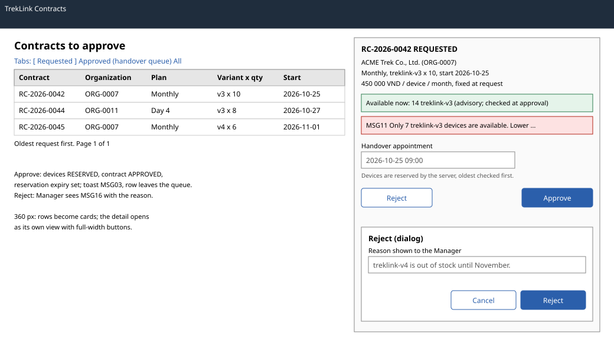

# `ContractApprovalPage` (`/t/contracts`)

| | |
|---|---|
| Owner | LongLP |
| Task | `specs/frontend/tasks.md` 5.3 |
| Assigned, due | 2026-10-21, 2026-10-23 |
| Status | Ready for review |
| Routes | `/t/contracts`, the approval queue, with the selected request in a side panel; a row link opens `/t/contracts/:id` (screen 5.2) (`specs/frontend/design.md` §2) |
| Roles | TrekLink Staff and Admin: the queue, availability, approve and reject. Organization accounts: MSG26 (TrekLink route). |
| Use case, FRs, story | UC-16, UC-17; FR-CON-03, FR-CON-04, FR-CON-11, FR-DEV-01; US-UC16, US-UC17 |
| Requirements | `specs/rentals/requirements.md` REQ-EVT-02, REQ-UBI-01, REQ-UBI-02, REQ-ERR-01, REQ-EVT-14 |
| Wireframe |  |

Scope from the task: rentals api-design 04 and 05; availability from devices api-design 24; MSG11 on shortfall

## Data

| Shown | Source (api-design file, property) |
|---|---|
| Queue: code, organization, plan, variant and quantity, requested start | rentals 02 with `status=REQUESTED`: `items[].code`, `organization.code`, `planType`, `dayPlanDays`, `hardwareVariant.id`, `quantity`, `requestedStartDate`; the variant here, in the request panel and in the availability banner is its display name, billing 01 `variants[].name` matched on `id`, else `hardwareVariant.code` (screen 5.2) |
| Tabs "Approved" (handover queue) and "All" | rentals 02 with `status=APPROVED`, and without a status |
| Request panel: organization name, prices fixed at request | rentals 02 `items[].organization.legalName`, `monthlyUnitPriceVnd`, `dayPremium`, `holdingFeeRatio` |
| Available devices of the requested variant (advisory) | devices 24 `[].code`, `available`, queried with `hardwareVariantId` |
| After approval: reserved devices and the reservation expiry | rentals 04 `result.devices[].assetTag`, `reservationExpiresAt` |

## Actions

| Control | Shown when | Endpoint | Confirmation | Success message |
|---|---|---|---|---|
| Select a row | always | none; opens the request panel and loads devices 24 for its variant | none | none |
| Approve (panel, primary) | `REQUESTED` | rentals 04 `POST /api/contracts/:id/approve` | none: the reservation is released by Cancel (screen 5.2) | toast MSG03; the panel lists the reserved asset tags and the reservation expiry; the row moves to the Approved tab |
| Reject (panel, secondary) | `REQUESTED` | rentals 05 `POST /api/contracts/:id/reject` | dialog naming the contract code with the reason field: "The Manager sees this reason." | toast MSG03; the Manager receives MSG16 with the reason |
| Open (row link) | always | navigation to `/t/contracts/:id` (screen 5.2) | none | none |
| Go to counter (Approved tab row) | `APPROVED` | navigation to `/t/counter/:contractId` (screen 5.4) | none | none |

Devices are chosen by the server, the oldest-checked first. rentals 04 also accepts an explicit
`deviceIds` list; this screen does not offer it, because choosing units needs the fleet list
(devices 06), which is outside this task's scope.

## States

| State | What the user sees |
|---|---|
| Loading | Queue skeleton rows; the availability banner shows a spinner while devices 24 runs; Approve and Reject show their pending state and are disabled until the server answers |
| Empty | "No contract requests are waiting." With a filter or another tab: MSG01 |
| Availability below the quantity (devices 24) | Amber banner "Only {available} {variant name} available now"; Approve stays enabled because the count is advisory and approval decides (FR-CON-03) |
| Error `VALIDATION_FAILED` (400, rentals 04, 05) | MSG02 under the field the server names |
| Error `INSUFFICIENT_DEVICES` (409, rentals 04) | MSG11 dialog with the available count and the variant; nothing is reserved (REQ-ERR-01) |
| Error `INVALID_STATE_TRANSITION` (409, rentals 04, 05) | MSG28 with the current state; the queue refetches (another Staff member acted first) |
| Error `STALE_VERSION` (409, rentals 04, 05) | MSG36 dialog with Reload |
| Not found or forbidden | `NOT_FOUND` (404) or `FORBIDDEN` (403): MSG26 |
| Success | Toast MSG03; the queue and the counts refetch |

## Form fields (if any)

| Step | Field | Type | Required | Rule |
|---|---|---|---|---|
| Approve | Handover appointment | date and time | yes | at the counter; prefilled with `requestedStartDate` at opening hours; sent as UTC (rentals 04 `handoverAt`); a time before the current minute is refused with 400 `VALIDATION_FAILED` (rentals REQ-ERR-09), shown under this field and cleared when the time changes |
| Reject | Reason | text area | yes | not empty; shown to the Manager (rentals 05 `reason`) |

Approve and Reject send the contract `version` as `expectedVersion` (rentals 04, 05).

## Mobile, accessibility, live data

- 360 px layout: queue rows become cards; selecting one opens the request panel as its own view with a Back button; Approve and Reject are full width and at least 44 px high.
- Tab order and focus after each action: tabs, queue, then the panel (appointment, Reject, Approve). After an approval or a rejection, focus moves to the next row of the queue, or to the empty state. The tabs are a `tablist`; the availability banner is `role="status"`.
- WebSocket events and invalidated query keys: no live events. Query keys `['contracts', 't', status, page]`, `['availability', variantId]`; Approve and Reject invalidate both and `['contract', id]`.

## Checklist

Chapter 06 §7 (Screen Design Checklist) and §8 (UI and UX practices), ticked by the owner before review.

- [x] Route and roles match `design.md` §2; organization accounts get MSG26
- [x] Data: every field names rentals 02, rentals 04 or devices 24
- [x] Actions: approve, reject with reason (MSG16 to the Manager), navigation
- [x] States: loading, empty, advisory shortfall, every error code of rentals 04 and 05, 403 and 404, success
- [x] Forms: appointment and reason with type, requirement and rule
- [x] Mobile: 360 px layout described
- [x] Accessibility: tablist, focus to the next row, status banner
- [x] Live data: none; query keys listed
- [x] Traceability: UC-16, UC-17, US-UC16, US-UC17
