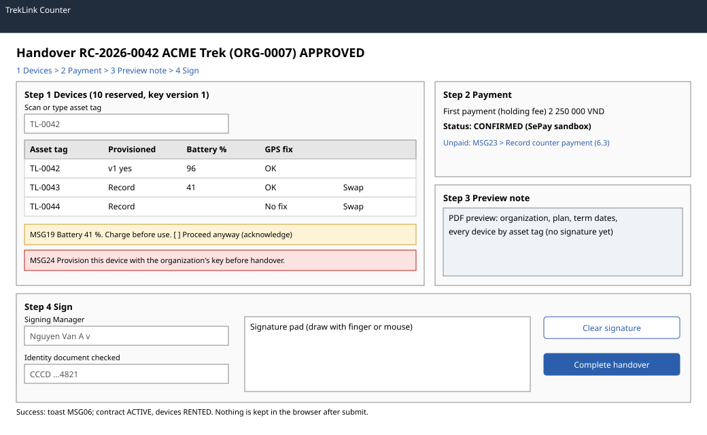

# `CounterPage` handover (`/t/counter/:contractId`)

| | |
|---|---|
| Owner | LongLP |
| Task | `specs/frontend/tasks.md` 5.4 |
| Assigned, due | 2026-10-21, 2026-10-23 |
| Status | Ready for review |
| Routes | `/t/counter/:contractId` for an `APPROVED` contract; the same route serves check-in for a contract with devices out (screen 5.5) (`specs/frontend/design.md` §2 and §5) |
| Roles | TrekLink Staff (and Admin, D-057 rule 7): the whole page. Organization accounts: MSG26. The Org Manager is present at the counter and signs on the Staff member's screen. |
| Use case, FRs, story | UC-14, UC-20, UC-21; FR-CON-05, FR-CON-06, FR-DEV-05, BR-09, E01-4, E01-5, D-037; US-UC14, US-UC20, US-UC21 |
| Requirements | `specs/rentals/requirements.md` REQ-EVT-04 to REQ-EVT-06, REQ-EVT-16, REQ-UBI-05, REQ-ERR-04, REQ-ERR-07, REQ-ERR-08, REQ-ERR-10 |
| Wireframe |  |

Scope from the task: rentals api-design 07 to 10 in four steps (design §5): devices with scan, provisioning, battery and GPS check and swap; payment status; preview note; signature pad (PNG) and identity field; nothing stored in the browser after submit

## Data

| Shown | Source (api-design file, property) |
|---|---|
| Header: contract code, organization, status, plan, variant, quantity, requested start | rentals 03 `code`, `organization.code`, `legalName`, `status`, `planType`, `hardwareVariant.code`, `quantity`, `requestedStartDate` |
| Reserved devices by asset tag | rentals 03 `devices[].deviceId`, `assetTag` |
| Organization's current key version (the version to write and record) | organizations 03 `channelKeyVersion` |
| Provisioning recorded per device | rentals 09 `result.keyVersion`, `provisionedAt` in this visit; after a reload, rentals 03 `devices[].provisionedKeyVersion` ("Provisioned v{n}", or "Not provisioned yet"); a unit undone in this visit shows "Not provisioned yet" whatever the contract read still says (rentals 19) |
| Contract version sent by the undo and the handover | rentals 03 `version`, or rentals 19 `result.contractVersion` when an undo answered a higher one |
| Swap result: released and newly reserved device | rentals 07 `released.assetTag`, `status`; `reserved.assetTag`, `status` |
| First payment: amount, paid, payment status and sandbox flag | billing 08 with `contractId` (`items[].id`, `status`); billing 09 `lines[]` of type `HOLDING_FEE` (monthly) or the day-plan fee line, `amountVnd`, `paidVnd`; `payments[].status`, `method`, `isSandbox` |
| Note preview (unsigned PDF), listing each unit's battery and GPS fix | rentals 08 `pdfBase64`, requested with `checks`: the step 1 readings of every unit with a valid battery (`deviceId`, `batteryPct`, `gpsFixOk`); a unit without one prints "not checked" |
| Signing Managers to choose from | organizations 12 `items` with `role` `MANAGER` and active, `id`, `fullName` |
| After completion: devices issued, note hash | rentals 10 `result.devices[].assetTag`, `handoverNoteSha256` |

## Actions

| Control | Step | Endpoint | Confirmation | Success message |
|---|---|---|---|---|
| Scan or type asset tag | 1 Devices | none; highlights the matching reserved row, MSG12 if the tag is not reserved to this contract | none | row focused |
| Record provisioning (row) | 1 Devices | rentals 09 `POST /api/contracts/:id/devices/:deviceId/provisioning` with the organization's `channelKeyVersion` | none | the row shows "Provisioned v{n}" |
| Undo (row, next to "Provisioned v{n}"; accessible name "Undo provisioning of {assetTag}") | 1 Devices | rentals 19 `POST /api/contracts/:id/devices/:deviceId/provisioning/undo` with the contract `version` as `expectedVersion`; shown only on a provisioned row, disabled while a row or bulk recording runs | `ConfirmDialog` "Undo the provisioning of {assetTag}?": "Use this when provisioning was recorded on the wrong unit. {assetTag} goes back to "Not provisioned yet" and its battery and GPS readings are cleared. Record it again before handover."; buttons Keep it and Undo provisioning (danger) | toast "Provisioning of {assetTag} undone. Record it again before handover."; the row shows "Not provisioned yet" with empty readings, and Next is held until it is recorded again |
| Select (row checkbox) and Select all units | 1 Devices | none; Select all is mixed when some units are selected, and shows "{n} of {total} selected" | none | none |
| Record provisioning for selected | 1 Devices | rentals 09, one call per selected unit in list order, one at a time; units already at the current `channelKeyVersion` are skipped without a call | none | progress "Recording provisioning: {done} of {total} done." while it runs; then "Recorded {n} of {total}." and the selection is cleared; a skipped unit adds "Skipped {assetTags}: already provisioned v{n}." |
| Set readings for selected | 1 Devices | none; writes the bulk battery, the bulk GPS fix or both into each selected row, and an empty bulk value leaves the row's value as it is | none | "Readings set on {n} units." |
| Swap (row) | 1 Devices | rentals 07 `POST /api/contracts/:id/devices/:deviceId/swap` | dialog: "Send {assetTag} to maintenance and reserve another {variant}?" with the reason field | toast MSG03; the row is replaced by the new asset tag, which needs its own provisioning and check |
| Record counter payment (link) | 2 Payment | navigation to screen 6.3 for the first invoice, returning here | none | none |
| Next and Back | all | none | none | none |
| Complete handover (primary) | 4 Sign | rentals 10 `POST /api/contracts/:id/handover` | none: the signed preview is the confirmation | toast MSG06; the page shows the issued devices and the note download (screen 5.2); the signature, identity text and preview are cleared from memory |
| Clear signature | 4 Sign | none | none | none |

## States

| State | What the user sees |
|---|---|
| Loading | Header and device table skeletons; each row action shows its pending state; Complete handover is disabled until the server answers |
| Empty | Not applicable: an `APPROVED` contract always has reserved devices |
| Before the start date | Amber banner "Handover is possible from {requestedStartDate}." (`BEFORE_START_DATE`); Complete handover disabled |
| Bulk provisioning running | Every row Record provisioning, the selection boxes and both bulk buttons are disabled; the unit being recorded shows "Recording…" and the bulk button "Recording {i} of {total}…" |
| Bulk provisioning refused | The run stops at the first refusal. The units recorded before it keep "Provisioned v{n}"; the failed row shows the server's message, mapped as for the single-row action (MSG12, MSG24, or the server's `message`); the selection keeps the failed unit and the units not reached, so the same button resumes; the note reads "Stopped at {assetTag}: {n} of {total} recorded. The selection keeps the unit that failed and the units not reached." |
| Error `VALIDATION_FAILED` (400, rentals 07, 08, 09, 10) | MSG02 under the field the server names |
| Error `DEVICE_NOT_ON_CONTRACT` (409, rentals 07, 09) | MSG12 |
| Error `KEY_VERSION_MISMATCH` (409, rentals 09) | MSG24; the page reloads organizations 03 for the current version |
| Error `INSUFFICIENT_DEVICES` (409, rentals 07) | MSG11 dialog: no replacement exists, so the handover is held (E01-5) |
| Error `FIRST_PAYMENT_MISSING` (409, rentals 10) | MSG23 on step 2, with the link to screen 6.3 |
| Error `DEVICE_NOT_PROVISIONED` (409, rentals 10) | MSG24 on the device row; step 1 opens |
| Error `DEVICE_CHECK_FAILED` (409, rentals 10) | MSG17 on the device row with Swap |
| Error `LOW_BATTERY` (409, rentals 10) | MSG19 amber banner on the row with "Proceed anyway"; resending sets `acknowledgeLowBattery` |
| Error `BEFORE_START_DATE` (409, rentals 10) | The server's `message` ("Handover is possible from {date}."); no SRS code |
| Error `SIGNER_NOT_MANAGER` (400, rentals 10) | The server's `message` under Signing Manager ("Only a Manager of the organization can sign."); no SRS code |
| Error `INVALID_STATE_TRANSITION` (409, rentals 07 to 10) | MSG28 with the contract's state |
| Error `STALE_VERSION` (409, rentals 10) | MSG36 dialog with Reload |
| Error `STALE_VERSION` (409, rentals 19) | The undo dialog closes; the page shows the MSG36 banner with Reload, and Complete handover is disabled until the reload |
| Error `DEVICE_NOT_PROVISIONED` (409, rentals 19) | The server's message in the undo dialog ("{assetTag} has no provisioning to undo."); the row shows "Not provisioned yet" and the contract is read again |
| Error `INVALID_STATE_TRANSITION` or `DEVICE_NOT_ON_CONTRACT` (409, rentals 19) | MSG28 or MSG12 in the undo dialog, which stays open with Keep it |
| Not found or forbidden | `NOT_FOUND` (404) or `FORBIDDEN` (403): MSG26 |
| Success | Toast MSG06; contract `ACTIVE`, devices `RENTED` |

## Form fields (if any)

| Step | Field | Type | Required | Rule |
|---|---|---|---|---|
| 1 Devices | Asset tag | text, scanner input | no | a tag reserved to this contract |
| 1 Devices | Battery %, per device | integer 0 to 100 | yes | below `devices.handoverMinBatteryPct` needs the acknowledgement (rentals 10 `deviceChecks[].batteryPct`) |
| 1 Devices | GPS fix, per device | checkbox | yes | a failed fix means Swap before handover (rentals 10 `deviceChecks[].gpsFixOk`) |
| 1 Devices | Battery % for selected | integer 0 to 100 | no | same rule as the row field; a value outside it shows "Enter the battery as a whole number from 0 to 100." and changes no row |
| 1 Devices | GPS fix for selected | select: Leave as is, GPS fix, No GPS fix | no | with the battery empty and Leave as is, Set readings asks for one of the two |
| 1 Devices | Swap reason | text, in the swap dialog | yes | what failed (rentals 07 `reason`) |
| 2 Payment | none | | | read-only status |
| 3 Preview note | none | | | read-only PDF |
| 4 Sign | Signing Manager | select | yes | an active Manager of the organization (rentals 10 `signedByMemberId`) |
| 4 Sign | Identity document checked | text | yes | document type and last digits seen, never the full number (rentals 10 `identityChecked`) |
| 4 Sign | Signature | signature pad, PNG | yes | not blank (rentals 10 `signaturePng`) |

Four steps (`design.md` §5, NFR-USE-01). Step 1 holds one row per reserved device with a selection
box and two inputs each, the scan field, and the bulk bar (Select all, Record provisioning for
selected, the bulk battery and GPS fix with Set readings for selected), so five units need one
selection, one provisioning click and one readings click (dry run defect 4, 2026-10-30). The
single-row actions stay. A provisioned row carries Undo, which asks first and then clears the record and the
unit's readings (rentals 19, dry run defect 5, 2026-10-30). The other steps have at most three fields. The request sends the contract
`version` as `expectedVersion`. Nothing is stored in the browser after submit: no `localStorage`,
`sessionStorage` or cache entry holds the signature or the identity text.

## Mobile, accessibility, live data

- 360 px layout: the counter runs on a desktop or tablet; on a narrow screen the steps stack, the device table becomes one card per device with its selection box, inputs and actions, the bulk bar wraps above the cards, and the signature pad takes the full width at a fixed height.
- Tab order and focus after each action: the scan field has focus on step 1 and keeps it after each scan; the matching row is announced. Next moves focus to the next step's heading. The signature pad has a text alternative ("Signature area, drawn by the Manager") and Clear signature next to it; Complete handover follows it. Errors are announced and move focus to the failing row or field.
- WebSocket events and invalidated query keys: no live events. Query keys `['contract', id]`, `['organization', orgId]`, `['org-members', orgId]`, `['invoices', { contractId }]`, `['invoice', invoiceId]`, `['handover-preview', id, checks]` (the readings are part of the key, so changed readings render a new preview); every mutation invalidates `['contract', id]`; completion also invalidates `['contracts', ...]` and removes `['handover-preview', id]`.

## Checklist

Chapter 06 §7 (Screen Design Checklist) and §8 (UI and UX practices), ticked by the owner before review.

- [x] Route and roles match `design.md` §2 and §5; organization accounts get MSG26
- [x] Data: every field names rentals 03, 07 to 10, 19, organizations 03 and 12, or billing 08 and 09
- [x] Actions: scan, provisioning (row and selected) and its undo (row, with a confirmation), readings for the selected units, swap, payment link, complete handover (MSG06)
- [x] States: loading, start-date banner, every error code of rentals 07 to 10 and 19, 403 and 404, success
- [x] Forms: four steps, with type, requirement and rule per field; nothing kept after submit
- [x] Mobile: narrow layout described
- [x] Accessibility: scan focus, step headings, signature pad text alternative, announced errors
- [x] Live data: none; query keys listed
- [x] Traceability: UC-14, UC-20, UC-21; US-UC14, US-UC20, US-UC21
