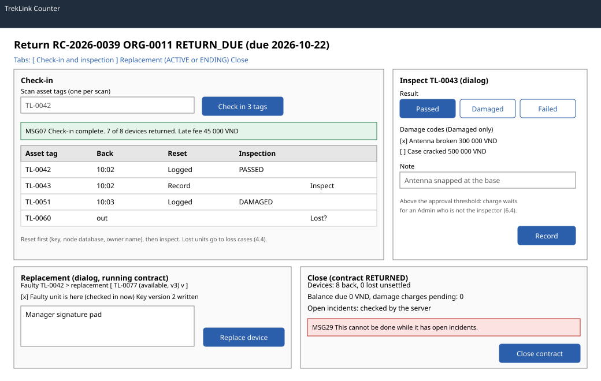

# Check-in, inspection, replacement, close (`/t/counter/:contractId`)

| | |
|---|---|
| Owner | LongLP |
| Task | `specs/frontend/tasks.md` 5.5 |
| Assigned, due | 2026-10-21, 2026-10-23 |
| Status | Ready for review |
| Routes | `/t/counter/:contractId` for a contract with devices out or back; the handover of an `APPROVED` contract is screen 5.4 on the same route (`specs/frontend/design.md` §2) |
| Roles | TrekLink Staff (and Admin, D-057 rule 7): check-in, reset, inspection, replacement and close. Organization accounts: MSG26. The Org Manager signs a replacement on the Staff member's screen. |
| Use case, FRs, story | UC-43, UC-44, UC-47, UC-51, UC-61; FR-CON-13 to FR-CON-15, FR-DEV-07, FR-BILL-03, FR-BILL-04, FR-MON-08, BR-27, BR-28, BR-41, E05-1, E05-7; US-UC43, US-UC44, US-UC51, US-UC61 |
| Requirements | `specs/rentals/requirements.md` REQ-EVT-09 to REQ-EVT-11, REQ-EVT-15, REQ-STA-01, REQ-ERR-05, REQ-ERR-07 |
| Wireframe |  |

Scope from the task: rentals api-design 14 to 17; check-in by scan (MSG07); inspection with damage codes; replacement of a faulty or lost unit with a signed note; close with MSG29 on open incidents

## Data

| Shown | Source (api-design file, property) |
|---|---|
| Header: code, organization, status, return due | rentals 03 `code`, `organization.code`, `status`, `returnDueAt` |
| Devices: asset tag, back time, lost | rentals 03 `devices[].assetTag`, `checkedInAt`, `lostAt` |
| Check-in result: tags taken, returned of total, contract state, late fee | rentals 14 `checkedIn`, `returned`, `total`, `contractStatus`, `lateFeeVnd` |
| Inspection result, device state, damage charge and its state | rentals 16 `inspection.result`, `damageCodes`; `device.status`; `damageCharge.amountVnd`, `status` |
| Damage codes with label and amount | billing 05 `[].code`, `label`, `amountVnd`, filtered by the contract's variant |
| Replacement choices: available units of the variant | devices 06 with status `AVAILABLE` and the contract's variant, `items[].id`, `assetTag` |
| Organization's current key version for the replacement | organizations 03 `channelKeyVersion` |
| Replacement result and note hash | rentals 15 `replacementDeviceId`, `noteSha256` |
| Close pre-check: due now, pending damage charges | billing 10 `dueNowVnd`, `pendingDamageCharges`, `settled` |

## Actions

| Control | Shown when | Endpoint | Confirmation | Success message |
|---|---|---|---|---|
| Check in (tags scanned so far, primary on the check-in tab) | `ENDING`, `RETURN_DUE`, `OVERDUE`, `DEFAULTED`, or `ACTIVE` on a day plan (REQ-STA-01) | rentals 14 `POST /api/contracts/:id/check-ins` | none | MSG07; the late fee, if any, shows under it |
| Record reset (device row) | device back, no reset logged | devices 10 `POST /api/devices/:id/reset` | none: the three boxes are the confirmation | the row shows "Reset logged" with the time; the state comes from `devices[].resetAt` of rentals 03, so it survives a reload, and 409 `ALREADY_RESET` (reset by another counter) is treated as logged: the toast says "Already reset. It was recorded by someone else." in place of "Saved." and the row is refreshed from rentals 03 |
| Inspect (device row) | reset logged, not inspected | rentals 16 `POST /api/contracts/:id/devices/:deviceId/inspection` | none | toast MSG03; the row shows the result and the device's new state; after a reload the result comes from `devices[].inspection` of rentals 03 |
| Lost? (device row, still out) | device out | navigation to the loss case report of screen 4.4 | as in screen 4.4 | as in screen 4.4 |
| Replace device (replacement tab, primary) | `ACTIVE` or `ENDING`, a faulty unit or one with an open loss case | rentals 15 `POST /api/contracts/:id/devices/:deviceId/replacement` | the Manager's signature is the confirmation | toast MSG03; the new asset tag joins the device list |
| Close contract (close tab, primary) | `RETURNED` | rentals 17 `POST /api/contracts/:id/close` | dialog: "Close contract {code}? Holder labels are erased." (rentals 17, FR-CON-14) | toast MSG03; the contract shows `CLOSED` |

## States

| State | What the user sees |
|---|---|
| Loading | Header and device table skeletons; each action shows its pending state and is disabled until the server answers |
| Empty | Not applicable: the contract always has devices |
| Monthly `ACTIVE` contract | Check-in is disabled with "A running monthly contract cannot return devices. Give notice first." (REQ-STA-01); replacement stays available |
| Error `VALIDATION_FAILED` (400, rentals 14 to 17, devices 10) | MSG02 under the field the server names |
| Error `DEVICE_NOT_ON_CONTRACT` (409, rentals 14, 15, 16) | MSG12 with the scanned tag; the other tags stay in the scan list |
| Error `RESET_INCOMPLETE` (400, devices 10) | The server's `message` ("Complete every reset step first."); not reachable because Record reset needs all three boxes |
| Error `RESET_REQUIRED` (409, rentals 16) | The server's `message` ("Reset this device before inspecting it."); the row's Record reset is highlighted |
| Error `UNKNOWN_DAMAGE_CODE` (400, rentals 16) | The server's `message`; the damage codes reload from billing 05 |
| Error `VARIANT_MISMATCH` (409, rentals 15) | The server's `message` ("Choose a unit of the same variant.") under the replacement field |
| Error `DEVICE_NOT_AVAILABLE` (409, rentals 15) | MSG17 under the replacement field; the choices reload |
| Error `ORGANIZATION_NOT_ACTIVE` (409, rentals 15) | MSG28 with the organization's state |
| Error `BALANCE_OUTSTANDING` (409, rentals 17) | MSG29 with dependency "balances", with a link to the contract's invoices (screen 6.1) and pending damage charges (screen 6.4) |
| Error `OPEN_INCIDENTS` (409, rentals 17) | MSG29 with dependency "incidents" (E05-7) |
| Error `INVALID_STATE_TRANSITION` (409, rentals 14 to 17) | MSG28 with the current state; the page refetches |
| Error `STALE_VERSION` (409, rentals 17) | MSG36 dialog with Reload |
| Not found or forbidden | `NOT_FOUND` (404) or `FORBIDDEN` (403): MSG26 |
| Success | MSG07 for check-in, toast MSG03 for the others; the page refetches |

## Form fields (if any)

| Step | Field | Type | Required | Rule |
|---|---|---|---|---|
| Check-in | Asset tags | scanner input, collected into a list | yes | at least one tag (rentals 14 `assetTags`) |
| Reset | Channel key removed, node database cleared, owner name cleared | three checkboxes | yes | all three ticked (devices 10 `keyRemoved`, `nodeDbCleared`, `ownerCleared`) |
| Inspect | Result | segmented control: Passed, Damaged, Failed | yes | (rentals 16 `result`) |
| Inspect | Damage codes | checkboxes with amounts from billing 05 | for Damaged | at least one active code (rentals 16 `damageCodes`) |
| Inspect | Note | text area | no | (rentals 16 `note`) |
| Replacement | Replacement unit | select of available units of the variant | yes | (rentals 15 `replacementDeviceId`) |
| Replacement | Faulty unit is here | checkbox | yes | ticked checks the faulty unit in now (rentals 15 `faultyPresent`) |
| Replacement | Key version written | number, prefilled from organizations 03 | yes | equals the organization's `channelKeyVersion` (rentals 15 `keyVersion`) |
| Replacement | Manager signature | signature pad, PNG | yes | not blank (rentals 15 `signatureImage`) |

Each dialog has at most four fields. Close sends the contract `version` as `expectedVersion`. The
replacement signature is cleared from memory after submit, as for the handover (screen 5.4).

## Mobile, accessibility, live data

- 360 px layout: the counter runs on a desktop or tablet; on a narrow screen the tabs become a select, the device table becomes one card per device with its row actions, and dialogs open full screen.
- Tab order and focus after each action: the scan field keeps focus after each scan and announces the tag added; after Check in, focus moves to the MSG07 result. Row actions follow the asset tag in each row. The inspect and replacement dialogs trap focus and return it to their row. The result and damage controls are labelled groups; the signature pad has a text alternative.
- WebSocket events and invalidated query keys: no live events on TrekLink counter screens. Query keys `['contract', id]`, `['contract-balance', id]`, `['damage-rates', variantId]`, `['devices', { status: 'AVAILABLE', variantId }]`; every mutation invalidates `['contract', id]` and `['contract-balance', id]`.

## Checklist

Chapter 06 §7 (Screen Design Checklist) and §8 (UI and UX practices), ticked by the owner before review.

- [x] Route and roles match `design.md` §2; organization accounts get MSG26
- [x] Data: every field names rentals 03, 14 to 17, devices 06 and 10, billing 05 and 10, or organizations 03
- [x] Actions: check-in (MSG07), reset, inspection, replacement with signature, close (MSG29 on blockers)
- [x] States: loading, monthly-active rule, every error code of rentals 14 to 17 and devices 10, 403 and 404, success
- [x] Forms: every field with type, requirement and rule; at most four per dialog
- [x] Mobile: narrow layout described
- [x] Accessibility: scan focus, labelled groups, focus trap and return, signature text alternative
- [x] Live data: none; query keys listed
- [x] Traceability: UC-43, UC-44, UC-51, UC-61; US-UC43, US-UC44, US-UC51, US-UC61
