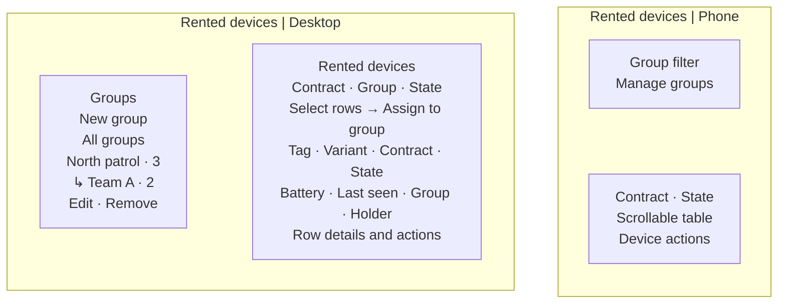

# Rented-device console with groups (`/o/devices`)

| | |
|---|---|
| Owner | LongLP |
| Task | `specs/frontend/tasks.md` 5.7 (rentals Phase 9, monitoring 7.1, incidents 9.1; treklink-web#305) |
| Assigned, due | 2026-11-02, spec 2026-11-03, build W10 |
| Status | Ready for review |
| Routes | `/o/devices` (new, `specs/frontend/design.md` §2); the group filter also on `/o/map` and `/o/incidents` |
| Roles | Org Manager: the whole page. Org Operator: no console (the navigation entry is hidden, a direct visit is MSG26); reads the groups for the filter on the map and the incident list. TrekLink Staff and other organizations: MSG26 |
| Use case, FRs, story | UC-66, UC-67, UC-68, UC-69; FR-CON-16 to FR-CON-19, FR-MON-11, BR-46, E04-8; BM04 F-11, F-21; US-UC66, TK-192 |
| Requirements | rentals REQ-EVT-20 to REQ-EVT-25, REQ-ERR-13 to REQ-ERR-16; monitoring REQ-EVT-09, REQ-UBI-05; incidents REQ-UBI-06 |
| Wireframe | The layout below was rendered and visually checked under D-067. Desktop uses a 280 px group tree beside the device table. On a phone the group filter and management controls appear above the scrollable table |

Scope from the task: monitoring api-design 09; rentals api-design 22 to 29; the device list with its filters, the
group tree and its dialogs, assignment, Report fault, and the group filter on the map and the incident list.

## Wireframe

The rendered layout was checked against `RentedDevicesPage`, `GroupTree` and monitoring api-design 09
on 2026-11-05. The implemented screen was also inspected at 1440 px and 390 px with local mocked data.

## Data

| Shown | Source (api-design file, property) |
|---|---|
| Device rows: asset tag, variant, contract code and plan, state, battery, last seen, group, holder | monitoring 09 `items[].assetTag`, `variantCode`, `contract.code`, `contract.planType`, `state`, `batteryPct`, `lastSeenAt`, `group.name`, `holder.name` |
| Open fault report and open loss case marks on a row | monitoring 09 `openFaultReportId`, `openLossCase.code` |
| Group tree: name, label, dates, device count, subgroups | rentals 22 `[].name`, `label`, `startsOn`, `endsOn`, `deviceCount`, `children[]` |
| Fault reports of a contract (row detail) | rentals 29 `[].description`, `reportedAt`, `resolvedAt`, `resolution` |
| Depth cap in the parent picker and MSG40 | rentals 22 `maxDepth` |

## Actions

| Control | Shown when | Endpoint | Confirmation | Success message |
|---|---|---|---|---|
| Filter by contract, group, state | always; the group filter offers "No group" (`groupId=none`) | monitoring 09 `?contractId=&groupId=&state=` | none | none |
| New group (tree header) | always | opens the group dialog | none | none |
| Save group (dialog, primary) | as above | rentals 23 `POST /api/groups` | none | toast MSG03; the tree refetches |
| Edit (tree node menu) | always | rentals 24 `PATCH /api/groups/:id` with `version` | none | toast MSG03 |
| Remove (tree node menu) | always | rentals 25 `DELETE /api/groups/:id` | alert dialog: "Remove {name}? Its {n} subgroups go with it, and its {m} devices become ungrouped." | toast MSG03; tree and table refetch |
| Select rows, then Assign to group (bulk bar) | one or more rows selected | rentals 26 `POST /api/groups/:id/devices` with `deviceIds` | dialog with the group picker | toast "{n} devices moved to {group}."; table and tree refetch |
| Fault history (row action) | always | rentals 29, filtered to this device | none | none |
| Remove from group (row action) | always; disabled without a group or while saving a group change, with the reason | rentals 27 `DELETE /api/groups/:id/devices/:deviceId` | none | toast MSG03 |
| Report fault (row action) | always; disabled with a reason when a fault or loss case is already open | rentals 28 `POST /api/contracts/:id/devices/:deviceId/fault-reports` | the dialog itself | toast MSG41 |
| Report lost, Label holder (row actions) | always; disabled on a closed contract; Report lost is also disabled for an open loss case | devices 17, rentals holder label | as on screens 4.4 and 5.2 | as there |
| Give notice (row action) | always; disabled with a reason outside a monthly `ACTIVE` contract | opens the notice dialog of screen 5.2 | as there | MSG18 |
| Group filter (`/o/map`, `/o/incidents`) | the organization has a group | monitoring 02 `?groupId=`, incidents 01 `?groupId=` | none | none |

## States

| State | What the user sees |
|---|---|
| Loading | Skeleton rows in the table and three skeleton nodes in the tree |
| Empty | No devices held: MSG01 "Your organization holds no devices right now." No groups: "No groups yet. Create one to sort your devices." With a filter: MSG01 with Clear filters |
| Error `VALIDATION_FAILED` (400, rentals 23, 24, 26, 28) | MSG02 under the field the server names; MSG35 under End date |
| Error `CONFLICT_UNIQUE` (409, rentals 23, 24) | MSG10 under Name: a group of that name already sits there |
| Error `GROUP_DEPTH_EXCEEDED` (409, rentals 23, 24) | MSG40 dialog with the cap; the parent picker already lists only allowed parents, so only a forced request or a cap lowered meanwhile reaches it |
| Error `STALE_VERSION` (409, rentals 24) | "Someone else changed this group. Reload to see the latest." with Reload |
| Error `DEVICE_NOT_HELD` (409, rentals 26) | "This device is not held by your organization now." in the assign dialog, naming the device; nothing moved; the table refetches (the unit was checked in meanwhile) |
| Error `FAULT_ALREADY_REPORTED` (409, rentals 28) | "A fault on {tag} is already reported and waits for TrekLink." with the report time |
| Error `INVALID_STATE_TRANSITION` (409, rentals 28) | MSG28 with the device state |
| Not found or forbidden | `NOT_FOUND` (404) or `FORBIDDEN` (403): MSG26 |
| Success | Toast; the table and the tree refetch |

## Form fields (if any)

| Step | Field | Type | Required | Rule |
|---|---|---|---|---|
| Group | Name | text | yes | 1 to 80 characters, unique under the same parent (rentals 23 `name`) |
| Group | Parent | select: "None (top level)" and the groups that may take a child | no | depth below `maxDepth` (rentals 23 `parentId`) |
| Group | Label | text | no | at most 80 characters, for example "ranger patrol" or "tour" (rentals 23 `label`) |
| Group | Start and end dates, area note | date, date, text area | no | end not before start; note at most 500 characters (rentals 23 `startsOn`, `endsOn`, `areaNote`) |
| Assign | Group | select | yes | a live group of the organization (rentals 26) |
| Report fault | What is wrong | text area | yes | 1 to 1000 characters (rentals 28 `description`) |

The group form has four fields when the dates and the area note are counted as one optional "Details" section,
collapsed by default.

## Mobile, accessibility, live data

- Every device row keeps the same six action slots in the same menu order, under UI standard §8.3.
  Disabled items remain focusable and expose their reason. Below 1440 px, variant and battery fold
  beneath the asset tag and state instead of occupying separate columns. All values remain available,
  the asset tag stays on one line and the Actions column fits at 1280 px without a sideways scroll.
- At ordinary viewport heights, the page fills the shell content area. The group list and table scroll
  inside their panes, with the title, filters and pagination outside the row scroll area. Below 480 CSS px
  height, the fixed shell bars release and the document can extend vertically so every control remains reachable.
  On phones from 480 to 740 CSS px high, group controls fold behind a toggle showing the current group.
  The opened controls scroll inside a floating panel capped at 40 percent of the viewport height.
  Selecting a group or pressing Escape closes it and returns focus to the toggle. Contract and state filters
  sit side by side, preserving at least one complete device row below the pinned table header.
  The 2026-11-05 review checked both themes at 1440, 1280, 900, 360 and 320 px widths and at
  318 by 236 CSS px, a 400 percent reflow-equivalent viewport. Screenshots and limits are recorded in
  [the PR review evidence](../../../docs/review-evidence/pr-395/README.md).
- 360 px layout: the tree becomes a group select above the table; the table scrolls sideways (the `DataTable`
  narrow layout); dialogs open full screen with full-width buttons at least 44 px high.
- Tab order and focus after each action: tree, filters, table. The tree is a `tree` with `treeitem` nodes and
  arrow-key navigation; selecting a node filters the table and announces the count. Dialogs trap focus and return
  it to their button; after a removal, focus moves to the parent node or the tree header. State is a text label,
  battery a number with its unit, never colour alone.
- WebSocket events and invalidated query keys: `device.groupChanged` and `device.label` invalidate
  `['rented-devices', filters]`; poll mode (D-089) refetches on the 15 s cadence like the map. Query keys
  `['rented-devices', filters]`, `['groups']`, `['fault-reports', contractId]`; a group change invalidates
  `['groups']` and `['rented-devices']`, an assignment both and the map snapshot.

## Checklist

Chapter 06 §7 (Screen Design Checklist) and §8 (UI and UX practices), ticked by the owner before review.

- [x] Route and roles match `design.md` §2; the console is the Manager's; members get the group filter
- [x] Data: every field names monitoring 09 or rentals 22 to 29
- [x] Actions: group create, edit, remove, assign, unassign, fault report, with their confirmations and messages
- [x] States: loading, empty, every error code of rentals 22 to 29, 403 and 404
- [x] Forms: every field with type, requirement and rule
- [x] Mobile: narrow layout described
- [x] Accessibility: tree semantics, focus trap and return, text labels
- [x] Live data: events and query keys listed
- [x] Traceability: UC-66 to UC-69, FR-CON-16 to FR-CON-19, FR-MON-11
