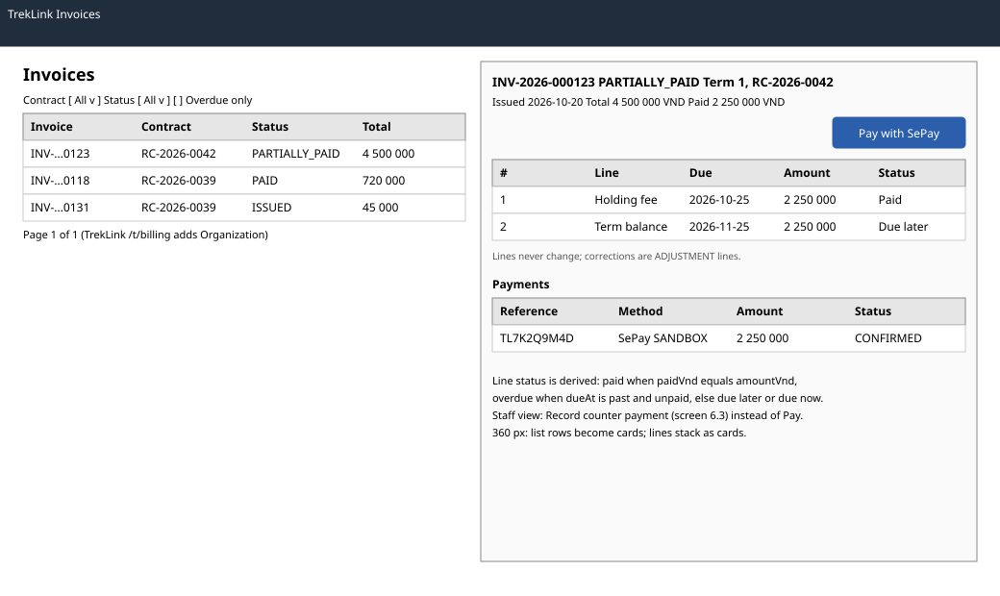

# `InvoicePage` and invoice list (`/o/invoices`, `/o/invoices/:id`, `/t/billing`)

| | |
|---|---|
| Owner | LongLP |
| Task | `specs/frontend/tasks.md` 6.1 |
| Assigned, due | 2026-10-21, 2026-10-23 |
| Status | Ready for review |
| Routes | `/o/invoices` and `/o/invoices/:id` (organization); the invoice tab of `/t/billing` with the same detail in a side panel (TrekLink) (`specs/frontend/design.md` §2) |
| Roles | Org Manager: the organization's invoices, Pay with SePay. TrekLink Staff and Admin: every organization's invoices with the organization column, Record counter payment (screen 6.3). Org Operator: MSG26 (billing 08 and 09 grant no Operator access). |
| Use case, FRs, story | UC-55, UC-45; FR-BILL-06, FR-AUTH-11, NFR-UI-03; US-UC55 |
| Requirements | `specs/billing/requirements.md` REQ-UBI-02, REQ-UBI-04, REQ-EVT-02, REQ-EVT-03, REQ-STA-02; `specs/frontend/requirements.md` REQ-UBI-08 |
| Wireframe |  |

Scope from the task: billing api-design 08, 09; lines with due dates and status

## Data

| Shown | Source (api-design file, property) |
|---|---|
| List: number, kind and term, contract, status, total, paid, issued | billing 08 `items[].number`, `kind`, `term.seq`, `contract.code`, `status`, `totalVnd`, `paidVnd`, `issuedAt` |
| List paging | billing 08 `pageNumber`, `pageSize`, `totalCount`, `totalPages` |
| Organization (TrekLink list only) | billing 08 `items[].organizationId`, shown by code from the cached organizations list (screen 3.2) |
| Detail header | billing 09 `number`, `status`, `kind`, `term.seq`, `contract.code`, `issuedAt`, `totalVnd`, `paidVnd` |
| Lines: number, type, description, quantity, unit, amount, due date, paid | billing 09 `lines[].seq`, `type`, `description`, `quantity`, `unitVnd`, `amountVnd`, `dueAt`, `paidVnd` |
| Line status, derived on the client | Paid when `paidVnd` equals `amountVnd`; Overdue when `dueAt` is past and not paid; Due now when `dueAt` is today or past; else Due later |
| Payments: reference, method, amount, status, sandbox label, confirmed | billing 09 `payments[].reference`, `method`, `amountVnd`, `status`, `isSandbox`, `confirmedAt` |

## Actions

| Control | Shown when | Endpoint | Confirmation | Success message |
|---|---|---|---|---|
| Filter by contract, status, overdue only | always | billing 08 `GET /api/invoices?contractId=&status=&overdue=` | none | none |
| Open an invoice (row) | always | billing 09 `GET /api/invoices/:id` | none | none |
| Pay with SePay (detail, primary) | Org Manager, an unpaid amount is due now | navigation to `/o/pay/:paymentId` after billing 11 creates the payment (screen 6.2) | none | none |
| Record counter payment (detail) | TrekLink Staff or Admin, an unpaid line | opens the form of screen 6.3 for this invoice | none | none |
| Contract link | always | navigation to the contract (screen 5.2) | none | none |

## States

| State | What the user sees |
|---|---|
| Loading | List skeleton rows; detail header and line table skeletons |
| Empty | No invoices: "No invoices yet. Invoices appear when TrekLink approves a contract." With a filter: MSG01 |
| Error `VALIDATION_FAILED` (400, billing 08) | MSG02 next to the filter the server names; the filters reset |
| Error `UNAUTHENTICATED` (401) | `apiClient` refreshes once and retries, else `/sign-in` (frontend REQ-EVT-02) |
| Not found or forbidden | `NOT_FOUND` (404, billing 09) or `FORBIDDEN` (403): MSG26 full page; another organization's invoice answers 404 (auth REQ-ERR-06) |
| Sandbox payment | Amber `SANDBOX` label on the payment row, never in a tooltip (NFR-UI-03, chapter 06 §8.10) |
| Success | The list and the detail show the server's figures; a payment made elsewhere shows after refetch |

## Form fields (if any)

| Step | Field | Type | Required | Rule |
|---|---|---|---|---|
| Filters | Contract | select of the organization's contracts | no | (billing 08 `contractId`) |
| Filters | Status | select of invoice statuses | no | (billing 08 `status`) |
| Filters | Overdue only | checkbox | no | (billing 08 `overdue`) |

## Mobile, accessibility, live data

- 360 px layout: list rows become cards (number, contract, status label, total, paid); the detail stacks the header, Pay with SePay as a full-width button at least 44 px high, the lines as cards and the payments.
- Tab order and focus after each action: filters, list, pager, then the detail (primary action, lines, payments). Opening an invoice moves focus to its heading. Statuses are text labels in the billing palette (chapter 06 §8.3); amounts are VND with thousands separators and right-aligned; due dates show the viewer's timezone (§8.8).
- WebSocket events and invalidated query keys: no live events. Query keys `['invoices', scope, filters]` and `['invoice', id]`; a confirmed payment (screen 6.2 or 6.3) invalidates both and `['contract-balance', contractId]`.

## Checklist

Chapter 06 §7 (Screen Design Checklist) and §8 (UI and UX practices), ticked by the owner before review.

- [x] Route and roles match `design.md` §2; Org Operator gets MSG26
- [x] Data: every field names billing 08 or 09; line status rule stated
- [x] Actions: filters, open, pay (screen 6.2), counter payment (screen 6.3)
- [x] States: loading, empty, every error code of billing 08 and 09, 403 and 404, sandbox label
- [x] Forms: filter fields with type and rule
- [x] Mobile: 360 px layout described
- [x] Accessibility: focus on open, text status labels, VND and timezone formatting
- [x] Live data: none; query keys listed
- [x] Traceability: UC-55, US-UC55
