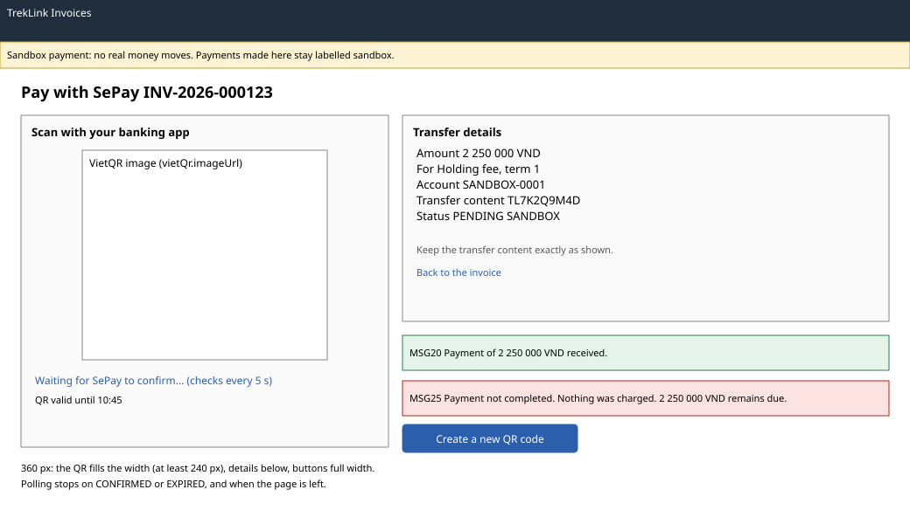

# SePay payment page (`/o/pay/:paymentId`)

| | |
|---|---|
| Owner | LongLP |
| Task | `specs/frontend/tasks.md` 6.2 |
| Assigned, due | 2026-10-21, 2026-10-23 |
| Status | Ready for review |
| Routes | `/o/pay/:paymentId`, opened from Pay with SePay on an invoice (screen 6.1) (`specs/frontend/design.md` §2) |
| Roles | Org Manager only (billing 11 is Org Manager: own). Org Operator: MSG26. TrekLink accounts may read a payment (billing 15) but never pay; they see payments on screens 6.1 and 6.3. |
| Use case, FRs, story | UC-19; FR-BILL-07, FR-BILL-09, BR-34, NFR-UI-03, E05-4; US-UC19 |
| Requirements | `specs/billing/requirements.md` REQ-UBI-04, REQ-EVT-08, REQ-EVT-09, REQ-STA-01, REQ-ERR-02; `specs/frontend/requirements.md` REQ-UBI-08 |
| Wireframe |  |

Scope from the task: billing api-design 11, 15; VietQR image labelled sandbox; poll the payment until `CONFIRMED` (MSG20) or `EXPIRED` (MSG25)

## Data

| Shown | Source (api-design file, property) |
|---|---|
| QR code image | billing 11 `result.vietQr.imageUrl`, held in router state from the create call |
| Account and transfer content | billing 11 `result.vietQr.bankAccount`, `vietQr.content` |
| Amount, reference, expiry | billing 11 `amountVnd`, `reference`, `expiresAt`; then billing 15 the same properties |
| Status and sandbox label | billing 15 `status` (`PENDING`, `CONFIRMED`, `EXPIRED`), `isSandbox` |
| Confirmed time | billing 15 `confirmedAt` |
| What is paid (line and invoice) | the invoice of screen 6.1 (billing 09 `number`, `lines[]`), carried in router state |

billing 15 does not return the VietQR block. After a reload the page shows the status, amount and
reference from billing 15 and asks the Manager to return to the invoice for the QR code.

## Actions

| Control | Shown when | Endpoint | Confirmation | Success message |
|---|---|---|---|---|
| Pay with SePay (on screen 6.1) | an amount is due now | billing 11 `POST /api/invoices/:id/payments/sepay`, optionally with `lineSeq` | none | navigation to this page with the QR |
| Status check (automatic, every 5 seconds while `PENDING` and the page is visible) | `PENDING` | billing 15 `GET /api/payments/:id` | none | `CONFIRMED`: MSG20 panel, polling stops, the invoice and balance refetch |
| Expiry | `EXPIRED` from billing 15, or `expiresAt` passed | none | none | MSG25 panel, polling stops |
| Create a new QR code | `EXPIRED` | billing 11 again for the same invoice | none | the page shows the new payment |
| Back to the invoice | always | navigation to `/o/invoices/:id` (screen 6.1) | none | none |

## States

| State | What the user sees |
|---|---|
| Loading | QR placeholder and detail skeleton until billing 11 or 15 answers |
| Pending | QR, transfer details, "Waiting for SePay to confirm" with a spinner, the time the QR stays valid |
| Confirmed | MSG20 panel with the amount; the QR is removed |
| Expired | MSG25 panel with the amount still due and Create a new QR code (REQ-STA-01, E05-4) |
| Empty | Not applicable |
| Error `VALIDATION_FAILED` (400, billing 11) | MSG02; not reachable from the invoice page |
| Error `NOTHING_DUE` (409, billing 11) | The server's `message` ("This invoice has nothing to pay."); the invoice refetches |
| Error `PAYMENT_PENDING` (409, billing 11) | The server's `message` ("A payment for this invoice is already waiting. Use its QR code."); the page opens that payment if its id is known, otherwise the Manager waits for its expiry |
| Error `UNAUTHENTICATED` (401) | `apiClient` refreshes once and retries, else `/sign-in` (frontend REQ-EVT-02); polling stops |
| Not found or forbidden | `NOT_FOUND` (404, billing 11, 15) or `FORBIDDEN` (403): MSG26 full page |
| Sandbox | The amber sandbox banner sits above the page and the `SANDBOX` label next to the status, never in a tooltip (NFR-UI-03, chapter 06 §8.10) |

## Form fields (if any)

None. The Manager scans the QR code in a banking app; nothing is typed on this page.

## Mobile, accessibility, live data

- 360 px layout: the sandbox banner, then the QR at the full width (at least 240 px square), the transfer details, and the buttons full width and at least 44 px high. The transfer content can be copied with one button.
- Tab order and focus after each action: Back to the invoice, the copy buttons, then Create a new QR code when shown. The QR image has a text alternative with the reference, the amount and "sandbox". The status line is `role="status"`; MSG20 and MSG25 are announced and take focus when they appear.
- WebSocket events and invalidated query keys: no live event exists for payments, so the page polls billing 15 (`['payment', id]`, refetch interval 5 s while `PENDING` and the tab is visible). `CONFIRMED` invalidates `['invoice', invoiceId]`, `['invoices', ...]` and `['contract-balance', contractId]`.

## Checklist

Chapter 06 §7 (Screen Design Checklist) and §8 (UI and UX practices), ticked by the owner before review.

- [x] Route and roles match `design.md` §2; Org Manager only
- [x] Data: every field names billing 11 or 15; the missing QR after reload is stated
- [x] Actions: create, poll, new QR on expiry, back to the invoice
- [x] States: pending, confirmed (MSG20), expired (MSG25), every error code of billing 11 and 15, 403 and 404
- [x] Forms: none
- [x] Mobile: 360 px layout described
- [x] Accessibility: QR text alternative, announced status changes
- [x] Live data: polling interval and query keys listed
- [x] Traceability: UC-19, US-UC19
