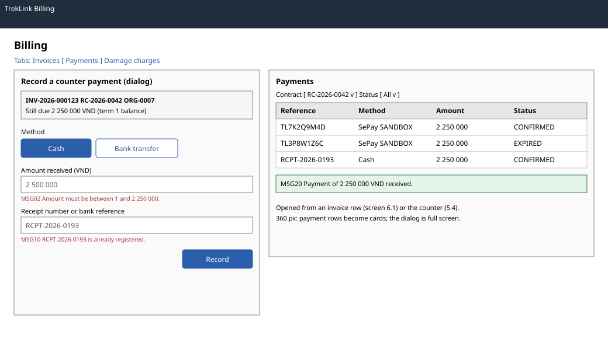

# Counter payments (`/t/billing`, payments tab)

| | |
|---|---|
| Owner | LongLP |
| Task | `specs/frontend/tasks.md` 6.3 |
| Assigned, due | 2026-10-21, 2026-10-23 |
| Status | Ready for review |
| Routes | `/t/billing`, payments tab, with the record dialog; the dialog also opens from an invoice (screen 6.1) and from step 2 of the counter handover (screen 5.4) (`specs/frontend/design.md` §2) |
| Roles | TrekLink Staff and Admin: record a counter payment and list payments. Organization accounts: MSG26 on this route; the Org Manager sees the organization's payments on the invoice (screen 6.1). |
| Use case, FRs, story | UC-22, UC-55; FR-BILL-08, FR-BILL-07, BR-31, E01-6, NFR-UI-03; US-UC22 |
| Requirements | `specs/billing/requirements.md` REQ-UBI-03, REQ-UBI-04, REQ-EVT-10, REQ-ERR-04, REQ-ERR-05 |
| Wireframe |  |

Scope from the task: billing api-design 13, 14; overpayment and duplicate reference errors

## Data

| Shown | Source (api-design file, property) |
|---|---|
| Dialog header: invoice number, contract, organization | billing 09 `number`, `contract.code`, `organizationId` (shown by code) |
| Amount still due | billing 09 `totalVnd` minus `paidVnd`, and the unpaid `lines[]` with their `dueAt` |
| Recorded payment | billing 13 `result.reference`, `amountVnd`, `method`, `status`, `confirmedAt` |
| Payments list: reference, method, sandbox label, amount, status, confirmed | billing 14 `items[].reference`, `method`, `isSandbox`, `amountVnd`, `status`, `confirmedAt` |
| List paging | billing 14 `pageNumber`, `pageSize`, `totalCount`, `totalPages` |

## Actions

| Control | Shown when | Endpoint | Confirmation | Success message |
|---|---|---|---|---|
| Filter by contract or status | always | billing 14 `GET /api/payments?contractId=&status=` | none | none |
| Record counter payment (invoice row, counter step 2) | the invoice has an unpaid amount | opens the dialog for that invoice | none | none |
| Record (dialog, primary) | form valid | billing 13 `POST /api/invoices/:id/payments/counter` | none: the amount and reference are on the form | MSG20; the dialog closes, the list, the invoice and the contract balance refetch |
| Cancel (dialog) | always | none | asks first if a field is filled (chapter 06 §8.7) | none |

## States

| State | What the user sees |
|---|---|
| Loading | List skeleton rows; Record shows its pending state and is disabled until the server answers, so a double click records nothing twice (chapter 06 §8.5) |
| Empty | No payments: "No payments recorded." With a filter: MSG01 |
| Error `VALIDATION_FAILED` (400, billing 13, 14) | MSG02 under the field the server names |
| Error `OVERPAYMENT` (400, billing 13) | MSG02 under Amount, with 1 and the amount still due as the range |
| Error `DUPLICATE_REFERENCE` (409, billing 13) | MSG10 under Reference, with the reference; nothing is recorded (REQ-ERR-05) |
| Error `UNAUTHENTICATED` (401) | `apiClient` refreshes once and retries, else `/sign-in` (frontend REQ-EVT-02) |
| Not found or forbidden | `NOT_FOUND` (404, billing 13) or `FORBIDDEN` (403): MSG26 |
| Sandbox payment | Amber `SANDBOX` label on SePay rows; counter payments carry `isSandbox` false (NFR-UI-03) |
| Success | MSG20 with the amount |

## Form fields (if any)

| Step | Field | Type | Required | Rule |
|---|---|---|---|---|
| Record | Method | radio: Cash, Bank transfer | yes | `CASH` or `BANK_TRANSFER` (billing 13 `method`) |
| Record | Amount received (VND) | integer, thousands separators | yes | 1 to the amount still due (billing 13 `amountVnd`) |
| Record | Receipt number or bank reference | text | yes | not empty; unique across payments (billing 13 `reference`) |

One step of three fields. A failed submit keeps every field (chapter 06 §8.7).

## Mobile, accessibility, live data

- 360 px layout: TrekLink billing runs on a desktop at the counter; on a narrow screen the tabs become a select, payment rows become cards and the dialog opens full screen with full-width buttons at least 44 px high.
- Tab order and focus after each action: tabs, filters, list, pager. The dialog starts on Method, traps focus and returns it to the button that opened it. After MSG20, focus moves to the new payment row. Amounts are right-aligned VND with thousands separators (chapter 06 §8.8); statuses are text labels.
- WebSocket events and invalidated query keys: no live events. Query keys `['payments', filters]`, `['invoice', invoiceId]`; Record invalidates both, `['invoices', ...]` and `['contract-balance', contractId]`.

## Checklist

Chapter 06 §7 (Screen Design Checklist) and §8 (UI and UX practices), ticked by the owner before review.

- [x] Route and roles match `design.md` §2; organization accounts get MSG26
- [x] Data: every field names billing 09, 13 or 14
- [x] Actions: filter, record (MSG20), cancel with a dirty-form check
- [x] States: loading, empty, overpayment (MSG02), duplicate reference (MSG10), 401, 403 and 404, sandbox label
- [x] Forms: three fields with type, requirement and rule
- [x] Mobile: narrow layout described
- [x] Accessibility: focus trap and return, focus to the new row, text status labels
- [x] Live data: none; query keys listed
- [x] Traceability: UC-22, US-UC22
