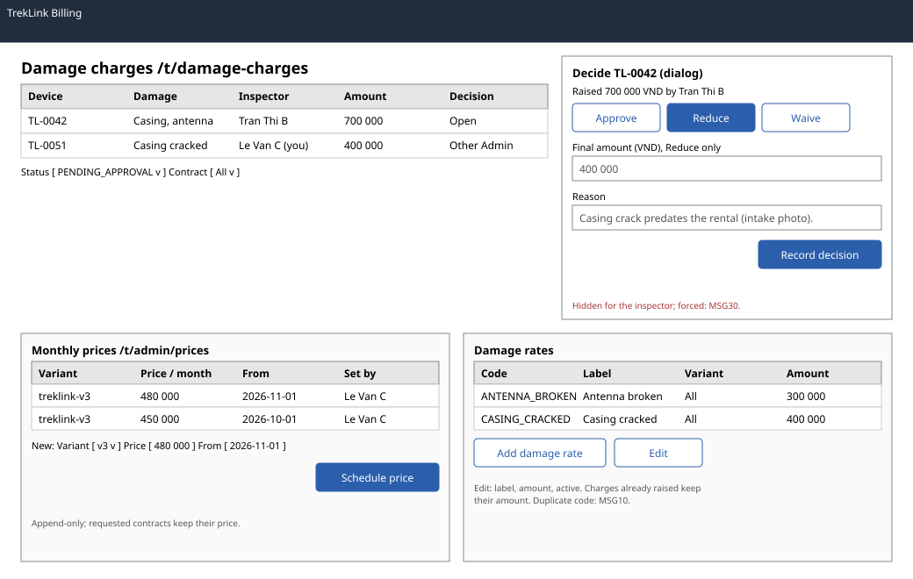

# Prices, damage rates, `DamageChargesPage` (`/t/admin/prices`, `/t/damage-charges`)

| | |
|---|---|
| Owner | LongLP |
| Task | `specs/frontend/tasks.md` 6.4 |
| Assigned, due | 2026-10-21, 2026-10-23 |
| Status | Ready for review |
| Routes | `/t/admin/prices` (monthly prices and damage rates, Admin) and `/t/damage-charges` (the approval queue) (`specs/frontend/design.md` §2). §2 names no route of its own for damage rates; they sit on the prices page. |
| Roles | TrekLink Admin: prices, damage rates, and decisions on charges they did not inspect. TrekLink Staff: `/t/damage-charges` read-only (billing 16), no decision; `/t/admin/prices` is MSG26. Organization accounts: MSG26 on both routes. |
| Use case, FRs, story | UC-48, UC-56, UC-47; FR-BILL-04, FR-CFG-01, FR-CFG-02, BR-24, BR-29, E05-6; US-UC48, US-UC56 |
| Requirements | `specs/billing/requirements.md` REQ-UBI-05, REQ-EVT-05, REQ-EVT-06, REQ-ERR-03 |
| Wireframe |  |

Scope from the task: billing api-design 03 to 07, 16, 17; decision hidden for the inspector (MSG30)

## Data

| Shown | Source (api-design file, property) |
|---|---|
| Price history: variant, monthly price, effective from, set by, set at | billing 03 `items[].hardwareVariantId` (shown by variant code), `monthlyPriceVnd`, `effectiveFrom`, `createdBy`, `createdAt` |
| Current or upcoming label per price row | derived: the latest row with `effectiveFrom` in the past is current; later rows are upcoming |
| Damage rates: code, label, variant or all, amount, active | billing 05 `[].code`, `label`, `hardwareVariantId` (null shows "All"), `amountVnd`, `isActive` |
| Damage charges: device, damage codes, inspector, amount, status, raised | billing 16 `items[].assetTag`, `damageCodes`, `inspector.fullName`, `amountVnd`, `status`, `createdAt` |
| Decision result | billing 17 `status`, `finalVnd`, `decidedAt` |
| Whether the viewer inspected the charge | billing 16 `items[].inspector.id` compared with auth 04 `result.id` |

## Actions

| Control | Shown when | Endpoint | Confirmation | Success message |
|---|---|---|---|---|
| Schedule price (prices, primary) | Admin | billing 04 `POST /api/price-schedules` | dialog: "Set {variant} to {price} VND per device per month from {date}? Contracts already requested keep their price." | toast MSG03 |
| Add damage rate | Admin | billing 06 `POST /api/damage-rates` | none | toast MSG03 |
| Edit (rate row) | Admin | billing 07 `PATCH /api/damage-rates/:id` | deactivating asks: "Deactivate {code}? Inspections can no longer use it." | toast MSG03 |
| Filter charges by status or contract | always | billing 16 `GET /api/damage-charges?status=&contractId=` | none | none |
| Decide (charge row) | Admin, `PENDING_APPROVAL`, and the viewer is not the inspector | opens the decision dialog | none | none |
| Record decision (dialog, primary) | as above | billing 17 `POST /api/damage-charges/:id/decision` | the dialog itself; Waive asks "Waive the {amount} VND charge on {assetTag}?" | toast MSG03; the row leaves the pending queue |

On a charge the viewer inspected, the row shows "Another Admin must decide" in place of Decide
(BR-24, chapter 06 §8.1). MSG30 appears only if the server refuses a forced request.

## States

| State | What the user sees |
|---|---|
| Loading | Table skeleton rows per section; each primary button shows its pending state until the server answers |
| Empty | No pending charges: "No damage charges are waiting for a decision." No damage rates: "No damage codes yet. Add one before inspections can record damage." With a filter: MSG01 |
| Error `VALIDATION_FAILED` (400, billing 03, 04, 06, 07, 16, 17) | MSG02 under the field the server names |
| Error `EFFECTIVE_IN_PAST` (400, billing 04) | MSG02 style text under Effective from: the server's `message` ("effectiveFrom must not be in the past.") |
| Error `CONFLICT_UNIQUE` (409, billing 06) | MSG10 under Code, with the code |
| Error `INVALID_STATE_TRANSITION` (409, billing 17) | MSG28 with the charge's state; the queue refetches (another Admin decided first) |
| Error `SEPARATION_OF_DUTY` (403, billing 17) | MSG30 dialog ("A different Admin must approve this charge."); the control is hidden, so only a forced request reaches it |
| Not found or forbidden | `NOT_FOUND` (404, billing 07, 17) or `FORBIDDEN` (403): MSG26 |
| Success | Toast MSG03; the section refetches |

## Form fields (if any)

| Step | Field | Type | Required | Rule |
|---|---|---|---|---|
| Schedule price | Variant | select | yes | (billing 04 `hardwareVariantId`) |
| Schedule price | Monthly price (VND) | integer | yes | positive (billing 04 `monthlyPriceVnd`) |
| Schedule price | Effective from | date and time | yes | now or later (billing 04 `effectiveFrom`) |
| Add damage rate | Code | text | yes | UPPER_SNAKE, unique for the variant scope (billing 06 `code`) |
| Add damage rate | Label | text | yes | (billing 06 `label`) |
| Add damage rate | Variant | select with "All variants" | no | "All variants" sends null (billing 06 `hardwareVariantId`) |
| Add damage rate | Amount (VND) | integer | yes | positive (billing 06 `amountVnd`) |
| Edit damage rate | Label, Amount (VND), Active | text, integer, toggle | no | at least one changed (billing 07 `label`, `amountVnd`, `isActive`) |
| Decide | Decision | radio: Approve, Reduce, Waive | yes | (billing 17 `decision`) |
| Decide | Final amount (VND) | integer | for Reduce | below the charge's `amountVnd` (billing 17 `finalVnd`) |
| Decide | Reason | text area | yes | not empty (billing 17 `note`) |

Every form is one step of at most four fields.

## Mobile, accessibility, live data

- 360 px layout: administration runs on a desktop; on a narrow screen each section stacks, table rows become cards and dialogs open full screen with full-width buttons at least 44 px high.
- Tab order and focus after each action: charge filters, queue, then prices, then damage rates. Dialogs trap focus and return it to their button; after a decision, focus moves to the next pending row. Status, current and upcoming are text labels; amounts are right-aligned VND with thousands separators (chapter 06 §8.8).
- WebSocket events and invalidated query keys: no live events. Query keys `['price-schedules', variantId]`, `['damage-rates', variantId]`, `['damage-charges', filters]`; each mutation invalidates its own key, and a decision also invalidates `['contract-balance', contractId]`.

## Checklist

Chapter 06 §7 (Screen Design Checklist) and §8 (UI and UX practices), ticked by the owner before review.

- [x] Route and roles match `design.md` §2; Staff read-only on charges; decision hidden for the inspector
- [x] Data: every field names billing 03, 05, 16, 17 or auth 04
- [x] Actions: schedule price, add and edit damage rate, decide a charge, each with its confirmation and MSG03
- [x] States: loading, empty per section, every error code of billing 03 to 07, 16 and 17, MSG30, 403 and 404
- [x] Forms: every field with type, requirement and rule; at most four per form
- [x] Mobile: narrow layout described
- [x] Accessibility: focus trap and return, focus to the next pending row, text labels
- [x] Live data: none; query keys listed
- [x] Traceability: UC-48, UC-56; US-UC48, US-UC56
