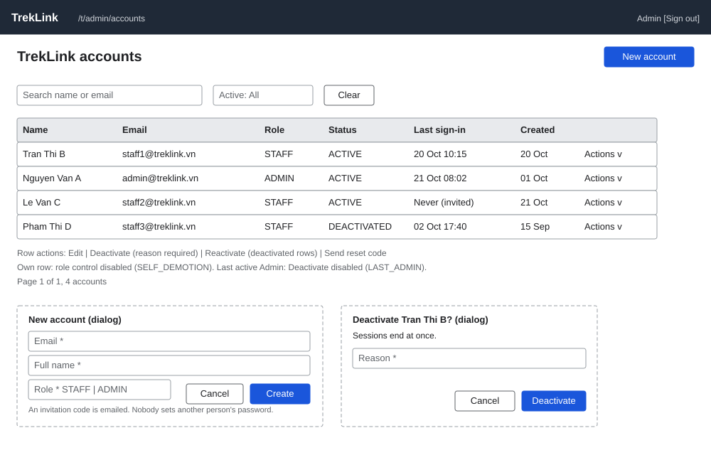

# TrekLink accounts (`/t/admin/accounts`)

| | |
|---|---|
| Owner | LongNN |
| Task | `specs/frontend/tasks.md` 7.1 |
| Assigned, due | 2026-10-21, 2026-10-23 |
| Status | Ready for review |
| Routes | `/t/admin/accounts` (`specs/frontend/design.md` §2) |
| Roles | TrekLink Admin: full page. TrekLink Staff: no access (MSG26); Staff reach only the "Send reset code" action through other screens (auth api-design 14). Organization roles: no access (MSG26). |
| Use case, FRs, story | UC-10; FR-AUTH-05, FR-AUTH-06, FR-AUTH-07, FR-AUTH-09, FR-AUTH-10; US-UC10 |
| Requirements | `specs/auth/requirements.md` REQ-UBI-03, REQ-UBI-09, REQ-EVT-06, REQ-EVT-07 |
| Wireframe |  |

Scope from the task: auth api-design 09 to 14; last-Admin and self-demotion errors

## Data

| Shown | Source (api-design file, property) |
|---|---|
| Table row: full name | auth 09 `items[].fullName` |
| Table row: email | auth 09 `items[].email` |
| Table row: phone (second line under the email; "None" when empty) | auth 09 `items[].phoneNumber` |
| Table row: role badge (`ADMIN`, `STAFF`, text on every badge) | auth 09 `items[].roles[]` |
| Table row: status badge `ACTIVE` or `DEACTIVATED` | auth 09 `items[].isActive` |
| Table row: last sign-in (viewer timezone, UTC on hover); "Never" while null | auth 09 `items[].lastLoginAt` |
| Table row: created | auth 09 `items[].createdAt` |
| Pager: page, total count | auth 09 `pageNumber`, `pageSize`, `totalCount`, `totalPages` |
| "Invitation pending" hint on a row whose `lastLoginAt` is null | auth 09 `items[].lastLoginAt` is null: the invitation is still pending (D-057 rule 1); no separate flag |

`accountType` is always `TREKLINK` on this list; it is not shown.

## Actions

| Control | Endpoint | Confirmation | Success message |
|---|---|---|---|
| Filter bar: search box, Active filter | auth 09 `GET /api/accounts?q&isActive&pageNumber&pageSize` | none | none |
| New account (primary, top right) opens the form | auth 10 `POST /api/accounts` | none; the form is the confirmation | MSG03 toast, server message "Account created, invitation sent" |
| Row: Edit name or role | auth 11 `PATCH /api/accounts/:id` | Changing a role asks "Change {fullName} from {old} to {new}? It applies on their next request." | MSG03 toast, server message "Account updated" |
| Row: Deactivate | auth 12 `POST /api/accounts/:id/deactivate` | Dialog names the account ("Deactivate Tran Thi B?"), states that sessions end at once, requires a reason | MSG03 toast, server message "Account deactivated" |
| Row: Reactivate (shown only when deactivated) | auth 13 `POST /api/accounts/:id/reactivate` | Dialog names the account | MSG03 toast, server message "Account reactivated" |
| Row: Send reset code | auth 14 `POST /api/accounts/:id/password-reset` | Dialog: "Send a reset code to {email}? You will not see the password." | MSG03 toast, server message "Reset code sent to the account email" |

Row actions sit at the row end. The primary action is New account; Deactivate is secondary and
styled as destructive (chapter 06 §8 items 1 and 2).

## States

| State | What the user sees |
|---|---|
| Loading | Table skeleton of 5 rows; filter bar and New account already usable |
| Empty | MSG01 "No results match your filters." with a "Clear filters" link; when the platform has no accounts at all the hint is "Create the first account with New account." |
| Error `VALIDATION_FAILED` (400) | Form: MSG02 under the field from the Zod schema; a server-side 400 shows the server `message` in a form-level banner and keeps every field (§8 item 7) |
| Error `UNAUTHENTICATED` (401) | One silent refresh by `apiClient`; if it fails the user goes to `/sign-in` and returns here |
| Error `CONFLICT_UNIQUE` (409, create) | MSG10 under the email field: "{email} is already registered." |
| Error `SELF_DEMOTION` (409, edit) | Dialog MSG39 "You cannot remove your own Admin role." The role control is also disabled on the signed-in Admin's own row, so this dialog is the backstop. |
| Error `LAST_ADMIN` (409, deactivate) | Dialog MSG37 "At least one active Admin must remain." The Deactivate button is also disabled on the last active Admin's row, with a visible text line under the name. MSG37 also covers demoting the last Admin; auth 11 lists only `SELF_DEMOTION`, so a demotion of the last Admin by another Admin is not reachable from this screen today. |
| Error `NOT_FOUND` (404) | The row is gone (another Admin removed it): toast with the server message "Account not found." and the table reloads |
| Not found or forbidden (403 `FORBIDDEN`) | MSG26 full-page notice "You do not have access to this." |
| Success | Toast, the table row updates from the invalidated query; focus stays on the row's action menu button |

## Form fields (if any)

New account is one step of 3 fields, and edit adds an optional phone (chapter 06 §3: at most 4 steps of 6 fields). Edit reuses the form.

| Step | Field | Type | Required | Rule |
|---|---|---|---|---|
| 1 | Email | email text | yes (create only; read-only on edit) | Valid email; stored lower-case (REQ-UBI-01); duplicate gives MSG10 |
| 1 | Full name | text | yes on create, optional on edit | Non-empty, trimmed; MSG02 when empty |
| 1 | Phone | text | no (edit only) | auth 11 `phoneNumber`; MSG02 when malformed |
| 1 | Role | select: `STAFF`, `ADMIN` | yes on create, optional on edit | Enum from auth 10 and 11. Disabled on the signed-in Admin's own row. |
| Deactivate dialog | Reason | text | yes | Non-empty (auth 12 `reason`); MSG02 when empty |

`phoneNumber` is returned by auth 09 and accepted by auth 11, so the edit form carries it as an optional
field (text, digits and a leading plus, as the DTO validates it). No field ever sets a password: the invitation email carries a code
(FR-AUTH-05, REQ-EVT-06), and the form says so in one line under the role field.

## Mobile, accessibility, live data

- 360 px layout: not an operator screen (NFR-UI-01 does not require it). The table collapses to cards: name and role badge on the first line, email and status below, the row actions behind one "Actions" button. Filters stack above the cards.
- Tab order and focus after each action: header (New account) then filters, then table rows left to right, then pager. Opening a dialog moves focus to its first field (or the confirm button for Reactivate and Send reset code); closing it returns focus to the control that opened it. After a successful create, focus moves to the new row's name cell.
- WebSocket events and invalidated query keys: none on `/live` concern accounts. Every successful mutation invalidates `['accounts']` (all filter variants).

## Checklist

Chapter 06 §7 (Screen Design Checklist) and §8 (UI and UX practices), ticked by the owner before review.

- [x] Route and roles match `design.md` §2; Staff and organization roles are stated as no access
- [x] Data: every field names its api-design source; `phoneNumber` comes from auth 09 and the pending state from `lastLoginAt` null (D-057 rule 1)
- [x] Actions: endpoint, confirmation and message for each control
- [x] States: loading, empty, one row per error code of auth 09 to 14, forbidden, success
- [x] Forms: 1 step, 3 fields plus the deactivate reason
- [x] Mobile: collapse rule stated (not an operator screen)
- [x] Accessibility: tab order, focus after each action; role and status badges carry text (§8 item 3)
- [x] Live data: no stream event applies, stated
- [x] Traceability: UC-10, FR-AUTH-05 to FR-AUTH-10, US-UC10
- [x] §8 items 1 to 8 applied (one primary action, destructive named, server `message` shown, input preserved)
