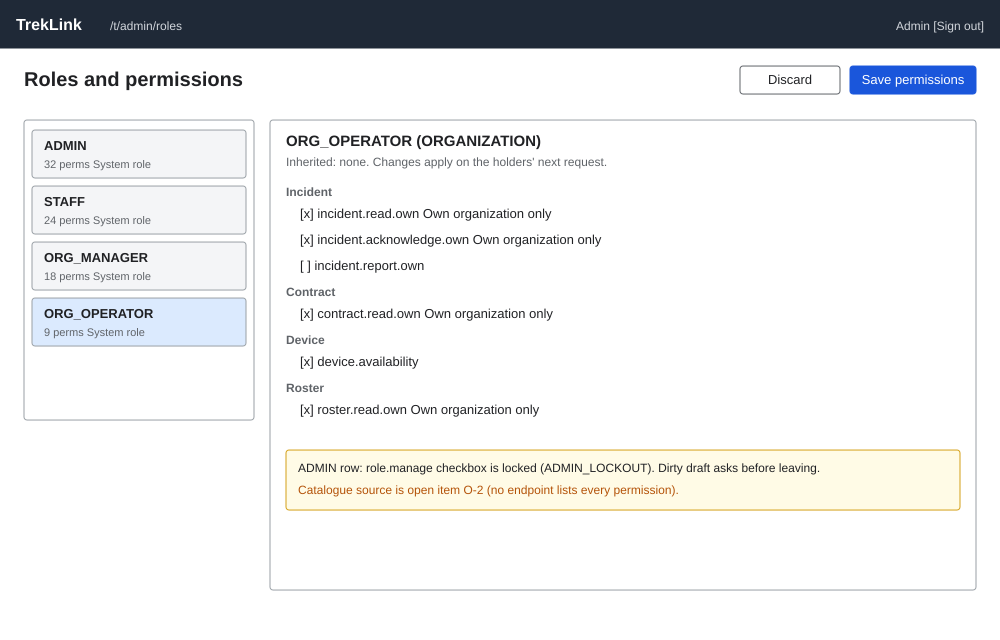

# Roles and permissions (`/t/admin/roles`)

| | |
|---|---|
| Owner | LongNN |
| Task | `specs/frontend/tasks.md` 7.2 |
| Assigned, due | 2026-10-21, 2026-10-23 |
| Status | Ready for review |
| Routes | `/t/admin/roles` (`specs/frontend/design.md` §2) |
| Roles | TrekLink Admin: view and edit. TrekLink Staff and organization roles: no access (MSG26). |
| Use case, FRs, story | UC-10; FR-AUTH-06, FR-AUTH-10; US-UC10 |
| Requirements | `specs/auth/requirements.md` REQ-UBI-05, REQ-EVT-08 |
| Wireframe |  |

Scope from the task: auth api-design 15 and 16

## Data

| Shown | Source (api-design file, property) |
|---|---|
| Role list (left column): role key and account type, "System role" tag | auth 15 `result[].key`, `accountType`, `isSystem` |
| Permission count per role | auth 15 `result[].permissions.length` |
| Permission list of the selected role, grouped by `subject`: key, action, subject | auth 15 `result[].permissions[].key`, `action`, `subject` |
| Scope text per permission, "Own organization only" when it has a condition | auth 15 `result[].permissions[].conditions` (a condition on `organizationId` renders as that text; the raw JSON is not shown) |
| Inherited tag: ADMIN holds every STAFF permission, ORG_MANAGER every ORG_OPERATOR permission | rule in `specs/auth/requirements.md` REQ-UBI-05; shown as a read-only note, not as editable rows (open item O-2) |
| The full list of permissions a role could hold (the checkbox universe) | not returned by any endpoint of auth 15 or 16 (open item O-2). The screen draws the checkbox list from the union of `permissions[]` over the four roles, plus the permission matrix `specs/auth/permission-matrix.md` as the agreed catalogue. |

## Actions

| Control | Endpoint | Confirmation | Success message |
|---|---|---|---|
| Role list click | auth 15 `GET /api/roles` (loaded once, all four roles in one response) | none | none |
| Permission checkboxes | none until saved; local draft state | Leaving with a dirty draft asks first (§8 item 7) | none |
| Save permissions (primary, top right of the role panel) | auth 16 `PUT /api/roles/:id/permissions` with the full `permissionKeys` list | Dialog names the role and the diff: "Change ORG_OPERATOR: remove 1, add 2? Holders are affected on their next request." | MSG03 toast, server message "Permissions updated" |
| Discard draft | none | none | none |

Save is disabled while the draft equals the loaded set and shows its pending state at once (§8 item 5).

## States

| State | What the user sees |
|---|---|
| Loading | Role list skeleton and an empty permission panel |
| Empty | A role with no permissions shows "This role holds no permissions." and the checkbox list is still editable (MSG01 is not used: the list is not a search result) |
| Error `VALIDATION_FAILED` (400) | Form-level banner with the server message; draft kept |
| Error `UNKNOWN_PERMISSION` (400) | Banner with the server message "Unknown permission: {key}."; the offending checkbox is marked and the page reloads `['roles']` because the catalogue changed under the client |
| Error `ADMIN_LOCKOUT` (409) | Dialog with the server message "Admins must keep the right to manage roles." (MSG28 class). The `role.manage` checkbox on ADMIN is also disabled with a text note, so this error is the backstop. |
| Error `NOT_FOUND` (404) | Toast with "Role not found." and the list reloads |
| Error `UNAUTHENTICATED` (401) | One silent refresh, then `/sign-in` |
| Not found or forbidden (403) | MSG26 full-page notice |
| Success | Toast; the panel shows the saved set; focus returns to the Save button |

## Form fields (if any)

One step, no text fields. The control is a checkbox list.

| Step | Field | Type | Required | Rule |
|---|---|---|---|---|
| 1 | Permission checkboxes, grouped by subject | checkbox group (maps to `permissionKeys: string[]`) | yes (the array may be empty only for roles other than ADMIN) | Keys must exist in the catalogue (`UNKNOWN_PERMISSION`); `role.manage` cannot be removed from ADMIN (`ADMIN_LOCKOUT`) |

## Mobile, accessibility, live data

- 360 px layout: not an operator screen. The role list becomes a select at the top of the page; the permission panel stacks below it with one checkbox per row.
- Tab order and focus after each action: role list (roving focus, arrow keys), then the permission groups, then Save and Discard. Selecting a role moves focus to the panel heading. Each checkbox has a visible label made of the permission key and its scope text; the scope is never colour alone.
- WebSocket events and invalidated query keys: none on `/live`. A successful save invalidates `['roles']`. Because a role change applies "on the next request" (REQ-EVT-08), the signed-in Admin's own `['me']` is also invalidated when the edited role is one they hold.

## Checklist

Chapter 06 §7 (Screen Design Checklist) and §8 (UI and UX practices), ticked by the owner before review.

- [x] Route and roles match `design.md` §2
- [x] Data: every field names its source; the missing permission catalogue is open item O-2
- [x] Actions: endpoint, confirmation with diff, message for each control
- [x] States: one row per error code of auth 15 and 16, forbidden, success
- [x] Forms: 1 step, 1 control
- [x] Mobile: collapse rule stated
- [x] Accessibility: roving focus, labels, focus after save
- [x] Live data: none, `['roles']` and `['me']` invalidation stated
- [x] Traceability: UC-10, FR-AUTH-06, FR-AUTH-10, US-UC10
- [x] §8 items 1 to 8 applied
