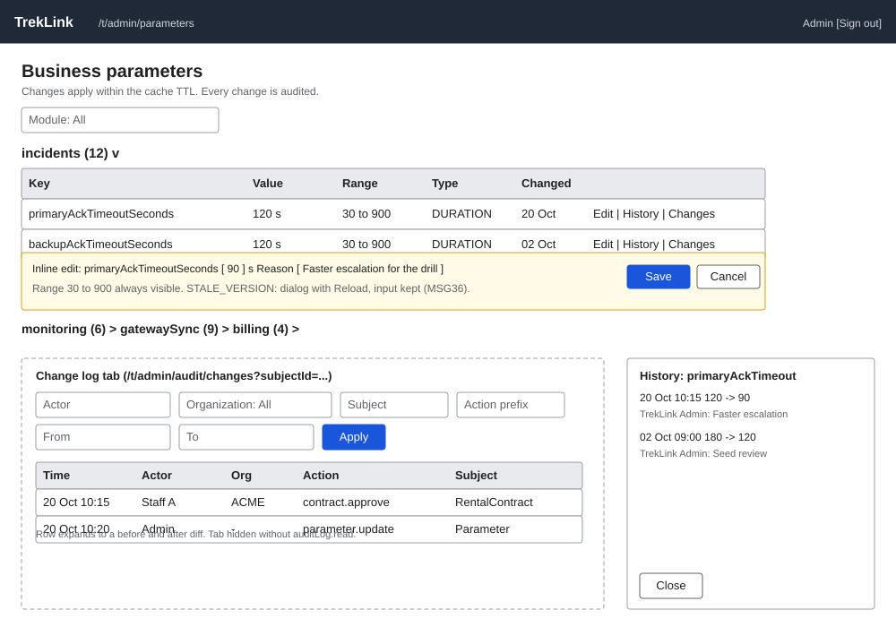

# Parameters and change log (`/t/admin/parameters`, `/t/admin/audit/changes`)

| | |
|---|---|
| Owner | LongNN |
| Task | `specs/frontend/tasks.md` 7.4 |
| Assigned, due | 2026-10-21, 2026-10-23 |
| Status | Ready for review |
| Routes | `/t/admin/parameters` (parameters) and `/t/admin/audit/changes` (change log, the audit log tab; `/t/admin/audit` redirects to it; the sign-in log is screen 7.3 at `/t/admin/audit/sign-ins`). The change-log tab is hidden for a user without `auditLog.read`. Filters live in the URL query. Both from `specs/frontend/design.md` §2 (D-057 rule 3). |
| Roles | TrekLink Admin only. Staff and organization roles: MSG26. |
| Use case, FRs, story | UC-57 (parameters), UC-58 (audit log); FR-CFG-01, FR-CFG-02, NFR-CFG-02, FR-AUTH-08; BR-29; US-UC57, US-UC58 |
| Requirements | `specs/platform/requirements.md` REQ-EVT-02, REQ-EVT-03, REQ-ERR-05 |
| Wireframe |  |

Scope from the task: platform api-design 02 to 05; parameters grouped by module with inline edit within bounds and a history drawer; change log with the organization filter

## Data

Parameters page:

| Shown | Source (api-design file, property) |
|---|---|
| Group heading per owning module (collapsible) | platform 02 `items[].ownerModule` |
| Key | platform 02 `items[].key` |
| Description | platform 02 `items[].description` |
| Current value with unit (for example `120 seconds`) | platform 02 `items[].value`, `unit` |
| Allowed range ("30 to 900") | platform 02 `items[].bounds.min`, `bounds.max` |
| Type (`INT`, `DURATION_SECONDS`, `DECIMAL`, `PERCENT`, `JSON`) | platform 02 `items[].valueType`; type list from `specs/platform/configuration-matrix.md` |
| Last changed | platform 02 `items[].updatedAt` |
| Version (kept as `expectedVersion` when editing) | platform 02 `items[].version` |
| History drawer rows: previous value, new value, actor, reason, time | platform 04 `items[].previousValue`, `newValue`, `changedBy.fullName`, `reason`, `changedAt` |
| History pager | platform 04 `pageNumber`, `totalCount`, `totalPages` |

Change log tab:

| Shown | Source (api-design file, property) |
|---|---|
| Time | platform 05 `items[].createdAt` |
| Actor name and roles | platform 05 `items[].actor.fullName`, `actorRoles[]` |
| Organization (name resolved from the id for display) | platform 05 `items[].organizationId`; names from organizations api-design 02 `items[].legalName` |
| Action | platform 05 `items[].action` |
| Subject type and id | platform 05 `items[].subjectType`, `subjectId` |
| Before and after (expandable diff, redacted by the server) | platform 05 `items[].before`, `after` |
| Request id (for support) | platform 05 `items[].requestId` |

## Actions

| Control | Endpoint | Confirmation | Success message |
|---|---|---|---|
| Module filter (parameters) | platform 02 `GET /api/parameters?ownerModule&pageNumber&pageSize`; built as one read of the whole registry (`pageSize` 100, about sixty parameters) filtered in the client and kept in `?module=` | none | none |
| Edit value (click the value cell: inline input with Save and Cancel) | platform 03 `PATCH /api/parameters/:key` with `value`, `expectedVersion`, optional `reason` | The inline row shows "Change {key} from {old} to {new}?" with the optional reason field; Save confirms | MSG03 toast, server message "Parameter updated"; effect noted as "Readers see it within the cache TTL" |
| History (opens the right drawer) | platform 04 `GET /api/parameters/:key/history` | none | none |
| Changes (row link) | navigation to `/t/admin/audit/changes?action=parameter.&subjectId=<key>`, the change log filtered to this parameter; confirmed against `ParameterService.update` (2026-10-31): the audit entry stores `action` `parameter.update`, `subjectType` `BusinessParameter` and `subjectId` equal to the parameter key, so this link is exact | none | none |
| Change-log filters: actor, organization, subject type, subject id, action prefix, from, to (organization options from organizations 02 `GET /api/organizations`, `items[].id`, `legalName`) | platform 05 `GET /api/audit-logs?actorId&organizationId&subjectType&subjectId&action&from&to&pageNumber&pageSize` | none | none |
| Row: expand before and after | none (data already loaded) | none | none |

The parameters page has no primary action: editing is per row. Edit, History and Changes are the row-end controls.

## States

| State | What the user sees |
|---|---|
| Loading | Parameters: grouped skeleton. Drawer: 3 skeleton rows. Change log: 8-row skeleton. |
| Empty | Parameters filter with no result: MSG01. History with no rows: "This parameter has not been changed since the seed." Change log: MSG01 with Clear filters. |
| Error `VALIDATION_FAILED` (400) | Audit and lists: banner with the server message. |
| Error `PARAMETER_OUT_OF_RANGE` (400, edit) | Inline under the input, MSG02 "{key} must be between {min} and {max}." from the bounds already loaded; the client blocks Save before sending, and the server message ("value must be between 30 and 900.") is the backstop. The stored value is unchanged and the input keeps what was typed. |
| Error `STALE_VERSION` (409, edit) | Dialog MSG36 "Someone else changed this. Reload to see the latest." with a Reload button that refetches `['parameters']`; the typed value and reason are kept and shown beside the new value (§8 item 7) |
| Error `NOT_FOUND` (404) | Toast with "Parameter not found." and the list reloads |
| Error `UNAUTHENTICATED` (401) | One silent refresh, then `/sign-in` |
| Not found or forbidden (403) | MSG26 full-page notice |
| Success | Toast, the cell shows the new value and version, the history drawer (if open) reloads, focus returns to the edited cell's Edit button |

## Form fields (if any)

Inline edit is one step of up to 2 fields.

| Step | Field | Type | Required | Rule |
|---|---|---|---|---|
| 1 | Value | input matched to `valueType`: whole number for `INT` and `DURATION_SECONDS`, decimal for `DECIMAL`, 0 to 100 for `PERCENT`, a JSON text area for `JSON` | yes | Within `bounds.min` and `bounds.max`; JSON must parse (MSG02 otherwise) |
| 1 | Reason | text | no | Free text, kept in the history |

`expectedVersion` is never typed: it is the `version` the row loaded with. Change-log filters are one
step of 7 optional fields in two rows; this is a filter bar, not a multi-step form.

## Mobile, accessibility, live data

- 360 px layout: not an operator screen. Parameter rows become cards (key, value, range, Edit); the history drawer becomes a full-screen sheet; change-log rows become cards with the diff behind an "Details" disclosure. Filters collapse into a disclosure.
- Tab order and focus after each action: module filter, parameter groups in order, then per row the value cell, Edit, History, Changes. Opening the drawer moves focus to its heading and closing it returns focus to the History button that opened it. Escape cancels an inline edit and returns focus to the cell. Range text is always visible next to the input, not only in a tooltip. Audit: filters, Apply, table, pager; expand buttons have `aria-expanded`.
- WebSocket events and invalidated query keys: none. Query keys: `['parameters', ownerModule, page]`, `['parameter-history', key, page]`, `['audit-logs', filters]` (filters mirrored in the URL query). A successful edit invalidates `['parameters']` and `['parameter-history', key]`.

## Checklist

Chapter 06 §7 (Screen Design Checklist) and §8 (UI and UX practices), ticked by the owner before review.

- [x] Route and roles match `design.md` §2 (`/t/admin/audit/changes`, tab hidden without `auditLog.read`)
- [x] Data: every field names its source; `valueType` list taken from the configuration matrix
- [x] Actions: endpoint, confirmation and message for each control
- [x] States: one row per error code of platform 02 to 05, forbidden, success
- [x] Forms: inline edit of 2 fields; audit filter bar documented
- [x] Mobile: collapse rule stated
- [x] Accessibility: tab order, focus after each action, range always visible
- [x] Live data: none, query keys stated
- [x] Traceability: UC-57, UC-58, FR-CFG-01, FR-CFG-02, US-UC57, US-UC58
- [x] §8 items 1 to 8 applied (input preserved on a failed edit, server message shown, times in viewer timezone)
