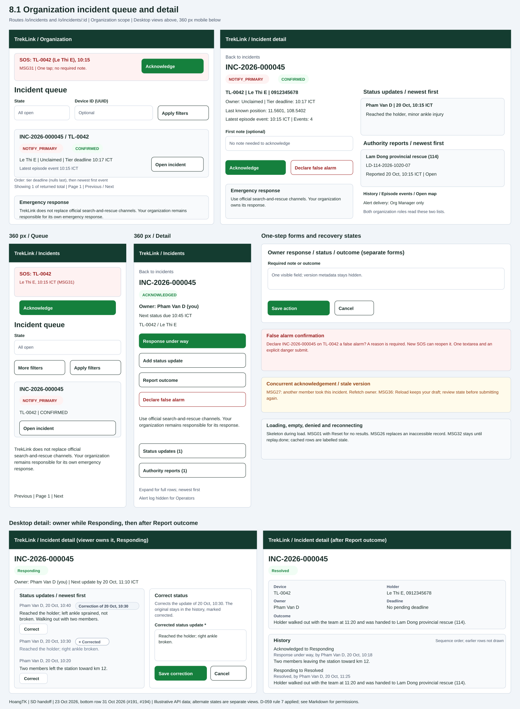

# Organization incident queue and `IncidentDetailPage`

| | |
|---|---|
| Owner | HoangTK |
| Task | `specs/frontend/tasks.md` 8.1 |
| Assigned, due | 2026-10-21, 2026-10-23 |
| Status | Ready for review |
| Routes | `/o/incidents`, `/o/incidents/:id`, unchanged from [frontend design section 2](../design.md#2-routes-and-screen-authorization) |
| Roles | Org Operator and Org Manager: own organization only. Both acknowledge and declare false alarms in allowed states. Only the response owner reports response, status or outcome. Alert delivery log: Org Manager only, API 14. TrekLink roles use task 8.2. |
| Use case, FRs, story | UC-32, UC-33, UC-34; FR-INC-04, FR-INC-06 to FR-INC-08; US-UC32, US-UC33, US-UC34. Supporting FR-INC-11 to FR-INC-13 and FR-AUTH-11. |
| Requirements | [Frontend](../requirements.md): REQ-UBI-01 to REQ-UBI-05, REQ-UBI-07, REQ-UBI-09, REQ-EVT-01 to REQ-EVT-03, REQ-ERR-01, AC-02. [Incidents](../../incidents/requirements.md): REQ-EVT-05 to REQ-EVT-08, REQ-EVT-10 to REQ-EVT-12, REQ-STA-01, REQ-ERR-01 and REQ-ERR-02. |
| Wireframe |  |

Scope: incidents API 01 to 07 and 12 to 14. Numbers below refer to the [API index](../../incidents/api-design/README.md). Message source: Report 3 SRS, `Documents/reports/Report3_SRS_DRAFT.md` section 5.3. MSG36 follows D-057 rule 5; ordering, nested rows and acknowledgement errors follow D-059 rule 7 in the `treklink-docs` decisions register. Cross-repository sources are cited by name so their references do not become broken GitHub links. Ready for review is the status of this follow-up to the approved design.

## Layout

Queue: workspace header, global alert region, title, filters, server-paged incident list. Default `open=true` includes `RESOLVED` and `FALSE_ALARM` until `CLOSED`. Supported filters: state, open, Device ID and Created from. Device ID means UUID, not an unsupported asset-tag search. Apply or Reset returns to page 1. Back from detail restores filters, page and scroll.

Detail: summary and action card first, evidence panels afterwards. Desktop uses two columns; mobile opens the detail route as a full-width page. The primary action changes with state and owner. There is no manual Create, Escalate, Reopen or Close incident control.

Queue and detail show this visible disclaimer: "TrekLink does not replace official search-and-rescue channels. Your organization remains responsible for its own emergency response." Confidence says `SUSPECTED` or `CONFIRMED`; suspicion is not automatically dismissed. Device silence is separate from incident state.

Reuse shared lists, badges, alert region, forms, dialogs and pager. Proposed spacing uses Tailwind `p-4`, `gap-4`, `rounded-lg`, `lg:grid-cols-2`; primary button `brand.700` comes from `frontend/tailwind.config.js`. Slate surfaces, red alerts and amber suspected/stale badges always retain text. No shared component code is introduced in this design task.

## Data

Paths are inside unwrapped `result`; list rows start at `items[]`.

| Shown | Source (api-design file, property) |
|---|---|
| Code, device tag, holder and contact | [API 01](../../incidents/api-design/01-get-incidents.md) / [API 02](../../incidents/api-design/02-get-incidents-id.md): `code`, `id`, `device.assetTag`, nullable `device.holder.name`, `device.holder.phone`. Missing holder: "No holder label". |
| State, confidence, source, device silence | API 01/02 `state`, `confidence`, `source`, `stale`. |
| Episode times and counts | API 01/02 `firstEventAt`, `lastEventAt`, `eventCount`, `reopenCount`, `stateChangedAt`. |
| Owner and owner-only controls | API 02 `owner`; the object shape is documented in [API 03](../../incidents/api-design/03-post-incidents-id-acknowledge.md): `id`, `fullName`. Compare with [auth 04](../../auth/api-design/04-get-auth-me.md) `id`. Null: "Unclaimed". |
| Tier deadline / next update due | API 01/02 `tierDeadlineAt`, `statusDueAt`; derive countdown from returned timestamps. Null: "No pending deadline". Expiry refetches; it never causes a local state transition. |
| Last known coordinates | API 01/02 `lastPosition.lat`, `lastPosition.lon`; null: "Position unavailable". Label `lastEventAt` as latest episode event, not a claimed GPS fix time. |
| Reopen window, when returned | API 06/07 `reopenWindowEndsAt`. API 02 does not document it; after reload do not invent an expiry. |
| Status history and latest saved note | API 02 `statusUpdates[].id` as row key, `note`, `author.id`, `author.fullName`, `createdAt`, newest first. Show author and time above the wrapped note. [API 05](../../incidents/api-design/05-post-incidents-id-status-updates.md) returns the newly saved `note`, `createdAt` and `statusDueAt`; refetch API 02 for authoritative history and author. Empty: "No status updates recorded." Each row also carries `correctsId` and `correctedById`: a row with `correctedById` shows a neutral "Corrected" badge and muted note text; a row with `correctsId` shows "Correction of <time of the corrected row>". Whoever may add a status sees a small Correct button on each row without `correctedById` (dry run defect 15). |
| Organization's authority report collection | API 02 `authorityReports[].id` as row key, `agency`, `reference`, `reportedAt`, `caseClosedAt`, newest first. Show agency, full reference, report time and Open/Closed derived from `caseClosedAt`; show closure time when non-null. Empty: "No authority reports recorded." Both organization roles read this list without Staff-only actions or API 11 calls. |
| Transition trail | [API 12](../../incidents/api-design/12-get-incidents-id-transitions.md): `seq`, `fromState`, `toState`, `actor`, `reason`, `note`, `createdAt`; null origin means Created. Keep sequence order. Each row shows the transition, then the reason, actor and time line. A non-null `note` (the response saved with Response under way, the outcome saved with Report outcome, the false-alarm reason) prints as plain text under that line with line breaks preserved and long words wrapped, in the primary text token. A null `note` prints nothing. |
| Outcome | API 02 `outcomeNote`. A labelled "Outcome" fact in the summary card, full width, plain text with line breaks preserved, shown only when non-null (after Report outcome, until a reopen clears it). Nothing is shown while the incident is unresolved. |
| Episode evidence | [API 13](../../incidents/api-design/13-get-incidents-id-events.md): `eventId` as key, `kind`, `observedAt`, `latitude`, `longitude`, oldest first. Coordinates remain text; Open map navigates to `/o/map` (task 9.1). |
| Manager-only alert log | [API 14](../../incidents/api-design/14-get-incidents-id-alerts.md): `tier`, `recipient`, `channel`, `status`, `attempts`, optional `sentAt`, `lastError`. Operators neither request nor render it. Failed delivery does not mean failed transition. |
| Pager and ordering | API 01 `pageNumber`, `pageSize`, `totalCount`, `totalPages`. Start at 20 within platform `MAX_PAGE_SIZE`. Keep `tierDeadlineAt` ascending, nulls last, then `firstEventAt` newest first. D-059 rule 7 deliberately provides no sort parameter; do not add client sort controls. |

## Actions

| Control | Endpoint | Confirmation | Success message |
|---|---|---|---|
| Apply/reset filters, pager, Refresh | API 01 `GET /api/incidents`; only documented filters and pagination | None | Updated list, no toast |
| Open row / retry detail | API 02 `GET /api/incidents/:id`; route `/o/incidents/:id` | Guard dirty input before leaving | Detail heading focus, no toast |
| Acknowledge / banner acknowledge | API 03 `POST /api/incidents/:id/acknowledge` | None; one step | MSG03 "Saved."; `ACKNOWLEDGED` and returned owner |
| Response under way | [API 04](../../incidents/api-design/04-post-incidents-id-responding.md) `POST /api/incidents/:id/responding` | Explicit labelled form submit | MSG03; `RESPONDING` and returned deadline |
| Add status | API 05 `POST /api/incidents/:id/status-updates` | None | MSG03; saved note and updated deadline |
| Report outcome | [API 06](../../incidents/api-design/06-post-incidents-id-resolve.md) `POST /api/incidents/:id/resolve` | Form says "Resolve {code}? A new SOS may reopen this incident." Submit: Resolve incident | MSG03; `RESOLVED` |
| Declare false alarm | [API 07](../../incidents/api-design/07-post-incidents-id-false-alarm.md) `POST /api/incidents/:id/false-alarm` | Reason dialog names incident code and device tag; explicit danger submit | MSG03; `FALSE_ALARM` |
| Status history / authority reports disclosure | Existing API 02 detail result; Refresh uses `GET /api/incidents/:id` | None; read-only collections | Rows expand, no toast |
| Evidence disclosures / retry | API 12, 13, permitted API 14 GETs | None | Panel updates, no toast |
| Back / Open map | `/o/incidents` / `/o/map`; destinations own GETs | Ask before discarding dirty form | No toast |

| State and viewer | Available actions |
|---|---|
| `NOTIFY_PRIMARY`, `NOTIFY_BACKUP`, `NOTIFY_MANAGER` | Primary Acknowledge; secondary Declare false alarm. |
| `ACKNOWLEDGED`, viewer owns it | Primary Response under way; secondary Add status, Report outcome, Declare false alarm. |
| `RESPONDING`, viewer owns it | Primary Add status; secondary Report outcome, Declare false alarm. |
| `ACKNOWLEDGED` / `RESPONDING`, another owner | Read-only response owner notice; a member can still Declare false alarm under API 07. No takeover action. |
| `ESCALATED`, `REPORTED` | Acknowledge is available to the routed organization's member, including when an owner is retained. No false alarm here. |
| `RESOLVED`, `FALSE_ALARM`, `CLOSED` | Read-only; reopen and timed closure are automatic. |
| `DETECTED`, `UNROUTED` | No organization mutations; refresh transient `DETECTED`. Server scope controls visibility. Staff handle `UNROUTED`. |

One-tap banner acknowledge immediately shows pending feedback, obtains API 02 `version` if fresh detail is unavailable, then sends API 03 with `expectedVersion`. The alert payload has no version. API 03 checks `ALREADY_OWNED` (MSG27) before `STALE_VERSION` (MSG36), so a second member learns who took the incident. No required typing or confirmation is added. Do not automatically retry a POST after network loss; refetch before offering another deliberate attempt.

## States

Known `result.errorCode` maps to SRS messages; server `message` is fallback (D-057). Main-record access failure clears the detail. Independent panel failure preserves the rest of the page.

| State | What the user sees |
|---|---|
| Loading | Queue/detail skeleton, `aria-busy`; no actions until state/version are known. |
| Empty | MSG01 "No results match your filters." plus Reset. Status history: "No status updates recorded." Authority reports: "No authority reports recorded." Empty nested arrays do not replace the incident summary. |
| `VALIDATION_FAILED` (400, API 01/03 to 07) | MSG02 under known invalid fields; server-only validation at form level, preserving input. |
| `UNAUTHENTICATED` (401, all calls) | One shared silent refresh; `/sign-in` and sensitive cache/socket clear if it fails. |
| `FORBIDDEN` (403, all calls) | MSG26 "You do not have access to this." Main-record refusal reveals no data; panel refusal hides that panel. |
| `NOT_FOUND` (404, API 02 to 07/12 to 14) | MSG26 for missing/cross-organization main record; clear detail. A panel error rechecks main access. |
| `ALREADY_OWNED` (409, API 03) | MSG27 "{actor} took this incident at {time}." Use server message; refetch owner. Do not assume structured winner/time fields. |
| `NOT_OWNER` (403, API 04 to 06) | MSG26 by form, retain draft, refetch owner and remove unavailable submits. |
| `INVALID_STATE_TRANSITION` (409, API 03 to 07) | MSG28 "This cannot be done while it is {state}." Refetch and recompute actions; keep unsaved text for copying. |
| `STALE_VERSION` (409, API 03/04/06/07) | MSG36 dialog: "This was changed by someone else. Reload and try again." Reload keeps input; require a new deliberate submit after reviewing state/version. API 03 checks `ALREADY_OWNED` first, so a losing acknowledgement uses MSG27 when another member already owns it. |
| Network / unknown error | Server fallback or connection message, Retry for GETs. Preserve draft, check state before retrying a write; no success toast. |
| Reconnecting | MSG32 "Reconnecting. Live data is paused." Label retained data stale until replay completes. |
| Alert / escalation | MSG31 for a recipient SOS; MSG34 beside escalated state, with history distinguishing timeout from stale owner response. No rescue-dispatch promise. |
| Success | MSG03, returned state/owner and refreshed evidence. Toast does not steal focus. |

## Form fields

Separate one-step action forms, not one combined wizard. Labels above inputs, required fields marked. Contracts specify no maximum text lengths, so none are invented (H-05).

| Step / form | Field | Type | Required | Rule |
|---|---|---|---|---|
| Acknowledge, 1 | First note, `note` | Textarea | No | String when present; banner omits it. |
| Response, 1 | Response note, `note` | Textarea | Yes | Required string, API 04. |
| Status, 1 | Status update, `note` | Textarea | Yes | Required string, API 05; this body has no version field. |
| Correct status, 1 | Corrected status update, `note`, hidden `correctsId` | Textarea | Yes | Opens from Correct on a status row, prefilled with that row's note; posts API 05 with `correctsId`. The old row is never edited (dry run defect 15). |
| Outcome, 1 | Outcome, `outcomeNote` | Textarea | Yes | Required string, API 06. Confirmation is in the same form. |
| False alarm, 1 | Reason, `reason` | Textarea | Yes | Required string, API 07; device cancel never closes it automatically. |
| Hidden metadata | `expectedVersion` | Integer | Yes on API 03/04/06/07 | Latest reviewed API 02 `version`; never editable. Incident UUID comes from selected record. |

Queue filters: optional state enum, open boolean, device UUID and ISO datetime `from` with displayed timezone. Invalid types get MSG02. No new query parameters are introduced.

## Mobile, accessibility, live data

- **360 px:** separate queue and detail screens are drawn at 360 px. Use 16 px side padding, full-width cards, controls at least 44 px high. State stays visible; More filters expands the Device ID, Created from, Open-only and Reset controls in one column, pushing the list down. Detail opens its route, not a narrow side panel. Alert, primary action and disclaimer precede evidence. Long text wraps; no page-level horizontal scroll.
- **Nested detail panels:** status updates and authority reports are separate disclosures, ordered newest first as returned by API 02. Desktop expanded rows are drawn; mobile disclosures expand into full-width cards and push later evidence down. Status author/time precede note text; authority agency/reference precede reported time and Open/Closed. Full references remain available without truncation. No author, authority or case-close control is inferred from a display row.
- **Keyboard/focus:** skip link, alert action, navigation, filters, Apply/Reset, rows, pager. Detail: Back, heading/summary, primary, secondary actions, evidence. Enter submits; Escape closes a dialog and restores its trigger. Trap modal focus below the visible alert; a Close control restores access to the banner. Announce new alerts without moving focus. After acknowledge focus owner/state summary; other actions return focus to their card. Errors focus first invalid field or form summary; dirty navigation asks before discard.
- **Visual feedback:** text labels accompany badges and icons, including "Device silent" and Back to incidents. Pending label appears within 1 second and disables repeat submit. Respect reduced motion for pulse. Target 4.5:1 normal text and 3:1 focus contrast. Times use viewer timezone, UTC+7 default, with zone on focus/hover.
- **Queries:** `['incidents', orgId, filters, pageNumber, pageSize]`, `['incident', orgId, incidentId]`, and `['incident', orgId, incidentId, 'transitions'|'events'|'alerts']`. Scope comes from auth; no editable organization ID. Clear cache, drafts and cursor on sign-out/account change.
- **Stream:** share the authenticated socket from the [live contract](../../monitoring/api-design/ws-live-contract.md). `stream.type=incident.changed` refreshes the queue, detail and loaded evidence keys. The shared event store handles live state; reconcile REST data. Personal `incident.alert` drives MSG31. A state change showing another owner removes pending acknowledgement. Accept only increasing `seq`; no invented `incident:new` socket event.
- **Recovery:** MSG32 remains until `replay.done`; on `replay.expired`, shell snapshot recovery is followed by visible queue/detail refetch. Device updates refresh relevant evidence without changing incident state locally. Refresh works while disconnected. Alert log has explicit Refresh because no delivery-retry push is documented. Refetch never discards dirty input.

## Review notes

D-059 rule 7 resolves H-01, H-02 and H-04; merged spec PR #46 is reflected above. [Follow-up record](../../../docs/sessions/2026-10-23-1303-hoangtk-screen-review-fixes.md) maps the leader's PR #45 review to these changes. H-03 uses the existing report list, H-05 preserves documented validation and H-06 follows API 09's conditional transition. No endpoint, requirement or lifecycle is changed here.

## Checklist

- [x] Routes, organization scope, owner restrictions and Manager-only log are stated.
- [x] Data fields and both non-empty detail collections map to API 02, including status author and newest-first order.
- [x] Actions, endpoints, confirmations and messages are mapped.
- [x] Loading, empty, success and every documented error code are covered.
- [x] Forms fit limits; acknowledge is one tap with no required visible field.
- [x] Queue and detail 360 px layouts are drawn.
- [x] Focus, keyboard, alternatives, contrast and motion are specified.
- [x] Stream, replay, invalidation and cache isolation are stated.
- [x] Use cases, FRs, requirements and stories are traced.
- [x] Chapter 06 section 8 primary action, placement, labelled state, feedback, recovery, input preservation, time, alert priority, disclaimer and reuse are addressed.
- [x] D-059 rule 7 governs section 8 item 4: preserve documented server order with pagination and no sort parameter/control.
