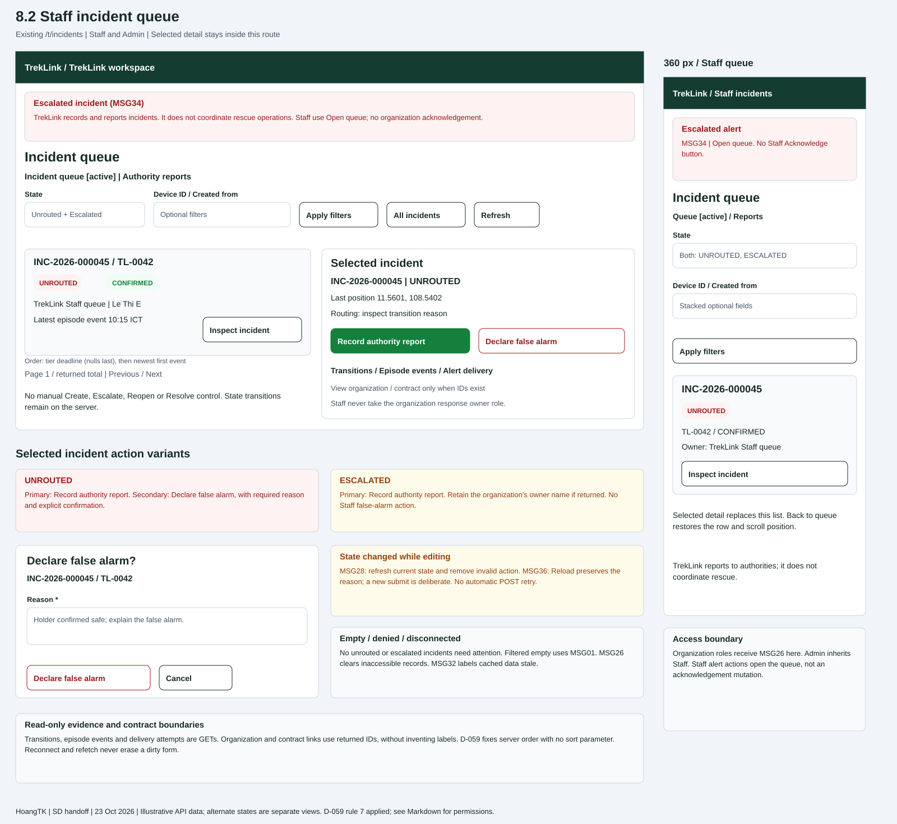

# `StaffIncidentsPage` (`/t/incidents`)

| | |
|---|---|
| Owner | HoangTK |
| Task | `specs/frontend/tasks.md` 8.2 |
| Assigned, due | 2026-10-21, 2026-10-23 |
| Status | Ready for review |
| Routes | `/t/incidents`, queue tab with inline detail. No `/t/incidents/:id` route is added. [Frontend design section 2](../design.md#2-routes-and-screen-authorization). |
| Roles | TrekLink Staff and TrekLink Admin (D-057 rule 7). Organization roles: MSG26. Staff inspect all incidents, report `UNROUTED`/`ESCALATED` incidents, and declare false alarm only from `UNROUTED`. They never acknowledge or act as an organization's response owner. |
| Use case, FRs, story | UC-29, UC-31; FR-EVT-17, FR-INC-01 to FR-INC-05, FR-INC-13; US-UC29, US-UC31. False alarm supports UC-34/FR-INC-08; authority reporting belongs to task 8.3. |
| Requirements | [Incidents](../../incidents/requirements.md): REQ-UBI-01 to REQ-UBI-05, REQ-EVT-01 to REQ-EVT-04, REQ-EVT-07 to REQ-EVT-09, REQ-EVT-12, REQ-STA-01, REQ-ERR-01; AC-02, AC-04, AC-09. [Frontend](../requirements.md): REQ-UBI-01 to REQ-UBI-05, REQ-EVT-01 to REQ-EVT-03, REQ-ERR-01. |
| Wireframe |  |

Scope: unrouted/escalated queue, read-only incident evidence and false alarm from `UNROUTED`. Creation, correlation, routing and escalation are automatic, with no manual Staff controls. Sources: [incidents API index](../../incidents/api-design/README.md), [lifecycle](../../incidents/design.md#2-incident-lifecycle-d-034-d-038), Report 3 SRS (`Documents/reports/Report3_SRS_DRAFT.md` section 5.3), D-057 MSG36 and D-059 rule 7 in the `treklink-docs` decisions register. Cross-repository sources are cited by name. Ready for review is the status of this follow-up to the approved design.

## Layout

Shared TrekLink shell and global alert region, then two client-side tabs: Incident queue and [Authority reports](8-3-authority-reports.md). Both use `/t/incidents`. A selected row opens a labelled detail region on the same page, beside the desktop list.

Default: API 01 `state=UNROUTED&state=ESCALATED`, page 1, size 20. Filters: Both/Unrouted/Escalated, optional Device ID and Created from. All incidents clears the state restriction for historical inspection; its heading distinguishes it from the active queue. Apply/reset returns to page 1. Server scope always decides access.

Primary selected-record action: Record authority report for `UNROUTED` or `ESCALATED`. It opens task 8.3 with that incident. Secondary false alarm appears only for `UNROUTED`. A retained owner on `ESCALATED` stays visible; Staff never get Acknowledge, Response under way, Add status or Resolve.

Show: "TrekLink records the incident and reports it to the authorities. TrekLink does not coordinate rescue operations." Device silence is a separate labelled badge. The transition trail explains routing failure; a null contract alone does not establish its cause.

Reuse task 8.1's Tailwind spacing, brand button, labelled badges and evidence panels. Below `lg`, detail replaces the list area within the same route; Back to queue restores selected-row focus and scroll.

## Data

List paths are relative to API 01 `result.items[]`; detail paths to API 02 `result`.

| Shown | Source (api-design file, property) |
|---|---|
| Code, asset tag and holder contact | [API 01](../../incidents/api-design/01-get-incidents.md), [API 02](../../incidents/api-design/02-get-incidents-id.md): `id`, `code`, `device.assetTag`, nullable `device.holder.name`, `phone`. Missing: "No holder label". |
| State, confidence and source | API 01/02 `state`, `confidence`, `source`. `SUSPECTED` stays distinct from `CONFIRMED`; no confidence editor. |
| Owner and times | API 02 `owner` (shape in API 03), `stateChangedAt`, `firstEventAt`, `lastEventAt`, `tierDeadlineAt`, `statusDueAt`. Null owner in `UNROUTED`/`ESCALATED`/`REPORTED`: "TrekLink Staff queue", role ownership from incidents REQ-UBI-03. |
| Silent device and last known coordinates | API 01/02 `stale`, `lastPosition.lat`, `lastPosition.lon`. Missing position: "Position unavailable". `lastEventAt` is labelled latest episode event, not GPS fix time. |
| Episode and reopen counts | API 01/02 `eventCount`, `reopenCount`; no separate queue row per beacon. |
| Routing links | API 02 `organizationId`, `contractId` produce View organization (`/t/organizations/:id`) and View contract (`/t/contracts/:id`). Omit null links. Organization name/code is not returned, so it is not invented or taken from the current holder. |
| Transition trail | [API 12](../../incidents/api-design/12-get-incidents-id-transitions.md): `seq`, `fromState`, `toState`, `actor`, `reason`, `createdAt`. Keep sequence order. |
| Episode evidence | [API 13](../../incidents/api-design/13-get-incidents-id-events.md): `eventId` key, `kind`, `observedAt`, `latitude`, `longitude`, oldest first. Text coordinates; Fleet map uses `/t/map`. |
| Alert delivery evidence | [API 14](../../incidents/api-design/14-get-incidents-id-alerts.md): `tier`, `recipient`, `channel`, `attempts`, `status`, optional `sentAt`, `lastError`. Retry failure never blocks an incident action. |
| Pager and ordering | API 01 `pageNumber`, `pageSize`, `totalCount`, `totalPages`. Total belongs to active filters. Keep `tierDeadlineAt` ascending with nulls last, then `firstEventAt` newest first (D-059 rule 7). There is no sort parameter or client sort control. |
| Reopen window after false alarm | API 07 `reopenWindowEndsAt`; do not calculate a configured window if the GET omits it. |

## Actions

| Control | Endpoint | Confirmation | Success message |
|---|---|---|---|
| Apply/reset, All incidents, pager, Refresh | API 01 `GET /api/incidents` with documented filters | None | Updated list, no toast |
| Inspect / Refresh detail | API 02 `GET /api/incidents/:id`; selection is client state | Guard dirty input | Detail heading focus, no toast |
| Record authority report | Opens task 8.3; its submit calls API 08 `POST /api/incidents/:id/authority-reports` | Task 8.3 confirms agency/reference/time | MSG03 after report save; refresh queue |
| Declare false alarm (`UNROUTED` only) | [API 07](../../incidents/api-design/07-post-incidents-id-false-alarm.md) `POST /api/incidents/:id/false-alarm` | "Declare {code} on {assetTag} a false alarm?" Required reason and explicit danger submit | MSG03 "Saved."; `FALSE_ALARM` leaves default queue |
| History / episode / delivery disclosure and Retry | API 12, 13, 14 GETs | None | Panel updates, no toast |
| Authority reports tab | Task 8.3, API 11 `GET /api/authority-reports` | Guard dirty form | No toast |
| View organization / contract / Fleet map | Existing `/t/organizations/:id`, `/t/contracts/:id`, `/t/map`; destination owns GETs | Guard dirty form | No toast |

When a successful action removes a row from the queue, keep a success notice naming its code and focus the next row or queue heading. In All incidents, retain the updated row. A live state change that invalidates an action keeps evidence visible and replaces the submit with current state and Refresh.

## States

| State | What the user sees |
|---|---|
| Loading | Independent queue/detail/panel skeletons with `aria-busy`; one panel never blocks the queue. |
| Empty default queue | "No unrouted or escalated incidents need attention." Refresh and All incidents remain available; screen copy without a MSG code (D-057 rule 6). |
| Empty filtered list | MSG01 "No results match your filters." plus Reset. |
| `VALIDATION_FAILED` (400, API 01/07) | MSG02 under known invalid fields; server-only error at form level. Preserve reason and filters. |
| `UNAUTHENTICATED` (401, all calls) | One shared refresh; sign-in on failure and clear protected caches/socket. |
| `FORBIDDEN` (403, all calls) | MSG26 "You do not have access to this." Main refusal reveals no incident; panel refusal hides its content. |
| `NOT_FOUND` (404, API 02/07/12/13/14) | MSG26; close inaccessible selected detail and refetch queue. Panel error first rechecks main record. |
| `INVALID_STATE_TRANSITION` (409, API 07) | MSG28 "This cannot be done while it is {state}." Refetch; remove false alarm unless `UNROUTED`; retain draft for copying. |
| `STALE_VERSION` (409, API 07) | MSG36 Reload dialog, keeping reason. Review new state before deliberate resubmit. |
| Escalated / device silent | MSG34 with recorded reason/current owner. Device silent badge never replaces the state or implies rescue dispatch. |
| Disconnected | MSG32 "Reconnecting. Live data is paused." Cached data stays labelled stale. |
| Network / unknown error | Server fallback or connection message; Retry reads. A write failure retains input and refreshes state before another deliberate attempt; no automatic repeat POST. |
| Success | MSG03 after false alarm or task 8.3 report; refresh and retain filters. |

Known codes map to SRS messages; server text is fallback (D-057). API 08 errors stay visible in task 8.3's form. `ALREADY_OWNED` and `NOT_OWNER` are not invented for the false-alarm endpoint.

## Form fields

| Step | Field | Type | Required | Rule |
|---|---|---|---|---|
| False alarm, 1 | Reason, `reason` | Textarea | Yes | String explaining why false, API 07; no undocumented maximum length. |
| Hidden | `expectedVersion` | Integer | Yes | Latest reviewed API 02 `version`, held when form opens. Dirty form refetch never silently replaces it. |
| Filters, 1 | State / All incidents | Enum choice | No | API 01 repeatable `state`; All incidents clears restriction. |
| Filters, 1 | Device ID, `deviceId` | UUID | No | Type validation, not free-text asset-tag search. |
| Filters, 1 | Created from, `from` | Datetime | No | ISO timestamp; viewer timezone displayed. |

False alarm is one step with one visible field and confirmation in the same form. Escape/Cancel restores trigger focus; ask before discarding dirty input. Role/state checks remain on the server.

## Mobile, accessibility, live data

- **360 px:** the SVG draws stacked filters, incident cards and selected detail. Detail replaces queue content; Back restores it. Controls are at least 44 px high, long codes/notes wrap, and actions precede evidence. No page-level horizontal scroll.
- **Focus:** skip link, alert, navigation, queue/report tabs, filters, Apply/Reset/Refresh, Inspect links, pager, selected summary/actions, disclosures. Arrow keys move tabs; Enter activates. Detail opening focuses heading, closing restores Inspect. Live rows never steal focus or selection. Dialog behavior and reduced motion follow task 8.1.
- **Feedback:** labelled states/icons, visible focus, 4.5:1 normal text and 3:1 focus contrast. Errors announce as alerts; pending/success politely. Disable submit and show pending feedback within 1 second. Timezone is shown on focus/hover, UTC+7 default. Alerts remain visible above dialogs; Close restores access to the alert region.
- **Keys:** `['incidents', 'fleet', filters, pageNumber, pageSize]`, `['incident', 'fleet', id]`, and loaded evidence suffixes. They never share organization keys. Clear protected data on sign-out/account change.
- **Stream:** shared [live socket](../../monitoring/api-design/ws-live-contract.md), fleet scope, `stream.type=incident.changed` invalidates queue/detail/evidence. A removed live row does not discard a dirty reason. Personal Staff `incident.alert` highlights Open queue; Staff get no organization Acknowledge endpoint, despite the shared MSG31 wording. Verify this integration with the shell owner.
- **Recovery:** ignore duplicate `seq`; MSG32 until `replay.done`; `replay.expired` delegates snapshot recovery to shell then refetches queue/detail. Refresh works during disconnect. Delivery retry progress has explicit Refresh because no delivery-status push is specified.

## Review notes

D-059 rule 7 resolves H-01 with the documented server order, without a sort parameter. API 02's nested rows are now specified and displayed in task 8.1; Staff authority-report workflows remain in task 8.3 using API 11. H-05 follows documented validation. See the [follow-up record](../../../docs/sessions/2026-10-23-1303-hoangtk-screen-review-fixes.md). No scope, routing, endpoint or lifecycle rule is changed.

## Checklist

- [x] Route, Admin inheritance, Staff limits and organization denial are explicit.
- [x] Data maps to API fields without invented organization labels/current-holder routing.
- [x] Actions, endpoint mapping, confirmations, messages and reporting handoff are specified.
- [x] Loading, both empty states, success and documented errors are covered.
- [x] False-alarm form and filters fit field/step limits.
- [x] Desktop and mobile collapse are drawn.
- [x] Focus, keyboard, dynamic selection and text alternatives are stated.
- [x] Fleet stream, keys, replay and isolation are defined.
- [x] System stories introduce no manual create/escalate controls.
- [x] Chapter 06 section 8 placement, primary action, labelled state, feedback, recovery, input preservation, time, alerts, disclaimer and reuse are addressed.
- [x] D-059 rule 7 supplies the approved server order; pagination preserves it without a sort control.
