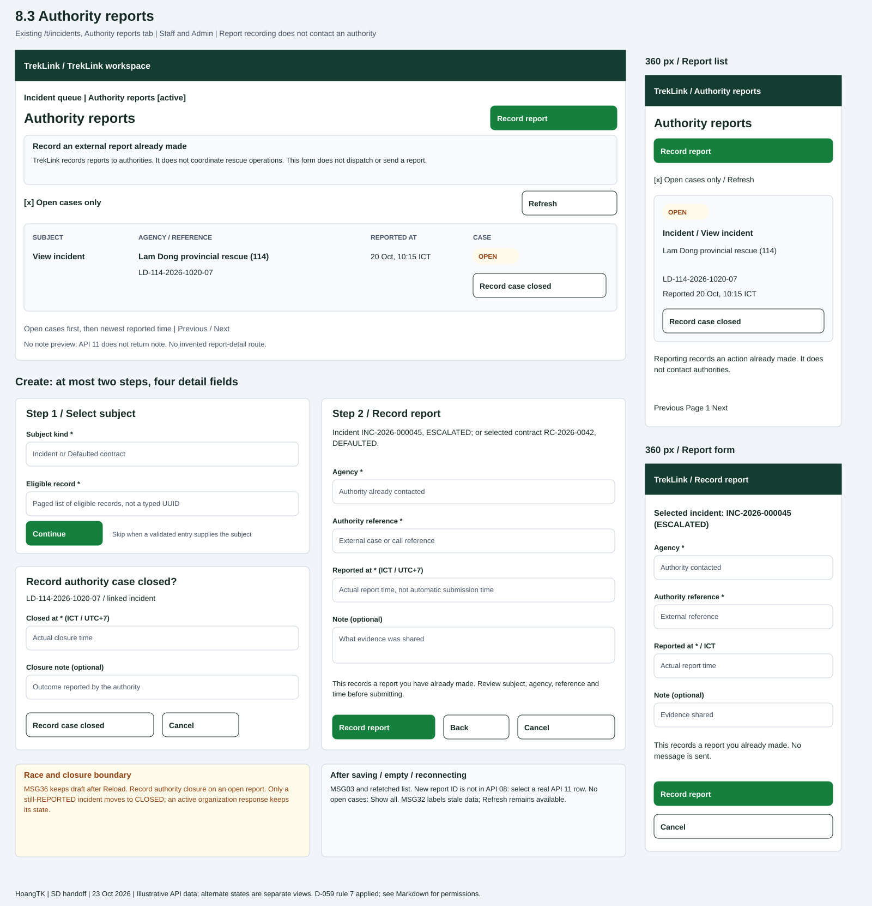

# Authority reports (`/t/incidents`, Authority reports tab)

| | |
|---|---|
| Owner | HoangTK |
| Task | `specs/frontend/tasks.md` 8.3 |
| Assigned, due | 2026-10-21, 2026-10-23 |
| Status | Ready for review |
| Routes | Tab/forms in existing `/t/incidents`; no new authority-report route. Entry from task 8.2 selected incident or `/t/contracts/:id` (task 5.2). [Frontend design section 2](../design.md#2-routes-and-screen-authorization). |
| Roles | TrekLink Staff and TrekLink Admin (D-057 rule 7). Organization roles cannot list/create/close reports here. Their own report collection belongs to incidents API 02, outside this screen. |
| Use case, FRs, story | UC-35, UC-37; FR-INC-04, FR-INC-10, FR-INC-11; BR-15, BR-17, BR-18; US-UC35, US-UC37. Contract reporting also traces UC-50 and BR-26. |
| Requirements | [Incidents](../../incidents/requirements.md): REQ-UBI-01, REQ-EVT-09, REQ-EVT-10, REQ-ERR-01, AC-04. [Frontend](../requirements.md): REQ-UBI-01 to REQ-UBI-05, REQ-UBI-07, REQ-ERR-01. |
| Wireframe |  |

Scope: incidents API 08 to 11, linked through [API index](../../incidents/api-design/README.md). Messages follow [SRS section 5.3](../../../../Documents/reports/Report3_SRS_DRAFT.md), with MSG36 from D-057. Ready for review is not approval of the contract questions below.

## Layout

Use task 8.2's shell/tabs at `/t/incidents`. Report tab: title, primary Record report, Open cases only, Refresh, server-paged table. Default `open=true`; unchecking omits `open` to show all. Do not assume `open=false` means closed-only. There is no unsupported agency/date/subject/sort filter.

Record report opens at most two steps: select kind and eligible subject, then agency/reference/report time/optional note. A validated incident or contract entry context skips selection. Subject stays visible read-only during entry. An incident must be `UNROUTED` or `ESCALATED`; a contract must be `DEFAULTED`. Recheck current eligibility before opening.

This records an external report already made by a person. The submit does not contact or dispatch an authority. Visible copy: "TrekLink records reports to authorities. It does not coordinate rescue operations." Incident success means `REPORTED`; an organization member can acknowledge afterwards. Contract reporting does not imply a contract state change.

Open report rows have a secondary Record case closed action. API 09's activity diagram first records `caseClosedAt`, then transitions the linked incident only if it is still `REPORTED`. A report linked to an incident that an organization has since acknowledged can still record authority closure; it does not close that incident's active response. Contract report closure records the authority closure time, not contract settlement. No report edit/delete action exists.

Reuse shared forms/dialogs, pager, badges and task 8.1's Tailwind/brand tokens. Open/Closed is derived from `caseClosedAt`, not a fictitious report `status`. Dialogs stay beneath the global alert region.

## Data

| Shown | Source (api-design file, property) |
|---|---|
| Agency, authority reference, reported and closed times | [API 11](../../incidents/api-design/11-get-authority-reports.md) `items[].agency`, `reference`, `reportedAt`, `caseClosedAt`. Null closure: Open; non-null: Closed. |
| Subject kind and link | API 11 `items[].incidentId` or `contractId`. Use View incident / View contract unless a separate subject GET supplies its code. `id` is the internal report action key, not an invented report code. |
| Incident selection/heading | [API 01](../../incidents/api-design/01-get-incidents.md) and [API 02](../../incidents/api-design/02-get-incidents-id.md): `id`, `code`, `state`, `device.assetTag`, `version`. Version is hidden metadata for API 08. |
| Contract selection/heading | [Rentals API 02](../../rentals/api-design/02-get-contracts.md), [API 03](../../rentals/api-design/03-get-contracts-id.md): `id`, `code`, `status`, `organization.legalName`. Select `status=DEFAULTED`; overdue days never substitute for this state. |
| Pagination | API 11 `pageNumber`, `pageSize`, `totalCount`, `totalPages`; initial size 20 within `MAX_PAGE_SIZE`. Server returns open cases first. |
| Closure result | [API 09](../../incidents/api-design/09-post-authority-reports-reportid-close-case.md): `id`, `caseClosedAt`, `incidentState` when returned. Contract report closure does not mean contract closed. |
| Note | Request `note` in API 08/10/09. API 11 returns no note; there is no note preview or invented report-detail endpoint. |

## Actions

| Control | Endpoint | Confirmation | Success message |
|---|---|---|---|
| Open-only / Refresh / pager | API 11 `GET /api/authority-reports?open=true&pageNumber=1&pageSize=20`; omit `open` for all | None | List updates, no toast |
| Record report / subject kind | Opens form; no mutation | None | No toast |
| Choose eligible incident | API 01 `GET /api/incidents?state=UNROUTED&state=ESCALATED`, paged, then API 02 detail | None | Selected code/state |
| Choose defaulted contract | Rentals API 02 `GET /api/contracts?status=DEFAULTED`, paged, then API 03 detail | None | Selected code/status |
| Save incident report | [API 08](../../incidents/api-design/08-post-incidents-id-authority-reports.md) `POST /api/incidents/:id/authority-reports` | Subject, agency, reference and time visible above Record report. Copy: "This records a report you have already made." | MSG03 "Saved."; incident `REPORTED` |
| Save contract report | [API 10](../../incidents/api-design/10-post-authority-reports.md) `POST /api/authority-reports` | Same; contract must be `DEFAULTED` | MSG03; refresh reports, no assumed contract transition |
| Record case closed | API 09 `POST /api/authority-reports/:reportId/close-case` | "Record case {reference} with {agency} closed?" Linked subject and explicit submit | MSG03; report Closed; still-`REPORTED` incident `CLOSED` |
| View incident | API 02 for row's `incidentId`; switch to task 8.2 inline detail | Guard dirty form | No toast |
| View contract | `/t/contracts/:id`; destination owns GET | Guard dirty form | No toast |
| Back / Cancel / Reload conflict | Form navigation; Reload fetches subject and list as needed | Ask before discarding; Reload preserves values | No toast |

API 08 returns the incident, not the new report ID. Refetch API 11 after saving; do not assume the report appears on page 1 or that its ID equals the incident ID (H-03). An absent subject on one page is not proof that no report exists. Select an actual returned row for closure. Open-only removal after close keeps a success notice.

## States

Map known `result.errorCode` to SRS messages and use server text as fallback (D-057). Drafts stay in memory only; never persist authority notes in browser storage.

| State | What the user sees |
|---|---|
| Loading list / subject | Independent skeletons, submit unavailable until current subject eligibility is known. Never display previous subject data as the new selection. |
| Empty list | "No authority reports recorded." Open-only: "No open authority cases." Show all and Record report remain. Screen copy has no MSG code (D-057 rule 6). |
| Empty selector | MSG01 "No results match your filters." Explain eligible incidents/defaulted contracts only; Refresh/Back remain. |
| `VALIDATION_FAILED` (400, API 08 to 11 and selector lists) | MSG02 for known required/type errors; server-only rules at form level, all values preserved. |
| `UNAUTHENTICATED` (401, all calls) | Refresh once; sign-in on failure with cache/draft/socket clear. |
| `FORBIDDEN` (403, all calls) | MSG26 "You do not have access to this." Main refusal reveals no reports; remove submit if permission disappears. |
| `NOT_FOUND` (404, API 08/09 and subject details) | MSG26; clear inaccessible subject/row and refresh list. API 10 does not document 404. |
| `INVALID_STATE_TRANSITION` (409, API 08) | MSG28 "This cannot be done while it is {state}." Keep form data, refresh incident, select another subject if needed. |
| `STALE_VERSION` (409, API 08) | MSG36 Reload dialog keeps agency/reference/time/note; recheck eligibility and require a deliberate resubmit. |
| `CONTRACT_NOT_DEFAULTED` (409, API 10) | MSG28 using returned contract status; keep details, refresh contract. Never default or report it automatically. |
| `CASE_ALREADY_CLOSED` (409, API 09) | MSG28 with `CLOSED` as API 09 specifies; refresh closure time, remove action, never overwrite another closure. |
| Organization acknowledges after reporting | Report stays visible and its authority closure can still be recorded. Refetch the linked incident after saving; an incident outside `REPORTED` keeps its response state under API 09's conditional transition. Never label report closure as incident resolution. |
| Disconnected | MSG32 "Reconnecting. Live data is paused." Cached list labelled stale; Refresh remains. |
| Network / unknown error | Server fallback or connection message, Retry reads. No success toast for failed POST. Refresh current state/list before another manual attempt; no automatic repeat POST. |
| Success | MSG03, refreshed list and subject. Close returns focus to next row or list heading when Open-only removes the row. |

## Form fields

At most two create steps and four visible detail fields. Entry context can skip step 1. Users select records rather than typing internal UUIDs.

| Step / form | Field | Type | Required | Rule |
|---|---|---|---|---|
| Create, 1 | Subject kind | Incident / Defaulted contract | Yes | Client choice, not an API property. |
| Create, 1 | Subject record | Paged record selector | Yes | UUID from eligible API result; detail GET rechecks state. Incident ID is path value; contract ID is API 10 `contractId`. |
| Create, 2 | Agency, `agency` | Text input | Yes | String, API 08/10; no undocumented length cap. |
| Create, 2 | Authority reference, `reference` | Text input | Yes | External authority's reference; never generated by TrekLink. |
| Create, 2 | Reported at, `reportedAt` | Datetime with zone | Yes | Valid ISO datetime. API 08 forbids future time; API 10 has no explicit temporal bound (H-05). Do not treat submission time as actual call time by default. |
| Create, 2 | Note, `note` | Textarea | No | String describing evidence shared. No attachment or upload control exists. |
| Create, hidden | `expectedVersion` | Integer | Yes, API 08 only | Version reviewed on entering incident form. API 10 has no version field. |
| Close, 1 | Closed at, `closedAt` | Datetime with zone | Yes | Valid datetime, API 09; temporal bounds not specified (H-05). |
| Close, 1 | Closure note, `note` | Textarea | No | String. Report ID comes from API 11 row; API 09 has no version field. |

Confirmation is embedded in create step 2 and the separate one-step close dialog. Show timezone beside the datetime control; serialize explicit offset/UTC. Enforce documented types and required fields only; H-05 requests remaining validation limits from KhoaDD.

## Mobile, accessibility, live data

- **360 px:** wireframe draws report cards and a single-column report form. Card labels include kind, agency, full reference, reported time, Open/Closed and action. Controls at least 44 px, long notes/references wrap. Subject and confirmation precede Submit; no page-level horizontal scroll.
- **Focus:** skip link, alert, navigation, tabs, Record report, Open-only, Refresh, row subject/close controls, pager. Form order follows fields; opening focuses heading/first field. Back preserves values, Escape asks before dirty discard and restores trigger. Success focuses list heading or next row; errors focus first invalid field or form summary. Pending/success is polite, failures are alerts.
- **Shell:** task 8.1 labelled badges, focus contrast and reduced motion. Show pending/disable repeat submit within 1 second. Global alert stays above overlays; Close restores access. Staff use Open queue, never organization acknowledgement. All displayed times include viewer timezone, UTC+7 default, on focus/hover. No payment, sandbox or map UI is needed here.
- **Keys:** `['authority-reports', 'fleet', openOnly, pageNumber, pageSize]`, `['incident', 'fleet', id]`, `['contract', 'fleet', id]`. API 08 invalidates reports, incident queues/detail/transitions; API 10 reports; API 09 reports plus incident queues/detail/transitions if incident-linked. Reconcile final state from GET.
- **Stream/fallback:** share the [live socket](../../monitoring/api-design/ws-live-contract.md). `incident.changed` invalidates report list/selected incident and rechecks eligibility without erasing drafts. No `authority-report.changed` or contract-report event is specified. Refresh, tab entry and window-focus refetch reconcile those changes; do not promise a push that does not exist. MSG32 until `replay.done`; after `replay.expired`, shell snapshot recovery then refetch. Ignore duplicate sequences; clear cache/drafts on account change.

## Review notes

Carry [the review-note dispositions](../../../docs/sessions/2026-10-23-1111-hoangtk-screen-design.md#review-and-submission-continuation) into the PR description. H-01 still requests a sorting ruling. H-03 uses the existing paged list, H-05 preserves documented validation, and H-06 is resolved by API 09's activity diagram and catalog steps. No generated catalog, requirement or lifecycle is modified.

## Checklist

- [x] Existing route/tab integration and Staff/Admin authorization are explicit.
- [x] Fields/subject lookups are sourced; no report-detail API or note preview is invented.
- [x] Both report actions and closure have endpoints, confirmation and MSG03 feedback.
- [x] Loading, empty, success and documented errors are covered.
- [x] Create fits two steps/four detail fields; closure fits one step/two fields.
- [x] Mobile collapse and a 360 px form are drawn.
- [x] Focus, keyboard, errors and text alternatives are specified.
- [x] Invalidation, stream limits and refresh fallback are stated.
- [x] Use cases, FRs, business rules and stories are traced.
- [x] Chapter 06 section 8 placement, primary action, labelled state, feedback, recovery, input preservation, time, alert priority and reuse are addressed.
- [ ] Server sorting awaits H-01.
- [x] H-06 follows API 09: record authority closure, and close the incident only if still `REPORTED`.
