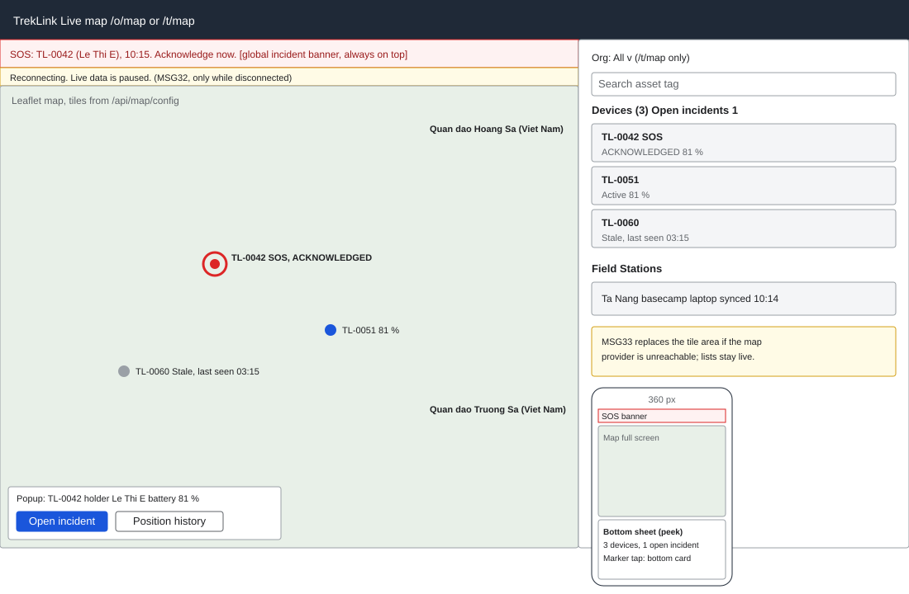

# `LiveMapPage` for organizations and the fleet (`/o/map`, `/t/map`)

| | |
|---|---|
| Owner | LongNN |
| Task | `specs/frontend/tasks.md` 9.1 |
| Assigned, due | 2026-10-21, 2026-10-23 |
| Status | Ready for review |
| Routes | `/o/map` (organization workspace) and `/t/map` (fleet map); one `LiveMapPage` component, the route sets the scope (`specs/frontend/design.md` §2) |
| Roles | `/o/map`: Org Operator and Org Manager, own organization only (the token fixes the organization, REQ-UBI-06). `/t/map`: TrekLink Staff and TrekLink Admin (Admin inherits every Staff route, FR-AUTH-10, auth REQ-UBI-05; D-057 rule 7), plus the organization filter. Other roles: MSG26. |
| Use case, FRs, story | UC-38, UC-41; FR-MON-01 to FR-MON-05, FR-MON-09, FR-AUTH-11, FR-CFG-03, FR-INC-13; BR-19, BR-21, BR-30; E04-1, E04-3; US-UC38, US-UC41 |
| Requirements | `specs/monitoring/requirements.md` REQ-UBI-01 to REQ-UBI-03, REQ-EVT-01 to REQ-EVT-04, REQ-STA-01, REQ-STA-02; NFR-UI-01, NFR-LEG-01 |
| Wireframe |  (desktop and 360 px frames) |

Scope from the task: monitoring api-design 01 and 02 then stream entries in `seq` order, ignoring entries at or below the snapshot cursor; stale markers with last-seen time; pulsing incident markers; late entries kept off the live map

## Data

| Shown | Source (api-design file, property) |
|---|---|
| Base tiles and attribution (always visible on the map) | monitoring 01 `tileUrl`, `attribution`, `provider` |
| Initial centre and zoom | monitoring 01 `defaultViewport.lat`, `lon`, `zoom` |
| Sovereignty overlay labels over the two archipelagos (always on top, no toggle), each on an opaque mask that hides the basemap's own labels there (D-085) | monitoring 01 `sovereigntyOverlay[].label`, `lat`, `lon`, `mask` |
| Stale threshold used for the "stale" text | monitoring 01 `staleAfterSeconds` |
| Device marker position | monitoring 02 `devices[].position.lat`, `lon`; later `device.position` stream payload |
| Marker label: asset tag | monitoring 02 `devices[].assetTag` |
| Marker popup: holder label | monitoring 02 `devices[].holder.name`; `device.label` stream payload (null shows "No holder") |
| Marker popup: contract code | monitoring 02 `devices[].contractCode` |
| Marker popup: variant | monitoring 02 `devices[].hardwareVariant` |
| Marker popup: battery | monitoring 02 `devices[].batteryPct`; `device.telemetry` payload `batteryPct` |
| Marker popup: last seen (viewer timezone) | monitoring 02 `devices[].lastSeenAt`; `device.stale` payload `lastSeenAt` |
| Stale state ("Stale, last seen 03:15") | monitoring 02 `devices[].stale`; `device.stale` payload `stale` |
| Open incident on a marker (pulsing ring) and link to the incident | monitoring 02 `devices[].openIncident`; `incident.changed` payload `incidentId`, `code`, `state`, `tier`, `ownerName`, `lastPosition`, `stale` |
| Field Station list (side panel): name, last sync, stale | monitoring 02 `fieldStations[].name`, `lastSyncAt`, `stale`; `station.stale` payload |
| Device list (side panel, same rows as markers) | monitoring 02 `devices[]` |
| Subscription cursor (not shown) | monitoring 02 `cursor`; stream `seq` |
| Connection banner | MSG32 text from the WebSocket state |

Rules for what is drawn, from the contract and the requirements:
- A position with `late: true` is never drawn as a live marker (ws-live-contract; REQ-EVT-04). It may appear in the device history (screen 9.2).
- A device never gets a marker for a position marked not plotted (REQ-UBI-03); the server never sends one.
- A `device.released` entry removes the device from the map at once.
- A device with no position yet is listed in the side panel with "No position yet" and has no marker.
- An incident marker has a text alternative ("SOS at TL-0042, {state}") and a state label; pulsing is an extra cue, never the only one (§8 item 3).

## Actions

| Control | Endpoint | Confirmation | Success message |
|---|---|---|---|
| Page load, step 1 | monitoring 01 `GET /api/map/config` | none | none |
| Page load, step 2 | monitoring 02 `GET /api/map/snapshot` (`/t/map` adds `?organizationId` when the organization filter is set; omit it for the whole fleet) | none | none |
| Page load, step 3 | WebSocket `/live` handshake with `{ token, after: <snapshot cursor> }`; the server replays entries after the cursor, then `replay.done`, then live entries | none | none |
| Organization filter (`/t/map` only) | monitoring 02 with `organizationId`; the socket stays on the `fleet` room and the client filters entries by the organization of the device | none | none |
| Marker click: opens popup | none (data already loaded) | none | none |
| Popup: "Open incident" (only when `openIncident` is set) | navigation to `/o/incidents/:id` (screen 8.1) on `/o/map`, or `/t/incidents` (screen 8.2) on `/t/map` | none | none |
| Popup: "Position history" | navigation to the telemetry screen 9.2: `/o/devices/:id/telemetry` on `/o/map`, `/t/devices/:id/telemetry` on `/t/map` | none | none |
| Side panel row click | centres the map on the marker and opens its popup | none | none |
| Reload map (shown with MSG33 or after `replay.expired`) | repeats steps 1 and 2 | none | none |

The map changes nothing on the server: acknowledgement and every other incident action go through
REST on the incident screens (ws-live-contract, "Client-to-server events"). There is no primary
button; the map is the primary surface.

## States

| State | What the user sees |
|---|---|
| Loading | Map frame with a centred spinner and the text "Loading the map"; side panel skeleton rows. The incident banner is above the page and is not blocked by loading (§8 item 9). |
| Empty | `/o/map`: no rented devices, side panel reads "No devices are out on rent. Devices appear here from handover to check-in." `/t/map`: MSG01 when the organization filter returns nothing. The map still draws, with the overlay. |
| Reconnecting | Banner MSG32 "Reconnecting. Live data is paused." from disconnect to `replay.done`; the last known positions stay (REQ-STA-01) |
| `replay.expired` | The client reloads `GET /api/map/snapshot` and re-subscribes from the new cursor; markers redraw once, no message |
| Map provider unreachable | Panel MSG33 "The map is unavailable. Device and incident lists are still live." replaces the tile area; the side panel keeps updating (REQ-STA-02) and the overlay labels are listed as text |
| Error `UNAUTHENTICATED` (401, REST) or `connect_error` `UNAUTHENTICATED` | One silent refresh and a reconnect with `auth.refresh`; if that fails, `/sign-in` |
| Error `KEY_REVOKED` | Not applicable to the web user (API keys do not open this page) |
| Error `VALIDATION_FAILED` (400, snapshot) | Banner with the server message; the organization filter resets to "All" |
| Not found or forbidden (403) | MSG26 full-page notice. Another organization's device is never sent (REQ-ERR-01 answers 404 on direct requests). |
| Stale device | Marker drawn grey with the text "Stale" and "last seen {time}" in the popup and the list; the colour is paired with text (§8 item 3) |
| Stale Field Station | Row in the side panel with "Stale, last sync {time}" |
| Success | Markers and list in sync; the cursor advances with every applied entry |

## Form fields (if any)

None. The only inputs are the organization filter (`/t/map`) and the side-panel search box, which
filter in the client.

## Mobile, accessibility, live data

- 360 px layout (required by NFR-UI-01): see the second frame of the wireframe. The map fills the screen under a 48 px header. The side panel becomes a bottom sheet with three snap positions (peek with the device count and the number of open incidents, half, full). A marker tap opens its popup as a bottom card with the holder, battery, last seen and the Open incident button at least 44 px high. The MSG32 banner and the incident banner sit above the map and are never covered by the sheet. The organization filter lives in the sheet header.
- Tab order and focus after each action: skip link, banner, organization filter, side-panel search, side-panel list, then the map controls (zoom, recentre), then markers. Each marker is a focusable element with an `aria-label` ("TL-0042, holder Le Thi E, battery 81 percent, last seen 03:15" and "SOS, state ACKNOWLEDGED" when an incident is open). Enter on a list row or marker opens the popup and moves focus into it; Escape closes it and returns focus to the marker. Arrow keys pan the map.
- WebSocket events and invalidated query keys: the page does not use polling. Entries of the event `stream` are applied in `seq` order to the in-memory map state, ignoring any entry at or below the snapshot cursor (`ack` is optional and diagnostic only):
  - `device.position` updates the marker (skipped when `late: true`), which glides to the new reading over about 1 s and moves at once on a first placement, a move over 2 km or out of view, or under `prefers-reduced-motion: reduce`; the open popup moves with it and a side-panel selection pans to the new reading; `device.telemetry` updates the battery; `device.stale` toggles the stale state; `device.label` updates the holder; `device.released` removes the device.
  - `incident.changed` updates the pulsing ring and invalidates `['incident', incidentId]` and `['incident-queue']`; `incident.alert` is handled by the global banner (MSG31), not by this page.
  - `station.stale` updates the Field Station row.
  - Query keys: `['map', 'config']`, `['map', 'snapshot', organizationId]`. A reconnect with `replay.done` does not refetch; `replay.expired` invalidates `['map', 'snapshot']`.

## Checklist

Chapter 06 §7 (Screen Design Checklist) and §8 (UI and UX practices), ticked by the owner before review.

- [x] Route and roles match `design.md` §2 (Admin inherits the Staff route, D-057 rule 7)
- [x] Data: every field names its source; stream payload properties are cited from `ws-live-contract.md`
- [x] Actions: load sequence, filter, popup links; no mutating call
- [x] States: loading, empty, reconnecting, `replay.expired`, MSG33, 401, 400, 403, stale, success
- [x] Forms: none
- [x] Mobile: 360 px layout drawn (NFR-UI-01)
- [x] Accessibility: tab order, focus on popup open and close, text alternative on every marker
- [x] Live data: events and query keys listed
- [x] Traceability: UC-38, UC-41, FR-MON-01 to FR-MON-05, US-UC38, US-UC41
- [x] §8 items 3, 8, 9 (alerts outrank the map), 10 applied
