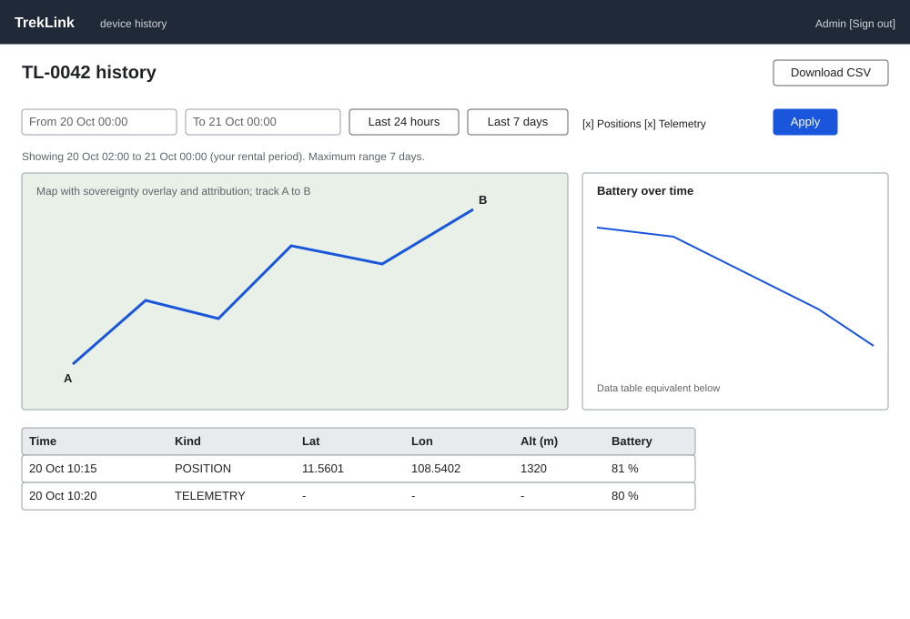

# Device telemetry history (`/o/devices/:id/telemetry`, `/t/devices/:id/telemetry`)

| | |
|---|---|
| Owner | LongNN |
| Task | `specs/frontend/tasks.md` 9.2 |
| Assigned, due | 2026-10-21, 2026-10-23 |
| Status | Ready for review |
| Routes | `/o/devices/:id/telemetry` (organizations) and `/t/devices/:id/telemetry` (TrekLink Staff and Admin); the period is in the query, `?from=&to=` (`specs/frontend/design.md` §2, D-057 rule 8). Named telemetry so it never collides with the lifecycle history of `/t/devices/:id` (monitoring api-design 07). Entry points: the map popup (screen 9.1), the contract device row (`/o/contracts/:id`), and the device detail page (screen 4.2). |
| Roles | Org Operator and Org Manager: own devices, clipped to the periods the organization rented them. TrekLink Staff and Admin: any device, whole history. Other roles: MSG26. |
| Use case, FRs, story | UC-40; FR-MON-07, FR-MON-04, FR-AUTH-11; BR-19; US-UC40 |
| Requirements | `specs/monitoring/requirements.md` REQ-EVT-06, REQ-ERR-01, REQ-ERR-02, REQ-UBI-03 |
| Wireframe |  |

Scope from the task: monitoring api-design 03; a range of at most `monitoring.historyMaxRangeDays` days (7 by default, configurable from 1 to 31)

## Data

| Shown | Source (api-design file, property) |
|---|---|
| Device heading: asset tag | devices api-design 07 `GET /api/devices/:id` `assetTag` (staff); for organizations the tag arrives from the link that opened the page (map snapshot `devices[].assetTag`) |
| Rented periods the data is clipped to ("Showing 20 Oct 02:00 to 21 Oct 00:00, your rental period") | monitoring 03 `clippedTo[].from`, `clippedTo[].to` |
| Track on the map: polyline through the `POSITION` points in time order, start and end markers | monitoring 03 `points[]` where `kind = POSITION`: `lat`, `lon`, `at` |
| Sovereignty overlay and attribution on this map too | monitoring 01 `sovereigntyOverlay`, `attribution` |
| Table row: time | monitoring 03 `points[].at` |
| Table row: kind badge `POSITION` or `TELEMETRY` | monitoring 03 `points[].kind` |
| Table row: latitude, longitude | monitoring 03 `points[].lat`, `lon` |
| Table row: altitude (m) | monitoring 03 `points[].altitude` |
| Table row: battery (%) | monitoring 03 `points[].batteryPct` |
| Battery over time (small line chart under the map) | monitoring 03 `points[].batteryPct`, `at` |

No point marked not plotted is returned, so none is drawn (FR-MON-04). Points are not paged by the
endpoint; the table pages in the client (50 rows), and the 7-day cap keeps the response bounded.

## Actions

| Control | Endpoint | Confirmation | Success message |
|---|---|---|---|
| Load with the default range (the last 24 hours) | monitoring 03 `GET /api/telemetry/devices/:id/history?from&to&kind` | none | none |
| Range: From and To pickers, quick buttons "Last 24 hours" and "Last {n} days" with n = `monitoring.historyMaxRangeDays`; the range is written to `?from=&to=` | same | none | none |
| Kind filter: Positions, Telemetry (both on by default) | same with `kind` | none | none |
| Download CSV (secondary, top right) | monitoring 03 `GET /api/telemetry/devices/:id/history?...&format=csv` | none | file saved; no toast |
| Row click | centres the map on the point | none | none |
| Back to device (link) | navigation to the map popup source or `/t/devices/:id` | none | none |

The screen is read-only. Its main control is the range picker; Download CSV is secondary.

## States

| State | What the user sees |
|---|---|
| Loading | Map frame with spinner, chart and table skeletons; the range controls stay usable |
| Empty | MSG01 "No results match your filters." plus the line "Your organization rented this device from {from} to {to}" taken from `clippedTo` when the requested range lies outside it |
| Error `VALIDATION_FAILED` (400): period reversed or longer than `monitoring.historyMaxRangeDays` (REQ-ERR-02) | The form blocks it first with MSG35 under the To field ("Choose an end after the start, at most {n} days later.", n from the parameter); the server message is the backstop in a banner |
| Error `UNAUTHENTICATED` (401) | One silent refresh, then `/sign-in` |
| Error `NOT_FOUND` (404) | Another organization's device, or an unknown id: MSG26 full-page notice, with no hint which of the two it was (REQ-ERR-01) |
| Not found or forbidden (403) | MSG26 full-page notice |
| Map provider unreachable | Panel MSG33 replaces the map; the table and chart still render |
| Success | Track, chart and table agree on the same points; the range is kept in the URL query (ISO dates only) |

## Form fields (if any)

One step of 3 fields.

| Step | Field | Type | Required | Rule |
|---|---|---|---|---|
| 1 | From | date and time | yes | Inclusive; sent as ISO 8601 UTC |
| 1 | To | date and time | yes | Exclusive; after From and at most `monitoring.historyMaxRangeDays` days after From; MSG35 otherwise |
| 1 | Kind | checkbox pair: Positions, Telemetry | no | At least one stays ticked; both sends no `kind` |

## Mobile, accessibility, live data

- 360 px layout: not one of the operator screens required by NFR-UI-01, and it collapses the same way. Range controls stack, the map takes the first 240 px, the chart follows, and the table becomes cards (time, kind badge, position, battery). Download CSV moves into an overflow menu.
- Tab order and focus after each action: back link, range fields, kind checkboxes, Apply, Download CSV, map controls, chart (with a data table equivalent below it, so the chart is not the only way to read the values), table, pager. After Apply, focus moves to the result summary ("{n} points"), announced in a polite live region. The track has a text alternative: "Track of TL-0042 from {first time} to {last time}, {n} positions".
- WebSocket events and invalidated query keys: none; history is a fixed past range, so the stream does not change it. Query key `['telemetry-history', deviceId, from, to, kind]`; stale time 60 seconds.

## Checklist

Chapter 06 §7 (Screen Design Checklist) and §8 (UI and UX practices), ticked by the owner before review.

- [x] Route and roles match `design.md` §2 (`/o|/t/devices/:id/telemetry`)
- [x] Data: every field names its source property
- [x] Actions: endpoint and range rule for each control
- [x] States: one row per error code of monitoring 03, MSG33, empty with the clipping explanation
- [x] Forms: 1 step, 3 fields
- [x] Mobile: collapse rule stated
- [x] Accessibility: chart has a table equivalent, track has a text alternative
- [x] Live data: none, stated
- [x] Traceability: UC-40, FR-MON-07, US-UC40
- [x] §8 items 3, 6, 8 applied
