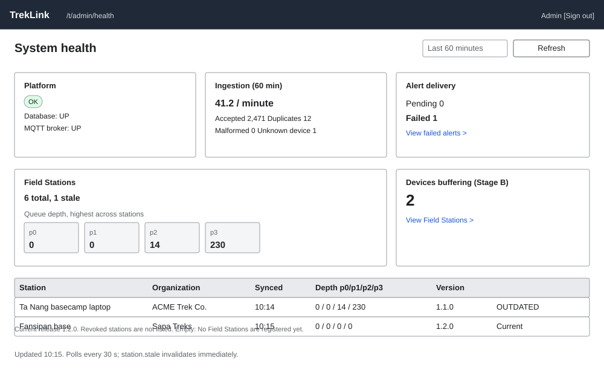

# `SystemHealthPage` (`/t/admin/health`)

| | |
|---|---|
| Owner | LongNN |
| Task | `specs/frontend/tasks.md` 9.3 |
| Assigned, due | 2026-10-21, 2026-10-23 |
| Status | Ready for review |
| Routes | `/t/admin/health` (`specs/frontend/design.md` §2) |
| Roles | TrekLink Admin only (permission `systemHealth.read`, `specs/auth/permission-matrix.md`). Staff and organization roles: MSG26. |
| Use case, FRs, story | UC-42; FR-MON-10, FR-EVT-13, FR-EVT-18; US-UC42 |
| Requirements | `specs/monitoring/requirements.md` REQ-EVT-03, REQ-STA-01; `specs/platform/requirements.md` REQ-EVT-04 |
| Wireframe |  |

Scope from the task: monitoring api-design 06; stations with depth per tier and `outdated`; buffering devices; alert delivery stats

## Data

| Shown | Source (api-design file, property) |
|---|---|
| Platform status badge `OK` or `DEGRADED` (text, not colour alone) | monitoring 06 `health.status` |
| Component rows: database, MQTT broker, each `UP`, `DOWN` or `UNKNOWN` | monitoring 06 `health.components.database`, `health.components.mqtt` |
| Ingestion rate (messages per minute) | monitoring 06 `ingestion.perMinute` |
| Accepted, duplicates, malformed, unknown device counts for the window | monitoring 06 `ingestion.accepted`, `duplicates`, `malformed`, `unknownDevice` |
| Window selector value ("Last 60 minutes") | monitoring 06 query `windowMinutes` |
| Field Stations: total and stale counts, "1 of 6 stale" | monitoring 06 `fieldStations.total`, `fieldStations.stale` |
| Queue depth per tier ("Tier 1: 0, Tier 2: 0, Tier 3: 14, Tier 4: 230"), highest across stations | monitoring 06 `fieldStations.maxQueueDepth[0..3]` |
| Devices buffering (Stage B, holding messages that have not reached a Field Station) | monitoring 06 `devicesBuffering` |
| Alert delivery: pending and failed counts | monitoring 06 `alerts.pending`, `alerts.failed` |
| Per-station rows with a version and an `outdated` flag | not returned by monitoring 06 (open item O-9); the same facts exist per organization in organizations api-design 23 `GET /api/organizations/:id/field-stations` (FR-EVT-18) |
| Last refreshed time | client clock at the last successful load |

The task asks for "stations with depth per tier and `outdated`". Monitoring 06 returns only the
aggregate (`total`, `stale`, `maxQueueDepth` across stations). The screen therefore shows the
aggregate card and a link "Field Stations by organization" to the fleet screens. The per-station
depth and `outdated` table is specified below as a conditional section that appears once the
contract adds it (O-9); until then it is not drawn and no data is invented for it.

## Actions

| Control | Endpoint | Confirmation | Success message |
|---|---|---|---|
| Page load and Refresh | monitoring 06 `GET /api/system-health?windowMinutes` | none | none |
| Window selector: 15, 60, 240 minutes | same with `windowMinutes` | none | none |
| Failed alerts card, "View failed alerts" link | navigation to `/t/incidents` (screen 8.2) | none | none |
| Stale stations card, "View Field Stations" link | navigation to `/t/organizations` (screen 3.2) | none | none |

Read-only. There is no primary action; Refresh is the only control in the header.

## States

| State | What the user sees |
|---|---|
| Loading | Five card skeletons; the window selector is usable |
| Empty | A fresh platform with no traffic shows zeros, not an empty state. If `fieldStations.total` is 0 the card says "No Field Stations are registered yet." (copy to confirm, open item O-6) |
| Error `VALIDATION_FAILED` (400) | Banner with the server message (for example an out-of-range `windowMinutes`); the selector resets to 60 |
| Error `UNAUTHENTICATED` (401) | One silent refresh, then `/sign-in` |
| Error `SERVICE_UNAVAILABLE` (503, from the health probe) | The platform card shows `DEGRADED` or `DOWN` with the component name; the other cards keep their last loaded data with "Last updated {time}". If no data ever loaded, a panel with Retry. |
| Not found or forbidden (403) | MSG26 full-page notice |
| MQTT `UNKNOWN` | Shown as `UNKNOWN` with the text "No probe is registered" (monitoring and platform health contract), never as `UP` |
| Reconnecting | MSG32 banner while the socket is down; the page keeps polling |
| Success | Cards with values and the refreshed time; a card with a problem (`stale > 0`, `failed > 0`, `DEGRADED`) carries its warning text and a link |

## Form fields (if any)

One control, not a form: the window selector (select, required, one of 15, 60 or 240 minutes,
default 60 as in monitoring 06 `windowMinutes`; the exact choices are a client decision within the
endpoint's integer parameter).

## Mobile, accessibility, live data

- 360 px layout: not an operator screen. Cards stack in one column in the order platform, alerts, Field Stations, ingestion, buffering; the window selector is a full-width select.
- Tab order and focus after each action: header (Refresh), window selector, cards in reading order with their links. After Refresh, focus stays on the button and a polite live region announces "Health updated at {time}". Status is text plus an icon with a text alternative, never colour alone (§8 item 3).
- WebSocket events and invalidated query keys: `station.stale` (room `fleet`) invalidates `['system-health']` so the stale count updates at once. Everything else is read by polling every 30 seconds while the tab is visible (a client design choice, no contract states an interval). Query key `['system-health', windowMinutes]`.

## Checklist

Chapter 06 §7 (Screen Design Checklist) and §8 (UI and UX practices), ticked by the owner before review.

- [x] Route and roles match `design.md` §2 and the permission matrix
- [x] Data: every figure names its monitoring 06 property; the per-station table gap is open item O-9
- [x] Actions: read-only, links named
- [x] States: loading, zeros, 400, 401, 503, MQTT unknown, 403, success
- [x] Forms: one selector
- [x] Mobile: collapse rule stated
- [x] Accessibility: text status, live region, tab order
- [x] Live data: `station.stale` and polling stated
- [x] Traceability: UC-42, FR-MON-10, FR-EVT-13, US-UC42
- [x] §8 items 3, 5, 6 applied
