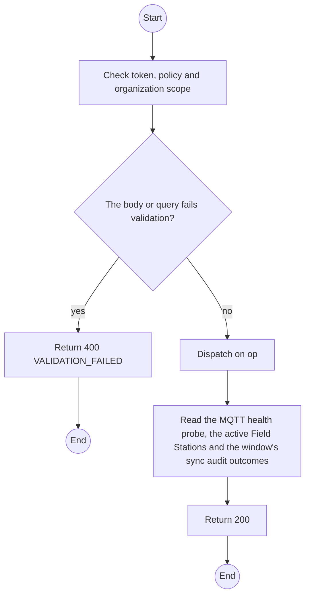
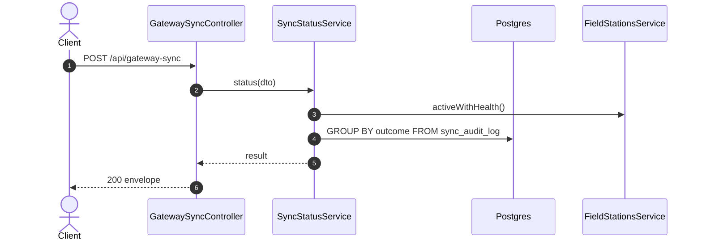

# POST /api/gateway-sync op syncStatus: Field data sync status

> Module `gateway-sync`. Generated from `scripts/specs/endpoints/gateway_sync.py` by `scripts/specs/build_api_design.py`; edit the catalog, not this file. Format: `02-templates/04-api-endpoint-template.md` with Mermaid (D-017). Envelope: D-002.

[TOC]

---
## Overview

MF-02 end to end for TrekLink Staff and Admin: the backend's MQTT subscriber connection, every Field Station that is not revoked with its connection state, queue depth per priority (D-057 rule 9), last sync, last flush and version, and the window's ingestion outcomes from the sync audit (FR-EVT-13, FR-EVT-18). Needs `read FieldEvent` and `read FieldStation`.

## API Specification

| API | URL |
| --- | --- |
| POST | /api/gateway-sync |
| Permission | TrekLink Staff, TrekLink Admin |
| Operation | `op: "syncStatus"` (D-027) |
| Traces | UC-26, UC-42, FR-EVT-01, FR-EVT-13, FR-EVT-18 |

## Request sample

```json
{
  "op": "syncStatus",
  "windowMinutes": 60
}
```

| Field | Description | Data Type | Required | Examples |
| --- | --- | --- | --- | --- |
| op | Literal `syncStatus` | string | yes | `syncStatus` |
| windowMinutes | Ingestion look-back, default 60, at most 1440 | int | no | `60` |

## Response sample

```json
{
  "result": {
    "broker": {
      "subscriber": "up"
    },
    "staleAfterSeconds": 180,
    "fieldStations": [
      {
        "id": "f1e2d3c4-b5a6-4978-8a9b-0c1d2e3f4a5b",
        "name": "Ta Nang basecamp laptop",
        "mqttUsername": "fs-org-0001-1",
        "organization": {
          "id": "5b1d2c0e-7f3a-4e21-9c8d-1a2b3c4d5e6f",
          "code": "ORG-0001",
          "name": "TrekLink Demo Tours Co., Ltd."
        },
        "connection": "CONNECTED",
        "lastSyncAt": "2026-10-20T03:15:00.000Z",
        "lastFlushAt": "2026-10-20T03:15:00.000Z",
        "queueDepth": {
          "p0": 0,
          "p1": 0,
          "p2": 2,
          "p3": 9
        },
        "oldestRetryCount": 0,
        "version": "0.1.0"
      }
    ],
    "ingestion": {
      "windowMinutes": 60,
      "accepted": 26,
      "acceptedUnattributed": 1,
      "duplicates": 10,
      "malformed": 0,
      "unknownDevice": 2,
      "lastReceivedAt": "2026-10-20T03:15:00.000Z"
    }
  },
  "isSuccess": true,
  "statusCode": 200,
  "message": "OK"
}
```

## Validation

<table>
    <th>Status code</th>
    <th>Description</th>
    <th>Examples</th>
    <tbody>
        <tr>
            <td>400</td>
            <td>The body or query fails validation (<code>VALIDATION_FAILED</code>)</td>
<td>

```json
{
  "result": {
    "errorCode": "VALIDATION_FAILED"
  },
  "isSuccess": false,
  "statusCode": 400,
  "message": "{field} is required."
}
```
</td>
        </tr>
        <tr>
            <td>401</td>
            <td>Missing, malformed or expired access token or API key (<code>UNAUTHENTICATED</code>)</td>
<td>

```json
{
  "result": {
    "errorCode": "UNAUTHENTICATED"
  },
  "isSuccess": false,
  "statusCode": 401,
  "message": "Authentication required."
}
```
</td>
        </tr>
        <tr>
            <td>403</td>
            <td>The caller's role, policy or organization does not allow this action (<code>FORBIDDEN</code>)</td>
<td>

```json
{
  "result": {
    "errorCode": "FORBIDDEN"
  },
  "isSuccess": false,
  "statusCode": 403,
  "message": "You do not have access to this."
}
```
</td>
        </tr>
    </tbody>
</table>

## Activity Diagram



## Sequence Diagram


