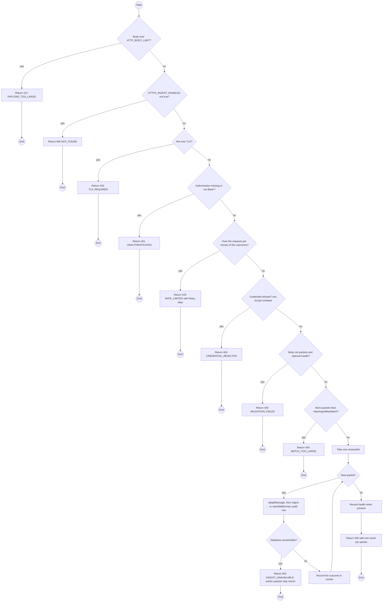
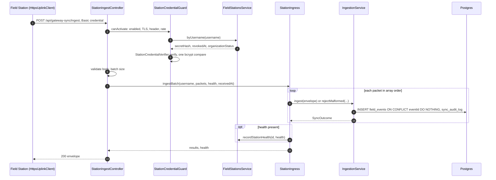

# POST /api/gateway-sync/ingest: Ingest a Field Station batch over HTTPS

> **Draft, pending supervisor acceptance (D-098 amended)**: built only if the supervisor accepts it (gateway-sync design §10); MQTT stays the primary uplink.

> Module `gateway-sync`. Generated from `scripts/specs/endpoints/gateway_sync.py` by `scripts/specs/build_api_design.py`; edit the catalog, not this file. Format: `02-templates/04-api-endpoint-template.md` with Mermaid (D-017). Envelope: D-002.

[TOC]

---
## Overview

The HTTPS fallback of the Stage C uplink, for a deployment that hosts no MQTT broker, such as the Vercel staging (design §10). Each element of `packets` is exactly a Stage C MQTT message (mqtt-ingress-contract.md: the stock JSON plus `fs_captured_at` and `fs_sent_at`), and goes through the same `FieldStationJsonAdapter` decoding and `IngestionService.ingest` as that message, with ingress `FIELD_STATION` and the authenticated username as the uplink key: same `eventId` (D-006), same deduplication, occurrence time, attribution, audit row and outcomes. A packet sent over MQTT and over HTTPS is stored once (BR-11). Packets are ingested one at a time in array order with one `receivedAt` for the request, and the answer lists one result per packet in that order; the Field Station removes exactly the rows listed. An optional `health` member is the `treklink.fs_health` report of the station's health topic and is recorded the same way. MQTT stays the primary uplink: the Field Station uses this route only when no broker is configured (REQ-EVT-19).

## API Specification

| API | URL |
| --- | --- |
| POST | /api/gateway-sync/ingest |
| Permission | Public (Field Station credential) |
| Traces | UC-26, UC-27, FR-EVT-01, FR-EVT-02, FR-EVT-11, FR-EVT-13, FR-EVT-14, BR-11, D-037, D-098 amended |
| Notes | Served only with `HTTPS_INGEST_ENABLED=true`; otherwise 404. TLS only: `request.secure`, or the first `X-Forwarded-Proto` value with `HTTPS_INGEST_TRUST_PROXY=true` (Vercel). Authentication: `Authorization: Basic base64(username:secret)`, the Username and Secret of the station's existing Field Station credential (organizations api-design 24, D-037), checked by `StationCredentialVerifier`, the check the broker hook of api-design 01 makes: one bcrypt compare on every path, one refusal code for every reason. Public to the JWT guard, as the broker hooks are: the caller is a station, not a user, and no permission is added. The station is taken from the credential, never from the body. Limits from `ParameterService` (D-015), read per request: `gatewaySync.httpsIngestMaxBatch` packets per request, `gatewaySync.httpsIngestRequestsPerMinute` requests per username, counted before the secret compare. Result `outcome` is a `SyncOutcome` value, `IGNORED` for a type ingestion does not read (no audit row, as on MQTT) or `FAILED` for an unexpected error, logged and acknowledged as the MQTT subscriber does. `eventId` is null when the packet has no valid `from` and `id`. `health` is `RECORDED`, `DROPPED` (invalid report) or null (none sent). |

## Request sample

```json
{
  "packets": [
    {
      "id": 2000001,
      "from": 3724541961,
      "to": 4294967295,
      "channel": 0,
      "timestamp": 1762394400,
      "type": "text",
      "sender": "!de000009",
      "payload": {
        "text": "SOS - "
      },
      "fs_captured_at": 1762394400250,
      "fs_sent_at": 1762394460000
    },
    {
      "id": 2000002,
      "from": 3724541962,
      "to": 4294967295,
      "channel": 0,
      "timestamp": 1762394405,
      "type": "position",
      "sender": "!de000009",
      "payload": {
        "latitude_i": 115601000,
        "longitude_i": 1085402000,
        "altitude": 1320
      },
      "rssi": -97,
      "snr": 6.25,
      "hops_away": 1,
      "fs_captured_at": 1762394405100,
      "fs_sent_at": 1762394460000
    }
  ],
  "health": {
    "schema": "treklink.fs_health",
    "v": 1,
    "version": "0.2.0",
    "depth": [
      0,
      0,
      2,
      9
    ],
    "oldest_attempts": 1,
    "last_flush_at": 1762394400000,
    "sent_at": 1762394460000
  }
}
```

| Field | Description | Data Type | Required | Examples |
| --- | --- | --- | --- | --- |
| packets | Stage C messages, at most `gatewaySync.httpsIngestMaxBatch`; may be empty when `health` is present | object[] | yes | see the sample |
| packets[].id, from, timestamp, type, sender, payload | The stock Meshtastic JSON members of mqtt-ingress-contract.md, Message | mixed | yes | `1834576211` |
| packets[].fs_captured_at | Station clock when the packet came off the serial port | uint64 epoch ms | yes | `1762394400250` |
| packets[].fs_sent_at | Station clock when this request was sent; the same value for every packet of the request | uint64 epoch ms | yes | `1762394460000` |
| health | The `treklink.fs_health` report of mqtt-ingress-contract.md, Field Station health | object | no | see the sample |

## Response sample

```json
{
  "result": {
    "receivedAt": "2026-11-06T02:01:00.120Z",
    "results": [
      {
        "index": 0,
        "eventId": "3f1c9a...",
        "outcome": "ACCEPTED"
      },
      {
        "index": 1,
        "eventId": "b07e42...",
        "outcome": "DUPLICATE_REJECTED"
      }
    ],
    "health": "RECORDED"
  },
  "isSuccess": true,
  "statusCode": 200,
  "message": "Batch ingested."
}
```

| Field | Description | Data Type | Examples |
| --- | --- | --- | --- |
| receivedAt | The one receipt time of the request, the `receivedAt` of every packet | datetime | `2026-11-06T02:01:00.120Z` |
| results[].index | Position of the packet in `packets` | int | `0` |
| results[].eventId | `sha256(from + ":" + id)`, lower-case hex; null when the packet has none | string or null | `3f1c9a...` |
| results[].outcome | `SyncOutcome`, or `IGNORED` or `FAILED` | enum | `ACCEPTED` |
| health | `RECORDED`, `DROPPED` or null | enum or null | `RECORDED` |

## Validation

<table>
    <th>Status code</th>
    <th>Description</th>
    <th>Examples</th>
    <tbody>
        <tr>
            <td>400</td>
            <td>The body or query fails validation (<code>VALIDATION_FAILED</code>)</td>
<td>

```json
{
  "result": {
    "errorCode": "VALIDATION_FAILED"
  },
  "isSuccess": false,
  "statusCode": 400,
  "message": "{field} is required."
}
```
</td>
        </tr>
        <tr>
            <td>413</td>
            <td>The body exceeds `HTTP_BODY_LIMIT` (<code>PAYLOAD_TOO_LARGE</code>)</td>
<td>

```json
{
  "result": {
    "errorCode": "PAYLOAD_TOO_LARGE"
  },
  "isSuccess": false,
  "statusCode": 413,
  "message": "The request body is too large."
}
```
</td>
        </tr>
        <tr>
            <td>404</td>
            <td>`HTTPS_INGEST_ENABLED` is not true (<code>NOT_FOUND</code>)</td>
<td>

```json
{
  "result": {
    "errorCode": "NOT_FOUND"
  },
  "isSuccess": false,
  "statusCode": 404,
  "message": "Not found."
}
```
</td>
        </tr>
        <tr>
            <td>403</td>
            <td>The request did not arrive over TLS (<code>TLS_REQUIRED</code>)</td>
<td>

```json
{
  "result": {
    "errorCode": "TLS_REQUIRED"
  },
  "isSuccess": false,
  "statusCode": 403,
  "message": "Use HTTPS."
}
```
</td>
        </tr>
        <tr>
            <td>401</td>
            <td>The `Authorization` header is missing or not Basic with a username and secret (<code>UNAUTHENTICATED</code>)</td>
<td>

```json
{
  "result": {
    "errorCode": "UNAUTHENTICATED"
  },
  "isSuccess": false,
  "statusCode": 401,
  "message": "Authentication required."
}
```
</td>
        </tr>
        <tr>
            <td>429</td>
            <td>This username sent more than `gatewaySync.httpsIngestRequestsPerMinute` requests this minute; `Retry-After` gives the seconds to wait (<code>RATE_LIMITED</code>)</td>
<td>

```json
{
  "result": {
    "errorCode": "RATE_LIMITED"
  },
  "isSuccess": false,
  "statusCode": 429,
  "message": "Too many requests. Try again in a minute."
}
```
</td>
        </tr>
        <tr>
            <td>403</td>
            <td>Unknown username, wrong secret, revoked station or `CLOSED` organization (<code>CREDENTIAL_REJECTED</code>)</td>
<td>

```json
{
  "result": {
    "errorCode": "CREDENTIAL_REJECTED"
  },
  "isSuccess": false,
  "statusCode": 403,
  "message": "Denied."
}
```
</td>
        </tr>
        <tr>
            <td>400</td>
            <td>More packets than `gatewaySync.httpsIngestMaxBatch` (<code>BATCH_TOO_LARGE</code>)</td>
<td>

```json
{
  "result": {
    "errorCode": "BATCH_TOO_LARGE",
    "maxBatch": 50
  },
  "isSuccess": false,
  "statusCode": 400,
  "message": "Send at most 50 packets per request."
}
```
</td>
        </tr>
        <tr>
            <td>503</td>
            <td>The database became unreachable during the batch; packets before it stay stored and a resend is deduplicated (<code>INGEST_UNAVAILABLE</code>)</td>
<td>

```json
{
  "result": {
    "errorCode": "INGEST_UNAVAILABLE"
  },
  "isSuccess": false,
  "statusCode": 503,
  "message": "Ingestion is unavailable. Retry later."
}
```
</td>
        </tr>
    </tbody>
</table>

## Activity Diagram



## Sequence Diagram



The refusals of the guard (401, 403, 404, 429), the body checks (400, 413) and the 503 of a database outage mid-batch are in the Validation table and the activity diagram; the steps inside `IngestionService.ingest` are design Figures 5 and 6.
