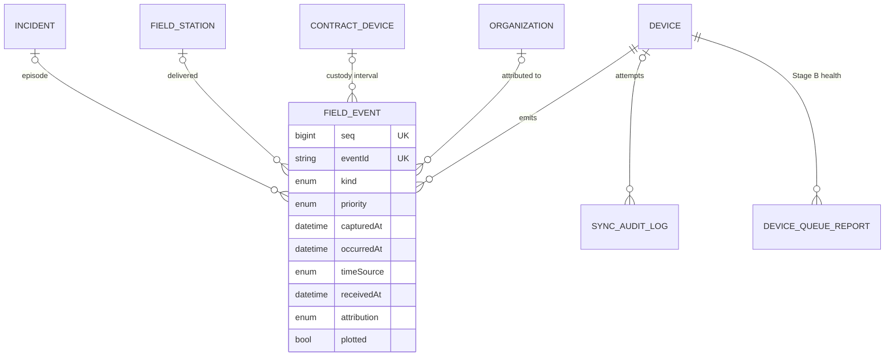
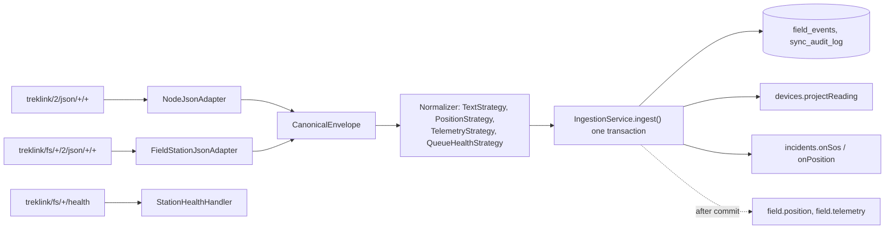
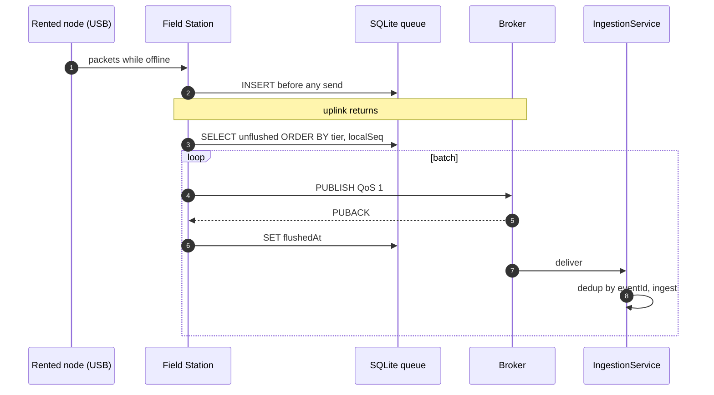
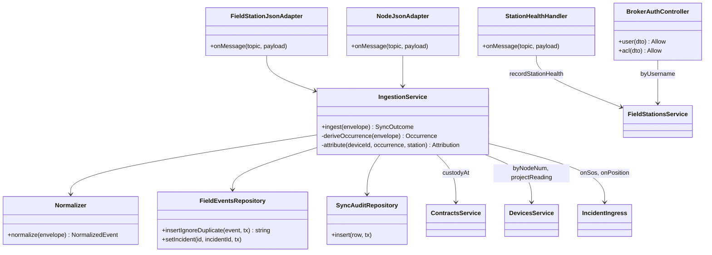
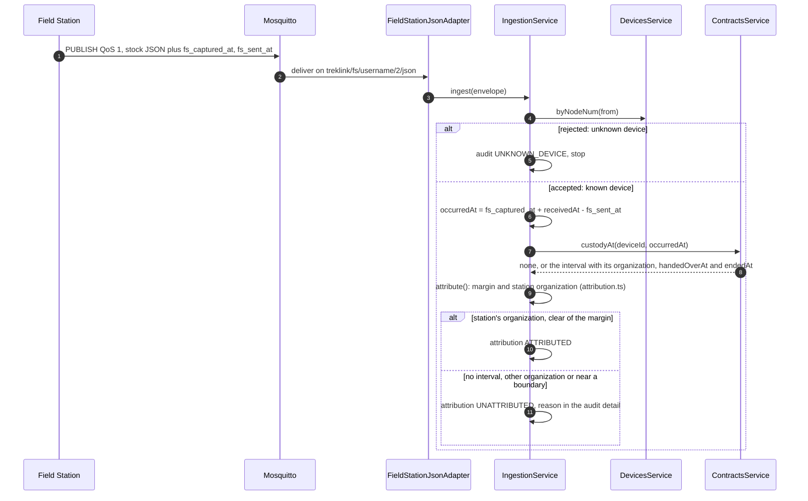
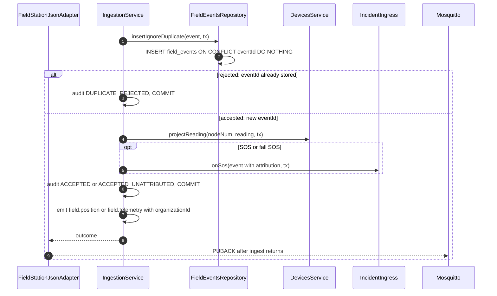
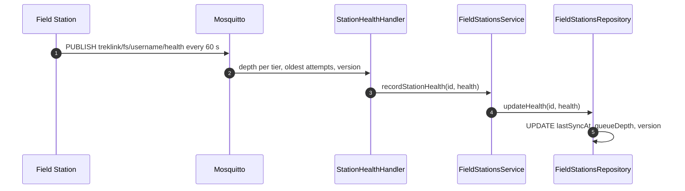
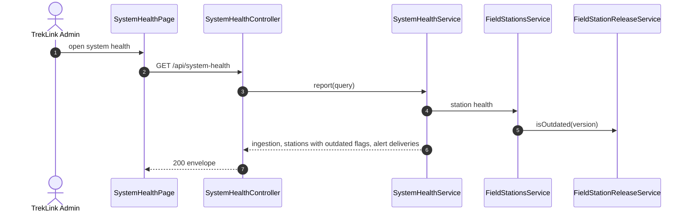

# Technical Design: gateway-sync

> Fulfills `requirements.md` in this folder. Schema: the `// @module gateway-sync` block of
> `backend/prisma/schema.prisma` is authoritative. Contracts: [mqtt-ingress-contract.md](api-design/mqtt-ingress-contract.md),
> [queue-health-payload.md](api-design/queue-health-payload.md), [field-station-local-page.md](api-design/field-station-local-page.md).
>
> **Status**: Approved, written by KhoaDD and merged on `dev` (treklink-web PR #30 and #31, 2026-10-18). Changes go through a pull request reviewed by KhoaDD (D-052).

---

## 1. Data model

***Figure 1***: gateway-sync slice. `FieldEvent.seq` is the ingestion order used by history queries.
`occurredAt` decides attribution only (D-040); ordering stays on `seq` and the queue tier (FR-EVT-08).

---

## 2. Pipeline

***Figure 2***: Ingestion pipeline (D-007). Adapters only translate topics and envelopes; strategies only
decode payloads; `IngestionService` alone writes.

`IngestionService.ingest(envelope)`:

1. Compute `eventId`; resolve the device by `nodeNum` (`UNKNOWN_DEVICE` otherwise).
2. Stage C: resolve the station from the topic; revoked, or a device its organization neither holds now
   nor returned less than `gatewaySync.lateUploadGraceHours` ago, ends the attempt with its audit outcome.
2a. Derive `occurredAt` and `timeSource` (REQ-UBI-06), then `rentals.custodyAt(deviceId, occurredAt)`:
   inside an interval, clear of `gatewaySync.attributionMarginSeconds` from its ends, and (Stage C) of the
   station's organization gives `ATTRIBUTED` with that `contractDeviceId` and `organizationId`; anything
   else gives `UNATTRIBUTED` with both null (REQ-ERR-06).
3. `BEGIN`; `INSERT field_events ... ON CONFLICT (eventId) DO NOTHING RETURNING id`. No row means
   `DUPLICATE_REJECTED`: audit and `COMMIT`.
4. Position rules (bounds, speed); `devices.projectReading`; `incidents.onSos` or `onPosition` with the
   same `tx`, passing the attribution; set `incidentId` on the event when it joined an episode (the one allowed update).
5. Audit `ACCEPTED`; `COMMIT`; emit.

The MQTT client uses QoS 1 and a persistent session, and acknowledges a message only after `ingest()`
returns, so a backend crash mid-transaction gets the message redelivered and dedup absorbs it.

Implementation notes (2026-10-23):

- The acknowledgement rides on mqtt.js `handleMessage`, which sends the PUBACK when it calls back and
  handles one message at a time, so ingestion is also serial and in arrival order.
- While the database is unreachable (Prisma `P1001`, `P1002`, `P1008`, `P1017`, `P2024`, or an
  initialization error) the message is retried with backoff from 1 s up to 30 s and stays unacknowledged.
  Any other error is a defect: it is logged and the message is acknowledged, so one bad packet cannot
  stall the stream.
- The speed rule compares occurrence times against the device's last plotted position in `seq` order.
- The device projection skips only an older reading; a reading of the same second applies (devices
  REQ-EVT-08), because a node reports position and telemetry together.

### Field data simulator (D-090 rule 2)

The Vercel production has no MQTT subscriber, so with `FIELD_SIMULATOR_ENABLED=true` (default `false`, set
only there) `AppModule` loads `FieldSimulatorModule`, whose `gatewaySync.fieldSimulator` job (cron every
10 s, run on Vercel by the request-driven tick of platform design §4.6) ingests synthetic packets through
`UplinkIngress`: the node topic `<MQTT_ROOT>/2/json/LongFast/<nodeId>`, `NodeJsonAdapter` and
`IngestionService`, the path a broker message takes. The nodes are `!de000009` and `!de00000a`, TL-0009
and TL-0010 of the demo seed and the gateway simulator's defaults; the packets have the gateway
`FrameSimulator`'s stock shape (`mqtt-ingress-contract.md`). `simulatedBatch` is stateless: per interval of
`gatewaySync.simulatorIntervalSeconds` (default 60) each node sends a position on a slow loop of about
330 m around the simulator's Ta Nang start point and a telemetry reading, timed at the interval's start,
with packet ids derived from node, kind and time. A second run or a second instance in the same interval
builds the same packets, which deduplicate on `(from, id)` (D-006). With
`gatewaySync.simulatorSosIntervalMinutes` above 0 (default 0) the first node sends an SOS text once per
window. Testers are told the data is simulated (`deploy/README.md`, the sandbox banner).

---

## 3. Field Station (Stage C) executable

A Node.js program in `treklink-web/gateway/`, packaged as one executable per OS (task 5.1):

| Part | Design |
|---|---|
| Serial reader | Meshtastic serial protocol over the USB COM port of one rented node; decodes `FromRadio` packets into the stock JSON shape |
| Queue | SQLite in WAL mode, table `queue(localSeq INTEGER PRIMARY KEY, tier INT, eventJson TEXT, capturedAt INTEGER, attempts INT, flushedAt)`; `capturedAt` is the station clock in epoch milliseconds when the packet came off the serial port; insert before anything else |
| Flush | One in-flight batch: `SELECT ... WHERE flushedAt IS NULL ORDER BY tier, localSeq LIMIT 50`; publish each with QoS 1, adding `fs_captured_at` (the row's `capturedAt`) and `fs_sent_at` (the station clock at publish) to the top level of the stock JSON; set `flushedAt` on its PUBACK. When the connection drops, the station discards the MQTT client's own copies of the publishes still waiting for a PUBACK, so the client does not resend them on reconnect ahead of the flush; those rows stay queued and go out again in tier order (NFR-REL-04). The backend offset `receivedAt - fs_sent_at` corrects the station clock on every publish; transit time makes the corrected time slightly late, never early |
| Bound | `QUEUE_MAX_ROWS` (environment `GATEWAY_QUEUE_MAX_ROWS`, requirements §4); on overflow delete the oldest P3, then P2, in the insert's transaction, each shed logged with its tier and local id; never P0 or P1, so with only those left the queue runs over its bound and logs it |
| Broker credential | `GATEWAY_FS_USERNAME` and `GATEWAY_FS_SECRET`, the Username and Secret of the station's credential (§4, organizations api-design 24), sent as the MQTT username and password only when both are set; with either empty the client connects without credentials. `MQTT_BROKER_URL` takes `mqtt://` or `mqtts://`; a new credential carries `FIELD_STATION_BROKER_URL`, else `MQTT_BROKER_URL` (`field-stations.service.ts:101-103`), and the example in `.env.example` is `mqtts://mqtt.treklink.vn:8883`. The secret is never logged, and user information in the broker URL is removed before the URL is logged |
| Health | every 60 s while connected, publish depth per tier, the oldest `attempts` and the executable's version to `treklink/fs/<username>/health` (FR-EVT-18) |
| Local page | `127.0.0.1:4321`, the routes of `field-station-local-page.md` |

---

## 4. Broker hooks

mosquitto 2 with the go-auth plugin, HTTP backend, JSON params, **status** response mode
(https://github.com/iegomez/mosquitto-go-auth, read 2026-10-04): any 2xx allows. The hooks answer through
the normal envelope with 200, 401 or 403, which status mode reads correctly. The plugin's cache is on (`auth_opt_cache true`)
with `auth_opt_auth_cache_seconds` and `auth_opt_acl_cache_seconds` at most 60 and `auth_opt_cache_refresh false` (option names read
from the plugin README on 2026-10-18), which bounds how long a revoked station keeps a
fresh connection; the backend additionally drops every message from a revoked username at once (§2 step 2).

| Credential kind | Username | Publish | Subscribe |
|---|---|---|---|
| Backend subscriber | `MQTT_USERNAME` | none | `treklink/#` |
| Fleet node (Stage A, B) | `node-<nodeId>` | `treklink/2/json/+/<nodeId>`, `treklink/2/e/+/<nodeId>` | none |
| Field Station | `fs-<org>-<n>` | `treklink/fs/<username>/#` | none |

---

## 5. Services and ports

| Export | Used by |
|---|---|
| `GatewaySyncService.eventsOfIncident(id)`, `events(deviceId, periods, kinds)`, `stats(window)` | incidents, monitoring |
| consumes `ContractsService.custodyAt(deviceId, at)` | attribution (§2 step 2a) |
| provider of `MQTT_HEALTH_PROBE` | platform |

Listens to `fieldStation.revoked`. Emits `field.position`, `field.telemetry`, `fieldStation.synced`.

Operator reads of `POST /api/gateway-sync` (D-027), TrekLink Staff and Admin through `read FieldEvent`:
`FieldEventQueryService.listEvents` (api-design 03), `SyncAuditService.listAudit` (api-design 04, the
audit rows newest first, with the raw payload of a `MALFORMED_ENVELOPE` row cut to 500 Unicode code points) and
`SyncStatusService.status` (api-design 07, which also needs `read FieldStation`), whose ingestion counts
are the window's audit rows grouped by `SyncOutcome`. All three read through `SyncQueryRepository`.

---

## 6. Error catalogue

| Code | HTTP |
|---|---|
| `BROKER_SECRET` | 401 |
| `CREDENTIAL_REJECTED` | 403 |
| `TOPIC_DENIED` | 403 |
| `NOT_REPLAYABLE` | 409 |

Ingestion outcomes are audit values (`SyncOutcome`), not HTTP codes.

---

## 7. Sequence: offline flush

<!-- sdd: MF-02 seq UC-27 -->

***Figure 3***: Stage C flush; P0 first (BR-12).

---

## 8. Testing strategy

Golden fixtures captured from v2, v3 and v4 devices per payload type; dedup under concurrent duplicate
delivery; the replay harness for TC-11; an outage harness that blocks the uplink for 30 s to 30 min and
counts delivery and ordering (RQ1); Field Station crash mid-flush; broker hook table tests.

Attribution (D-040, D-042): every test runs with at least two organizations. The E02-7 scenario as a
fixture (A's station flushes an SOS after the device was handed to B); `rx_time` 0 and implausible
`rx_time` near a handover (E02-8); a station clock set hours wrong, corrected by `fs_sent_at`; a flush
past the late-upload grace. Load: an MQTT harness with simulated Field Stations and devices at 20
simultaneous submissions, 10 organizations and 50 devices (NFR-PERF-02, NFR-PERF-03).

---

## 9. Detailed design for Report 4 (D-044)

Layering as in `organizations` design §9, except that ingestion has no page or controller: the broker
delivers to an adapter, which plays the controller's role. Figure 4 is the class view; Figures 5
to 8 are the MF-02 ingestion with attribution (D-040) and the station health report (FR-EVT-18).
The Stage C flush is Figure 3.

<!-- sdd: MF-02 class gateway-sync -->

***Figure 4***: gateway-sync classes. The right-hand services belong to `rentals`, `devices`,
`incidents` and `organizations`.

<!-- sdd: MF-02 seq UC-26 part 1 of 2: receive and attribute -->

***Figure 5***: UC-26 Ingest Field Event, part 1 of 2: occurrence time and custody attribution
(FR-EVT-15 to FR-EVT-17).

<!-- sdd: MF-02 seq UC-26 part 2 of 2: persist and hand off -->

***Figure 6***: UC-26 Ingest Field Event, part 2 of 2: deduplication, persistence and hand-off in one
transaction.

<!-- sdd: MF-02 seq UC-42 part 1 of 2: station report -->

***Figure 7***: UC-42 View System Health, part 1 of 2: the Field Station's health and version report
(FR-EVT-13, FR-EVT-18).

<!-- sdd: MF-02 seq UC-42 part 2 of 2: health page -->

***Figure 8***: UC-42 View System Health, part 2 of 2: the health page.