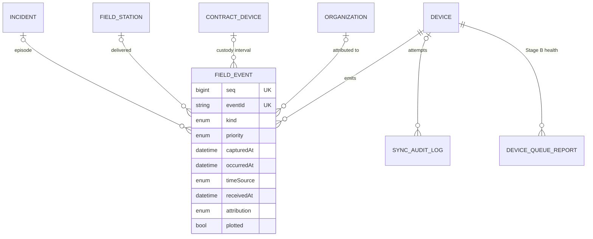
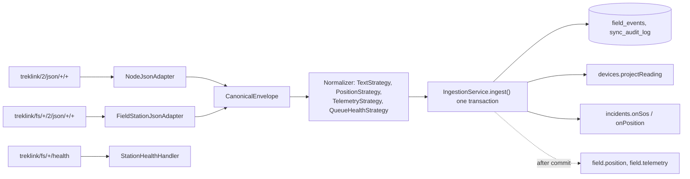
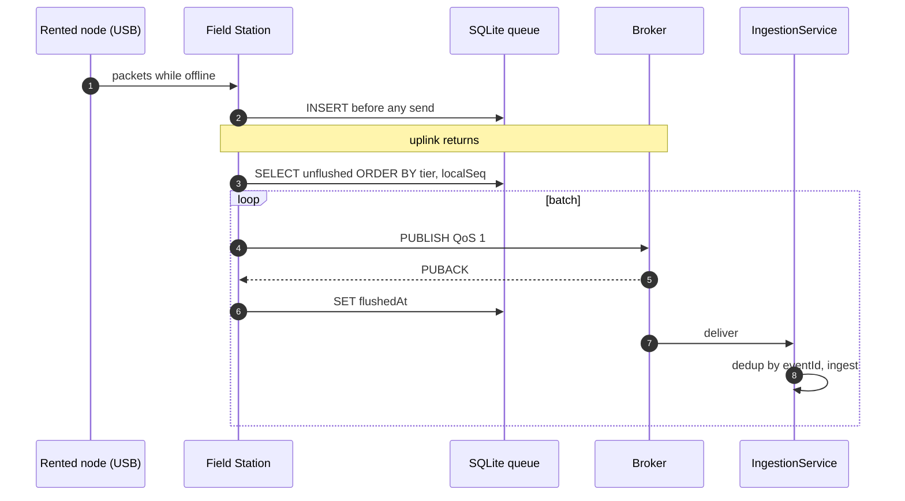
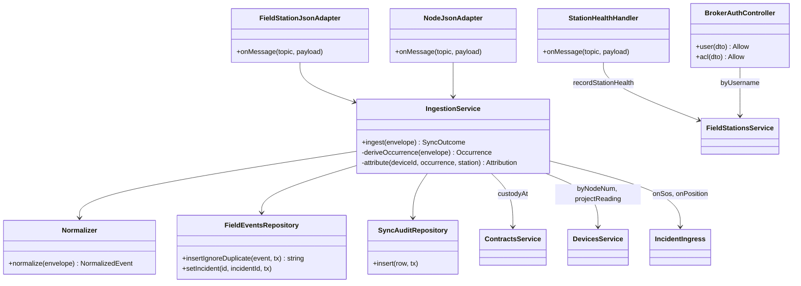
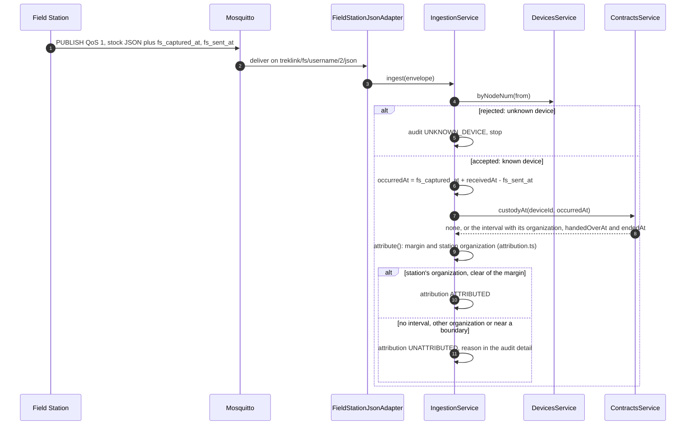
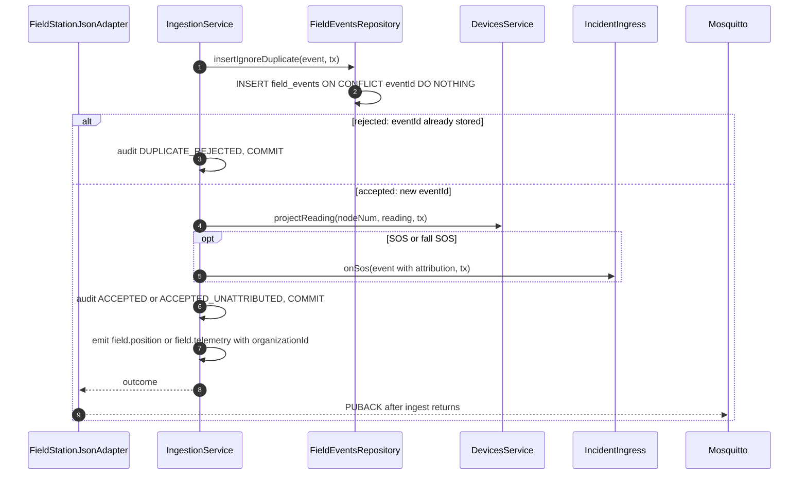
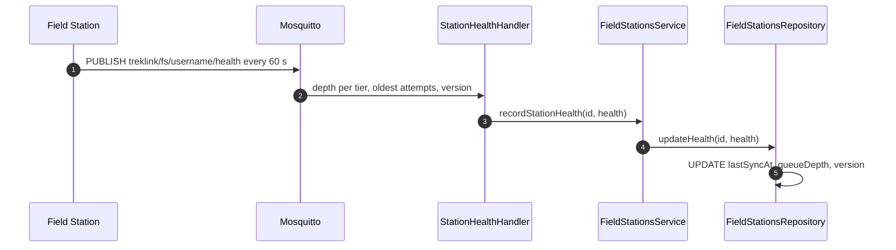
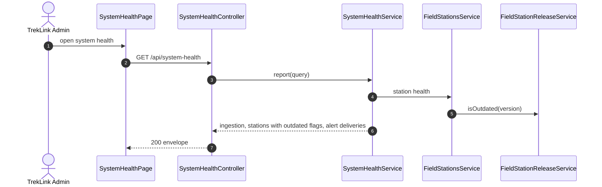
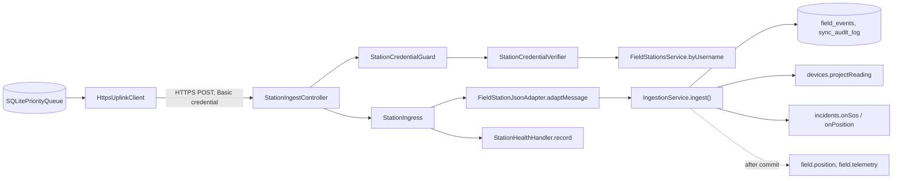
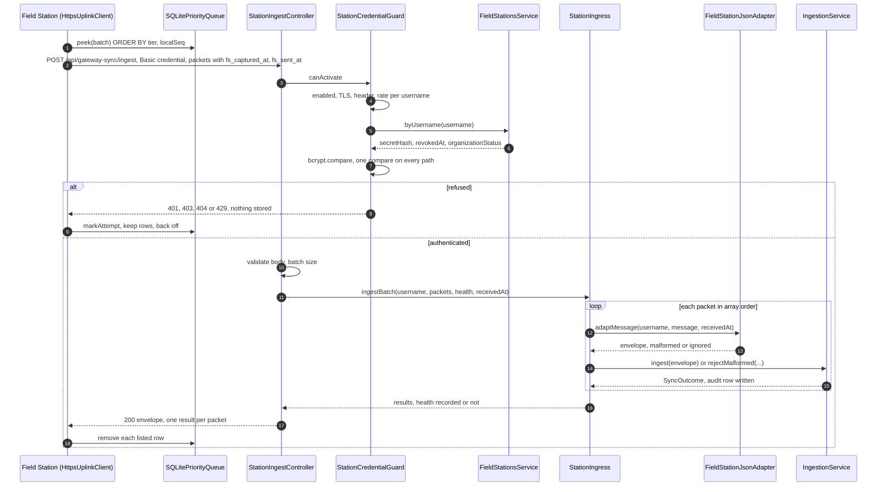

# Technical Design: gateway-sync

> **Draft, pending supervisor acceptance (D-098 amended)**: §10 (HTTPS ingest fallback) and the note
> under §6 are a draft, built only if the supervisor accepts them. MQTT stays the primary uplink.
> Every other section keeps its approved status.

> Fulfills `requirements.md` in this folder. Schema: the `// @module gateway-sync` block of
> `backend/prisma/schema.prisma` is authoritative. Contracts: [mqtt-ingress-contract.md](api-design/mqtt-ingress-contract.md),
> [queue-health-payload.md](api-design/queue-health-payload.md), [field-station-local-page.md](api-design/field-station-local-page.md).
>
> **Status**: Approved, written by KhoaDD and merged on `dev` (treklink-web PR #30 and #31, 2026-10-18). Changes go through a pull request reviewed by KhoaDD (D-052).

---

## 1. Data model

***Figure 1***: gateway-sync slice. `FieldEvent.seq` is the ingestion order used by history queries.
`occurredAt` decides attribution only (D-040); ordering stays on `seq` and the queue tier (FR-EVT-08).

---

## 2. Pipeline

***Figure 2***: Ingestion pipeline (D-007). Adapters only translate topics and envelopes; strategies only
decode payloads; `IngestionService` alone writes.

`IngestionService.ingest(envelope)`:

1. Compute `eventId`; resolve the device by `nodeNum` (`UNKNOWN_DEVICE` otherwise).
2. Stage C: resolve the station from the topic; revoked, or a device its organization neither holds now
   nor returned less than `gatewaySync.lateUploadGraceHours` ago, ends the attempt with its audit outcome.
2a. Derive `occurredAt` and `timeSource` (REQ-UBI-06), then `rentals.custodyAt(deviceId, occurredAt)`:
   inside an interval, clear of `gatewaySync.attributionMarginSeconds` from its ends, and (Stage C) of the
   station's organization gives `ATTRIBUTED` with that `contractDeviceId` and `organizationId`; anything
   else gives `UNATTRIBUTED` with both null (REQ-ERR-06).
3. `BEGIN`; `INSERT field_events ... ON CONFLICT (eventId) DO NOTHING RETURNING id`. No row means
   `DUPLICATE_REJECTED`: audit and `COMMIT`.
4. Position rules (bounds, speed); `devices.projectReading`; `incidents.onSos` or `onPosition` with the
   same `tx`, passing the attribution; `onPosition` also gets `IngestionRepository` as its
   `PositionHistory`, which answers the cadence count over the stored positions (incidents design §4);
   set `incidentId` on the event when it opened or joined an episode (the one allowed update).
5. Audit `ACCEPTED`; `COMMIT`; emit.

The MQTT client uses QoS 1 and a persistent session, and acknowledges a message only after `ingest()`
returns, so a backend crash mid-transaction gets the message redelivered and dedup absorbs it.

Implementation notes (2026-10-23):

- The acknowledgement rides on mqtt.js `handleMessage`, which sends the PUBACK when it calls back and
  handles one message at a time, so ingestion is also serial and in arrival order.
- While the database is unreachable (Prisma `P1001`, `P1002`, `P1008`, `P1017`, `P2024`, or an
  initialization error) the message is retried with backoff from 1 s up to 30 s and stays unacknowledged.
  Any other error is a defect: it is logged and the message is acknowledged, so one bad packet cannot
  stall the stream.
- The speed rule compares occurrence times against the device's last plotted position in `seq` order.
- The device projection skips only an older reading; a reading of the same second applies (devices
  REQ-EVT-08), because a node reports position and telemetry together.

### Field data simulator (D-090 rule 2)

The Vercel production has no MQTT subscriber, so with `FIELD_SIMULATOR_ENABLED=true` (default `false`, set
only there) `AppModule` loads `FieldSimulatorModule`, whose `gatewaySync.fieldSimulator` job (cron every
10 s, run on Vercel by the request-driven tick of platform design §4.6) ingests synthetic packets through
`UplinkIngress`: the node topic `<MQTT_ROOT>/2/json/LongFast/<nodeId>`, `NodeJsonAdapter` and
`IngestionService`, the path a broker message takes. The nodes are `!de000009` and `!de00000a`, TL-0009
and TL-0010 of the demo seed and the gateway simulator's defaults; the packets have the gateway
`FrameSimulator`'s stock shape (`mqtt-ingress-contract.md`). `simulatedBatch` is stateless: per interval of
`gatewaySync.simulatorIntervalSeconds` (default 60) each node sends a position and a telemetry reading. The position walks a real trail, OpenStreetMap way
1164619760 (an unnamed `highway=path` south-east of Ta Nang toward Phan Dung, read on 2026-11-01 and
simplified to 63 points, 7.2 km), out and back with no jump at the ends: 0.8 to 1.4 m/s by segment, two
four-minute rests each way, and a smooth deterministic wobble of up to 3 m. TL-0010 walks the same trail
15 minutes ahead of TL-0009. Positions are timed at the interval's start,
with packet ids derived from node, kind and time. A second run or a second instance in the same interval
builds the same packets, which deduplicate on `(from, id)` (D-006). With
`gatewaySync.simulatorSosIntervalMinutes` above 0 (default 0) the first node sends an SOS text once per
window. Testers are told the data is simulated (`deploy/README.md`, the sandbox banner).

### Field simulation and the `simulated` mark (D-093 amendment, D-094)

`specs/demo/design.md` §9. With `DEMO_SIMULATION_ENABLED=true` the same job reads its nodes from
`simulated_nodes` (owned here, written by the exported `FieldSimulationService`, which the `demo` routes call)
instead of the two fixed nodes; `FieldSimulatorModule` is then loaded even when `FIELD_SIMULATOR_ENABLED` is
off. The trails are compiled data in `simulator/trails.ts` (OpenStreetMap, ODbL); the position, battery and
beacon functions in `simulator/field-simulation.ts` are pure, so every run and every instance computes the
same packets for an interval and ingestion stores them once (D-006 ids from node, kind and time).

`UplinkIngress.ingest(topic, body, receivedAt, { simulated: true })` is the only way in for these packets:
the envelope carries `simulated`, `IngestionService` stores it on the new `field_events.simulated` column
(default `false`, never set by the MQTT or Field Station paths) and passes it on the `SosEvent` and
`PositionEvent` hand-offs, so `incidents` marks the incident it opens. A simulated position skips the
implausible-move rule (demo design §9, "Speed rule"); every other rule (bounds, attribution, deduplication,
the cadence count) applies unchanged. `FieldEventQueryService.simulatedDevices(ids)` answers which of the
devices have a simulated latest field event, for the `monitoring` reads.

---

## 3. Field Station (Stage C) executable

A Node.js program in `treklink-web/gateway/`, packaged as one executable per OS (task 5.1):

| Part | Design |
|---|---|
| Serial reader | Meshtastic client API over the USB port of one rented node (§3.1); decodes `FromRadio` packets into the stock JSON shape. The simulator runs instead only when `GATEWAY_SERIAL_SIMULATION` is `true` |
| Queue | SQLite in WAL mode, table `queue(localSeq INTEGER PRIMARY KEY, tier INT, eventJson TEXT, capturedAt INTEGER, attempts INT, flushedAt)`; `capturedAt` is the station clock in epoch milliseconds when the packet came off the serial port; insert before anything else |
| Flush | One in-flight batch: `SELECT ... WHERE flushedAt IS NULL ORDER BY tier, localSeq LIMIT 50`; publish each with QoS 1, adding `fs_captured_at` (the row's `capturedAt`) and `fs_sent_at` (the station clock at publish) to the top level of the stock JSON; set `flushedAt` on its PUBACK. When the connection drops, the station discards the MQTT client's own copies of the publishes still waiting for a PUBACK, so the client does not resend them on reconnect ahead of the flush; those rows stay queued and go out again in tier order (NFR-REL-04). The backend offset `receivedAt - fs_sent_at` corrects the station clock on every publish; transit time makes the corrected time slightly late, never early |
| Bound | `QUEUE_MAX_ROWS` (environment `GATEWAY_QUEUE_MAX_ROWS`, requirements §4); on overflow delete the oldest P3, then P2, in the insert's transaction, each shed logged with its tier and local id; never P0 or P1, so with only those left the queue runs over its bound and logs it |
| Broker credential | `GATEWAY_FS_USERNAME` and `GATEWAY_FS_SECRET`, the Username and Secret of the station's credential (§4, organizations api-design 24), sent as the MQTT username and password only when both are set; with either empty the client connects without credentials. `MQTT_BROKER_URL` takes `mqtt://` or `mqtts://`; a new credential carries `FIELD_STATION_BROKER_URL`, else `MQTT_BROKER_URL` (`field-stations.service.ts:101-103`), and the example in `.env.example` is `mqtts://mqtt.treklink.vn:8883`. The secret is never logged, and user information in the broker URL is removed before the URL is logged |
| Health | every 60 s while connected, publish depth per tier, the oldest `attempts` and the executable's version to `treklink/fs/<username>/health` (FR-EVT-18) |
| Local page | `127.0.0.1:4321` (`GATEWAY_LOCAL_PORT`), the routes of `field-station-local-page.md`; `gateway/src/local/`, the page in `gateway/local-page/`. Every route reads memory or the local SQLite file, never the network, so the page answers with the uplink down (REQ-STA-02) |

### 3.1 Serial reader (task 5.1, W11)

`gateway/src/serial/`. Chosen by `GATEWAY_SERIAL_SIMULATION` alone: `true` runs the frame simulator and
opens no port; `false` or unset reads the port; any other value stops the gateway at start
(requirements §4). A station that forgets the variable reads its radio rather than inventing packets,
so no simulated data reaches a checkpoint unlisted (D-093).

| Step | Design |
|---|---|
| Packages | `@meshtastic/core` 2.6.7, the version of the frontend docking adapter (`frontend/src/features/device-connector/`, treklink-web#351), with `@meshtastic/transport-node-serial` 0.0.2 (Node `serialport` 13) in place of the browser's Web Serial transport, and `@bufbuild/protobuf` 2 for `fromBinary` on core's schemas, which core does not export. Both Meshtastic packages are ESM only; the gateway stays CommonJS and loads them through Node's `require` of ES modules, so it needs Node 22.12 or later. Both are GPL-3.0-only, like the frontend's copy: shipping the station executable to organizations carries the source offer of the GPL **(open: licence ruling for the packaged executable, leader)** |
| Open | A `SerialPort` on `GATEWAY_SERIAL_PORT` at `GATEWAY_SERIAL_BAUD`, opened by the reader and then handed to `new TransportNodeSerial(port)`, then a `MeshDevice` on it. `TransportNodeSerial.create` is not used: it answers a failed open by closing the port that never opened, an unhandled error that ends the process (found in the build, W11). On open the reader calls `configure()`, which sends `ToRadio.want_config_id`: until a client asks, the node writes only its debug log to the port and no `FromRadio`. It sends a heartbeat every 5 minutes, because a serial client the node does not hear from for 15 minutes times out (core's `MeshDevice.heartbeat()` documentation) |
| Framing | `Utils.fromDeviceStream()` of core: each frame is `0x94 0xC3`, a 16-bit big-endian length, then that many bytes of `FromRadio`; bytes outside a frame are the node's debug log and are not packets |
| Station node | `MyNodeInfo.my_node_num` from the configuration answer; it is the `sender` of every packet the station queues, as the stock serializer names the uplinking node (mqtt-ingress-contract.md, field `sender`). Packets heard before it arrives wait for it |
| Packets | Every `MeshPacket` with a `decoded` payload (`MeshDevice.events.onMeshPacket`) is turned into the stock JSON shape by `toStockPacket` (table below) and handed to the queue with the tier of `tierOf`, the classification of mqtt-ingress-contract.md: a text starting with the backend's SOS prefix `SOS - ` (`SOS - FALL DETECTED` included) P0, a position P2, telemetry and every other text (CHAT, `SOS please` included) P3. The `eventId` of the queue row is `<sender>:<from>:<id>`, so the same packet heard again is not queued twice |
| Skipped | A packet still encrypted (no channel key on the node), a port number other than text, position and telemetry (node info, routing, admin and the rest), a telemetry message without device metrics, a position without coordinates (no fix), and a payload that does not decode: each is skipped at debug level and the read goes on (REQ-ERR-08) |
| Port lost | An open that fails, a port that closes or errors: logged, `reading` false on the local page, and a new open every `GATEWAY_SERIAL_RECONNECT_MS`; the queue and the uplink go on (REQ-ERR-07) |

The stock JSON shape, member by member, as `toStockPacket` writes it from a `MeshPacket`. Members marked
"when set" are left out when the protobuf field is zero or empty, as the serializer leaves them out
**(unverified against FGT §4 for the optional members, which the backend does not read; checked against
the bench units in task 5.1)**:

| Member | From | |
|---|---|---|
| `id`, `from`, `to`, `channel` | `MeshPacket.id`, `from`, `to`, `channel` | always |
| `timestamp` | `rx_time`; 0 when the node has no time, stored as unknown (REQ-UBI-04) | always |
| `type` | `text` for `TEXT_MESSAGE_APP`, `position` for `POSITION_APP`, `telemetry` for `TELEMETRY_APP` | always |
| `sender` | `!` and the eight lower-case hex digits of the station node | always |
| `rssi`, `snr` | `rx_rssi`, `rx_snr` | when set |
| `hops_away`, `hop_start` | `hop_start - hop_limit`, `hop_start` | when `hop_start` is set |
| `payload` of `text` | `{ text }`, the UTF-8 payload | always |
| `payload` of `position` | `latitude_i`, `longitude_i` always; `altitude`, `time` when set | |
| `payload` of `telemetry` | from `device_metrics`: `battery_level`, `voltage`, `channel_utilization`, `air_util_tx`, `uptime_seconds`, each when set | |

The tests read frames recorded as hex in `gateway/test/fixtures/serial/` through the same framing and
decoding, and drive a `MeshDevice` over a transport that replays them; no test opens a port. The frames
are built from the protobuf schemas until the bench captures of task 5.1 (a v1 and a v2 unit) replace
them.

---

## 4. Broker hooks

mosquitto 2 with the go-auth plugin, HTTP backend, JSON params, **status** response mode
(https://github.com/iegomez/mosquitto-go-auth, read 2026-10-04): any 2xx allows. The hooks answer through
the normal envelope with 200, 401 or 403, which status mode reads correctly. The plugin's cache is on (`auth_opt_cache true`)
with `auth_opt_auth_cache_seconds` and `auth_opt_acl_cache_seconds` at most 60 and `auth_opt_cache_refresh false` (option names read
from the plugin README on 2026-10-18), which bounds how long a revoked station keeps a
fresh connection; the backend additionally drops every message from a revoked username at once (§2 step 2).

| Credential kind | Username | Publish | Subscribe |
|---|---|---|---|
| Backend subscriber | `MQTT_USERNAME` | none | `treklink/#` |
| Fleet node (Stage A, B) | `node-<nodeId>` | `treklink/2/json/+/<nodeId>`, `treklink/2/e/+/<nodeId>` | none |
| Field Station | `fs-<org>-<n>` | `treklink/fs/<username>/#` | none |

Implementation notes (2026-11-01, KhoaDD under D-078, task 3.1):

- `BrokerAuthController` (`broker-hooks.controller.ts`) and `BrokerAuthService` serve api-design 01 and 02.
  `MQTT_AUTH_HOOK_SECRET` unset: both routes answer 404 and the open broker of `docker-compose.yml` never
  calls them. Set: `X-Broker-Secret` is compared in constant time before the body is validated.
  `treklink` in the table is `MQTT_ROOT`. The backend subscriber may read (`acc` 1) and subscribe (`acc` 4)
  under `<root>/`; nodes and stations may only write (`acc` 2); go-auth's `acc` 3 is denied to every kind.
  A Field Station is refused when unknown, revoked, of a `CLOSED` organization (`StationCredential.organizationStatus`)
  or with a wrong secret. A fleet node presents `MQTT_NODE_PASSWORD`, one secret shared by every node and
  compared in constant time; with it unset, fleet nodes are refused (leader decision, 2026-11-01).
  Known limit: any holder of the shared secret can log in under any node username, accepted for Stage A
  and B until per-device secrets come with the hosted broker (D-055).
- Open (review of #259): on the broker with credentials a Field Station may publish only under `treklink/fs/<username>/#` (design §4), so the Stage B uplinks the gateway sends on its nodes' topics `treklink/2/json/<channel>/<nodeId>` (`gateway/src/mqtt/mqtt-client.ts:110`) are refused with the station's credential; only its health report on `treklink/fs/<username>/health` is allowed. It closes when the gateway publishes on the station topic (task 2.1 subscription, task 5.1 Stage C topics). Keep the open broker for the Stage B demo flow.
- Secrets (`X-Broker-Secret`, `MQTT_PASSWORD`, `MQTT_NODE_PASSWORD`) are compared as SHA-256 digests with
  `timingSafeEqual`, which hides their length. A Field Station check makes exactly one bcrypt compare on
  every path, against a dummy hash of `BCRYPT_COST` when no station holds the username.
- go-auth's HTTP backend sets only `Content-Type` and `User-Agent` and has no option for another header
  (`backends/http.go`, read 2026-11-01; the plugin's repository is archived). The opt-in broker of
  `docker-compose.broker-auth.yml` therefore calls `broker-hook-proxy`, an nginx on the compose network that
  adds `X-Broker-Secret` from the environment and forwards the two hook paths to the backend, so the secret
  is in no committed file and in no URL. Broker: `iegomez/mosquitto-go-auth:3.0.0-mosquitto_2.0.18`
  with `infra/mosquitto/mosquitto.auth.conf` (`auth_opt_disable_superuser true`, cache 60 s). Walked on
  2026-11-01: the backend subscriber connected with `MQTT_USERNAME`; a station connected and published under
  its own topic; a wrong secret and an anonymous client were refused at CONNECT; a publish under another
  station's topic got PUBACK reason 135; after a revoke the station still connected 1 s later (cache) and
  was refused 62 s later (organizations AC-06).

---

## 5. Services and ports

| Export | Used by |
|---|---|
| provides incidents' `INCIDENT_EVENTS.eventsOfIncident(id, scope)` through global `IncidentEventsPortsModule` | incidents API 13; own repository reads linked events by occurredAt/eventId, no paging or time clipping, member custody attribution filter (R2-b, issue #118) |
| `FieldEventQueryService.historyPoints`, `SyncStatsService` | monitoring |
| consumes `ContractsService.custodyAt(deviceId, at)` | attribution (§2 step 2a) |
| provider of `MQTT_HEALTH_PROBE` | platform |

Listens to `fieldStation.revoked`. Emits `field.position`, `field.telemetry`, `fieldStation.synced`.

Operator reads of `POST /api/gateway-sync` (D-027), TrekLink Staff and Admin through `read FieldEvent`:
`FieldEventQueryService.listEvents` (api-design 03), `SyncAuditService.listAudit` (api-design 04, the
audit rows newest first, with the raw payload of a `MALFORMED_ENVELOPE` row cut to 500 Unicode code points) and
`SyncStatusService.status` (api-design 07, which also needs `read FieldStation`), whose ingestion counts
are the window's audit rows grouped by `SyncOutcome`. All three read through `SyncQueryRepository`.

---

## 6. Error catalogue

| Code | HTTP |
|---|---|
| `BROKER_SECRET` | 401 |
| `CREDENTIAL_REJECTED` | 403 |
| `TOPIC_DENIED` | 403 |
| `NOT_REPLAYABLE` | 409 |

Ingestion outcomes are audit values (`SyncOutcome`), not HTTP codes.

Draft (D-098 amended): the HTTPS ingest of §10 adds `TLS_REQUIRED` (403), `BATCH_TOO_LARGE` (400) and
`INGEST_UNAVAILABLE` (503), and reuses `UNAUTHENTICATED`, `CREDENTIAL_REJECTED`, `RATE_LIMITED`,
`PAYLOAD_TOO_LARGE`, `VALIDATION_FAILED` and `NOT_FOUND` (§10.5).

---

## 7. Sequence: offline flush

<!-- sdd: MF-02 seq UC-27 -->

***Figure 3***: Stage C flush; P0 first (BR-12).

---

## 8. Testing strategy

Golden fixtures captured from v2, v3 and v4 devices per payload type; dedup under concurrent duplicate
delivery; the replay harness for TC-11; an outage harness that blocks the uplink for 30 s to 30 min and
counts delivery and ordering (RQ1); Field Station crash mid-flush; broker hook table tests.

Attribution (D-040, D-042): every test runs with at least two organizations. The E02-7 scenario as a
fixture (A's station flushes an SOS after the device was handed to B); `rx_time` 0 and implausible
`rx_time` near a handover (E02-8); a station clock set hours wrong, corrected by `fs_sent_at`; a flush
past the late-upload grace. Load: an MQTT harness with simulated Field Stations and devices at 20
simultaneous submissions, 10 organizations and 50 devices (NFR-PERF-02, NFR-PERF-03).

---

## 9. Detailed design for Report 4 (D-044)

Layering as in `organizations` design §9, except that ingestion has no page or controller: the broker
delivers to an adapter, which plays the controller's role. Figure 4 is the class view; Figures 5
to 8 are the MF-02 ingestion with attribution (D-040) and the station health report (FR-EVT-18).
The Stage C flush is Figure 3.

<!-- sdd: MF-02 class gateway-sync -->

***Figure 4***: gateway-sync classes. The right-hand services belong to `rentals`, `devices`,
`incidents` and `organizations`.

<!-- sdd: MF-02 seq UC-26 part 1 of 2: receive and attribute -->

***Figure 5***: UC-26 Ingest Field Event, part 1 of 2: occurrence time and custody attribution
(FR-EVT-15 to FR-EVT-17).

<!-- sdd: MF-02 seq UC-26 part 2 of 2: persist and hand off -->

***Figure 6***: UC-26 Ingest Field Event, part 2 of 2: deduplication, persistence and hand-off in one
transaction.

<!-- sdd: MF-02 seq UC-42 part 1 of 2: station report -->

***Figure 7***: UC-42 View System Health, part 1 of 2: the Field Station's health and version report
(FR-EVT-13, FR-EVT-18).

<!-- sdd: MF-02 seq UC-42 part 2 of 2: health page -->

***Figure 8***: UC-42 View System Health, part 2 of 2: the health page.

---

## 10. HTTPS ingest fallback (draft, D-098 amended)

> **Draft, pending supervisor acceptance (D-098 amended).** Built only if the supervisor accepts it;
> until then no code, migration or parameter row exists for it, and its tasks (tasks.md Phase 7) stay
> unticked.

### 10.1 Purpose and scope

MQTT stays the primary uplink: a node or a Field Station publishes to a broker and `MqttSubscriber`
consumes it (§2). Some deployments host no broker. The Vercel staging runs the backend as functions,
which hold no MQTT subscriber and no TCP listener, so it runs with `MQTT_INGESTION_ENABLED=false`
(`deploy/README.md`, "Known gaps on Vercel Functions"). The fallback lets a Field Station deliver there:

- `POST /api/gateway-sync/ingest` on the platform ([api-design 08](api-design/08-post-gateway-sync-ingest.md)),
  served only with `HTTPS_INGEST_ENABLED=true`;
- an HTTPS transport in the Field Station executable, chosen only when no broker is configured
  (REQ-EVT-19).

Out of scope: Stage A and B nodes, whose firmware speaks MQTT only (FGT §4); a node keeps needing a
broker. The fallback carries Stage C traffic only.

### 10.2 Request flow

***Figure 9***: HTTPS ingest path (draft). Every box right of `StationIngress` is the box of Figure 2;
the HTTPS path adds only the controller, the guard and the ingress.

1. The Field Station reads one batch, `ORDER BY tier, localSeq LIMIT GATEWAY_QUEUE_FLUSH_BATCH_SIZE`,
   adds `fs_captured_at` (the row's capture time) and `fs_sent_at` (its clock now) to each packet, and
   posts `{ packets, health? }` with `Authorization: Basic base64(username:secret)`. One request is in
   flight at a time.
2. `StationIngestController` (`@Public()` to the JWT guard, as the broker hooks are) runs
   `StationCredentialGuard`, in this order: `HTTPS_INGEST_ENABLED` (404), TLS (403 `TLS_REQUIRED`),
   the header (401 `UNAUTHENTICATED`), the per-username rate (429 `RATE_LIMITED`), then the credential
   (403 `CREDENTIAL_REJECTED`). The guard runs before body validation, so a caller without a valid
   credential learns nothing about the body (§4 does the same).
3. The validation pipe checks the body shape (400 `VALIDATION_FAILED`); the controller checks the
   batch size against `gatewaySync.httpsIngestMaxBatch` (400 `BATCH_TOO_LARGE`).
4. The controller takes one `receivedAt` and calls `StationIngress.ingestBatch(username, packets,
   health, receivedAt)`.
5. For each packet, in array order and one at a time, `StationIngress` calls
   `FieldStationJsonAdapter.adaptMessage(username, message, receivedAt)`, the topic-free half of
   today's `adapt()`, then `IngestionService.rejectMalformed` or `IngestionService.ingest(envelope)`,
   the calls `MqttSubscriber.handle` makes (`mqtt-subscriber.ts:96-107`). The outcome is that
   method's `SyncOutcome`, `IGNORED` for a type ingestion does not read, or `FAILED` for an
   unexpected error, which is logged and acknowledged as the subscriber does (§2 implementation notes).
6. A transient database error (`isTransientDatabaseError`, `mqtt/retry.ts:7`) stops the batch at that
   packet: the answer is 503 `INGEST_UNAVAILABLE`, earlier packets stay committed, and the station's
   resend is absorbed by the unique `eventId` (REQ-ERR-10). The function does not retry in place,
   because a request has a bounded duration where the subscriber can wait.
7. A `health` member goes to `StationHealthHandler.record(username, report, receivedAt)`, the
   topic-free half of `handle()`; the report is validated by `parseStationHealth`
   (`station-health.handler.ts:26`).
8. 200 with `results` in packet order; the Field Station removes exactly the rows listed.

<!-- sdd: draft seq UC-27 HTTPS fallback -->

***Figure 10***: HTTPS ingest, request and outcome (draft). Steps from `IngestionService.ingest` on
are Figures 5 and 6 unchanged; a 503 mid-batch is in §10.5.

### 10.3 Shared code

The HTTPS path shares everything from envelope decoding on. It adds no second writer and no second copy
of a rule.

| Concern | Shared code | HTTPS adds |
|---|---|---|
| Stock JSON decode | `decodeStock` (`adapters/stock-json.ts:84`) | nothing |
| Stage C envelope, `fs_captured_at`, `fs_sent_at` | `FieldStationJsonAdapter.adapt` (`field-station-json.adapter.ts:28`), split into the topic match and `adaptMessage(uplinkKey, message, receivedAt)`, which both callers use | nothing |
| Station resolve, late-upload grace, `NOT_RENTED_TO_STATION_ORG` | `IngestionService.resolveStation` (`ingestion.service.ts:294`) | nothing |
| Dedup (D-006), occurrence time, attribution, persistence, projection, incidents, audit, emits | `IngestionService.ingest` (`ingestion.service.ts:73`) and `rejectMalformed` (`:57`) | nothing |
| Station credential check | `BrokerAuthService.checkUser`, Field Station branch (`broker-hooks.service.ts:143-158`), moved into `StationCredentialVerifier.verify(username, secret)` (`station-credential.ts`), which the broker hook and the new guard both call | the Basic header parse |
| Station health | `parseStationHealth` (`station-health.handler.ts:26`) and the record step of `handle` (`:79`), split into `record(username, report, receivedAt)` | nothing |
| Transient database errors | `isTransientDatabaseError` (`mqtt/retry.ts:7`) | the 503 in place of an in-process retry |
| Field Station queue | `SQLitePriorityQueue.peek`, `remove`, `markAttempt` (`gateway/src/queue/priority-queue.ts:170`, `:180`, `:186`) | nothing |
| Field Station packet and health bodies | the Stage C message of task 5.1 (`fs_captured_at`, `fs_sent_at`) and `buildHealthReport` (`gateway/src/mqtt/health-report.ts:24`) | `HttpsUplinkClient` in place of `GatewayMqttClient` |

`StationIngress` is the HTTPS counterpart of `UplinkIngress` (`uplink-ingress.ts:24`), which already
calls the adapter and `IngestionService` without a broker for the simulator. The rate counter cannot
reuse `monitoring`'s `ApiRateLimiter` (`monitoring/api-rate-limiter.ts`): `gateway-sync` may not reach
into another module's internals, so `StationIngestRateLimiter` repeats its fixed one-minute window in
`gateway-sync`, keyed by username.

### 10.4 Authentication

The station's existing credential, unchanged (D-037, organizations api-design 24): the Username
`fs-<org>-<n>` and the Secret shown once at creation, stored as a bcrypt hash and read through
`FieldStationsService.byUsername` (`field-stations.service.ts:228`). Over HTTPS it travels as HTTP Basic
(RFC 7617), `username:secret`. No new credential kind, no new permission and no migration.

`StationCredentialVerifier.verify` keeps the broker hook's rules: unknown username, revoked station,
`CLOSED` organization or wrong secret is refused (403 `CREDENTIAL_REJECTED`, one code for every reason,
so the answer does not tell which); a `SUSPENDED` organization is accepted, because its devices stay
monitored (BR-32); exactly one bcrypt compare on every path, against a dummy hash at `BCRYPT_COST` for
an unknown username. The reason is logged with the username, never the secret.

The rate check comes before the compare, keyed by the username in the header, so a flood costs no
bcrypt work. A flood under a real station's username can delay that station's flush; its queue holds
the packets and it retries after `Retry-After` (REQ-ERR-11).

This route is mutating without a JWT guard or a CASL policy. It is the third machine route of that kind,
after the broker hooks (api-design 01, 02) and the SePay webhook (billing): the caller is a station
holding a machine credential, not a user. No permission is added to `scripts/specs/catalog.py`.

TLS: `request.secure` decides, or, with `HTTPS_INGEST_TRUST_PROXY=true`, the first `X-Forwarded-Proto`
value, for an edge that terminates TLS (Vercel). The backend sets no `trust proxy` today (no match for
`trust proxy` under `backend/src`, 2026-11-06), so the guard reads the header itself and only when the
variable says the edge is trusted.

### 10.5 Errors and retries

| Condition | Backend answer | Stored | Field Station does |
|---|---|---|---|
| `HTTPS_INGEST_ENABLED` not `true` | 404 `NOT_FOUND` | nothing | keeps rows, retries at `GATEWAY_HTTPS_RETRY_MAX_MS`, shows the error |
| Not over TLS | 403 `TLS_REQUIRED` | nothing | cannot happen from the station, which refuses a non-`https` URL at start |
| No or malformed `Authorization` | 401 `UNAUTHENTICATED` | nothing | keeps rows, retries at the maximum wait, shows the error |
| Over `gatewaySync.httpsIngestRequestsPerMinute` | 429 `RATE_LIMITED`, `Retry-After` | nothing | keeps rows, waits at least `Retry-After` |
| Unknown, revoked, `CLOSED` or wrong secret | 403 `CREDENTIAL_REJECTED` | nothing | keeps rows, retries at the maximum wait, shows the error; a new credential needs a restart |
| Body over `HTTP_BODY_LIMIT` | 413 `PAYLOAD_TOO_LARGE` | nothing | halves the batch and retries |
| Body not `{ packets, health? }`, or neither present | 400 `VALIDATION_FAILED` | nothing | keeps rows, retries at the maximum wait, logs a defect |
| More packets than `gatewaySync.httpsIngestMaxBatch` | 400 `BATCH_TOO_LARGE`, `maxBatch` in the result | nothing | halves the batch and retries at once |
| Database unreachable mid-batch | 503 `INGEST_UNAVAILABLE` | packets before it | keeps every row, backs off, resends the whole batch; dedup absorbs the committed ones |
| Any other 5xx, a timeout or no connection | none or 5xx | unknown | keeps every row, backs off, resends; dedup absorbs |
| A packet malformed, unknown device, not rented, duplicate, failed normalization | 200, that packet's outcome | its audit row | removes the row, as a PUBACK does |
| Otherwise | 200, `ACCEPTED` or another accepted outcome | event and audit row | removes the row |

Backoff: `GATEWAY_HTTPS_RETRY_MIN_MS`, doubled after each failure up to `GATEWAY_HTTPS_RETRY_MAX_MS`,
reset by a 200, never shorter than a `Retry-After`. Each failed request counts one attempt on each of
its rows (`markAttempt`), so `oldest_attempts` in the health report rises as it does over MQTT.

A request whose answer is lost after the backend committed is resent and stored once, with one
`DUPLICATE_REJECTED` audit row per resent packet. The duplicate counts of the sync status page then
include resends, as they do for a lost PUBACK.

### 10.6 Parameters and environment

| Name | Where | Default | Meaning |
|---|---|---|---|
| `gatewaySync.httpsIngestMaxBatch` | `ParameterService` (D-015) | `50` (1 to 500) | packets per request |
| `gatewaySync.httpsIngestRequestsPerMinute` | `ParameterService` (D-015) | `60` (1 to 600) | requests per username per minute |
| `HTTPS_INGEST_ENABLED` | backend environment | `false` | serve the route |
| `HTTPS_INGEST_TRUST_PROXY` | backend environment | `false` | read TLS from `X-Forwarded-Proto` |
| `GATEWAY_INGEST_URL` | gateway environment | unset | the ingest URL, `https://` only |
| `GATEWAY_HTTPS_TIMEOUT_MS`, `GATEWAY_HTTPS_RETRY_MIN_MS`, `GATEWAY_HTTPS_RETRY_MAX_MS` | gateway environment | `15000`, `2000`, `60000` | REQ-ERR-11 |
| `GATEWAY_QUEUE_FLUSH_BATCH_SIZE`, `GATEWAY_HEALTH_INTERVAL_MS`, `GATEWAY_FS_USERNAME`, `GATEWAY_FS_SECRET` | gateway environment | unchanged | shared with the MQTT transport |

Both parameters are read per request, so a TrekLink Admin's change applies to the next request (BR-29).
The 1 MB `HTTP_BODY_LIMIT` (`backend/src/app.setup.ts:33`) holds a batch of 50 Stage C packets with
room to spare: the ingested messages of the synthesized fixtures of task 1.2 are 167 to 288 bytes of
compact JSON (`backend/test/fixtures/mqtt/*.json`, measured 2026-11-06), so 50 packets are under 15 KB.
Captured packets from real devices may be larger and are re-measured when task 1.2 replaces them.

### 10.7 Transport in the audit (open)

Both transports write `ingress = FIELD_STATION`, so the audit and the sync status page cannot tell them
apart. This draft adds a nullable `transport` column (`MQTT`, `HTTPS`, null for the simulator and older
rows) on `sync_audit_log`, by a new forward migration, so AC-10 and the delivery experiments can count
per path. Leader ruling pending; the alternative is no schema change and a log line per request.

### 10.8 Unchanged on the MQTT path

- `MqttSubscriber`, its topics, QoS 1, the persistent session, the PUBACK after `ingest()` and the
  in-process retry (§2).
- The broker hooks (§4, api-design 01 and 02): same answers; `checkUser` calls the extracted
  `StationCredentialVerifier`, whose behaviour its tests already pin.
- `IngestionService`, the adapters' validation, the strategies, attribution, the audit outcomes, the
  emits and every `SyncOutcome` value.
- `GatewayMqttClient` and the Field Station's MQTT behaviour, including the dropped unacknowledged
  publishes on close (§3). With `MQTT_BROKER_URL` set, the station never builds the HTTPS client.
- The field data simulator (§2) and `UplinkIngress`.

### 10.9 Field Station HTTPS transport

`gateway/src/https/https-uplink-client.ts`, `HttpsUplinkClient`, built by `gateway/src/index.ts` when
REQ-EVT-19 chooses HTTPS, with the same surface as `GatewayMqttClient` (`connected`, `uplinkStatus()`,
`flushQueue()`, `publishHealth()`), so the serial reader, the queue and the local page are unchanged.
It uses Node's `fetch` with an `AbortSignal` timeout of `GATEWAY_HTTPS_TIMEOUT_MS`.

- Flush: after every enqueue and every 200, as the MQTT client does; one request in flight.
- `connected`: true after a 200 and until a request fails; the local page's `/local/uplink` reports
  the transport and the ingest URL without user information in the `broker` member it has today
  (field-station-local-page.md change in task 7.5).
- Health: `buildHealthReport` every `GATEWAY_HEALTH_INTERVAL_MS`, sent with the next batch or alone.
- The secret is never logged; a 401 or 403 is logged with the status and the code only.

### 10.10 Known limits (draft)

- The rate counter lives in one function instance. Vercel may run several, so the per-minute limit is
  approximate there; the batch limit is exact.
- `MqttSubscriber` ingests serially. Concurrent HTTPS requests can reach different instances at once,
  so ingestion's correctness relies on the unique `eventId` index (REQ-UBI-01), which holds. Two
  packets of one device ingested at the same instant could both read the same last plotted position
  for the speed rule **(inferred, medium confidence: needs a test in task 7.4)**; one station sends one
  request at a time, so this takes two stations hearing one device.
- A batch of 50 packets runs several queries per packet from `sin1` to Neon; its duration against the
  function's time limit is **unverified** and is measured on the staging in task 7.6 before the default
  of `gatewaySync.httpsIngestMaxBatch` is confirmed.
- The station adds `fs_captured_at` and `fs_sent_at` only once task 5.1 brings the Stage C queue
  (`capturedAt` in epoch milliseconds; no such field in `gateway/src` on 2026-11-06). The HTTPS
  transport depends on it.
