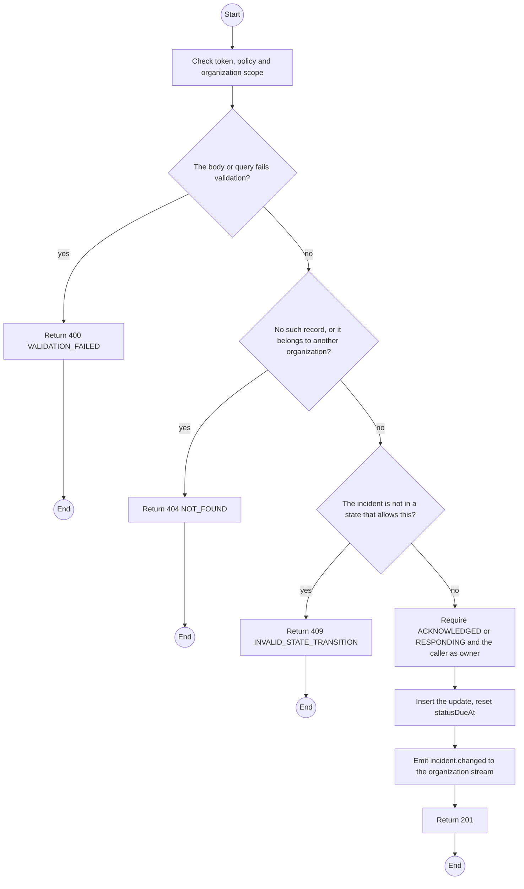
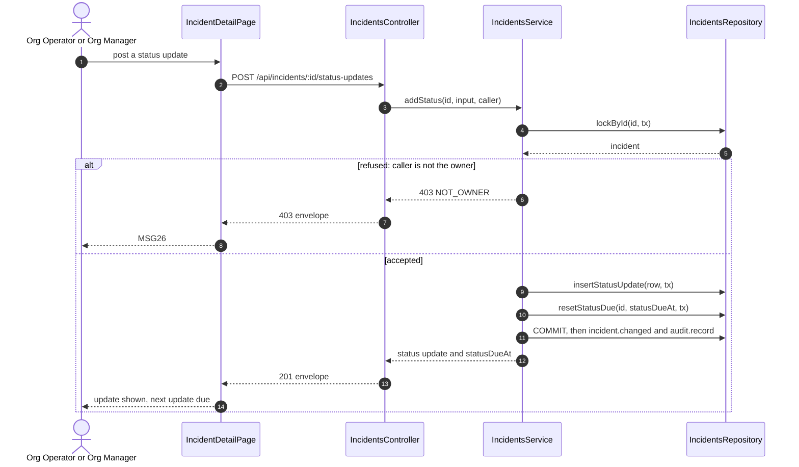

# POST /api/incidents/:id/status-updates: Add a status update

> Module `incidents`. Generated from `scripts/specs/endpoints/incidents.py` by `scripts/specs/build_api_design.py`; edit the catalog, not this file. Format: `02-templates/04-api-endpoint-template.md` with Mermaid (D-017). Envelope: D-002.

[TOC]

---
## Overview

Appends a status note during `ACKNOWLEDGED` or `RESPONDING` and resets the stale timer; no state change. Without one inside the stale limit the incident escalates (FR-INC-07, E03-5).

## API Specification

| API | URL |
| --- | --- |
| POST | /api/incidents/:id/status-updates |
| Permission | Owner (Org Manager or Org Operator) |
| Traces | UC-33, FR-INC-07, E03-5 |

### Path parameters

| Field | Description | Data Type | Examples |
| --- | --- | --- | --- |
| id | Incident id; members may use only their own organization's | uuid | `7a6b5c4d-3e2f-4a1b-8c9d-0e1f2a3b4c5d` |

## Request sample

```json
{
  "note": "Reached the holder, minor ankle injury"
}
```

| Field | Description | Data Type | Required | Examples |
| --- | --- | --- | --- | --- |
| note | Status | string | yes | `Reached the holder, minor ankle injury` |

## Response sample

```json
{
  "result": {
    "id": "su-3",
    "note": "Reached the holder, minor ankle injury",
    "createdAt": "2026-10-20T03:15:00.000Z",
    "statusDueAt": "2026-10-20T04:45:00Z"
  },
  "isSuccess": true,
  "statusCode": 201,
  "message": "Status recorded"
}
```

## Validation

<table>
    <th>Status code</th>
    <th>Description</th>
    <th>Examples</th>
    <tbody>
        <tr>
            <td>400</td>
            <td>The body or query fails validation (<code>VALIDATION_FAILED</code>)</td>
<td>

```json
{
  "result": {
    "errorCode": "VALIDATION_FAILED"
  },
  "isSuccess": false,
  "statusCode": 400,
  "message": "{field} is required."
}
```
</td>
        </tr>
        <tr>
            <td>401</td>
            <td>Missing, malformed or expired access token or API key (<code>UNAUTHENTICATED</code>)</td>
<td>

```json
{
  "result": {
    "errorCode": "UNAUTHENTICATED"
  },
  "isSuccess": false,
  "statusCode": 401,
  "message": "Authentication required."
}
```
</td>
        </tr>
        <tr>
            <td>403</td>
            <td>The caller's role, policy or organization does not allow this action (<code>FORBIDDEN</code>)</td>
<td>

```json
{
  "result": {
    "errorCode": "FORBIDDEN"
  },
  "isSuccess": false,
  "statusCode": 403,
  "message": "You do not have access to this."
}
```
</td>
        </tr>
        <tr>
            <td>404</td>
            <td>No such record, or it belongs to another organization (<code>NOT_FOUND</code>)</td>
<td>

```json
{
  "result": {
    "errorCode": "NOT_FOUND"
  },
  "isSuccess": false,
  "statusCode": 404,
  "message": "Incident not found."
}
```
</td>
        </tr>
        <tr>
            <td>403</td>
            <td>Only the member who owns the response may do this (<code>NOT_OWNER</code>)</td>
<td>

```json
{
  "result": {
    "errorCode": "NOT_OWNER"
  },
  "isSuccess": false,
  "statusCode": 403,
  "message": "You do not have access to this."
}
```
</td>
        </tr>
        <tr>
            <td>409</td>
            <td>The incident is not in a state that allows this (<code>INVALID_STATE_TRANSITION</code>)</td>
<td>

```json
{
  "result": {
    "errorCode": "INVALID_STATE_TRANSITION"
  },
  "isSuccess": false,
  "statusCode": 409,
  "message": "This cannot be done while it is RESOLVED."
}
```
</td>
        </tr>
    </tbody>
</table>

## Activity Diagram



## Sequence Diagram



Not drawn in the sequence: 400 VALIDATION_FAILED for a blank note, 403 FORBIDDEN, 404 NOT_FOUND and 409 INVALID_STATE_TRANSITION, which the Validation table and the activity diagram carry.
