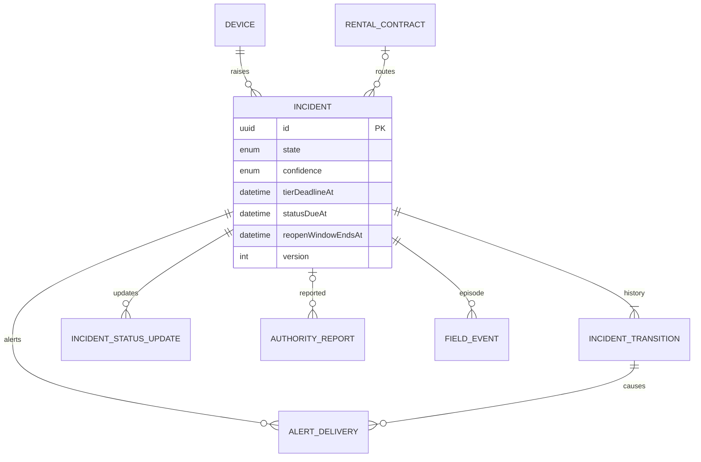
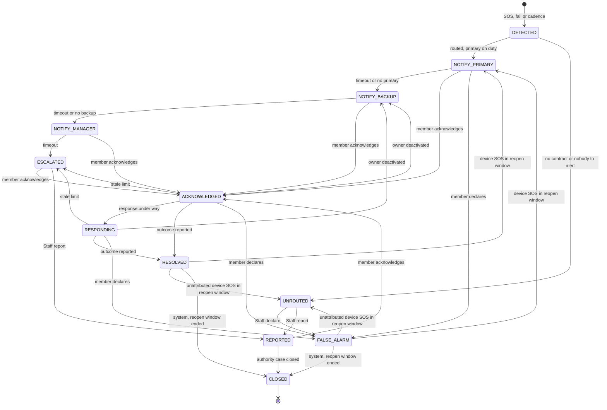
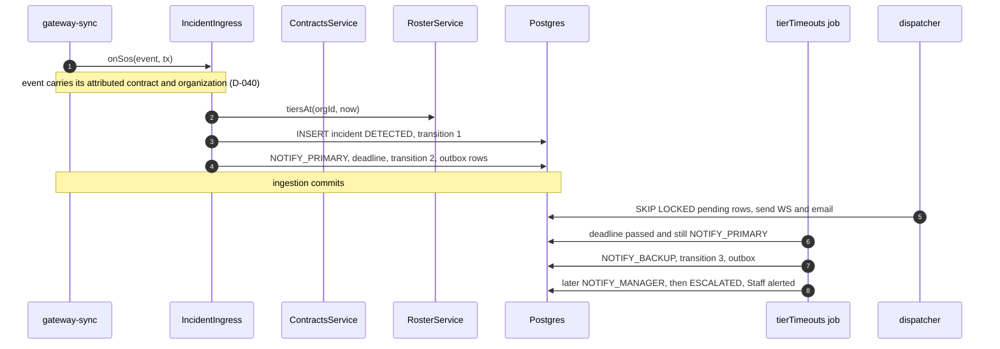
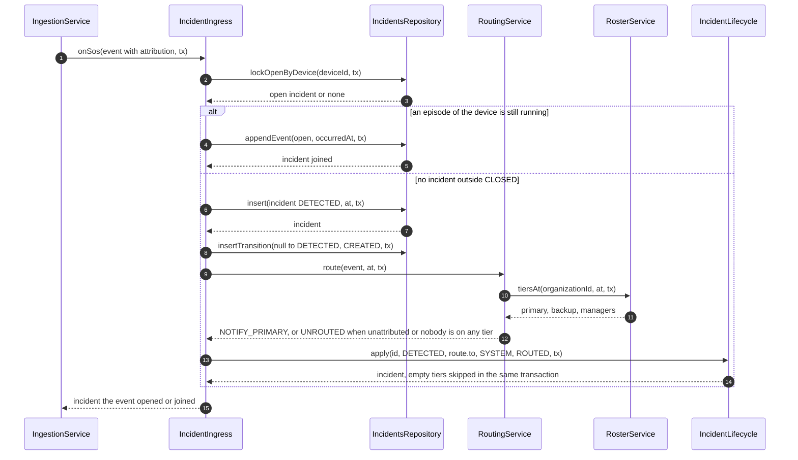
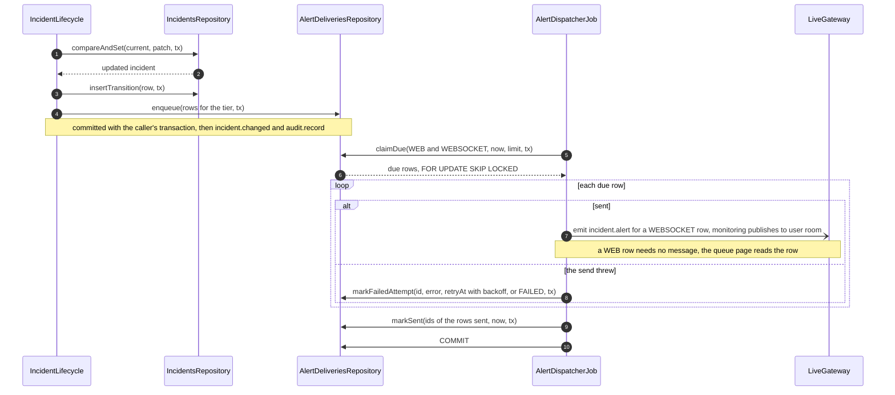
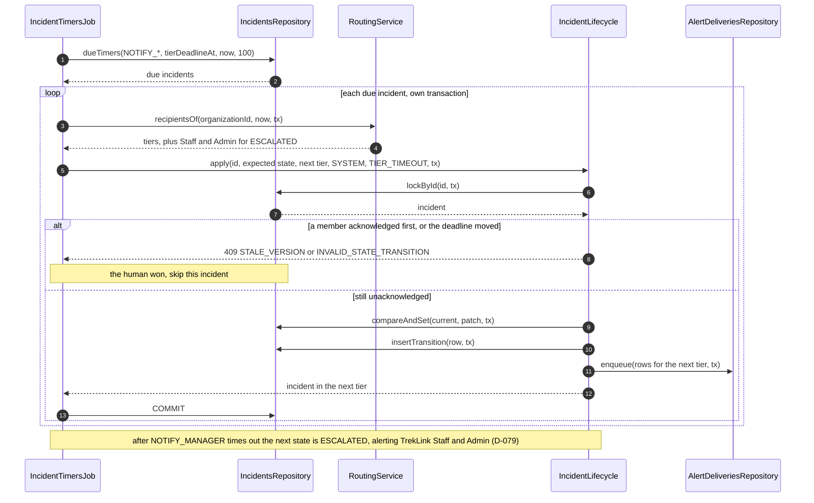
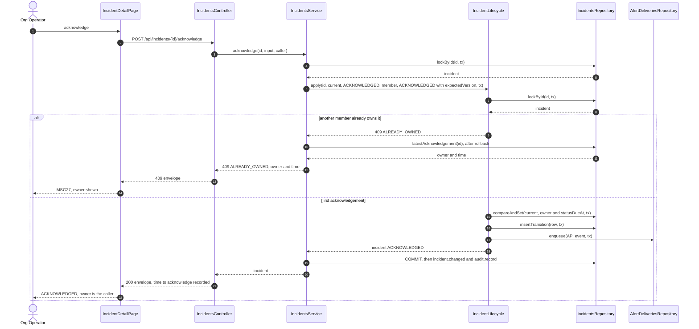
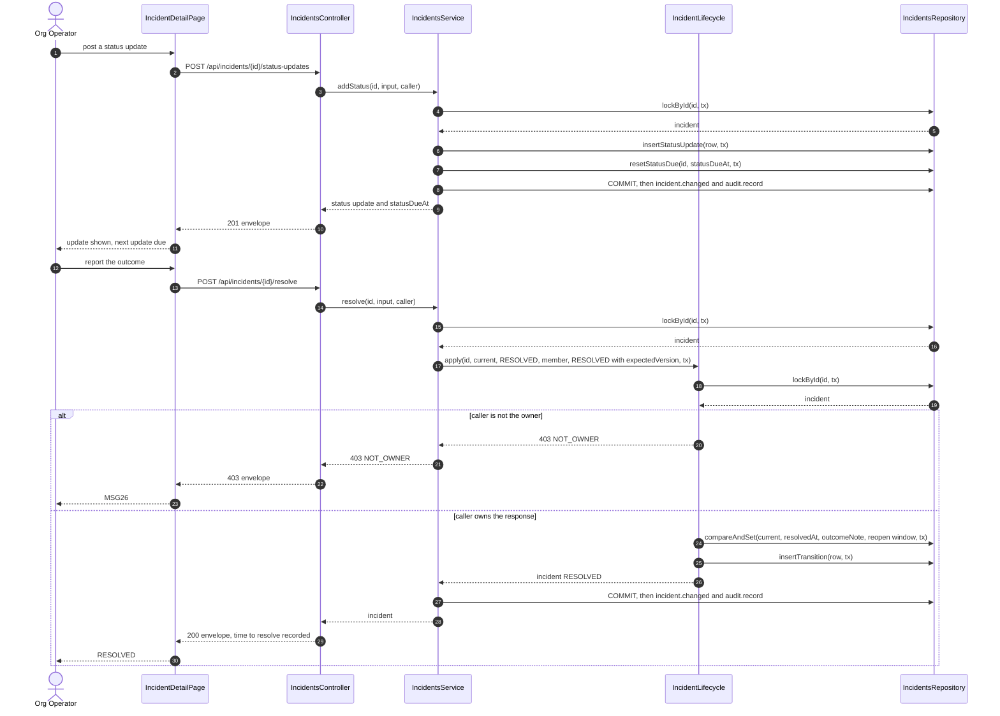
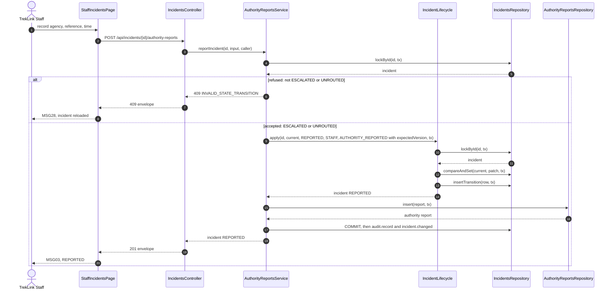

# Technical Design: incidents

> Fulfills `requirements.md` in this folder. Schema: the `// @module incidents` block of
> `backend/prisma/schema.prisma` is authoritative. The lifecycle is D-034 as amended by D-038.
>
> **Status**: Approved, written by KhoaDD and merged on `dev` (treklink-web PR #30 and #31, 2026-10-18). Changes go through a pull request reviewed by KhoaDD (D-052).

---

## 1. Data model

***Figure 1***: incidents slice. Routing (`contractId`, `organizationId`) is fixed at creation and redone
only on reopen.

`incident_status_updates` is append-only (a trigger refuses UPDATE and DELETE). A wrong status update is
corrected by a new row whose nullable `correctsId` names it; the corrected row is never edited. `correctsId`
is unique, so an update is corrected at most once, and a correction can itself be corrected by a later row.
The detail read (api-design 02) returns `correctsId` and `correctedById` on every update so the page can
mark the corrected one; a correction must name an update of the same incident (400 `VALIDATION_FAILED`) not
yet corrected (409 `CONFLICT_UNIQUE`), checked under the incident row lock (dry run defect 15, REQ-EVT-14).
A correction is a status update, so it needs the owner and an `ACKNOWLEDGED` or `RESPONDING` incident
(409 `INVALID_STATE_TRANSITION` once `RESOLVED` or `CLOSED`).

---

## 2. Incident lifecycle (D-034, D-038)

***Figure 2***: Incident lifecycle; SRS Figures 26 and 27. `NOTIFY_BACKUP` and `NOTIFY_MANAGER` also go
to `FALSE_ALARM` (D-034 "`NOTIFY_*`"); those two arrows are omitted from the figure for legibility.
`DETECTED` is transient: routing happens in the creating transaction. The route is the contract and
organization the triggering field event is attributed to (D-040), never the device's current holder; an
`UNATTRIBUTED` event routes to `UNROUTED`. A reopen is re-routed the same way (REQ-EVT-10 with
REQ-EVT-03), so an unattributed SOS, or an organization with nobody to alert, reopens to `UNROUTED`. A
device packet only opens or reopens an incident; a person ends it, and only the system closes a
`RESOLVED` or `FALSE_ALARM` episode, once its reopen window has ended (REQ-UBI-05, D-038 rule 2).

| Timer column | Set when entering | Cleared when leaving |
|---|---|---|
| `tierDeadlineAt` | `NOTIFY_PRIMARY` (+ primary timeout), `NOTIFY_BACKUP`, `NOTIFY_MANAGER` | any `NOTIFY_*` |
| `statusDueAt` | `ACKNOWLEDGED`, `RESPONDING`, and on each status update (+ stale limit) | those two states |
| `reopenWindowEndsAt` | `RESOLVED`, `FALSE_ALARM` (+ reopen window) | those two states |

**Empty tiers.** Entering a `NOTIFY_*` state whose tier has nobody (no shift, no primary, no backup)
continues immediately to the next tier in the same transaction, one transition row each, so the audit
trail shows the skip (BR-16). A Manager tier is never empty while the organization has an active
Manager (`organizations` REQ-UBI-02); if it is, the incident goes to `ESCALATED`.

**Transition implementation.** `IncidentLifecycle.apply(id, expectedState, to, actor, reason, tx)`,
called inside the caller's transaction by `IncidentsService`, `AuthorityReportsService`,
`IncidentIngress`, `IncidentTimersJob` and the owner-deactivation listener (there is no separate
lifecycle service): `SELECT ... FOR UPDATE` through `IncidentsRepository.lockById`, compare the state
and `reason.expectedVersion`, look up `(from, to)` for the reason code in its transition table, check
guards (owner, actor kind, deadlines), `UPDATE ... SET state, version = version + 1 ... WHERE id AND
state AND version` (`compareAndSet`), insert the transition row with the next `seq`, insert outbox rows
(`AlertDeliveriesRepository.enqueue`), all in one transaction. A second member acknowledging an owned
incident gets 409 `ALREADY_OWNED`; after the rollback `IncidentsService` reads the latest
acknowledgement and names the owner and time (MSG27).

---

## 3. Alert routing and delivery

| Transition into | Recipients | Channels |
|---|---|---|
| `NOTIFY_PRIMARY`, `NOTIFY_BACKUP` | that tier's member | WebSocket, web inbox, email |
| `NOTIFY_MANAGER` | every active Manager | WebSocket, web inbox, email |
| `ESCALATED`, `UNROUTED` | every active TrekLink Staff and Admin account, plus the organization's Managers for `ESCALATED` | WebSocket, web inbox, email (MSG34) |
| any change | the organization's stream | API event |
| stale flag | owner, or the current tier | WebSocket, web inbox |

The TrekLink recipients are the active, not deleted accounts holding the `STAFF` or `ADMIN` role, read
through `AccountsService.activeStaffAndAdminIds` on the `incidents --> auth` edge of platform design Figure 3
(D-079, REQ-EVT-04). An account whose invitation is not yet accepted is included. Each account gets one row
per channel; a recipient listed twice gets one set. Leader ruling of 2026-10-30, answering the confirmation
asked on PR #120: Admin stays a recipient, as this row always said, and D-079's "Staff" reads as Staff and
Admin. `ESCALATED` reads them since TK-144; `UNROUTED` waits for task 2.2.

The dispatcher job reads `alert_deliveries WHERE status = PENDING AND nextAttemptAt <= now()` with
`FOR UPDATE SKIP LOCKED`, sends, and sets `SENT`, or bumps `attempts` and `nextAttemptAt` with backoff
`base × 2^attempts`, or `FAILED` at the limit. WebSocket delivery emits the in-process event `incident.alert`,
whose synchronous listener in `monitoring` publishes to the recipient's room `user:<id>`
(`ws-live-contract.md`); `incidents` never imports `monitoring`. It counts as sent when the listener
returns, whether or not a socket is connected, because the web inbox holds the same alert.

On the wire, `incident.alert` is a `stream` event with `seq: 0`. It is not stored in the stream table,
whose entries are scoped by organization rather than by person, so it has no replay sequence. The
client delivers it without reading or moving its replay cursor; a missed alert stays visible in the
queue through its web inbox row.

---

## 4. Correlation

`IncidentIngress.onSos(event, tx)` is called by `gateway-sync` inside the ingestion transaction:

1. Lock the device's incident outside `CLOSED`, if any (`incidents_one_open_per_device`).
2. If none: create, route (§2), return.
3. If `RESOLVED` or `FALSE_ALARM`, a person has already ended the episode, and no packet ends it
   (REQ-UBI-05, D-038 rule 2). For an SOS that occurred after the episode ended:
   - **Past the window**: `reopenWindowEndsAt` is set and both the server time and the SOS occurrence
     time are at or after it. The window has genuinely ended, so the system closes the episode
     (`REOPEN_WINDOW_ENDED`, `SYSTEM` actor, under the same window guard as the
     `closeAfterReopenWindow` job) and the SOS opens a new incident through step 2, in the same
     transaction, so no SOS is swallowed.
   - **Otherwise**, the SOS occurred or arrives inside the window, or the window was never set (`null`
     counts as not ended): the device reopens the episode (`REOPENED`, `DEVICE` actor), re-routed as
     at creation. An attributed SOS whose organization has someone to alert reopens to
     `NOTIFY_PRIMARY`; an unattributed SOS, or one whose organization has nobody to alert, reopens to
     `UNROUTED`, exactly as a new incident would route (REQ-EVT-03). Nothing is closed.

   An earlier SOS uploaded late, which occurred before the episode ended, is appended to it.
4. Otherwise, if within the correlation window of `lastEventAt`: append (event count, last position,
   `CONFIRMED` upgrade for a suspected incident).
5. Otherwise (open, but older than the window): append too. One open incident per device means a new
   episode on an open incident is the same emergency still running.

`onPosition(event, tx)` appends positions of an open incident (`gatewaySync.retroTagGraceSeconds`
before the SOS included) and counts cadence for `SUSPECTED` creation. A position joins only an
episode still running (not `RESOLVED` or `FALSE_ALARM`). An SOS text carries no position on the wire
(FGT), so the incident's last position comes from these packets: it is set when none is known, and
moved unless its fix time is older than the stored fix time `lastPositionAt`, so an out-of-order
packet never overwrites a newer position (PR #114 review). Positions move neither `eventCount` nor
`lastEventAt`, the SOS correlation anchor.

---

## 5. Services and ports

| Export | Used by |
|---|---|
| `IncidentIngress.onSos(event, tx)`, `onPosition(event, tx)` | gateway-sync |
| `IncidentsService.markDeviceStale(deviceId, stale, lastPosition)` | monitoring |
| `IncidentsService.openByDevices(ids)`, `incidentsOfDevice(id)`, `responseTimes(range)`, `alertDeliveryStats()` | monitoring |
| provider of `CONTRACT_CLOSE_CHECKS` | rentals |

Listens to `member.deactivated` (REQ-EVT-11). Emits `incident.changed`, `audit.record`.

---

## 6. Scheduler jobs

`incidents.tierTimeouts`, `incidents.staleResponses`, `incidents.closeAfterReopenWindow`,
`incidents.deliverAlerts`: `platform` design §4.6. Each selects by its deadline column and state, then
calls `apply()` with the expected state, so a job racing a human action loses cleanly. The three timers
apply one transition per incident in its own transaction, up to 100 per run; a failure on one incident
is logged and that incident is due again on the next run. A `RESOLVED` or `FALSE_ALARM` row with no
reopen window is never selected, since a window never set has not ended.

---

## 7. Error catalogue

| Code | HTTP |
|---|---|
| `INVALID_STATE_TRANSITION` | 409 |
| `ALREADY_OWNED` | 409 |
| `NOT_OWNER` | 403 |
| `STALE_VERSION` | 409 |
| `CASE_ALREADY_CLOSED` | 409 |
| `CONTRACT_NOT_DEFAULTED` | 409 |
| `CONFLICT_UNIQUE` (status update already corrected) | 409 |

---

## 8. Sequence: SOS to escalation

***Figure 3***: MF-03 from the SOS to escalation, with nobody answering.

---

## 9. Testing strategy

Transition matrix over 12 states × events; race tests for acknowledge and for job versus human; restart
test with pending deadlines (fake clock); replay ×10; empty-tier skipping; reopen inside and outside the
window; outbox retry and `FAILED` without blocking escalation; cross-organization 404. Every routing test
runs with at least two organizations, including A's late SOS after the device passed to B (AC-09, D-042).

---

## 10. Detailed design for Report 4 (D-044)

Layering as in `organizations` design §9. Figure 4 is the class view; Figures 5 to 10 are the
MF-03 interactions. Names are the classes in `backend/src/modules/incidents/`. There is no separate
lifecycle service: `IncidentsService` holds the member actions (acknowledge, responding, status
update, resolve, false alarm), `AuthorityReportsService` the authority reports, and both, the ingress
and the timer job hand every state change to `IncidentLifecycle.apply`. The transition table
(`EDGES`) and the guards live inside `IncidentLifecycle`; no separate state machine class exists. The
outbox is `AlertDeliveriesRepository` over `alert_deliveries`.

```mermaid
classDiagram
    class IncidentsController {
        +list(query, caller, ability) PagedResult
        +detail(id, caller, ability) IncidentDetailView
        +transitions(id, caller, ability) TransitionView[]
        +alerts(id, caller, ability) AlertDeliveryView[]
        +acknowledge(id, dto, caller) IncidentView
        +responding(id, dto, caller) IncidentView
        +statusUpdate(id, dto, caller) StatusUpdateResult
        +resolve(id, dto, caller) IncidentView
        +falseAlarm(id, dto, caller) IncidentView
        +reportToAuthority(id, dto, caller) IncidentView
    }
    class AuthorityReportsController {
        +list(query) PagedResult
        +reportContract(dto, caller) AuthorityReportView
        +closeCase(reportId, dto, caller) CloseCaseResult
    }
    class IncidentsService {
        +acknowledge(id, input, caller) Incident
        +responding(id, input, caller) Incident
        +addStatus(id, input, caller) StatusUpdateResult
        +resolve(id, input, caller) Incident
        +falseAlarm(id, input, caller) Incident
    }
    class IncidentsQueryService {
        +list(query, caller, ability) PagedResult
        +detail(id, caller, ability) IncidentDetailView
        +views(rows) IncidentView[]
        +openByDevices(ids) Map
    }
    class AuthorityReportsService {
        +reportIncident(id, input, caller) Incident
        +reportContract(input, caller) AuthorityReportView
        +list(query) PagedResult
        +closeCase(reportId, input, caller) CloseCaseResult
    }
    class IncidentIngress {
        +onSos(event, tx) Incident
        +onPosition(event, tx) Incident
    }
    class RoutingService {
        +route(attribution, at, tx) Route
        +recipientsOf(organizationId, at, tx) IncidentRecipients
    }
    class IncidentLifecycle {
        +apply(id, expectedState, to, actor, reason, tx) Incident
    }
    class IncidentTimersJob {
        +tierTimeouts() number
        +staleResponses() number
        +closeAfterReopenWindow() number
    }
    class AlertDispatcherJob {
        +deliverAlerts() number
    }
    class IncidentsRepository {
        +lockById(id, tx) Incident
        +lockOpenByDevice(deviceId, tx) Incident
        +insert(incident, at, tx) IncidentInsertResult
        +appendEvent(incident, occurredAt, tx) Incident
        +compareAndSet(current, patch, tx) Incident
        +insertTransition(row, tx) IncidentTransition
        +insertStatusUpdate(row, tx) IncidentStatusUpdate
        +resetStatusDue(id, statusDueAt, tx)
        +dueTimers(states, column, now, limit) DueIncident[]
        +latestAcknowledgement(id) IncidentTransition
    }
    class AuthorityReportsRepository {
        +insert(data, tx) AuthorityReport
        +lockById(id, tx) AuthorityReport
        +closeCase(id, caseClosedAt, caseClosedById, tx) AuthorityReport
        +countOpenOnIncident(incidentId, tx) number
        +page(where, skip, take) AuthorityReportRow[]
    }
    class AlertDeliveriesRepository {
        +enqueue(rows, tx)
        +claimDue(channels, now, limit, tx) DueAlert[]
        +markSent(ids, at, tx)
        +markFailedAttempt(id, error, retryAt, tx)
    }
    class ContractsService {
        +statusOf(contractId) ContractStatus
    }
    class RosterService {
        +tiersAt(organizationId, at, tx) Tiers
    }
    class AccountsService {
        +activeStaffAndAdminIds(tx) string[]
    }
    IncidentsController --> IncidentsService
    IncidentsController --> IncidentsQueryService
    IncidentsController --> AuthorityReportsService : reportIncident
    AuthorityReportsController --> AuthorityReportsService
    IncidentsService --> IncidentLifecycle : apply
    IncidentsService --> IncidentsRepository
    AuthorityReportsService --> IncidentLifecycle : apply
    AuthorityReportsService --> IncidentsRepository : lockById
    AuthorityReportsService --> AuthorityReportsRepository
    AuthorityReportsService --> ContractsService : statusOf
    IncidentIngress --> IncidentsRepository
    IncidentIngress --> RoutingService : route
    IncidentIngress --> IncidentLifecycle : apply
    RoutingService --> RosterService : tiersAt
    RoutingService --> AccountsService : activeStaffAndAdminIds
    IncidentTimersJob --> IncidentsRepository : dueTimers
    IncidentTimersJob --> RoutingService : recipientsOf
    IncidentTimersJob --> IncidentLifecycle : apply
    IncidentLifecycle --> IncidentsRepository
    IncidentLifecycle --> AlertDeliveriesRepository : enqueue
    AlertDispatcherJob --> AlertDeliveriesRepository
```

<!-- sdd: MF-03 class incidents -->

***Figure 4***: incidents classes. `ContractsService` belongs to `rentals`, `RosterService` to
`organizations` and `AccountsService` to `auth`; each is called through its module's exported service.
Read-only repository methods of the query service are left out.

<!-- sdd: MF-03 seq UC-29 part 1 of 2: correlation and routing -->

***Figure 5***: UC-29 Create Incident, part 1 of 2: one incident per episode, routed by attribution
(FR-INC-03, D-040). `RoutingService` only chooses the target; `IncidentIngress` applies it.
Not drawn here: the reopen inside the window, the close after it and the concurrent-insert join, which §4
Correlation and REQ-EVT-10 carry.

<!-- sdd: MF-03 seq UC-29 part 2 of 2: alert outbox -->

***Figure 6***: UC-29 Create Incident, part 2 of 2: UC-30 Send Alert through the outbox (E03-7). EMAIL and
API_EVENT rows stay PENDING until their senders exist. Not drawn here: the retry backoff and the FAILED
limit, which REQ-EVT-13 and §3 carry.

<!-- sdd: MF-03 seq UC-31 -->

***Figure 7***: UC-31 Escalate Alert Tier (`incidents.tierTimeouts`). A job racing a human loses under
the row lock. Not drawn here: a failing incident, logged and due again on the next tick (§6).

<!-- sdd: MF-03 seq UC-32 -->

***Figure 8***: UC-32 Acknowledge Incident (E03-3, MSG27). Not drawn here: 403 for an account without an
organization, 404 NOT_FOUND, 409 STALE_VERSION and 409 INVALID_STATE_TRANSITION, which api-design 03 carries.

<!-- sdd: MF-03 seq UC-33 -->

***Figure 9***: UC-33 Report Incident Status, ending in `RESOLVED`. Not drawn here: 400 for a blank note,
403 FORBIDDEN, 404 NOT_FOUND, 409 STALE_VERSION and 409 INVALID_STATE_TRANSITION, which api-design 05 and 06
carry.

<!-- sdd: MF-03 seq UC-35 -->

***Figure 10***: UC-35 Report to Authorities (BR-17), in the order of
`AuthorityReportsService.reportIncident`: `lockById`, the state check, `IncidentLifecycle.apply`,
`AuthorityReportsRepository.insert`, COMMIT. Not drawn here: 403 FORBIDDEN, 400 VALIDATION_FAILED,
404 NOT_FOUND and 409 STALE_VERSION, which api-design 08 carries.
