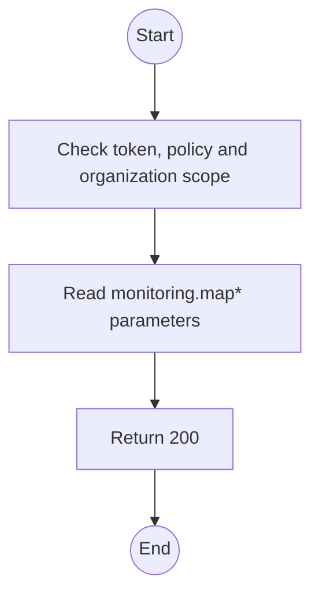
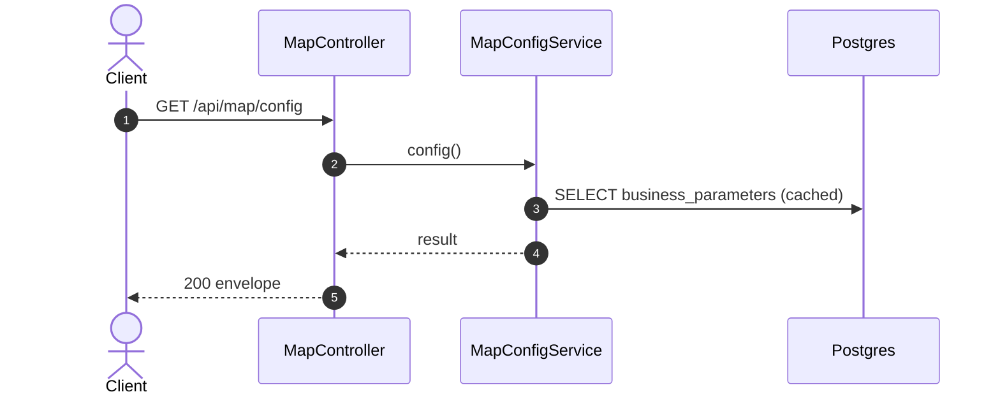

# GET /api/map/config: Map configuration

> Module `monitoring`. Generated from `scripts/specs/endpoints/monitoring.py` by `scripts/specs/build_api_design.py`; edit the catalog, not this file. Format: `02-templates/04-api-endpoint-template.md` with Mermaid (D-017). Envelope: D-002.

[TOC]

---
## Overview

Basemaps the user can switch between, the default one and the default viewport, from the business parameters (FR-CFG-03, D-031, D-072). `provider`, `tileUrl` and `attribution` repeat the default basemap for a client that draws one layer. Above an entry's `maxNativeZoom` the client enlarges the deepest tiles up to `maxZoom`. The sovereignty overlay labels are a constant of the build, `SOVEREIGNTY_OVERLAY` in `monitoring`, and an Admin cannot edit them away (D-031, BR-30). The client never hard-codes a provider or a label.

## API Specification

| API | URL |
| --- | --- |
| GET | /api/map/config |
| Permission | Any signed-in user |
| Traces | UC-38, FR-CFG-03, FR-MON-01, BR-30, NFR-LEG-01 |

## Request sample

No body.

## Response sample

```json
{
  "result": {
    "provider": "opentopomap",
    "tileUrl": "https://{s}.tile.opentopomap.org/{z}/{x}/{y}.png",
    "attribution": "Map data © OpenStreetMap contributors, SRTM; style © OpenTopoMap (CC-BY-SA)",
    "basemaps": [
      {
        "id": "opentopomap",
        "name": "Topographic (OpenTopoMap)",
        "tileUrl": "https://{s}.tile.opentopomap.org/{z}/{x}/{y}.png",
        "attribution": "Map data © OpenStreetMap contributors, SRTM; style © OpenTopoMap (CC-BY-SA)",
        "maxZoom": 18,
        "maxNativeZoom": 17
      },
      {
        "id": "openstreetmap",
        "name": "OpenStreetMap",
        "tileUrl": "https://tile.openstreetmap.org/{z}/{x}/{y}.png",
        "attribution": "© OpenStreetMap contributors",
        "maxZoom": 19,
        "maxNativeZoom": 19
      }
    ],
    "defaultViewport": {
      "lat": 11.56,
      "lon": 108.54,
      "zoom": 12
    },
    "sovereigntyOverlay": [
      {
        "label": "Quần đảo Hoàng Sa (Việt Nam)",
        "lat": 16.5,
        "lon": 112.0
      },
      {
        "label": "Quần đảo Trường Sa (Việt Nam)",
        "lat": 10.0,
        "lon": 114.0
      }
    ],
    "staleAfterSeconds": 300
  },
  "isSuccess": true,
  "statusCode": 200,
  "message": "OK"
}
```

## Validation

<table>
    <th>Status code</th>
    <th>Description</th>
    <th>Examples</th>
    <tbody>
        <tr>
            <td>401</td>
            <td>Missing, malformed or expired access token or API key (<code>UNAUTHENTICATED</code>)</td>
<td>

```json
{
  "result": {
    "errorCode": "UNAUTHENTICATED"
  },
  "isSuccess": false,
  "statusCode": 401,
  "message": "Authentication required."
}
```
</td>
        </tr>
        <tr>
            <td>403</td>
            <td>The caller's role, policy or organization does not allow this action (<code>FORBIDDEN</code>)</td>
<td>

```json
{
  "result": {
    "errorCode": "FORBIDDEN"
  },
  "isSuccess": false,
  "statusCode": 403,
  "message": "You do not have access to this."
}
```
</td>
        </tr>
    </tbody>
</table>

## Activity Diagram



## Sequence Diagram


