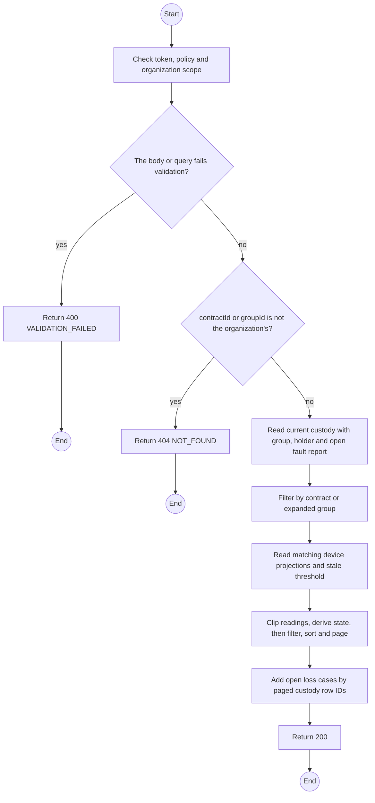
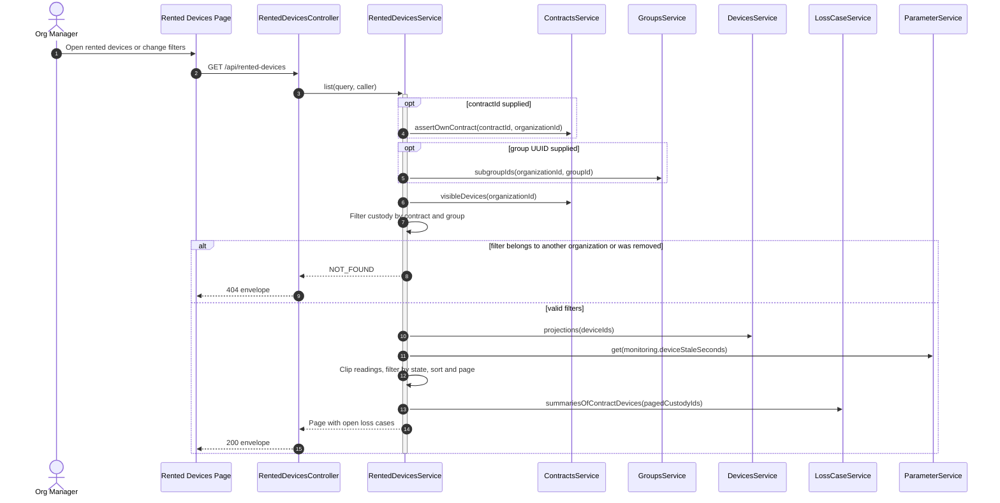

# GET /api/rented-devices: Rented-device console

> Module `monitoring`. Generated from `scripts/specs/endpoints/monitoring.py` by `scripts/specs/build_api_design.py`; edit the catalog, not this file. Format: `02-templates/04-api-endpoint-template.md` with Mermaid (D-017). Envelope: D-002.

[TOC]

---
## Overview

Every device the organization holds now across its contracts, one row per device on the contract holding it, for the Org Manager's console (UC-66, FR-CON-16): variant, asset tag, contract, the unit `state` with the battery and last-seen time clipped to the custody interval exactly as the organization's map snapshot (REQ-UBI-04, D-040), the group and the holder label, the open fault report and the open loss case. The loss case is read by the current custody row ID. `groupId` keeps the devices of that group and its subgroups, and `groupId=none` the devices in no group; `state` filters after the custody view, so it matches the map. A checked-in or settled-lost unit is not listed. An Org Operator or a TrekLink caller gets 403: the console is the Manager's (Report 3 RBAC).

## API Specification

| API | URL |
| --- | --- |
| GET | /api/rented-devices |
| Permission | Org Manager: own |
| Traces | UC-66, FR-CON-16, FR-MON-11, BR-19, BR-46 |

### Query parameters

| Field | Description | Data Type | Required | Examples |
| --- | --- | --- | --- | --- |
| contractId | One of the organization's contracts | uuid | no | `c0ffee00-1234-4abc-9def-001122334455` |
| groupId | A group of the organization, with its subgroups, or `none` for ungrouped devices | uuid or `none` | no | `7a790b20-40a7-46c6-a7b9-1af8f78400d1` |
| state | `LIVE`, `OFFLINE` or `NOT_HEARD` | enum | no | `OFFLINE` |
| pageNumber | 1-based page | int | no | `1` |
| pageSize | Items per page, at most MAX_PAGE_SIZE | int | no | `20` |

## Request sample

No body.

## Response sample

```json
{
  "result": {
    "items": [
      {
        "deviceId": "0d3f6a2b-7e11-4c55-8f0a-2b1c9e7d4a10",
        "assetTag": "TL-0042",
        "variantCode": "treklink-v3",
        "contract": {
          "id": "c0ffee00-1234-4abc-9def-001122334455",
          "code": "RC-2026-0042",
          "planType": "MONTHLY",
          "status": "ACTIVE"
        },
        "contractDeviceId": "8db32cf2-b5aa-4b69-85a5-639258f74030",
        "handedOverAt": "2026-10-19T01:30:00.000Z",
        "state": "OFFLINE",
        "batteryPct": 34,
        "lastSeenAt": "2026-10-20T03:15:00.000Z",
        "group": {
          "id": "c5b402ac-d922-417e-a0be-b2dab7608ebc",
          "name": "Team A",
          "parentId": "7a790b20-40a7-46c6-a7b9-1af8f78400d1"
        },
        "holder": {
          "name": "Le Thi E"
        },
        "openFaultReportId": null,
        "openLossCase": null
      }
    ],
    "pageNumber": 1,
    "pageSize": 20,
    "totalCount": 7,
    "totalPages": 1
  },
  "isSuccess": true,
  "statusCode": 200,
  "message": "OK"
}
```

## Validation

<table>
    <th>Status code</th>
    <th>Description</th>
    <th>Examples</th>
    <tbody>
        <tr>
            <td>400</td>
            <td>The body or query fails validation (<code>VALIDATION_FAILED</code>)</td>
<td>

```json
{
  "result": {
    "errorCode": "VALIDATION_FAILED"
  },
  "isSuccess": false,
  "statusCode": 400,
  "message": "{field} is required."
}
```
</td>
        </tr>
        <tr>
            <td>401</td>
            <td>Missing, malformed or expired access token or API key (<code>UNAUTHENTICATED</code>)</td>
<td>

```json
{
  "result": {
    "errorCode": "UNAUTHENTICATED"
  },
  "isSuccess": false,
  "statusCode": 401,
  "message": "Authentication required."
}
```
</td>
        </tr>
        <tr>
            <td>403</td>
            <td>The caller's role, policy or organization does not allow this action (<code>FORBIDDEN</code>)</td>
<td>

```json
{
  "result": {
    "errorCode": "FORBIDDEN"
  },
  "isSuccess": false,
  "statusCode": 403,
  "message": "You do not have access to this."
}
```
</td>
        </tr>
        <tr>
            <td>404</td>
            <td>contractId or groupId is not the organization's (<code>NOT_FOUND</code>)</td>
<td>

```json
{
  "result": {
    "errorCode": "NOT_FOUND"
  },
  "isSuccess": false,
  "statusCode": 404,
  "message": "Not found."
}
```
</td>
        </tr>
    </tbody>
</table>

## Activity Diagram



## Sequence Diagram



The validation table covers authentication, role and invalid-query refusals before the service call.
