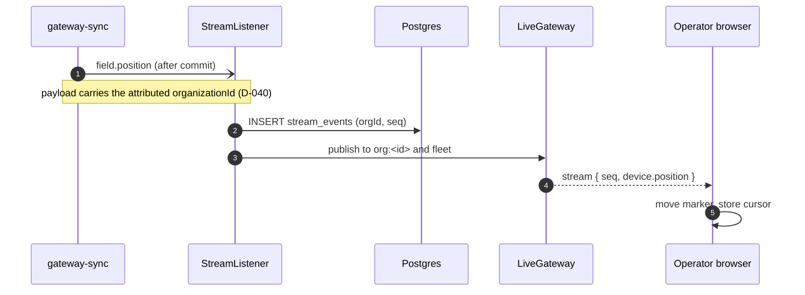
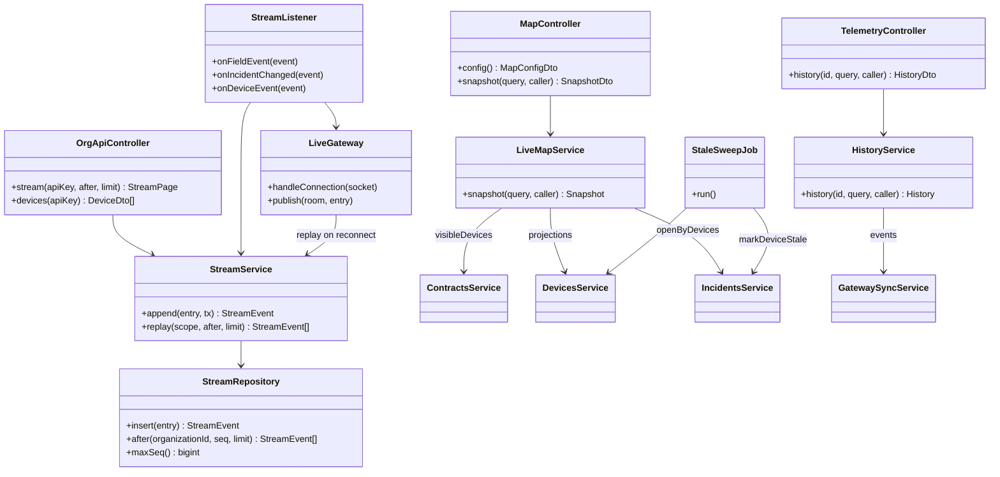
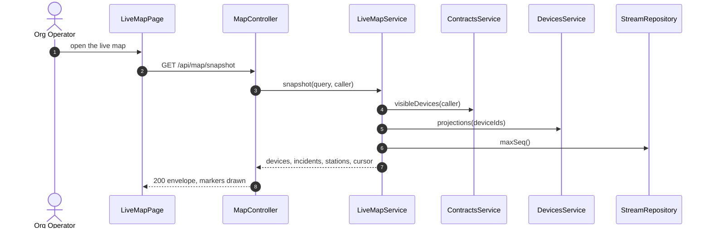
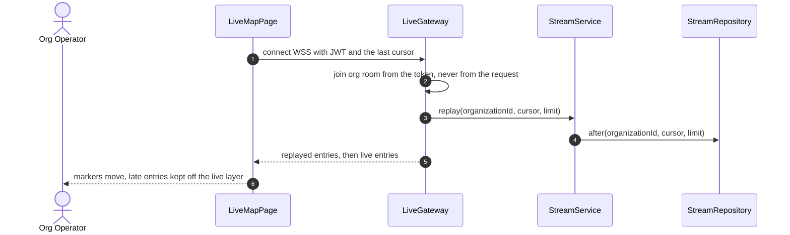
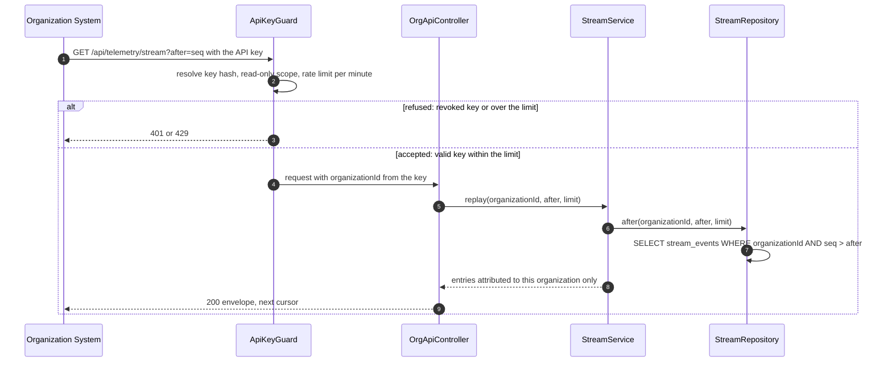
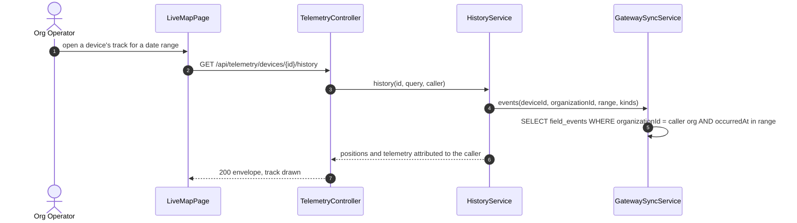
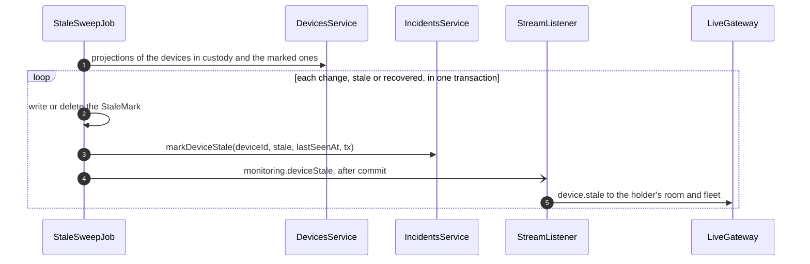

# Technical Design: monitoring

> Fulfills `requirements.md` in this folder. Schema: the `// @module monitoring` block of
> `backend/prisma/schema.prisma` is authoritative. Push contract: [ws-live-contract.md](api-design/ws-live-contract.md).
>
> **Status**: Approved, written by KhoaDD and merged on `dev` (treklink-web PR #30 and #31, 2026-10-18). Changes go through a pull request reviewed by KhoaDD (D-052).

---

## 1. Data model

`StreamEvent(seq, organizationId?, type, deviceId?, payload, createdAt)`: one row per live update; `seq`
is the cursor for both the WebSocket replay and `GET /api/telemetry/stream`. Rows are pruned after
`monitoring.streamRetentionHours`. `organizationId` null means platform-wide (fleet room only).

`DeviceRelease(organizationId, deviceId, checkedInAt)`: the latest check-in of a device from an organization,
one row per pair, replaced on each check-in. It is a table of its own because a field event is accepted
late for `gatewaySync.lateUploadGraceHours` (168), longer than the stream is kept (72), so the boundary
that marks an upload late must outlive the pruned stream (REQ-EVT-04, AC-06).

`StaleMark(subjectType, subjectId, organizationId?, lastSeenAt, markedAt)`: what the staleness sweep last
reported stale, one row per device (`DEVICE`) or Field Station (`FIELD_STATION`), written with the stale
entry and deleted with the recovered entry in the same transaction. It is stored so that the sweep emits a
transition once and a restart repeats none (REQ-EVT-03, AC-03). `organizationId` is the organization the
stale entry went to; `lastSeenAt` is the last-seen time it carried, so a later one means the subject was
heard again.

Everything else this module shows is read through other modules' services; it owns no other table.

---

## 2. Rooms and scoping

| Room | Joined by | Receives |
|---|---|---|
| `fleet` | TrekLink Staff and Admin | every entry |
| `org:<id>` | members and API keys of the organization | entries with that `organizationId` |
| `user:<id>` | that user | `incident.alert` only |

The organization of an entry comes with the event: a `field.*` event carries the organization
`gateway-sync` attributed it to by occurrence time (D-040), and an `incident.*` event its routed
organization. A `device.*` event names its organization as well (`device.handedOver`, `device.checkedIn`
and `device.labelChanged` all carry `organizationId`), so no lookup of the current holder is made. That
keeps a device that moves from A to B from leaking A's late entries to B or B's new ones to A (AC-01,
AC-06). A `field.*` entry whose occurrence time is at or before the device's latest check-in from that
organization, read from `DeviceRelease`, is marked `late` and is not plotted as a live marker.

---

## 3. Jobs

| Job | Rule |
|---|---|
| `monitoring.staleSweep` | every `monitoring.staleSweepSeconds` (a 5 s cron that skips a tick earlier than the parameter asks): a device in custody whose `lastSeenAt` is older than `monitoring.deviceStaleSeconds`, and a Field Station whose `lastSyncAt` is older than `monitoring.fieldStationStaleSeconds`, turn stale; a marked one heard again recovers. Transitions only, stored in `StaleMark`, each in its own transaction with its event emitted after commit; tell `incidents.markDeviceStale`. The rule matches the snapshot read: never stale before the first reading. A device handed to another organization while stale is reconsidered for the new holder and the old one hears nothing more; a marked device checked in and then heard again recovers to `fleet` only |
| `monitoring.pruneStream` | hourly: delete entries older than the retention |

---

## 4. Read-model services

| Endpoint | Composed from |
|---|---|
| `GET /api/map/snapshot` | `rentals.visibleDevices`, `devices.projections`, `incidents.openByDevices`, `organizations` stations, the max `seq` |
| `GET /api/telemetry/devices/:id/history` | `rentals.rentalPeriods`, `gatewaySync.events` |
| `GET /api/devices/:id/history` | `devices.trail`, `rentals.contractsOfDevice`, `incidents.incidentsOfDevice` |
| `GET /api/reports/:kind` | `rentals.utilization`, `billing.revenue`, `rentals` overdue and lost lists, `incidents.responseTimes` |
| `GET /api/system-health` | `HealthService`, `gatewaySync.stats`, `organizations` station health, `incidents.alertDeliveryStats` |

Reports return JSON or CSV text in the envelope; time-to-acknowledge and time-to-resolve are medians and
95th percentiles over the range.

---

## 5. Client side (specified in `specs/frontend/`)

Leaflet with the tile URL and attribution from `GET /api/map/config`, the overlay layer from the same
response (each label on its opaque `mask`, in a pane above the tiles and below the markers, so no basemap
label for the archipelagos shows, D-085), markers by state (normal, low battery, stale, incident), a reconnecting banner, and a map error
state that leaves the lists working. Tiles go from the browser to the chosen basemap's tile server with the browser's own
User-Agent and Referer; nothing prefetches tiles (D-031 tile policy).

---

## 6. Error catalogue

| Code | HTTP |
|---|---|
| `CURSOR_EXPIRED` | 410 |
| `RATE_LIMITED` | 429 |

---

## 7. Sequence: live update to the map

***Figure 1***: MF-04 push path.

---

## 8. Testing strategy

Scoping tests with two organizations and a device moving between them; replay and expiry; throttling;
stale transitions only once; rate limit per key; report numbers against seeded data.

---

## 9. Detailed design for Report 4 (D-044)

Layering as in `organizations` design §9. Figure 2 is the class view; Figures 3 to 7 are the
MF-04 interactions. The push path is Figure 1.

<!-- sdd: MF-04 class monitoring -->

***Figure 2***: monitoring classes. It owns only `StreamEvent`; everything else is read through other
modules' services.

<!-- sdd: MF-04 seq UC-38 part 1 of 2: snapshot -->

***Figure 3***: UC-38 View Live Map, part 1 of 2: snapshot.

<!-- sdd: MF-04 seq UC-38 part 2 of 2: live stream -->

***Figure 4***: UC-38 View Live Map, part 2 of 2: the scoped live stream (FR-MON-02, FR-MON-05).

<!-- sdd: MF-04 seq UC-39 -->

***Figure 5***: UC-39 Stream Telemetry via API (FR-MON-06, BR-36).

<!-- sdd: MF-04 seq UC-40 -->

***Figure 6***: UC-40 Query Device History, served by attribution (FR-MON-07, BR-36).

The history trusts the ingestion attribution. Gateway-sync decides, once and when the event is
stored, whether it lies inside one custody interval and writes `organizationId` and `attribution`
on the row (FR-EVT-16, FR-EVT-17); the history read filters on that `organizationId` and does not
re-check the occurrence time against the rental periods. `clippedTo` only reports the periods.
A correction to custody after ingestion therefore does not move events already stored. The read
answers at most `HISTORY_MAX_POINTS` (50,000) points, oldest first, with `truncated` set when the
range holds more (a CSV then ends with the comment row `# truncated`); `field_events("deviceId", "occurredAt")` serves the range (migration
`20261030200000_field_event_device_occurred_at`).

<!-- sdd: MF-04 seq UC-41 -->

***Figure 7***: UC-41 Mark Stale Device (FR-MON-03).
