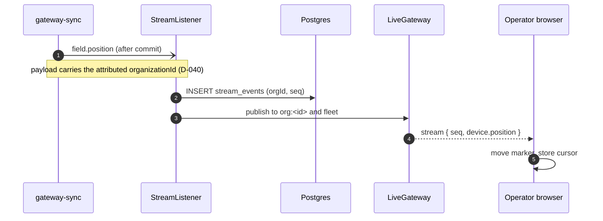
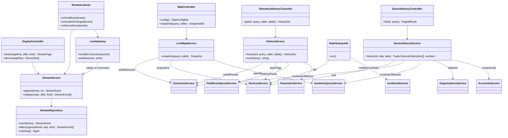
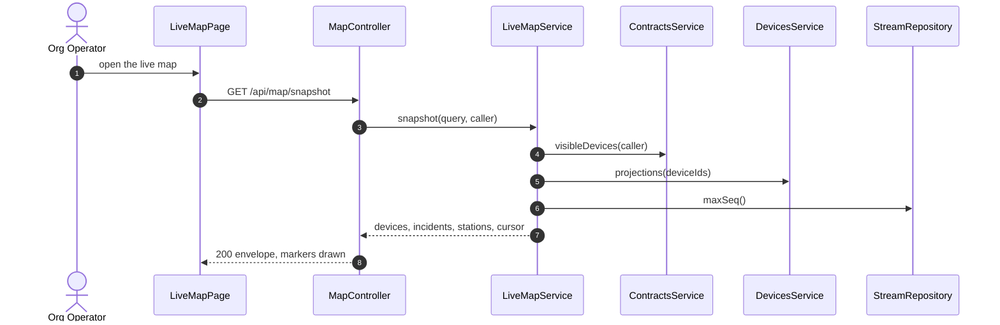
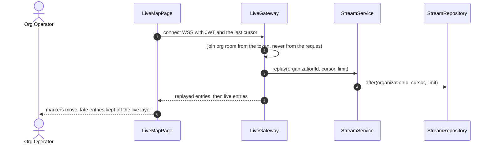
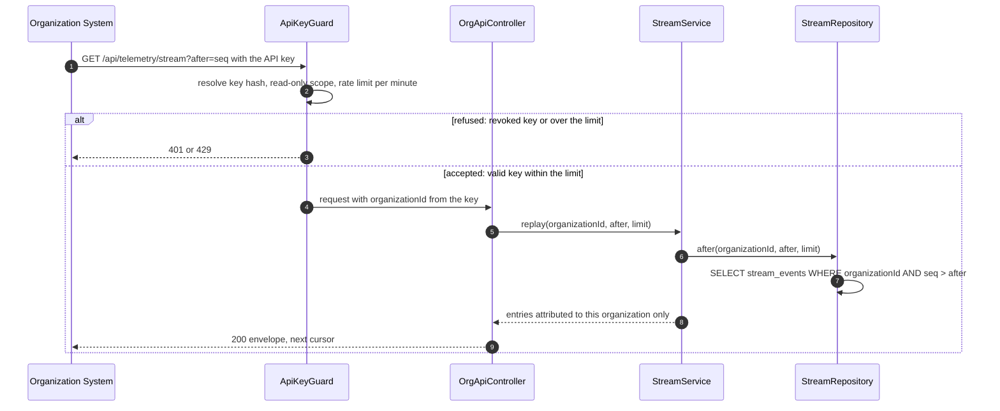
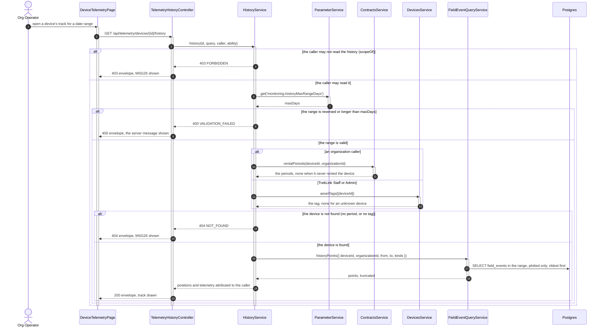
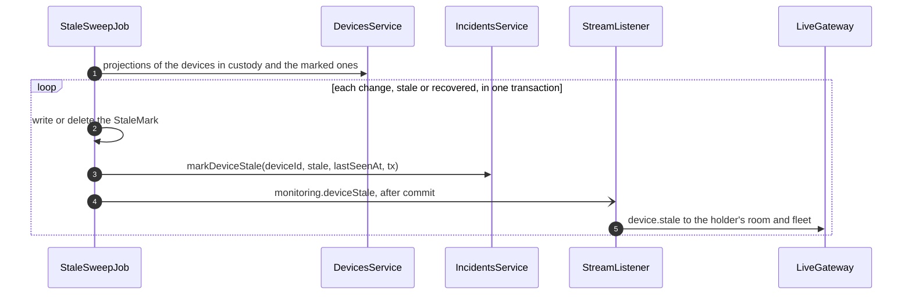

# Technical Design: monitoring

> Fulfills `requirements.md` in this folder. Schema: the `// @module monitoring` block of
> `backend/prisma/schema.prisma` is authoritative. Push contract: [ws-live-contract.md](api-design/ws-live-contract.md).
>
> **Status**: Approved, written by KhoaDD and merged on `dev` (treklink-web PR #30 and #31, 2026-10-18). Changes go through a pull request reviewed by KhoaDD (D-052).

---

## 1. Data model

`StreamEvent(seq, organizationId?, type, deviceId?, payload, createdAt)`: one row per live update; `seq`
is the cursor for both the WebSocket replay and `GET /api/telemetry/stream`. Rows are pruned after
`monitoring.streamRetentionHours`. `organizationId` null means platform-wide (fleet room only).

`DeviceRelease(organizationId, deviceId, checkedInAt)`: the latest check-in of a device from an organization,
one row per pair, replaced on each check-in. It is a table of its own because a field event is accepted
late for `gatewaySync.lateUploadGraceHours` (168), longer than the stream is kept (72), so the boundary
that marks an upload late must outlive the pruned stream (REQ-EVT-04, AC-06).

`StaleMark(subjectType, subjectId, organizationId?, lastSeenAt, markedAt)`: what the staleness sweep last
reported stale, one row per device (`DEVICE`) or Field Station (`FIELD_STATION`), written with the stale
entry and deleted with the recovered entry in the same transaction. It is stored so that the sweep emits a
transition once and a restart repeats none (REQ-EVT-03, AC-03). `organizationId` is the organization the
stale entry went to; `lastSeenAt` is the last-seen time it carried, so a later one means the subject was
heard again.

Everything else this module shows is read through other modules' services; it owns no other table.

---

## 2. Rooms and scoping

| Room | Joined by | Receives |
|---|---|---|
| `fleet` | TrekLink Staff and Admin | every entry |
| `org:<id>` | members and API keys of the organization | entries with that `organizationId` |
| `user:<id>` | that user | `incident.alert` only |

The organization of an entry comes with the event: a `field.*` event carries the organization
`gateway-sync` attributed it to by occurrence time (D-040), and an `incident.*` event its routed
organization. A `device.*` event names its organization as well (`device.handedOver`, `device.checkedIn`
and `device.labelChanged` all carry `organizationId`), so no lookup of the current holder is made. That
keeps a device that moves from A to B from leaking A's late entries to B or B's new ones to A (AC-01,
AC-06). A `field.*` entry whose occurrence time is at or before the device's latest check-in from that
organization, read from `DeviceRelease`, is marked `late` and is not plotted as a live marker.

---

## 3. Jobs

| Job | Rule |
|---|---|
| `monitoring.staleSweep` | every `monitoring.staleSweepSeconds` (a 5 s cron that skips a tick earlier than the parameter asks): a device in custody whose `lastSeenAt` is older than `monitoring.deviceStaleSeconds`, and a Field Station whose `lastSyncAt` is older than `monitoring.fieldStationStaleSeconds`, turn stale; a marked one heard again recovers. Transitions only, stored in `StaleMark`, each in its own transaction with its event emitted after commit; tell `incidents.markDeviceStale`. A marked device still stale asks `markDeviceStale(true)` again on every run, with no event, so an incident opened after the mark (a queued SOS a Field Station relays late) is flagged at the next run; the call changes nothing when the flag is set. A mark removed without an entry (a device reset to never heard, one that no longer exists, or one handed to another organization after it was heard again) is deleted in one transaction with `markDeviceStale(false)`, so the incident flag does not outlive it; a device handed over while still silent keeps its flag and is marked again for the new holder. The rule matches the snapshot read: never stale before the first reading. A device handed to another organization while stale is reconsidered for the new holder and the old one hears nothing more; a marked device checked in and then heard again recovers to `fleet` only |
| `monitoring.pruneStream` | hourly: delete entries older than the retention |

---

## 4. Read-model services

| Endpoint | Composed from |
|---|---|
| `GET /api/map/snapshot` | `rentals.visibleDevices` (with each unit's `handedOverAt`), `devices.projections` (with `lastPositionAt`), `incidents.openByDevices`, `organizations` stations, `monitoring.counterLocation`, `gatewaySync.simulatedDevices` (the `simulated` mark, demo design §9, from the handover for an organization as the position is, D-040), the max `seq` |
| `GET /api/telemetry/devices` | `rentals.visibleDevices` (with each unit's `handedOverAt`), `devices.projections` (with `lastPositionAt`), `incidents.openByDevices`, `gatewaySync.simulatedDevices` (from the handover, D-040), the max `seq` |
| `GET /api/telemetry/devices/:id/history` | `rentals.rentalPeriods` (organization callers), `devices.assetTags` (Staff and Admin), `gatewaySync.historyPoints` |
| `GET /api/rented-devices` (api-design 09, the console of UC-66, REQ-EVT-09) | `rentals.visibleDevices` (with each unit's group, holder and open fault report, rentals design §11.4), `devices.projections` through `custodyView` (organization view), `devices` variant codes and open loss cases; filters applied after the custody view, so a row's `state` filter matches the map |
| `GET /api/devices/:id/history` | `devices.trail`, `rentals.contractsOfDevice`, `organizations.labelsOf`, `incidents.incidentsOfDevice`, `accounts.contactCard` |
| `GET /api/reports/:kind` | `rentals.utilization`, `billing.revenue`, `rentals` overdue and lost lists, `incidents.responseTimes` |
| `GET /api/system-health` | `HealthService`, `gatewaySync.stats`, `organizations` station health, `incidents.alertDeliveryStats` |

The snapshot's unit state (REQ-UBI-04, D-092 rule 2) is derived per unit from its custody interval, which
starts at the `handedOverAt` of its open `ContractDevice` row (the interval is open, so it has no end). The
rule is one pure function, `custodyView` in `custody-view.ts`, called by `LiveMapService.snapshot` and by
`OrgApiService.devicesOf` (api-design 04, always the organization view), so both answer the same for the
same unit at the same time:

| State | Rule | Organization view | TrekLink staff view |
|---|---|---|---|
| `NOT_HEARD` | `lastSeenAt` null or before `handedOverAt` | `position`, `lastSeenAt` and `batteryPct` null, `counterLocation` set | `position` and `lastSeenAt` as stored, `counterLocation` set |
| `OFFLINE` | heard since `handedOverAt`, `lastSeenAt` older than `monitoring.deviceStaleSeconds` | `lastSeenAt`; `position` only when `lastPositionAt` is at or after `handedOverAt`; `batteryPct` only when `lastBatteryAt` is at or after `handedOverAt` | as stored |
| `LIVE` | heard since `handedOverAt`, within the threshold | as `OFFLINE` | as stored |

`lastPositionAt` is the time of the reading that set the projection's position (devices design §1): a
reading without a position moves `lastSeenAt` only, so `lastSeenAt` alone cannot place a position inside
the interval. A position stored before the column existed has no time and is not shown to an organization. The battery
follows the same rule through `lastBatteryAt` (2026-11-02): a battery read before the handover, or of unknown
time, is not shown to an organization even when the unit has been heard since.
The staleness sweep keeps marking a unit not heard since its handover (its incident flag rule is unchanged),
but sends that stale entry, and its recovery while `lastSeenAt` still predates the handover, to `fleet`
only (ws-live-contract).

`GET /api/telemetry/stream` (api-design 05) needs no clip of its own: it reads `stream_events` by the
key's organization (`StreamRepository.after`), and every entry's organization is fixed when it is written.
A field event carries the organization whose custody interval holds its occurrence time, clear of the
attribution margin, or none (`gateway-sync` `attribute`, D-040); a stale or recovery entry whose
`lastSeenAt` predates the handover goes to `fleet` (above). An entry from an earlier custody interval of
the same organization stays its own (D-040 attributes by occurrence time).

The snapshot and the console carry each unit's group and holder (REQ-UBI-05) from the same `visibleDevices` read;
a `groupId` filter expands to the group and its subgroups (rentals design §11, one level by default) before
filtering. `device.groupChanged` is forwarded to the organization room like `device.labelChanged`, so an open
map moves the marker's group without a reload.

Reports return JSON or CSV text in the envelope; time-to-acknowledge and time-to-resolve are medians and
95th percentiles over the range.

---

## 5. Client side (specified in `specs/frontend/`)

Leaflet with the tile URL and attribution from `GET /api/map/config`, the overlay layer from the same
response (each label on its opaque `mask`, in a pane above the tiles and below the markers, so no basemap
label for the archipelagos shows, D-085), markers by state (live, low battery, offline, not heard since handover at the counter location, incident), a reconnecting banner, and a map error
state that leaves the lists working. Tiles go from the browser to the chosen basemap's tile server with the browser's own
User-Agent and Referer; nothing prefetches tiles (D-031 tile policy). A basemap entry may carry
`localOnly: true` for a provider that serves keyless tiles to a loopback host only (Stadia answered 401 on
the Vercel production, 2026-11-01); the server validates it as a boolean and the client hides that entry
on any other host. The client also hides OpenTopoMap and Stadia on every host (2026-11-05): their tiles print
"South China Sea" at zoom 5 to 7 and "北部湾" on the Gulf of Tonkin, outside the overlay masks. Their entries
stay in `monitoring.mapBasemaps` so they return once those labels are masked.

---

## 6. Error catalogue

| Code | HTTP |
|---|---|
| `CURSOR_EXPIRED` | 410 |
| `RATE_LIMITED` | 429 |

---

## 7. Sequence: live update to the map

***Figure 1***: MF-04 push path.

---

## 8. Testing strategy

Scoping tests with two organizations and a device moving between them; replay and expiry; throttling;
stale transitions only once; rate limit per key; report numbers against seeded data.

---

## 9. Detailed design for Report 4 (D-044)

Layering as in `organizations` design §9. Figure 2 is the class view; Figures 3 to 7 are the
MF-04 interactions. The push path is Figure 1.

<!-- sdd: MF-04 class monitoring -->

***Figure 2***: monitoring classes. It owns only `StreamEvent`; everything else is read through other
modules' services.

<!-- sdd: MF-04 seq UC-38 part 1 of 2: snapshot -->

***Figure 3***: UC-38 View Live Map, part 1 of 2: snapshot.

<!-- sdd: MF-04 seq UC-38 part 2 of 2: live stream -->

***Figure 4***: UC-38 View Live Map, part 2 of 2: the scoped live stream (FR-MON-02, FR-MON-05).

<!-- sdd: MF-04 seq UC-39 -->

***Figure 5***: UC-39 Stream Telemetry via API (FR-MON-06, BR-36).

<!-- sdd: MF-04 seq UC-40 -->

***Figure 6***: UC-40 Query Device History, served by attribution (FR-MON-07, BR-36).

The history trusts the ingestion attribution. Gateway-sync decides, once and when the event is
stored, whether it lies inside one custody interval and writes `organizationId` and `attribution`
on the row (FR-EVT-16, FR-EVT-17); the history read filters on that `organizationId` and does not
re-check the occurrence time against the rental periods. `clippedTo` only reports the periods.
A correction to custody after ingestion therefore does not move events already stored. The read
answers at most `HISTORY_MAX_POINTS` (50,000) points, oldest first, with `truncated` set when the
range holds more (a CSV then ends with the comment row `# truncated`); `field_events("deviceId", "occurredAt")` serves the range (migration
`20261030200000_field_event_device_occurred_at`).

<!-- sdd: MF-04 seq UC-41 -->

***Figure 7***: UC-41 Mark Stale Device (FR-MON-03).
