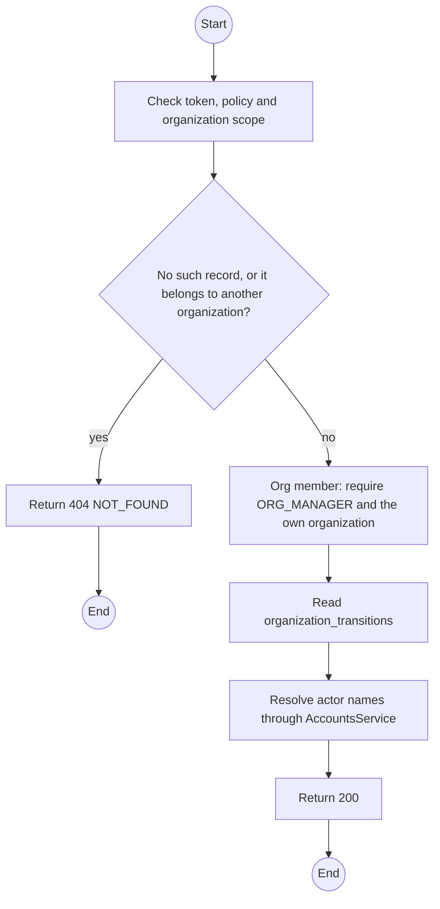
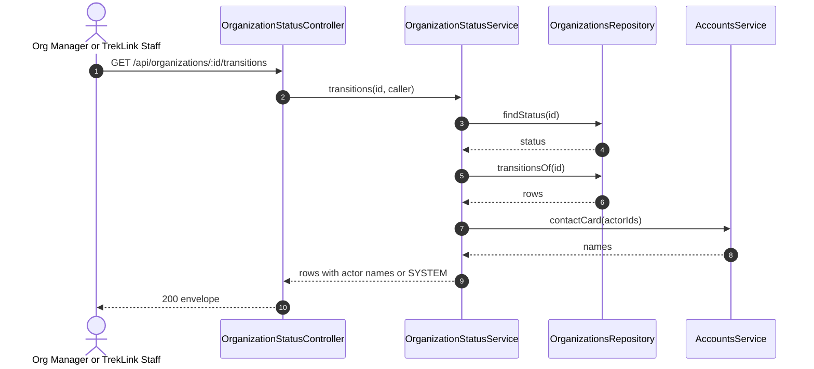

# GET /api/organizations/:id/transitions: Organization state history

> Module `organizations`. Generated from `scripts/specs/endpoints/organizations.py` by `scripts/specs/build_api_design.py`; edit the catalog, not this file. Format: `02-templates/04-api-endpoint-template.md` with Mermaid (D-017). Envelope: D-002.

[TOC]

---
## Overview

Returns the append-only state history of the organization. `actor` is the name of the account that made the change, or `SYSTEM` when none did (a contract that defaulted). An Org Operator holds `organization.read.own` but may not read suspension reasons, so the service answers 403 (ruling on treklink-web#135).

## API Specification

| API | URL |
| --- | --- |
| GET | /api/organizations/:id/transitions |
| Permission | TrekLink Staff, TrekLink Admin; Org Manager: own |
| Traces | UC-07, D-035 |

### Path parameters

| Field | Description | Data Type | Examples |
| --- | --- | --- | --- |
| id | Organization id; members may use only their own | uuid | `5b1d2c0e-7f3a-4e21-9c8d-1a2b3c4d5e6f` |

## Request sample

No body.

## Response sample

```json
{
  "result": [
    {
      "fromStatus": "PENDING",
      "toStatus": "ACTIVE",
      "actor": "Le Van C",
      "reason": null,
      "createdAt": "2026-10-20T03:15:00.000Z"
    },
    {
      "fromStatus": "ACTIVE",
      "toStatus": "SUSPENDED",
      "actor": "SYSTEM",
      "reason": "Contract RC-2026-0042 defaulted",
      "createdAt": "2026-10-20T03:15:00.000Z"
    }
  ],
  "isSuccess": true,
  "statusCode": 200,
  "message": "OK"
}
```

| Field | Description | Data Type | Examples |
| --- | --- | --- | --- |
| [].fromStatus | Status before, null for the first row | enum | `PENDING` |
| [].toStatus | Status after | enum | `ACTIVE` |
| [].actor | Full name of the account that made the change, `SYSTEM` when actorId is null | string | `Le Van C` |
| [].reason | Reason given, if any | string | `Contract RC-2026-0042 defaulted` |
| [].createdAt | When the change was written, UTC | datetime | `2026-10-20T03:15:00.000Z` |

## Validation

<table>
    <th>Status code</th>
    <th>Description</th>
    <th>Examples</th>
    <tbody>
        <tr>
            <td>401</td>
            <td>Missing, malformed or expired access token or API key (<code>UNAUTHENTICATED</code>)</td>
<td>

```json
{
  "result": {
    "errorCode": "UNAUTHENTICATED"
  },
  "isSuccess": false,
  "statusCode": 401,
  "message": "Authentication required."
}
```
</td>
        </tr>
        <tr>
            <td>403</td>
            <td>The caller's role, policy or organization does not allow this action (<code>FORBIDDEN</code>)</td>
<td>

```json
{
  "result": {
    "errorCode": "FORBIDDEN"
  },
  "isSuccess": false,
  "statusCode": 403,
  "message": "You do not have access to this."
}
```
</td>
        </tr>
        <tr>
            <td>404</td>
            <td>No such record, or it belongs to another organization (<code>NOT_FOUND</code>)</td>
<td>

```json
{
  "result": {
    "errorCode": "NOT_FOUND"
  },
  "isSuccess": false,
  "statusCode": 404,
  "message": "Organization not found."
}
```
</td>
        </tr>
        <tr>
            <td>403</td>
            <td>The caller is an Org Operator; only the Manager reads the history of its organization (<code>FORBIDDEN</code>)</td>
<td>

```json
{
  "result": {
    "errorCode": "FORBIDDEN"
  },
  "isSuccess": false,
  "statusCode": 403,
  "message": "Only the Manager of the organization may read its status history."
}
```
</td>
        </tr>
    </tbody>
</table>

## Activity Diagram



## Sequence Diagram



Not drawn in the sequence: 403 FORBIDDEN for an Org Operator and 404 NOT_FOUND for another organization or an unknown id, which the Validation table carries.
