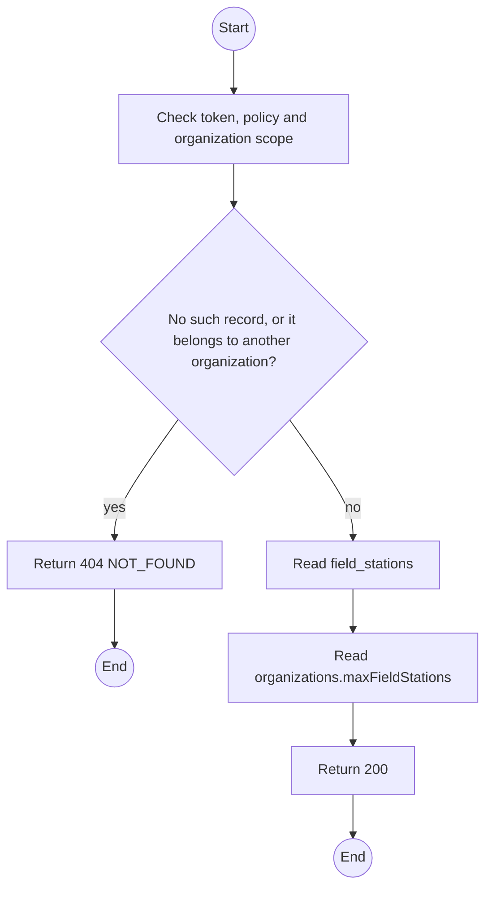
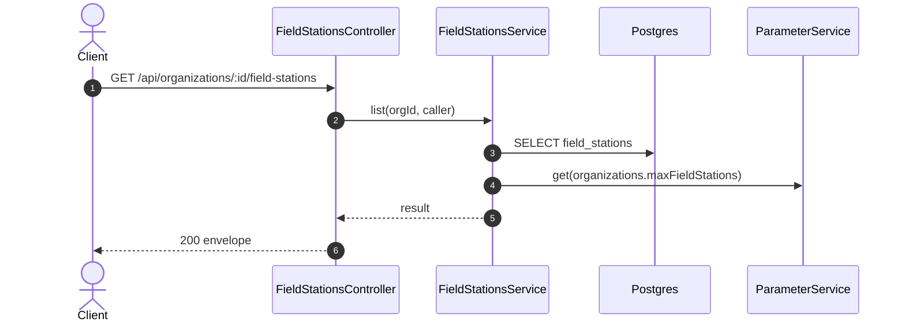

# GET /api/organizations/:id/field-stations: List Field Station credentials

> Module `organizations`. Generated from `scripts/specs/endpoints/organizations.py` by `scripts/specs/build_api_design.py`; edit the catalog, not this file. Format: `02-templates/04-api-endpoint-template.md` with Mermaid (D-017). Envelope: D-002.

[TOC]

---
## Overview

Lists the organization's Field Station credentials with their health: last sync, queue depth per tier, the retry count of the oldest queued event, and the version the station last reported, flagged `outdated` when it is older than the current release (FR-EVT-13, FR-EVT-18). `queueDepth` is named per priority, `{p0, p1, p2, p3}`, while the column stays `Int[]` (D-057 rule 9). The list carries the number of active credentials the organization may hold (ruling 2026-10-30).

## API Specification

| API | URL |
| --- | --- |
| GET | /api/organizations/:id/field-stations |
| Permission | Org Manager, Org Operator: own; TrekLink Staff, TrekLink Admin |
| Traces | UC-06, UC-42, FR-EVT-13, FR-EVT-14, FR-EVT-18 |

### Path parameters

| Field | Description | Data Type | Examples |
| --- | --- | --- | --- |
| id | Organization id; members may use only their own | uuid | `5b1d2c0e-7f3a-4e21-9c8d-1a2b3c4d5e6f` |

## Request sample

No body.

## Response sample

```json
{
  "result": {
    "items": [
      {
        "id": "f1e2d3c4-b5a6-4978-8a9b-0c1d2e3f4a5b",
        "name": "Ta Nang basecamp laptop",
        "mqttUsername": "fs-org-0007-1",
        "createdAt": "2026-10-20T03:15:00.000Z",
        "revokedAt": null,
        "lastSyncAt": "2026-10-20T03:15:00.000Z",
        "queueDepth": {
          "p0": 0,
          "p1": 0,
          "p2": 3,
          "p3": 12
        },
        "oldestRetryCount": 0,
        "version": "1.2.0",
        "outdated": false
      }
    ],
    "limit": 5
  },
  "isSuccess": true,
  "statusCode": 200,
  "message": "OK"
}
```

| Field | Description | Data Type | Examples |
| --- | --- | --- | --- |
| items | The list | object[] | see sample |
| limit | `organizations.maxFieldStations`, the most active ones the organization may hold; at that count the create endpoint answers 409 `STATION_LIMIT` (ruling 2026-10-30) | int | `5` |
| items[].queueDepth | Queued events per priority, `{p0, p1, p2, p3}`; null until the station first reports | object | `{"p0": 0, "p1": 0, "p2": 3, "p3": 12}` |

## Validation

<table>
    <th>Status code</th>
    <th>Description</th>
    <th>Examples</th>
    <tbody>
        <tr>
            <td>401</td>
            <td>Missing, malformed or expired access token or API key (<code>UNAUTHENTICATED</code>)</td>
<td>

```json
{
  "result": {
    "errorCode": "UNAUTHENTICATED"
  },
  "isSuccess": false,
  "statusCode": 401,
  "message": "Authentication required."
}
```
</td>
        </tr>
        <tr>
            <td>403</td>
            <td>The caller's role, policy or organization does not allow this action (<code>FORBIDDEN</code>)</td>
<td>

```json
{
  "result": {
    "errorCode": "FORBIDDEN"
  },
  "isSuccess": false,
  "statusCode": 403,
  "message": "You do not have access to this."
}
```
</td>
        </tr>
        <tr>
            <td>404</td>
            <td>No such record, or it belongs to another organization (<code>NOT_FOUND</code>)</td>
<td>

```json
{
  "result": {
    "errorCode": "NOT_FOUND"
  },
  "isSuccess": false,
  "statusCode": 404,
  "message": "Organization not found."
}
```
</td>
        </tr>
    </tbody>
</table>

## Activity Diagram



## Sequence Diagram


