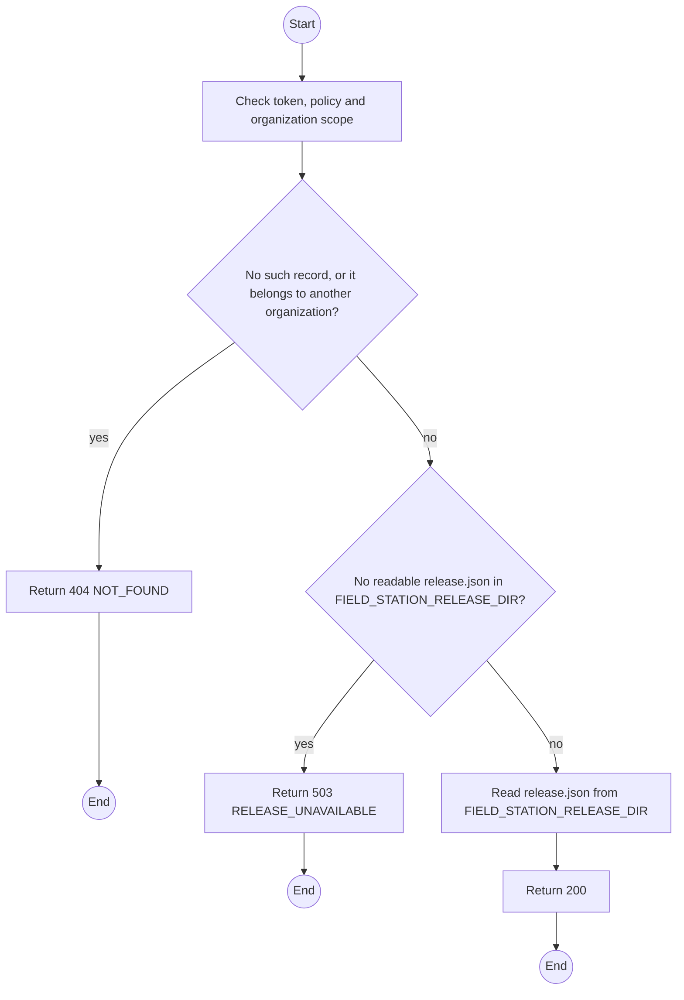
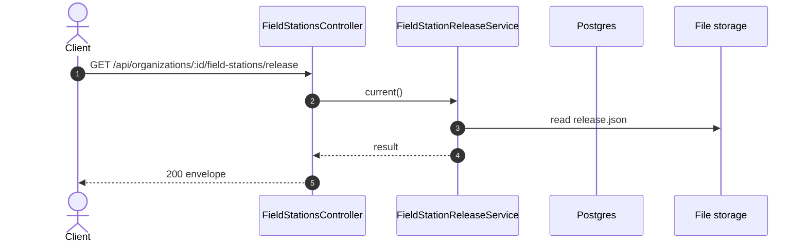

# GET /api/organizations/:id/field-stations/release: Get the current Field Station release

> Module `organizations`. Generated from `scripts/specs/endpoints/organizations.py` by `scripts/specs/build_api_design.py`; edit the catalog, not this file. Format: `02-templates/04-api-endpoint-template.md` with Mermaid (D-017). Envelope: D-002.

[TOC]

---
## Overview

Returns the current Field Station release: its version, publication time and one download per operating system with its SHA-256 and size. The files are served as static downloads outside the envelope. The organization updates a station by downloading the new release and replacing the executable (D-039, FR-EVT-18).

## API Specification

| API | URL |
| --- | --- |
| GET | /api/organizations/:id/field-stations/release |
| Permission | Org Manager, Org Operator: own; TrekLink Staff, TrekLink Admin |
| Traces | UC-06, FR-EVT-18, D-039 |

### Path parameters

| Field | Description | Data Type | Examples |
| --- | --- | --- | --- |
| id | Organization id; members may use only their own | uuid | `5b1d2c0e-7f3a-4e21-9c8d-1a2b3c4d5e6f` |

## Request sample

No body.

## Response sample

```json
{
  "result": {
    "version": "1.2.0",
    "publishedAt": "2026-10-20T03:15:00.000Z",
    "files": [
      {
        "os": "windows-x64",
        "downloadUrl": "/downloads/field-station/1.2.0/treklink-field-station-1.2.0-win-x64.exe",
        "sha256": "4be1...9a",
        "sizeBytes": 48211456
      }
    ]
  },
  "isSuccess": true,
  "statusCode": 200,
  "message": "OK"
}
```

## Validation

<table>
    <th>Status code</th>
    <th>Description</th>
    <th>Examples</th>
    <tbody>
        <tr>
            <td>401</td>
            <td>Missing, malformed or expired access token or API key (<code>UNAUTHENTICATED</code>)</td>
<td>

```json
{
  "result": {
    "errorCode": "UNAUTHENTICATED"
  },
  "isSuccess": false,
  "statusCode": 401,
  "message": "Authentication required."
}
```
</td>
        </tr>
        <tr>
            <td>403</td>
            <td>The caller's role, policy or organization does not allow this action (<code>FORBIDDEN</code>)</td>
<td>

```json
{
  "result": {
    "errorCode": "FORBIDDEN"
  },
  "isSuccess": false,
  "statusCode": 403,
  "message": "You do not have access to this."
}
```
</td>
        </tr>
        <tr>
            <td>404</td>
            <td>No such record, or it belongs to another organization (<code>NOT_FOUND</code>)</td>
<td>

```json
{
  "result": {
    "errorCode": "NOT_FOUND"
  },
  "isSuccess": false,
  "statusCode": 404,
  "message": "Organization not found."
}
```
</td>
        </tr>
        <tr>
            <td>503</td>
            <td>No readable release.json in FIELD_STATION_RELEASE_DIR (<code>RELEASE_UNAVAILABLE</code>)</td>
<td>

```json
{
  "result": {
    "errorCode": "RELEASE_UNAVAILABLE"
  },
  "isSuccess": false,
  "statusCode": 503,
  "message": "The Field Station download is unavailable. Try again later."
}
```
</td>
        </tr>
    </tbody>
</table>

## Activity Diagram



## Sequence Diagram


