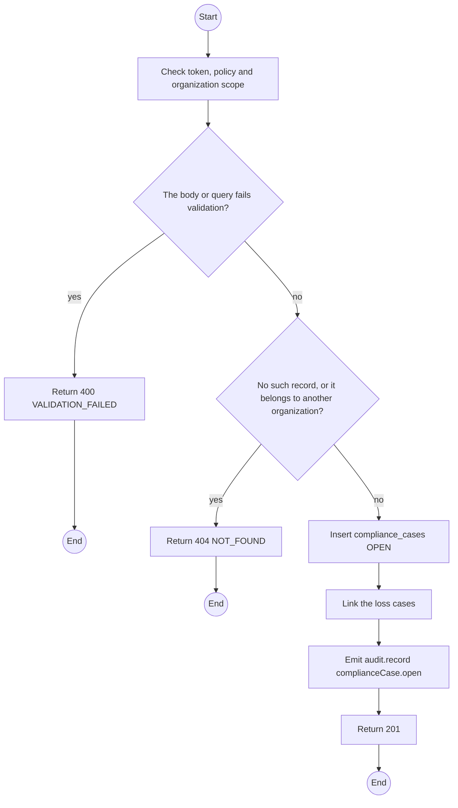
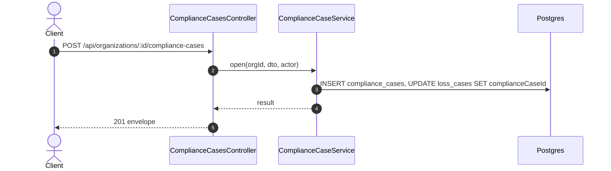

# POST /api/organizations/:id/compliance-cases: Open a compliance case

> Module `organizations`. Generated from `scripts/specs/endpoints/organizations.py` by `scripts/specs/build_api_design.py`; edit the catalog, not this file. Format: `02-templates/04-api-endpoint-template.md` with Mermaid (D-017). Envelope: D-002.

[TOC]

---
## Overview

Opens a case against an organization for a suspected fraud, theft, IP violation, NDA breach or other breach, with evidence notes and linked contracts or loss cases (FR-ORG-08, D-046).

## API Specification

| API | URL |
| --- | --- |
| POST | /api/organizations/:id/compliance-cases |
| Permission | TrekLink Staff, TrekLink Admin |
| Traces | UC-63, FR-ORG-08, D-046 |

### Path parameters

| Field | Description | Data Type | Examples |
| --- | --- | --- | --- |
| id | Organization id; members may use only their own | uuid | `5b1d2c0e-7f3a-4e21-9c8d-1a2b3c4d5e6f` |

## Request sample

```json
{
  "type": "SUSPECTED_THEFT",
  "evidence": "Three devices unreturned 40 days after default; phones unanswered",
  "linkedContractIds": [
    "c0ffee00-1234-4abc-9def-001122334455"
  ],
  "linkedLossCaseIds": []
}
```

| Field | Description | Data Type | Required | Examples |
| --- | --- | --- | --- | --- |
| type | SUSPECTED_FRAUD, SUSPECTED_THEFT, IP_VIOLATION, NDA_BREACH or OTHER_BREACH | string | yes | `SUSPECTED_THEFT` |
| evidence | What was observed | string | yes | `Three devices unreturned 40 days after default` |
| linkedContractIds | Contracts concerned | uuid[] | no | see sample |
| linkedLossCaseIds | Loss cases concerned | uuid[] | no | `[]` |

## Response sample

```json
{
  "result": {
    "id": "c4d3e2f1-a0b9-4c8d-9e7f-6a5b4c3d2e1f",
    "code": "CMP-0002",
    "organization": {
      "id": "5b1d2c0e-7f3a-4e21-9c8d-1a2b3c4d5e6f",
      "code": "ORG-0007"
    },
    "type": "SUSPECTED_THEFT",
    "status": "OPEN",
    "evidence": "Three devices unreturned 40 days after default; phones unanswered",
    "linkedContractIds": [
      "c0ffee00-1234-4abc-9def-001122334455"
    ],
    "linkedLossCases": [
      "LOSS-0003"
    ],
    "authorityReference": null,
    "outcome": null,
    "openedAt": "2026-10-20T03:15:00.000Z",
    "actions": []
  },
  "isSuccess": true,
  "statusCode": 201,
  "message": "Compliance case opened"
}
```

## Validation

<table>
    <th>Status code</th>
    <th>Description</th>
    <th>Examples</th>
    <tbody>
        <tr>
            <td>400</td>
            <td>The body or query fails validation (<code>VALIDATION_FAILED</code>)</td>
<td>

```json
{
  "result": {
    "errorCode": "VALIDATION_FAILED"
  },
  "isSuccess": false,
  "statusCode": 400,
  "message": "{field} is required."
}
```
</td>
        </tr>
        <tr>
            <td>401</td>
            <td>Missing, malformed or expired access token or API key (<code>UNAUTHENTICATED</code>)</td>
<td>

```json
{
  "result": {
    "errorCode": "UNAUTHENTICATED"
  },
  "isSuccess": false,
  "statusCode": 401,
  "message": "Authentication required."
}
```
</td>
        </tr>
        <tr>
            <td>403</td>
            <td>The caller's role, policy or organization does not allow this action (<code>FORBIDDEN</code>)</td>
<td>

```json
{
  "result": {
    "errorCode": "FORBIDDEN"
  },
  "isSuccess": false,
  "statusCode": 403,
  "message": "You do not have access to this."
}
```
</td>
        </tr>
        <tr>
            <td>404</td>
            <td>No such record, or it belongs to another organization (<code>NOT_FOUND</code>)</td>
<td>

```json
{
  "result": {
    "errorCode": "NOT_FOUND"
  },
  "isSuccess": false,
  "statusCode": 404,
  "message": "Organization not found."
}
```
</td>
        </tr>
    </tbody>
</table>

## Activity Diagram



## Sequence Diagram


