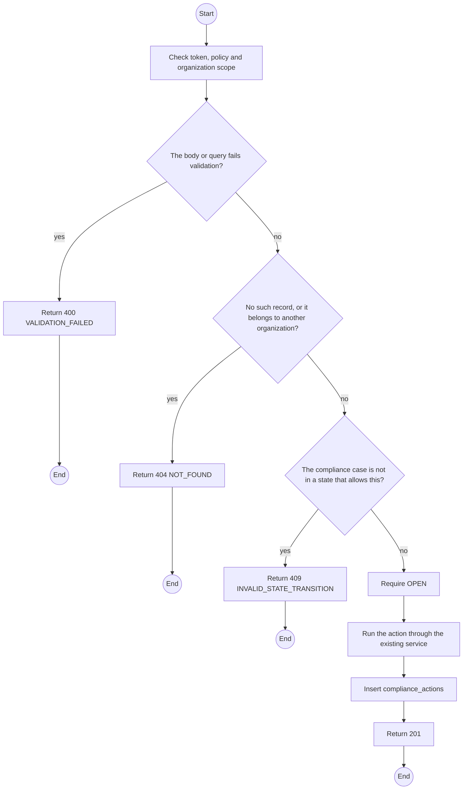
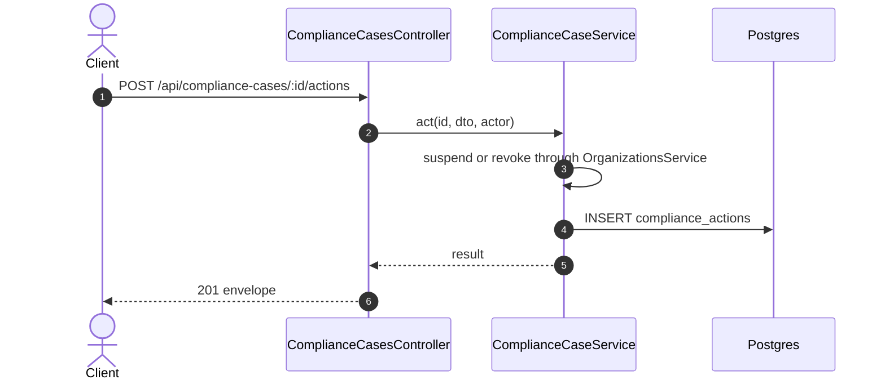

# POST /api/compliance-cases/:id/actions: Record an action on a compliance case

> Module `organizations`. Generated from `scripts/specs/endpoints/organizations.py` by `scripts/specs/build_api_design.py`; edit the catalog, not this file. Format: `02-templates/04-api-endpoint-template.md` with Mermaid (D-017). Envelope: D-002.

[TOC]

---
## Overview

Takes and records an action from the case: suspend the organization (FR-ORG-07), or revoke a Field Station credential or an API key. Each action is an append-only row with actor and time (FR-ORG-09).

## API Specification

| API | URL |
| --- | --- |
| POST | /api/compliance-cases/:id/actions |
| Permission | TrekLink Admin (suspend); TrekLink Staff, TrekLink Admin (revoke) |
| Traces | UC-63, FR-ORG-09, FR-ORG-07 |

### Path parameters

| Field | Description | Data Type | Examples |
| --- | --- | --- | --- |
| id | Compliance case id | uuid | `c4d3e2f1-a0b9-4c8d-9e7f-6a5b4c3d2e1f` |

## Request sample

```json
{
  "kind": "SUSPEND_ORGANIZATION",
  "targetId": null,
  "note": "Devices withheld after default"
}
```

| Field | Description | Data Type | Required | Examples |
| --- | --- | --- | --- | --- |
| kind | SUSPEND_ORGANIZATION, REVOKE_FIELD_STATION, REVOKE_API_KEY or OTHER | string | yes | `SUSPEND_ORGANIZATION` |
| targetId | Field Station or API key id, for a revocation | uuid | no | `f1e2d3c4-b5a6-4978-8a9b-0c1d2e3f4a5b` |
| note | Why | string | yes | `Devices withheld after default` |

## Response sample

```json
{
  "result": {
    "id": "c4d3e2f1-a0b9-4c8d-9e7f-6a5b4c3d2e1f",
    "code": "CMP-0002",
    "organization": {
      "id": "5b1d2c0e-7f3a-4e21-9c8d-1a2b3c4d5e6f",
      "code": "ORG-0007"
    },
    "type": "SUSPECTED_THEFT",
    "status": "OPEN",
    "evidence": "Three devices unreturned 40 days after default; phones unanswered",
    "linkedContractIds": [
      "c0ffee00-1234-4abc-9def-001122334455"
    ],
    "linkedLossCases": [
      "LOSS-0003"
    ],
    "authorityReference": null,
    "outcome": null,
    "openedAt": "2026-10-20T03:15:00.000Z",
    "actions": [
      {
        "kind": "SUSPEND_ORGANIZATION",
        "actor": {
          "id": "3f2e1d0c-9b8a-4c7d-8e6f-5a4b3c2d1e0f",
          "fullName": "Tran Thi B"
        },
        "at": "2026-10-20T03:15:00.000Z"
      }
    ]
  },
  "isSuccess": true,
  "statusCode": 201,
  "message": "Action recorded"
}
```

| Field | Description | Data Type | Examples |
| --- | --- | --- | --- |
| actions[] | Actions taken from the case, in the order they were recorded | object[] | see sample |
| actions[].kind | SUSPEND_ORGANIZATION, REVOKE_FIELD_STATION, REVOKE_API_KEY or OTHER | enum | `SUSPEND_ORGANIZATION` |
| actions[].actor.id | User who took the action (ComplianceAction.actorId) | uuid | `3f2e1d0c-9b8a-4c7d-8e6f-5a4b3c2d1e0f` |
| actions[].actor.fullName | That user's name | string | `Tran Thi B` |
| actions[].at | When the action was recorded (createdAt), UTC | datetime | `2026-10-20T03:15:00.000Z` |

## Validation

<table>
    <th>Status code</th>
    <th>Description</th>
    <th>Examples</th>
    <tbody>
        <tr>
            <td>400</td>
            <td>The body or query fails validation (<code>VALIDATION_FAILED</code>)</td>
<td>

```json
{
  "result": {
    "errorCode": "VALIDATION_FAILED"
  },
  "isSuccess": false,
  "statusCode": 400,
  "message": "{field} is required."
}
```
</td>
        </tr>
        <tr>
            <td>401</td>
            <td>Missing, malformed or expired access token or API key (<code>UNAUTHENTICATED</code>)</td>
<td>

```json
{
  "result": {
    "errorCode": "UNAUTHENTICATED"
  },
  "isSuccess": false,
  "statusCode": 401,
  "message": "Authentication required."
}
```
</td>
        </tr>
        <tr>
            <td>403</td>
            <td>The caller's role, policy or organization does not allow this action (<code>FORBIDDEN</code>)</td>
<td>

```json
{
  "result": {
    "errorCode": "FORBIDDEN"
  },
  "isSuccess": false,
  "statusCode": 403,
  "message": "You do not have access to this."
}
```
</td>
        </tr>
        <tr>
            <td>404</td>
            <td>No such record, or it belongs to another organization (<code>NOT_FOUND</code>)</td>
<td>

```json
{
  "result": {
    "errorCode": "NOT_FOUND"
  },
  "isSuccess": false,
  "statusCode": 404,
  "message": "Compliance case not found."
}
```
</td>
        </tr>
        <tr>
            <td>403</td>
            <td>Only an Admin may suspend (<code>FORBIDDEN</code>)</td>
<td>

```json
{
  "result": {
    "errorCode": "FORBIDDEN"
  },
  "isSuccess": false,
  "statusCode": 403,
  "message": "Ask a TrekLink Admin to suspend the organization."
}
```
</td>
        </tr>
        <tr>
            <td>409</td>
            <td>The compliance case is not in a state that allows this (<code>INVALID_STATE_TRANSITION</code>)</td>
<td>

```json
{
  "result": {
    "errorCode": "INVALID_STATE_TRANSITION"
  },
  "isSuccess": false,
  "statusCode": 409,
  "message": "This cannot be done while it is CLOSED."
}
```
</td>
        </tr>
    </tbody>
</table>

## Activity Diagram



## Sequence Diagram


