# Technical Design: organizations

> Fulfills `requirements.md` in this folder. Schema: the `// @module organizations` block of
> `backend/prisma/schema.prisma` is authoritative.
>
> **Status**: Approved, written by KhoaDD and merged on `dev` (treklink-web PR #30 and #31, 2026-10-18). Changes go through a pull request reviewed by KhoaDD (D-052).

---

## 1. Data model

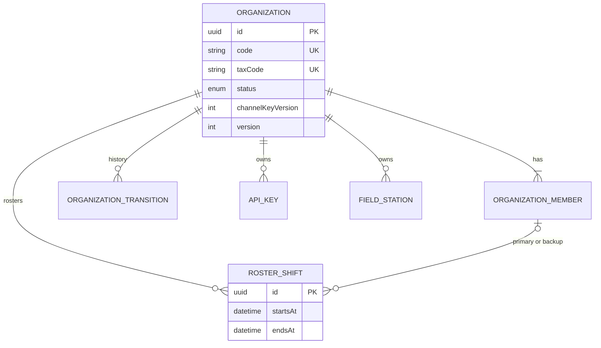

***Figure 1***: organizations slice. `OrganizationMember.userId` is unique: one account, one organization.

`code` is `ORG-` plus a zero-padded sequence. `channelKeyVersion` is the version of the organization's
channel key that Staff write to its devices at handover (FR-DEV-05); the key itself lives only in the
counter's provisioning tool and never in the platform (D-021, NFR-SEC-06). Rotating it is a TrekLink
procedure that bumps the version; devices on running contracts keep the version they were given.

---

## 2. Organization lifecycle (D-035)

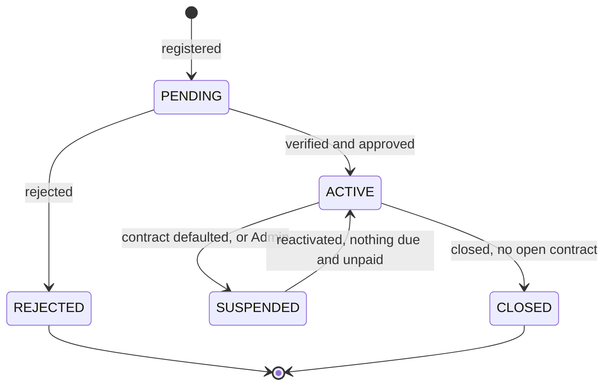

***Figure 2***: Organization lifecycle. Verification is a recorded fact on a `PENDING` organization, not a
state, matching SRS Figure 28.

| From | To | Who | Guard |
|---|---|---|---|
| (none) | `PENDING` | Guest | unique tax code and Manager email |
| `PENDING` | `ACTIVE` | Admin | `verifiedAt` set |
| `PENDING` | `REJECTED` | Admin | reason |
| `ACTIVE` | `SUSPENDED` | Admin, or `SYSTEM` from `rentals` on default | reason |
| `SUSPENDED` | `ACTIVE` | Admin | every `ORGANIZATION_EXIT_CHECKS.canReactivate(orgId, tx, at)` reports nothing; billing counts only lines due and unpaid at `at` (leader ruling 2026-10-30) |
| `ACTIVE` | `CLOSED` | Admin | every `ORGANIZATION_EXIT_CHECKS.canClose(orgId)` true |

Each transition is a compare-and-set on `version` plus one `OrganizationTransition` row in one
transaction.

---

## 3. Roster and on-duty resolution

A shift is `[startsAt, endsAt)` with an optional primary and an optional backup; the database rejects
overlaps (`roster_shifts_no_overlap`). `RosterService.tiersAt(orgId, instant)` returns:

```typescript
{ primary?: MemberContact; backup?: MemberContact; managers: MemberContact[] }
```

Only active members are returned. `incidents` calls it once when an incident is routed and again at
each tier step, so a roster edit applies to the next tier, never to an alert already sent (BR-16). A
window with no shift, or a shift with no primary, is the `NO_PRIMARY` warning; alerting then starts at
the backup tier, or at the Managers when there is no backup (D-034).

---

## 4. Keys and Field Station credentials

| | API key | Field Station credential |
|---|---|---|
| Created by | Org Manager | Org Manager (D-037) |
| Revoked by | Org Manager | Org Manager, TrekLink Staff, Admin |
| Revoke reason | not applicable, no `reason` field | required when `caller.organizationId` is null (TrekLink Staff, Admin); optional for the organization's own Manager; not re-checked when the station is already revoked (api-design 25) |
| Listed by | Org Manager: own; TrekLink Staff, Admin: any organization, read only (api-design 20, ruling 2026-10-30) | Org Manager, Org Operator: own; TrekLink Staff, Admin (api-design 23) |
| Limit | `organizations.maxApiKeys`, returned as `limit` by the list; 409 `KEY_LIMIT` on create | `organizations.maxFieldStations`, returned as `limit` by the list; 409 `STATION_LIMIT` on create |
| Secret | `tlk_` + 43 base64url chars; SHA-256 stored; prefix of 8 shown | `fs_` + 43 base64url chars; bcrypt stored |
| Identity | the hash | `mqttUsername` = `fs-<org code lower-case>-<n>` |
| Used by | `ApiKeyGuard` via `API_KEY_RESOLVER` | the broker's go-auth hook via `gateway-sync` |
| Health | `lastUsedAt` | `lastSyncAt`, `queueDepth` (stored `Int[]`, index = priority; returned as `{p0, p1, p2, p3}`, D-057 rule 9), `oldestRetryCount`, `version`, written by `gateway-sync` through `recordStationHealth()`; `outdated` is computed on read against the current release |

The Field Station is updated by download (D-039 (b)). `FieldStationReleaseService.current()` reads
`release.json` from `FIELD_STATION_RELEASE_DIR`, caches it until the file changes, and compares versions
by semantic-version order. There is no update push, release endpoint on the station, or self-replace.

SHA-256 for API keys keeps the per-request lookup an index hit; bcrypt for station secrets suits a
check made once per MQTT connection.

---

## 4.1 Contract terms and compliance cases (D-046)

Verification records `ndaSigned` and `softwareLicenceSigned`; both must be true (BR-43), because the
Field Station's code and the firmware are in the customer's hands. A `ComplianceCase` records a suspected
fraud, theft, IP violation, NDA breach or other breach. Actions taken from it reuse the existing
operations, suspension (`OrganizationsService.suspend`) and revocation of Field Station credentials and
API keys, and each is appended as a `ComplianceAction`. A `SUSPECTED_FRAUD` or `SUSPECTED_THEFT` case
closes only with a police report reference (BR-40), enforced by the service and by the
`compliance_cases_police_reference_to_close` CHECK. A loss case flagged as suspected theft opens a case,
or links to the organization's open case of the same type.

`channelKeyExposedAt` is set by `markKeyExposed` when a device in the organization's custody is lost
(D-045) and cleared when Staff record a key rotation. The platform cannot change a key on a device it
cannot reach, so rotation takes effect device by device at the counter. `markKeyExposed` runs in the
caller's transaction and is idempotent: while the flag is set it keeps the first time and does not tell
the Managers again. After the commit the live Managers with an active account are emailed, or the
contact address given at registration when none can be reached.

---

## 5. Services and ports

| Export | Used by | Purpose |
|---|---|---|
| `OrganizationsService.assertActive(orgId)` | rentals | FR-CON-02 |
| `OrganizationsService.suspendForDefault(orgId, contractCode, tx)` | rentals | FR-ORG-07 |
| `OrganizationsService.channelKeyVersion(orgId)` | rentals | provisioning |
| `RosterService.tiersAt(orgId, instant)` | incidents | routing and tiers |
| `FieldStationsService.byUsername(username)`, with the secret hash | gateway-sync | broker hook |
| `FieldStationsService.stationByUsername(username)`, without the secret hash | gateway-sync | Stage C ingestion, station health report |
| `FieldStationsService.recordStationHealth(id, health)` | gateway-sync | FR-EVT-13 |
| `ChannelKeyService.markKeyExposed(orgId, at, actor, tx)` | devices | FR-DEV-13, D-045 |
| `ComplianceCaseService.openOrLink(orgId, lossCaseId, actor, tx)` | devices | FR-DEV-13, D-046 |
| provider of `ACCOUNT_CONTEXT_PROVIDER`, `API_KEY_RESOLVER` | auth | `platform` design §2.1 |

Declares `ORGANIZATION_EXIT_CHECKS` (multi): `{ canReactivate(orgId, tx, at): Promise<Reason | null>; canClose(orgId, tx): Promise<Reason | null> }`; `at` is the reactivation time.

Declares `ORGANIZATION_COUNTS` (multi): `{ name: 'runningContracts' | 'openIncidents'; count(orgId): Promise<number> }`, for the counts of api-design 03. Provided by `rentals` (`runningContracts`: ACTIVE, ENDING, RETURN_DUE or OVERDUE) and `incidents` (`openIncidents`: not CLOSED); a count with no provider is reported as 0.

Events emitted: `member.deactivated`, `apiKey.revoked`, `fieldStation.revoked`, `organization.statusChanged` (with the reason), `organization.registered`, `organization.verified`, `audit.record`. `OnboardingNotifier` listens to `organization.registered`, `organization.verified` and `organization.statusChanged`: it tells Staff and Admin of a registration and of the first verification through `STAFF_NOTIFICATIONS`, and emails the Manager MSG05 or MSG16 when a `PENDING` organization is approved or rejected.

---

## 6. Error catalogue

| Code | HTTP |
|---|---|
| `NOT_VERIFIED` | 409 |
| `LAST_MANAGER` | 409 |
| `BALANCE_OUTSTANDING` | 409 |
| `OPEN_CONTRACTS` | 409 |
| `SHIFT_OVERLAP` | 409 |
| `SHIFT_STARTED` | 409 (deleting a shift that has started, api-design 19; changing any field but `endsAt` of one, api-design 18. An `endsAt` before now on a started shift is 400 `VALIDATION_FAILED`) |
| `MEMBER_NOT_ELIGIBLE` | 400 |
| `KEY_LIMIT` | 409 |
| `STATION_LIMIT` | 409 |
| `ORGANIZATION_NOT_ACTIVE` | 409 (raised for `rentals` by `assertActive`) |
| `CONTRACT_TERMS_MISSING` | 400 (verification without the NDA or the software licence, BR-43) |
| `POLICE_REFERENCE_REQUIRED` | 409 (closing a suspected fraud or theft case without an authority reference, BR-40) |

---

## 7. Sequence: registration to approval

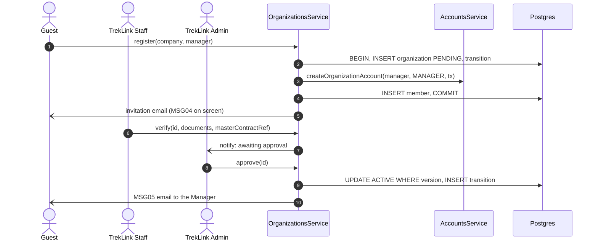

***Figure 3***: MF-01 onboarding.

---

## 8. Testing strategy

Lifecycle matrix unit test (every pair, allowed or 409); overlap and member-eligibility tests against
Postgres; key and station hashing; last-Manager under concurrency; cross-organization 404 on every route.

---

## 9. Detailed design for Report 4 (D-044)

Layering for every module (D-044): a page calls a controller over HTTPS; the controller checks the JWT
and the policy, then calls a service; the service owns the transaction and calls the module's
repository, the only class that touches Prisma; other modules are reached only through their exported
services. Figures 4 and 10 are the class views of this module, core and
compliance cases; Figures 5 to 9 and 11 are the MF-01, MF-02 and MF-05 interactions it owns.

<!-- sdd: MF-01 class organizations -->
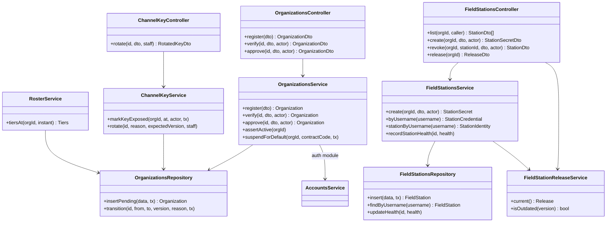

***Figure 4***: organizations classes. `AccountsService` belongs to `auth`.

<!-- sdd: MF-01 seq UC-01 -->
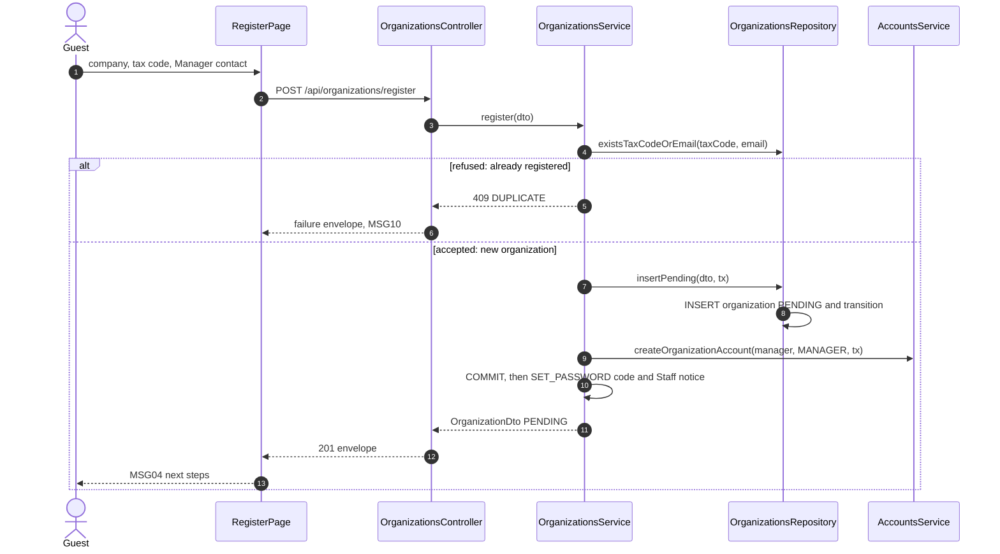

***Figure 5***: UC-01 Register Organization.

<!-- sdd: MF-01 seq UC-02 -->
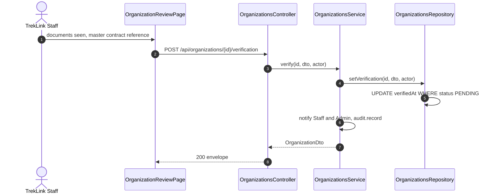

***Figure 6***: UC-02 Verify Organization.

<!-- sdd: MF-01 seq UC-03 -->
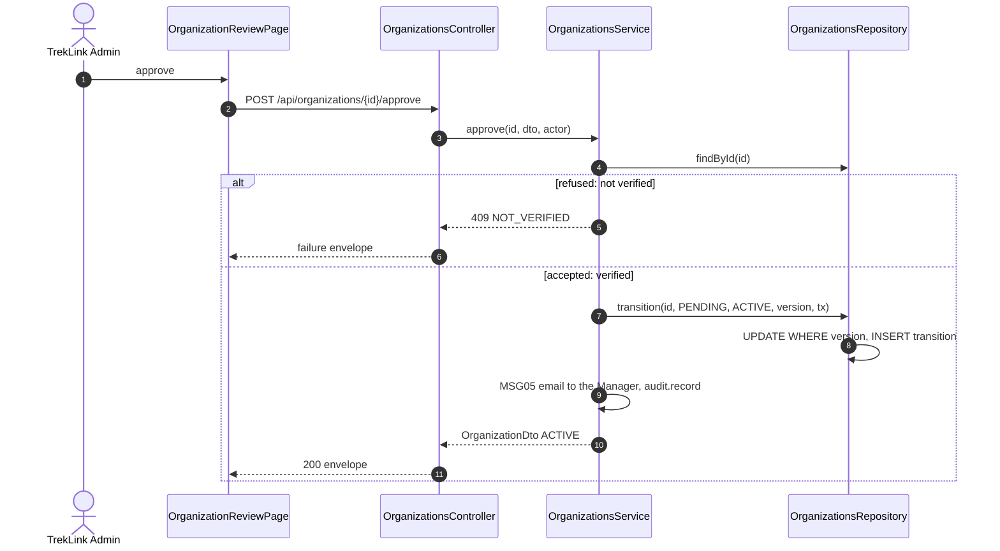

***Figure 7***: UC-03 Approve Organization.

<!-- sdd: MF-02 seq UC-06 part 1 of 2: credential and download -->
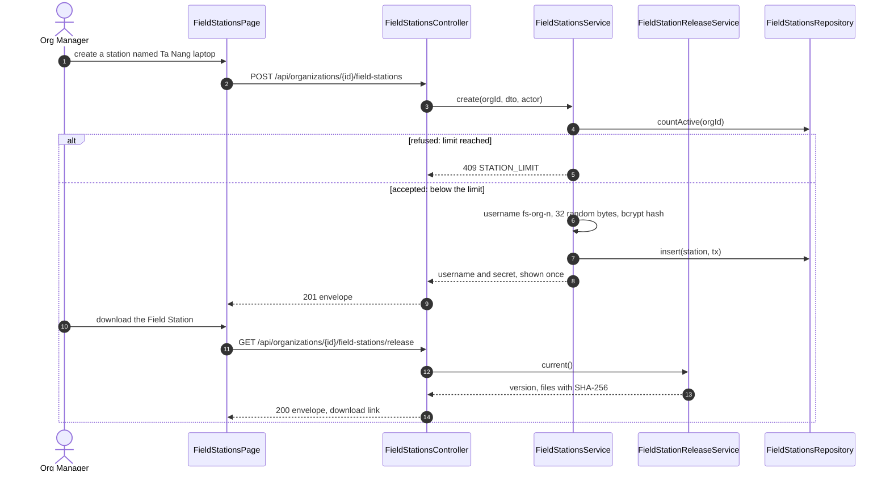

***Figure 8***: UC-06 for a Field Station, part 1 of 2: credential and download (FR-EVT-18).

<!-- sdd: MF-02 seq UC-06 part 2 of 2: broker check -->
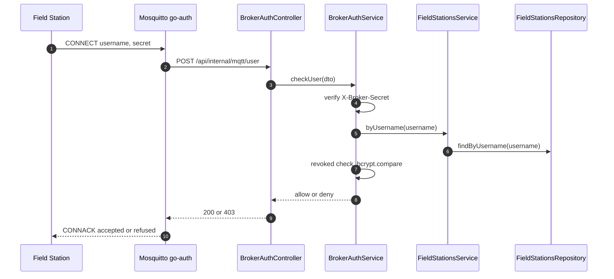

***Figure 9***: UC-06 for a Field Station, part 2 of 2: the broker's credential check.

<!-- sdd: MF-05 class organizations-compliance -->
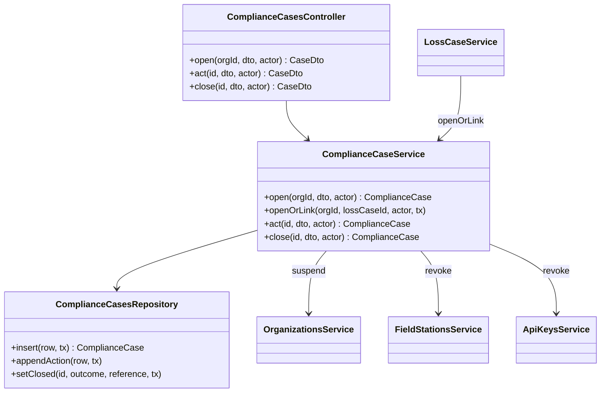

***Figure 10***: organizations classes for compliance cases (D-046). `LossCaseService` belongs to `devices`.

<!-- sdd: MF-05 seq UC-63 -->
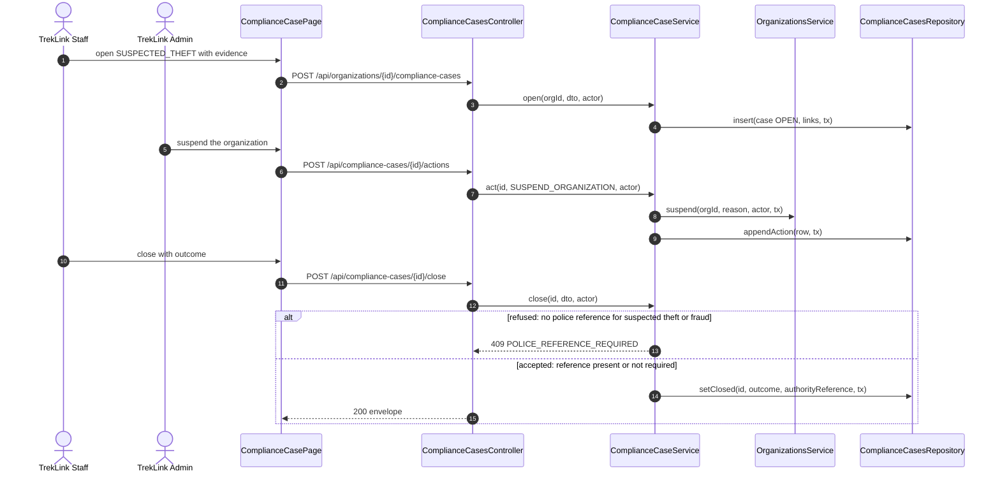

***Figure 11***: UC-63 Handle Compliance Case (BR-40, D-046).
