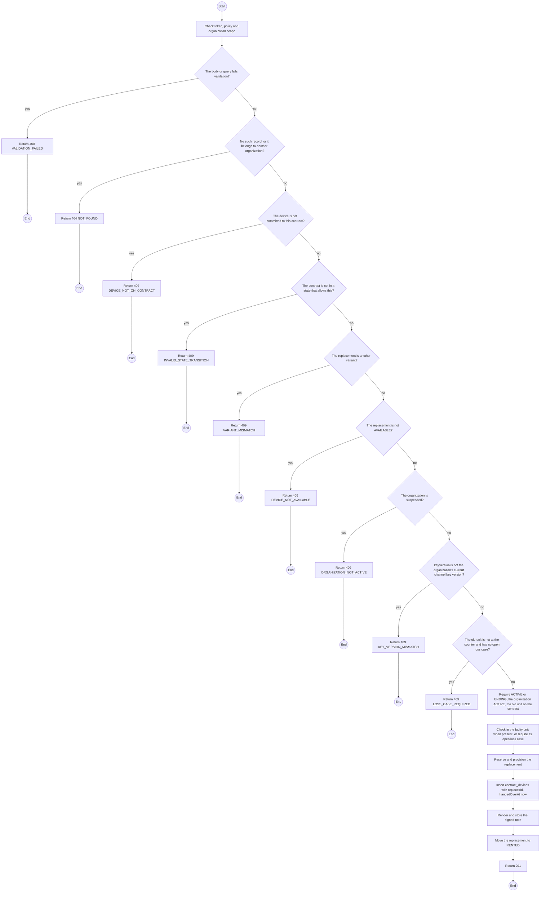
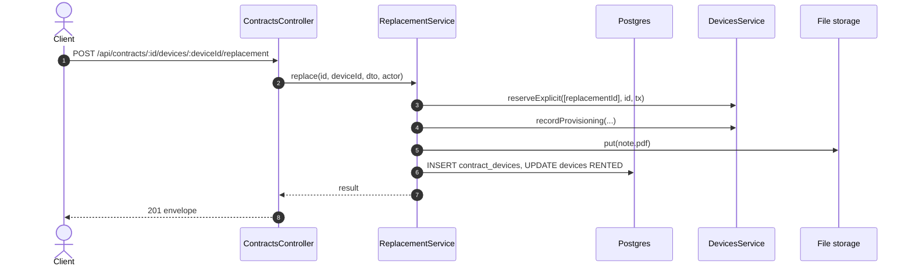

# POST /api/contracts/:id/devices/:deviceId/replacement: Replace a device on a running contract

> Module `rentals`. Generated from `scripts/specs/endpoints/rentals.py` by `scripts/specs/build_api_design.py`; edit the catalog, not this file. Format: `02-templates/04-api-endpoint-template.md` with Mermaid (D-017). Envelope: D-002.

[TOC]

---
## Overview

Replaces a faulty unit, or a unit with an open loss case, on an `ACTIVE` or `ENDING` contract with an `AVAILABLE` unit of the same variant. The faulty unit, if present, is checked in; the replacement is provisioned, signed on screen by the Manager, and gets its own custody interval. Plan, variant and quantity stay unchanged (FR-CON-15, BR-41, BR-05).

## API Specification

| API | URL |
| --- | --- |
| POST | /api/contracts/:id/devices/:deviceId/replacement |
| Permission | TrekLink Staff |
| Traces | UC-61, FR-CON-15, BR-41, BR-05 |

### Path parameters

| Field | Description | Data Type | Examples |
| --- | --- | --- | --- |
| id | Contract id; members may use only their own organization's | uuid | `c0ffee00-1234-4abc-9def-001122334455` |
| deviceId | Device committed to the contract | uuid | `0d3f6a2b-7e11-4c55-8f0a-2b1c9e7d4a10` |

## Request sample

```json
{
  "replacementDeviceId": "5e6f7a8b-9c0d-4e1f-a2b3-c4d5e6f7a8b9",
  "keyVersion": 2,
  "signatureImage": "iVBORw0KGgo...",
  "faultyPresent": true
}
```

| Field | Description | Data Type | Required | Examples |
| --- | --- | --- | --- | --- |
| replacementDeviceId | An AVAILABLE device of the same variant | uuid | yes | `5e6f7a8b-...` |
| keyVersion | Channel key version written to the replacement | int | yes | `2` |
| signatureImage | Manager's on-screen signature, PNG base64 | string | yes | `iVBORw0KGgo...` |
| faultyPresent | The faulty unit is at the counter and is checked in now | bool | yes | `true` |

## Response sample

```json
{
  "result": {
    "replacedDeviceId": "0d3f6a2b-7e11-4c55-8f0a-2b1c9e7d4a10",
    "replacementDeviceId": "5e6f7a8b-9c0d-4e1f-a2b3-c4d5e6f7a8b9",
    "contractDeviceId": "cd-91",
    "replacesId": "cd-77",
    "noteSha256": "3b1c...9e"
  },
  "isSuccess": true,
  "statusCode": 201,
  "message": "Device replaced"
}
```

## Validation

<table>
    <th>Status code</th>
    <th>Description</th>
    <th>Examples</th>
    <tbody>
        <tr>
            <td>400</td>
            <td>The body or query fails validation (<code>VALIDATION_FAILED</code>)</td>
<td>

```json
{
  "result": {
    "errorCode": "VALIDATION_FAILED"
  },
  "isSuccess": false,
  "statusCode": 400,
  "message": "{field} is required."
}
```
</td>
        </tr>
        <tr>
            <td>401</td>
            <td>Missing, malformed or expired access token or API key (<code>UNAUTHENTICATED</code>)</td>
<td>

```json
{
  "result": {
    "errorCode": "UNAUTHENTICATED"
  },
  "isSuccess": false,
  "statusCode": 401,
  "message": "Authentication required."
}
```
</td>
        </tr>
        <tr>
            <td>403</td>
            <td>The caller's role, policy or organization does not allow this action (<code>FORBIDDEN</code>)</td>
<td>

```json
{
  "result": {
    "errorCode": "FORBIDDEN"
  },
  "isSuccess": false,
  "statusCode": 403,
  "message": "You do not have access to this."
}
```
</td>
        </tr>
        <tr>
            <td>404</td>
            <td>No such record, or it belongs to another organization (<code>NOT_FOUND</code>)</td>
<td>

```json
{
  "result": {
    "errorCode": "NOT_FOUND"
  },
  "isSuccess": false,
  "statusCode": 404,
  "message": "Contract not found."
}
```
</td>
        </tr>
        <tr>
            <td>409</td>
            <td>The device is not committed to this contract (<code>DEVICE_NOT_ON_CONTRACT</code>)</td>
<td>

```json
{
  "result": {
    "errorCode": "DEVICE_NOT_ON_CONTRACT"
  },
  "isSuccess": false,
  "statusCode": 409,
  "message": "TL-0042 does not belong to contract RC-2026-0042."
}
```
</td>
        </tr>
        <tr>
            <td>409</td>
            <td>The contract is not in a state that allows this (<code>INVALID_STATE_TRANSITION</code>)</td>
<td>

```json
{
  "result": {
    "errorCode": "INVALID_STATE_TRANSITION"
  },
  "isSuccess": false,
  "statusCode": 409,
  "message": "This cannot be done while it is RETURN_DUE."
}
```
</td>
        </tr>
        <tr>
            <td>409</td>
            <td>The replacement is another variant (<code>VARIANT_MISMATCH</code>)</td>
<td>

```json
{
  "result": {
    "errorCode": "VARIANT_MISMATCH"
  },
  "isSuccess": false,
  "statusCode": 409,
  "message": "Choose a unit of the same variant."
}
```
</td>
        </tr>
        <tr>
            <td>409</td>
            <td>The replacement is not AVAILABLE (<code>DEVICE_NOT_AVAILABLE</code>)</td>
<td>

```json
{
  "result": {
    "errorCode": "DEVICE_NOT_AVAILABLE"
  },
  "isSuccess": false,
  "statusCode": 409,
  "message": "Choose an available unit."
}
```
</td>
        </tr>
        <tr>
            <td>409</td>
            <td>The organization is suspended (<code>ORGANIZATION_NOT_ACTIVE</code>)</td>
<td>

```json
{
  "result": {
    "errorCode": "ORGANIZATION_NOT_ACTIVE"
  },
  "isSuccess": false,
  "statusCode": 409,
  "message": "Replacement is not allowed while suspended."
}
```
</td>
        </tr>
        <tr>
            <td>409</td>
            <td>keyVersion is not the organization's current channel key version (<code>KEY_VERSION_MISMATCH</code>)</td>
<td>

```json
{
  "result": {
    "errorCode": "KEY_VERSION_MISMATCH"
  },
  "isSuccess": false,
  "statusCode": 409,
  "message": "The organization's channel key is at version 2; write that version to the device."
}
```
</td>
        </tr>
        <tr>
            <td>409</td>
            <td>The old unit is not at the counter and has no open loss case (<code>LOSS_CASE_REQUIRED</code>)</td>
<td>

```json
{
  "result": {
    "errorCode": "LOSS_CASE_REQUIRED"
  },
  "isSuccess": false,
  "statusCode": 409,
  "message": "Open a loss case for the missing unit first, or check it in at the counter."
}
```
</td>
        </tr>
    </tbody>
</table>

## Activity Diagram



## Sequence Diagram


