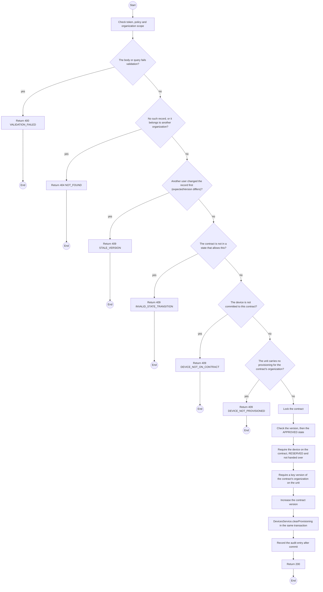
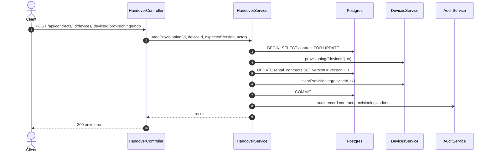

# POST /api/contracts/:id/devices/:deviceId/provisioning/undo: Undo a provisioning record

> Module `rentals`. Generated from `scripts/specs/endpoints/rentals.py` by `scripts/specs/build_api_design.py`; edit the catalog, not this file. Format: `02-templates/04-api-endpoint-template.md` with Mermaid (D-017). Envelope: D-002.

[TOC]

---
## Overview

Undoes the provisioning record of api-design 09 on a unit of an `APPROVED` contract before the handover, for a record made on the wrong unit at the counter (dry run 2026-10-30, defect 5). The unit's key version, key organization and provisioning time are cleared, so it shows "Not provisioned yet" and the handover refuses it until it is recorded again. The append-only `DeviceProvisioning` row stays; an audit entry `contract.provisioningUndone` records the undo. The contract `version` increases, so a screen that still shows the unit provisioned reloads before it signs. Undoing the record does not remove a key already written to the device: write the key again and record it, or swap the unit (api-design 07) (FR-DEV-05, D-021).

## API Specification

| API | URL |
| --- | --- |
| POST | /api/contracts/:id/devices/:deviceId/provisioning/undo |
| Permission | TrekLink Staff |
| Traces | UC-14, FR-DEV-05, BR-09, D-021 |

### Path parameters

| Field | Description | Data Type | Examples |
| --- | --- | --- | --- |
| id | Contract id; members may use only their own organization's | uuid | `c0ffee00-1234-4abc-9def-001122334455` |
| deviceId | Device committed to the contract | uuid | `0d3f6a2b-7e11-4c55-8f0a-2b1c9e7d4a10` |

## Request sample

```json
{
  "expectedVersion": 2
}
```

| Field | Description | Data Type | Required | Examples |
| --- | --- | --- | --- | --- |
| expectedVersion | Contract version the caller saw | int | yes | `4` |

## Response sample

```json
{
  "result": {
    "deviceId": "0d3f6a2b-7e11-4c55-8f0a-2b1c9e7d4a10",
    "assetTag": "TL-0042",
    "status": "RESERVED",
    "keyVersion": null,
    "keyOrganizationId": null,
    "provisionedAt": null,
    "contractVersion": 3
  },
  "isSuccess": true,
  "statusCode": 200,
  "message": "Provisioning undone"
}
```

## Validation

<table>
    <th>Status code</th>
    <th>Description</th>
    <th>Examples</th>
    <tbody>
        <tr>
            <td>400</td>
            <td>The body or query fails validation (<code>VALIDATION_FAILED</code>)</td>
<td>

```json
{
  "result": {
    "errorCode": "VALIDATION_FAILED"
  },
  "isSuccess": false,
  "statusCode": 400,
  "message": "{field} is required."
}
```
</td>
        </tr>
        <tr>
            <td>401</td>
            <td>Missing, malformed or expired access token or API key (<code>UNAUTHENTICATED</code>)</td>
<td>

```json
{
  "result": {
    "errorCode": "UNAUTHENTICATED"
  },
  "isSuccess": false,
  "statusCode": 401,
  "message": "Authentication required."
}
```
</td>
        </tr>
        <tr>
            <td>403</td>
            <td>The caller's role, policy or organization does not allow this action (<code>FORBIDDEN</code>)</td>
<td>

```json
{
  "result": {
    "errorCode": "FORBIDDEN"
  },
  "isSuccess": false,
  "statusCode": 403,
  "message": "You do not have access to this."
}
```
</td>
        </tr>
        <tr>
            <td>404</td>
            <td>No such record, or it belongs to another organization (<code>NOT_FOUND</code>)</td>
<td>

```json
{
  "result": {
    "errorCode": "NOT_FOUND"
  },
  "isSuccess": false,
  "statusCode": 404,
  "message": "Contract not found."
}
```
</td>
        </tr>
        <tr>
            <td>409</td>
            <td>Another user changed the record first (expectedVersion differs) (<code>STALE_VERSION</code>)</td>
<td>

```json
{
  "result": {
    "errorCode": "STALE_VERSION"
  },
  "isSuccess": false,
  "statusCode": 409,
  "message": "This was changed by someone else. Reload and try again."
}
```
</td>
        </tr>
        <tr>
            <td>409</td>
            <td>The contract is not in a state that allows this (<code>INVALID_STATE_TRANSITION</code>)</td>
<td>

```json
{
  "result": {
    "errorCode": "INVALID_STATE_TRANSITION"
  },
  "isSuccess": false,
  "statusCode": 409,
  "message": "This cannot be done while it is ACTIVE."
}
```
</td>
        </tr>
        <tr>
            <td>409</td>
            <td>The device is not committed to this contract (<code>DEVICE_NOT_ON_CONTRACT</code>)</td>
<td>

```json
{
  "result": {
    "errorCode": "DEVICE_NOT_ON_CONTRACT"
  },
  "isSuccess": false,
  "statusCode": 409,
  "message": "TL-0042 does not belong to contract RC-2026-0042."
}
```
</td>
        </tr>
        <tr>
            <td>409</td>
            <td>The unit carries no provisioning for the contract's organization (<code>DEVICE_NOT_PROVISIONED</code>)</td>
<td>

```json
{
  "result": {
    "errorCode": "DEVICE_NOT_PROVISIONED"
  },
  "isSuccess": false,
  "statusCode": 409,
  "message": "TL-0042 has no provisioning to undo."
}
```
</td>
        </tr>
    </tbody>
</table>

## Activity Diagram



## Sequence Diagram


