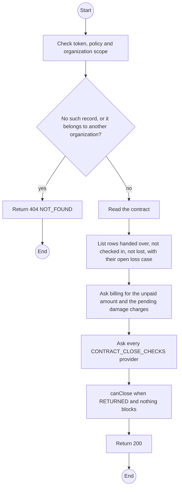
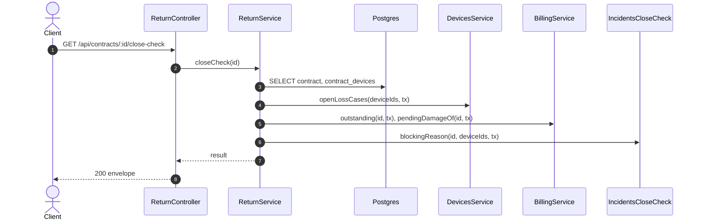

# GET /api/contracts/:id/close-check: What still blocks the close of a contract

> Module `rentals`. Generated from `scripts/specs/endpoints/rentals.py` by `scripts/specs/build_api_design.py`; edit the catalog, not this file. Format: `02-templates/04-api-endpoint-template.md` with Mermaid (D-017). Envelope: D-002.

[TOC]

---
## Overview

Answers whether the contract can close now (api-design 17) and lists every blocker with what resolves it, so the counter and the contract page show the Close action exactly when the close would pass and otherwise say what still stops it (REQ-EVT-18, D-092 rule 3). Blocker codes: `NOT_RETURNED` (the contract waits for its term end or for units still out; `waitsFor` is the term end or return due), `DEVICE_OUT` (a unit handed over, not checked in and not settled lost, replaced units included; `lossCase` is its open loss case, null when none is reported), `BALANCE_OUTSTANDING` (`amountVnd` unpaid on the contract's invoices), `DAMAGE_PENDING` (a damage charge waiting for an Admin, `chargeId`, `deviceId`, `amountVnd`) and `OPEN_INCIDENTS` (incidents outside `CLOSED` on the contract or its devices, `incidents[]` with `id` and `code`). A `CLOSED` contract answers `canClose` false with no blocker. Read only: nothing is locked or changed.

## API Specification

| API | URL |
| --- | --- |
| GET | /api/contracts/:id/close-check |
| Permission | TrekLink Staff, TrekLink Admin |
| Traces | UC-51, FR-CON-13, BR-27, E05-4, E05-7, MSG29 |

### Path parameters

| Field | Description | Data Type | Examples |
| --- | --- | --- | --- |
| id | Contract id; members may use only their own organization's | uuid | `c0ffee00-1234-4abc-9def-001122334455` |

## Request sample

No body.

## Response sample

```json
{
  "result": {
    "contractId": "c0ffee00-1234-4abc-9def-001122334455",
    "status": "RETURN_DUE",
    "version": 7,
    "canClose": false,
    "blockers": [
      {
        "code": "NOT_RETURNED",
        "message": "The contract becomes Returned once every unit is back or settled lost.",
        "waitsFor": "2026-11-25T02:00:00Z"
      },
      {
        "code": "DEVICE_OUT",
        "message": "TL-0042 is not back and not settled lost.",
        "deviceId": "0d3f6a2b-7e11-4c55-8f0a-2b1c9e7d4a10",
        "assetTag": "TL-0042",
        "lossCase": {
          "id": "lc-1",
          "code": "LOSS-0003",
          "state": "CONFIRMED"
        }
      },
      {
        "code": "BALANCE_OUTSTANDING",
        "message": "1,525,000 VND is unpaid.",
        "amountVnd": 1525000
      },
      {
        "code": "DAMAGE_PENDING",
        "message": "A damage charge on TL-0043 waits for an Admin.",
        "chargeId": "dc-1",
        "deviceId": "5e6f7a8b-9c0d-4e1f-a2b3-c4d5e6f7a8b9",
        "assetTag": "TL-0043",
        "amountVnd": 1200000
      },
      {
        "code": "OPEN_INCIDENTS",
        "message": "This cannot be done while it has open incidents.",
        "incidents": [
          {
            "id": "inc-1",
            "code": "INC-2026-000002"
          }
        ]
      }
    ]
  },
  "isSuccess": true,
  "statusCode": 200,
  "message": "OK"
}
```

## Validation

<table>
    <th>Status code</th>
    <th>Description</th>
    <th>Examples</th>
    <tbody>
        <tr>
            <td>401</td>
            <td>Missing, malformed or expired access token or API key (<code>UNAUTHENTICATED</code>)</td>
<td>

```json
{
  "result": {
    "errorCode": "UNAUTHENTICATED"
  },
  "isSuccess": false,
  "statusCode": 401,
  "message": "Authentication required."
}
```
</td>
        </tr>
        <tr>
            <td>403</td>
            <td>The caller's role, policy or organization does not allow this action (<code>FORBIDDEN</code>)</td>
<td>

```json
{
  "result": {
    "errorCode": "FORBIDDEN"
  },
  "isSuccess": false,
  "statusCode": 403,
  "message": "You do not have access to this."
}
```
</td>
        </tr>
        <tr>
            <td>404</td>
            <td>No such record, or it belongs to another organization (<code>NOT_FOUND</code>)</td>
<td>

```json
{
  "result": {
    "errorCode": "NOT_FOUND"
  },
  "isSuccess": false,
  "statusCode": 404,
  "message": "Contract not found."
}
```
</td>
        </tr>
    </tbody>
</table>

## Activity Diagram



## Sequence Diagram


