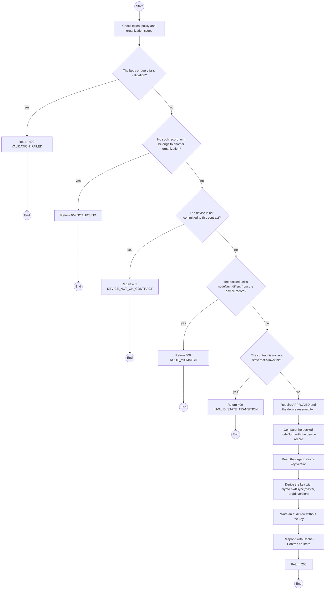
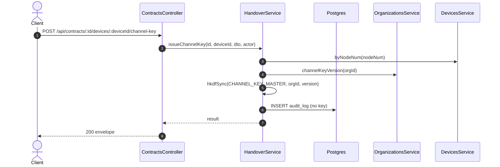

# POST /api/contracts/:id/devices/:deviceId/channel-key: Issue the device's channel key

> Module `rentals`. Generated from `scripts/specs/endpoints/rentals.py` by `scripts/specs/build_api_design.py`; edit the catalog, not this file. Format: `02-templates/04-api-endpoint-template.md` with Mermaid (D-017). Envelope: D-002.

[TOC]

---
## Overview

Derives and returns the organization's channel key once, for Staff to write to a docked unit (D-082 decision 1). Requires the contract APPROVED, the device reserved to it, and the docked nodeNum to match the device record; refuses otherwise. The response is never cached, stored or logged, and an audit row records the device, organization and key version, never the key (REQ-UBI-03).

## API Specification

| API | URL |
| --- | --- |
| POST | /api/contracts/:id/devices/:deviceId/channel-key |
| Permission | TrekLink Staff |
| Traces | UC-14, FR-DEV-05, BR-09, NFR-SEC-06, NFR-IF-03, D-082 |
| Notes | `Cache-Control: no-store` on the response; the key is never returned a second time for the same docking, so the counter must write it before asking again. |

### Path parameters

| Field | Description | Data Type | Examples |
| --- | --- | --- | --- |
| id | Contract id; members may use only their own organization's | uuid | `c0ffee00-1234-4abc-9def-001122334455` |
| deviceId | Device committed to the contract | uuid | `0d3f6a2b-7e11-4c55-8f0a-2b1c9e7d4a10` |

## Request sample

```json
{
  "nodeNum": 275612
}
```

| Field | Description | Data Type | Required | Examples |
| --- | --- | --- | --- | --- |
| nodeNum | The nodeNum read from the docked unit | int | yes | `275612` |

## Response sample

```json
{
  "result": {
    "keyHex": "3f9c0e1a2b4d5e6f7081920a1b2c3d4e5f60718293a4b5c6d7e8f9001a2b3c4d",
    "keyVersion": 1
  },
  "isSuccess": true,
  "statusCode": 200,
  "message": "Channel key issued"
}
```

## Validation

<table>
    <th>Status code</th>
    <th>Description</th>
    <th>Examples</th>
    <tbody>
        <tr>
            <td>400</td>
            <td>The body or query fails validation (<code>VALIDATION_FAILED</code>)</td>
<td>

```json
{
  "result": {
    "errorCode": "VALIDATION_FAILED"
  },
  "isSuccess": false,
  "statusCode": 400,
  "message": "{field} is required."
}
```
</td>
        </tr>
        <tr>
            <td>401</td>
            <td>Missing, malformed or expired access token or API key (<code>UNAUTHENTICATED</code>)</td>
<td>

```json
{
  "result": {
    "errorCode": "UNAUTHENTICATED"
  },
  "isSuccess": false,
  "statusCode": 401,
  "message": "Authentication required."
}
```
</td>
        </tr>
        <tr>
            <td>403</td>
            <td>The caller's role, policy or organization does not allow this action (<code>FORBIDDEN</code>)</td>
<td>

```json
{
  "result": {
    "errorCode": "FORBIDDEN"
  },
  "isSuccess": false,
  "statusCode": 403,
  "message": "You do not have access to this."
}
```
</td>
        </tr>
        <tr>
            <td>404</td>
            <td>No such record, or it belongs to another organization (<code>NOT_FOUND</code>)</td>
<td>

```json
{
  "result": {
    "errorCode": "NOT_FOUND"
  },
  "isSuccess": false,
  "statusCode": 404,
  "message": "Contract not found."
}
```
</td>
        </tr>
        <tr>
            <td>409</td>
            <td>The device is not committed to this contract (<code>DEVICE_NOT_ON_CONTRACT</code>)</td>
<td>

```json
{
  "result": {
    "errorCode": "DEVICE_NOT_ON_CONTRACT"
  },
  "isSuccess": false,
  "statusCode": 409,
  "message": "TL-0042 does not belong to contract RC-2026-0042."
}
```
</td>
        </tr>
        <tr>
            <td>409</td>
            <td>The docked unit's nodeNum differs from the device record (<code>NODE_MISMATCH</code>)</td>
<td>

```json
{
  "result": {
    "errorCode": "NODE_MISMATCH"
  },
  "isSuccess": false,
  "statusCode": 409,
  "message": "The docked unit is !0004351c, not TL-0042. Nothing was written."
}
```
</td>
        </tr>
        <tr>
            <td>409</td>
            <td>The contract is not in a state that allows this (<code>INVALID_STATE_TRANSITION</code>)</td>
<td>

```json
{
  "result": {
    "errorCode": "INVALID_STATE_TRANSITION"
  },
  "isSuccess": false,
  "statusCode": 409,
  "message": "This cannot be done while it is REQUESTED."
}
```
</td>
        </tr>
    </tbody>
</table>

## Activity Diagram



## Sequence Diagram


