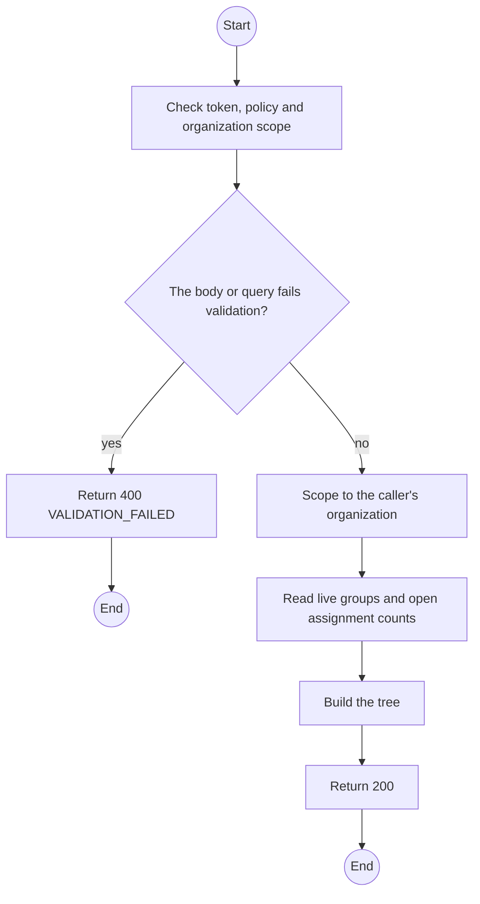
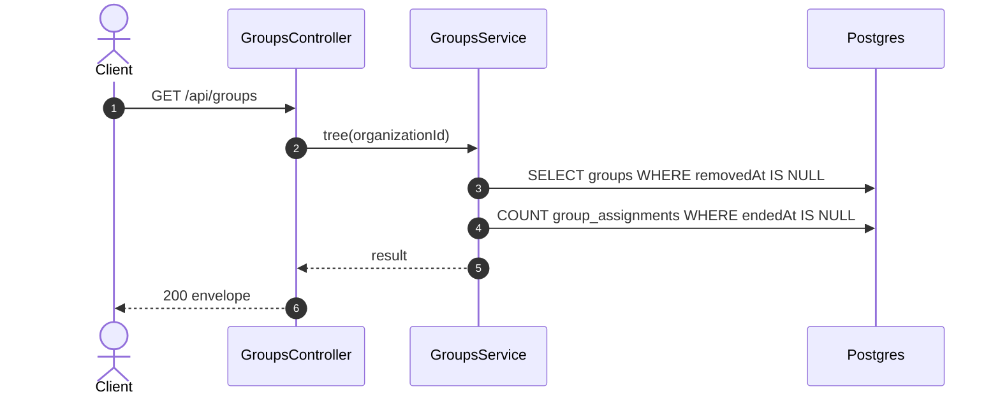

# GET /api/groups: Device groups

> Module `rentals`. Generated from `scripts/specs/endpoints/rentals.py` by `scripts/specs/build_api_design.py`; edit the catalog, not this file. Format: `02-templates/04-api-endpoint-template.md` with Mermaid (D-017). Envelope: D-002.

[TOC]

---
## Overview

The organization's live groups as a tree, each with its count of devices in it now, for the console and the group filters of the live map and the incident list (UC-67, FR-MON-11, design §11). `maxDepth` is `rentals.groupMaxDepth`, so the client lists only the parents that may take a child.

## API Specification

| API | URL |
| --- | --- |
| GET | /api/groups |
| Permission | Org Manager, Org Operator: own; TrekLink Staff with `organizationId` |
| Traces | UC-67, FR-CON-17, FR-MON-11, BR-46 |

### Query parameters

| Field | Description | Data Type | Required | Examples |
| --- | --- | --- | --- | --- |
| organizationId | TrekLink Staff: the organization to read | uuid | cond. | `5b1d2c0e-7f3a-4e21-9c8d-1a2b3c4d5e6f` |

## Request sample

No body.

## Response sample

```json
{
  "result": {
    "maxDepth": 1,
    "groups": [
      {
        "id": "g-1",
        "name": "Ranger patrol north",
        "label": "ranger patrol",
        "parentId": null,
        "startsOn": "2026-11-05",
        "endsOn": "2026-11-20",
        "areaNote": "Bidoup ridge, sector 3",
        "version": 1,
        "deviceCount": 3,
        "createdAt": "2026-10-20T03:15:00.000Z",
        "updatedAt": "2026-10-20T03:15:00.000Z",
        "children": [
          {
            "id": "g-2",
            "name": "Team A",
            "label": null,
            "parentId": "g-1",
            "startsOn": "2026-11-05",
            "endsOn": "2026-11-20",
            "areaNote": "Bidoup ridge, sector 3",
            "version": 1,
            "deviceCount": 2,
            "createdAt": "2026-10-20T03:15:00.000Z",
            "updatedAt": "2026-10-20T03:15:00.000Z",
            "children": []
          }
        ]
      }
    ]
  },
  "isSuccess": true,
  "statusCode": 200,
  "message": "OK"
}
```

## Validation

<table>
    <th>Status code</th>
    <th>Description</th>
    <th>Examples</th>
    <tbody>
        <tr>
            <td>400</td>
            <td>The body or query fails validation (<code>VALIDATION_FAILED</code>)</td>
<td>

```json
{
  "result": {
    "errorCode": "VALIDATION_FAILED"
  },
  "isSuccess": false,
  "statusCode": 400,
  "message": "{field} is required."
}
```
</td>
        </tr>
        <tr>
            <td>401</td>
            <td>Missing, malformed or expired access token or API key (<code>UNAUTHENTICATED</code>)</td>
<td>

```json
{
  "result": {
    "errorCode": "UNAUTHENTICATED"
  },
  "isSuccess": false,
  "statusCode": 401,
  "message": "Authentication required."
}
```
</td>
        </tr>
        <tr>
            <td>403</td>
            <td>The caller's role, policy or organization does not allow this action (<code>FORBIDDEN</code>)</td>
<td>

```json
{
  "result": {
    "errorCode": "FORBIDDEN"
  },
  "isSuccess": false,
  "statusCode": 403,
  "message": "You do not have access to this."
}
```
</td>
        </tr>
    </tbody>
</table>

## Activity Diagram



## Sequence Diagram


