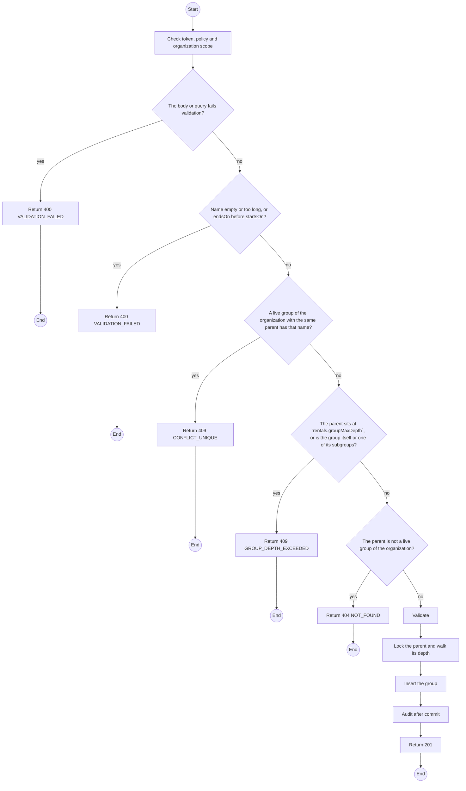
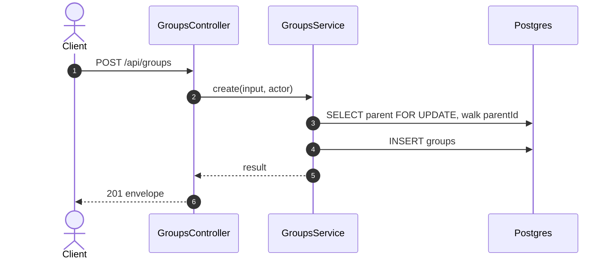

# POST /api/groups: Create a device group

> Module `rentals`. Generated from `scripts/specs/endpoints/rentals.py` by `scripts/specs/build_api_design.py`; edit the catalog, not this file. Format: `02-templates/04-api-endpoint-template.md` with Mermaid (D-017). Envelope: D-002.

[TOC]

---
## Overview

Creates a group of the caller's organization, top-level or under a parent at most `rentals.groupMaxDepth` levels down (FR-CON-17, BR-46, E04-8). Audited as `group.created` after commit.

## API Specification

| API | URL |
| --- | --- |
| POST | /api/groups |
| Permission | Org Manager |
| Traces | UC-67, FR-CON-17, BR-46, E04-8, MSG40 |

## Request sample

```json
{
  "name": "Team A",
  "parentId": "g-1",
  "label": "tour"
}
```

| Field | Description | Data Type | Required | Examples |
| --- | --- | --- | --- | --- |
| name | 1 to 80 characters, unique under the same parent | string | yes | `Team A` |
| parentId | A live group of the organization; null for top level | uuid | no | `g-1` |
| label | Free text, at most 80 characters | string | no | `tour` |
| startsOn | Date | date | no | `2026-11-05` |
| endsOn | Date, not before startsOn | date | no | `2026-11-20` |
| areaNote | At most 500 characters | string | no | `Bidoup ridge, sector 3` |

## Response sample

```json
{
  "result": {
    "id": "g-2",
    "name": "Team A",
    "label": "tour",
    "parentId": "g-1",
    "startsOn": null,
    "endsOn": null,
    "areaNote": null,
    "version": 1,
    "deviceCount": 0,
    "createdAt": "2026-10-20T03:15:00.000Z",
    "updatedAt": "2026-10-20T03:15:00.000Z"
  },
  "isSuccess": true,
  "statusCode": 201,
  "message": "Group created"
}
```

## Validation

<table>
    <th>Status code</th>
    <th>Description</th>
    <th>Examples</th>
    <tbody>
        <tr>
            <td>400</td>
            <td>The body or query fails validation (<code>VALIDATION_FAILED</code>)</td>
<td>

```json
{
  "result": {
    "errorCode": "VALIDATION_FAILED"
  },
  "isSuccess": false,
  "statusCode": 400,
  "message": "{field} is required."
}
```
</td>
        </tr>
        <tr>
            <td>401</td>
            <td>Missing, malformed or expired access token or API key (<code>UNAUTHENTICATED</code>)</td>
<td>

```json
{
  "result": {
    "errorCode": "UNAUTHENTICATED"
  },
  "isSuccess": false,
  "statusCode": 401,
  "message": "Authentication required."
}
```
</td>
        </tr>
        <tr>
            <td>403</td>
            <td>The caller's role, policy or organization does not allow this action (<code>FORBIDDEN</code>)</td>
<td>

```json
{
  "result": {
    "errorCode": "FORBIDDEN"
  },
  "isSuccess": false,
  "statusCode": 403,
  "message": "You do not have access to this."
}
```
</td>
        </tr>
        <tr>
            <td>400</td>
            <td>Name empty or too long, or endsOn before startsOn (<code>VALIDATION_FAILED</code>)</td>
<td>

```json
{
  "result": {
    "errorCode": "VALIDATION_FAILED"
  },
  "isSuccess": false,
  "statusCode": 400,
  "message": "Choose an end after the start."
}
```
</td>
        </tr>
        <tr>
            <td>409</td>
            <td>A live group of the organization with the same parent has that name (<code>CONFLICT_UNIQUE</code>)</td>
<td>

```json
{
  "result": {
    "errorCode": "CONFLICT_UNIQUE"
  },
  "isSuccess": false,
  "statusCode": 409,
  "message": "A group with this name already exists here."
}
```
</td>
        </tr>
        <tr>
            <td>409</td>
            <td>The parent sits at `rentals.groupMaxDepth`, or is the group itself or one of its subgroups (<code>GROUP_DEPTH_EXCEEDED</code>)</td>
<td>

```json
{
  "result": {
    "errorCode": "GROUP_DEPTH_EXCEEDED"
  },
  "isSuccess": false,
  "statusCode": 409,
  "message": "Groups can be nested only 1 level(s) deep. Choose a top-level group as the parent."
}
```
</td>
        </tr>
        <tr>
            <td>404</td>
            <td>The parent is not a live group of the organization (<code>NOT_FOUND</code>)</td>
<td>

```json
{
  "result": {
    "errorCode": "NOT_FOUND"
  },
  "isSuccess": false,
  "statusCode": 404,
  "message": "Not found."
}
```
</td>
        </tr>
    </tbody>
</table>

## Activity Diagram



## Sequence Diagram


