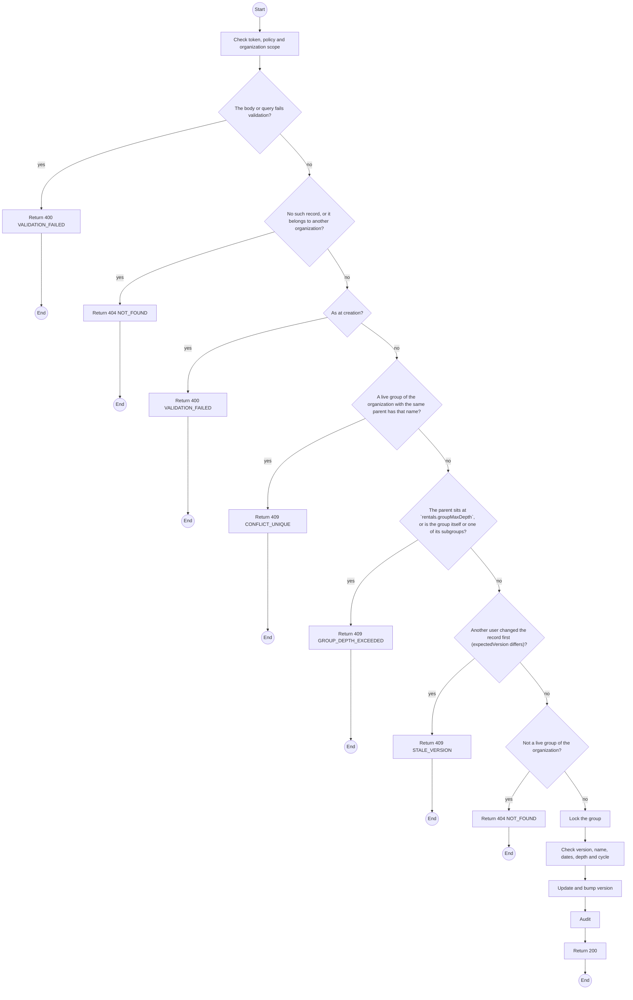
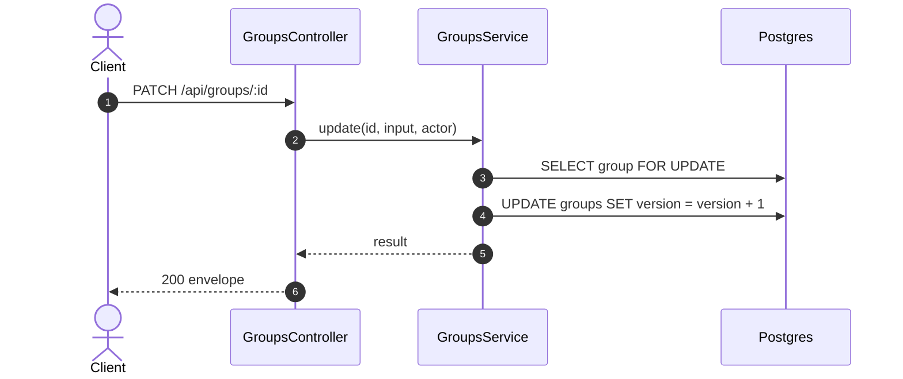

# PATCH /api/groups/:id: Edit a device group

> Module `rentals`. Generated from `scripts/specs/endpoints/rentals.py` by `scripts/specs/build_api_design.py`; edit the catalog, not this file. Format: `02-templates/04-api-endpoint-template.md` with Mermaid (D-017). Envelope: D-002.

[TOC]

---
## Overview

Changes a live group's name, label, dates, area note or parent with the `version` the Manager saw. Moving a group under another keeps the depth cap and refuses a cycle. Audited as `group.updated`.

## API Specification

| API | URL |
| --- | --- |
| PATCH | /api/groups/:id |
| Permission | Org Manager |
| Traces | UC-67, FR-CON-17, BR-46 |

### Path parameters

| Field | Description | Data Type | Examples |
| --- | --- | --- | --- |
| id | Group id; members may use only their own organization's | uuid | `g-1` |

## Request sample

```json
{
  "name": "Team A north",
  "expectedVersion": 1
}
```

| Field | Description | Data Type | Required | Examples |
| --- | --- | --- | --- | --- |
| name | As at creation | string | no | `Team A north` |
| parentId | As at creation; null moves it to top level | uuid | no | `null` |
| label, startsOn, endsOn, areaNote | As at creation; null clears | mixed | no | `null` |
| expectedVersion | The version the Manager saw | int | yes | `1` |

## Response sample

```json
{
  "result": {
    "id": "g-2",
    "name": "Team A north",
    "label": "ranger patrol",
    "parentId": "g-1",
    "startsOn": "2026-11-05",
    "endsOn": "2026-11-20",
    "areaNote": "Bidoup ridge, sector 3",
    "version": 2,
    "deviceCount": 3,
    "createdAt": "2026-10-20T03:15:00.000Z",
    "updatedAt": "2026-10-20T03:15:00.000Z"
  },
  "isSuccess": true,
  "statusCode": 200,
  "message": "Group updated"
}
```

## Validation

<table>
    <th>Status code</th>
    <th>Description</th>
    <th>Examples</th>
    <tbody>
        <tr>
            <td>400</td>
            <td>The body or query fails validation (<code>VALIDATION_FAILED</code>)</td>
<td>

```json
{
  "result": {
    "errorCode": "VALIDATION_FAILED"
  },
  "isSuccess": false,
  "statusCode": 400,
  "message": "{field} is required."
}
```
</td>
        </tr>
        <tr>
            <td>401</td>
            <td>Missing, malformed or expired access token or API key (<code>UNAUTHENTICATED</code>)</td>
<td>

```json
{
  "result": {
    "errorCode": "UNAUTHENTICATED"
  },
  "isSuccess": false,
  "statusCode": 401,
  "message": "Authentication required."
}
```
</td>
        </tr>
        <tr>
            <td>403</td>
            <td>The caller's role, policy or organization does not allow this action (<code>FORBIDDEN</code>)</td>
<td>

```json
{
  "result": {
    "errorCode": "FORBIDDEN"
  },
  "isSuccess": false,
  "statusCode": 403,
  "message": "You do not have access to this."
}
```
</td>
        </tr>
        <tr>
            <td>404</td>
            <td>No such record, or it belongs to another organization (<code>NOT_FOUND</code>)</td>
<td>

```json
{
  "result": {
    "errorCode": "NOT_FOUND"
  },
  "isSuccess": false,
  "statusCode": 404,
  "message": "Group not found."
}
```
</td>
        </tr>
        <tr>
            <td>400</td>
            <td>As at creation (<code>VALIDATION_FAILED</code>)</td>
<td>

```json
{
  "result": {
    "errorCode": "VALIDATION_FAILED"
  },
  "isSuccess": false,
  "statusCode": 400,
  "message": "Choose an end after the start."
}
```
</td>
        </tr>
        <tr>
            <td>409</td>
            <td>A live group of the organization with the same parent has that name (<code>CONFLICT_UNIQUE</code>)</td>
<td>

```json
{
  "result": {
    "errorCode": "CONFLICT_UNIQUE"
  },
  "isSuccess": false,
  "statusCode": 409,
  "message": "A group with this name already exists here."
}
```
</td>
        </tr>
        <tr>
            <td>409</td>
            <td>The parent sits at `rentals.groupMaxDepth`, or is the group itself or one of its subgroups (<code>GROUP_DEPTH_EXCEEDED</code>)</td>
<td>

```json
{
  "result": {
    "errorCode": "GROUP_DEPTH_EXCEEDED"
  },
  "isSuccess": false,
  "statusCode": 409,
  "message": "Groups can be nested only 1 level(s) deep. Choose a top-level group as the parent."
}
```
</td>
        </tr>
        <tr>
            <td>409</td>
            <td>Another user changed the record first (expectedVersion differs) (<code>STALE_VERSION</code>)</td>
<td>

```json
{
  "result": {
    "errorCode": "STALE_VERSION"
  },
  "isSuccess": false,
  "statusCode": 409,
  "message": "This was changed by someone else. Reload and try again."
}
```
</td>
        </tr>
        <tr>
            <td>404</td>
            <td>Not a live group of the organization (<code>NOT_FOUND</code>)</td>
<td>

```json
{
  "result": {
    "errorCode": "NOT_FOUND"
  },
  "isSuccess": false,
  "statusCode": 404,
  "message": "Not found."
}
```
</td>
        </tr>
    </tbody>
</table>

## Activity Diagram



## Sequence Diagram


